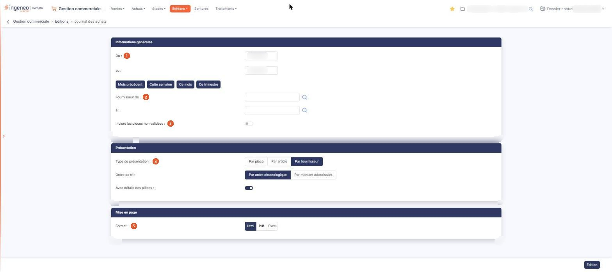

# Journal des achats


**Où le trouver :** Menu **Editions › Journal des achats**



**En bref** — Cette édition présente le journal de vos pièces d'achat sur une période : les factures en positif, les avoirs en négatif.

* Pour éditer le journal du mois écoulé : bouton \[Mois précédent], puis bouton \[Edition].


L'édition du journal des achats intègre les éléments provenant des factures et des avoirs.

<figure><figcaption>
Écran « Journal des achats » de la nouvelle interface
</figcaption></figure>

Tous les critères que vous indiquez s'appliquent simultanément à l'édition.

L'écran ne présente pas de liste : vous y renseignez des critères répartis en trois rubriques, puis vous lancez l'édition. Ce journal porte sur vos **pièces d'achat** ; les écritures comptables qu'elles ont produites font l'objet d'une option distincte du même menu, « Journal des écritures d'achats ». Les deux options sont voisines dans la liste et ne documentent pas la même chose : ici vous éditez des pièces commerciales, là des écritures comptables.

La sélection des tiers se fait ici **par fournisseur**. Contrairement au journal des ventes, cette édition ne se restreint pas par famille et ne propose pas de ventilation mensuelle. Et contrairement à l'option « Journal des ventes (bêta) », elle ne se restreint ni par vendeur ni par famille d'articles, et elle ne vous laisse pas choisir les éléments à afficher : les critères décrits ci-dessous sont les seuls de l'écran.

## Rubrique « Informations générales »

| Champ                                  | Ce qu'il faut savoir                                                                                                                                                                                                                                                                                                                                                                                                                                                                            |
| -------------------------------------- | ----------------------------------------------------------------------------------------------------------------------------------------------------------------------------------------------------------------------------------------------------------------------------------------------------------------------------------------------------------------------------------------------------------------------------------------------------------------------------------------------- |
| 1. **Du**                              | 
<strong>au :</strong> bornes de la période à éditer. Le logiciel vous propose par défaut le mois en cours — du premier au dernier jour — mais vous pouvez étendre ou restreindre cette période. Chacune des deux dates se saisit directement ou se choisit dans le calendrier. Quatre boutons de raccourci sont proposés à droite des dates pour renseigner les deux bornes en une fois : Bouton [Mois précédent], Bouton [Cette semaine], Bouton [Ce mois] et Bouton [Ce trimestre].
 |
| 2. **Fournisseur de**                  | **à :** l'édition se lance par défaut pour tous les fournisseurs ; vous pouvez la restreindre à un intervalle en indiquant le code du premier et celui du dernier fournisseur. Chacune des deux zones fonctionne en autocomplétion sur le code fournisseur et propose un pictogramme « Loupe » qui ouvre la fenêtre de sélection d'un fournisseur.                                                                                                                                              |
| 3. **Inclure les pièces non validées** | Activez l'interrupteur pour que l'édition tienne compte des pièces qui ne sont pas encore validées. L'interrupteur est désactivé par défaut : sauf action de votre part, ces pièces sont donc **absentes** de l'édition.                                                                                                                                                                                                                                                                        |

## Rubrique « Présentation »

**Type de présentation** : choisissez **Par pièce**, **Par article** ou **Par fournisseur**. La proposition par défaut est la troisième, **Par fournisseur**.

C'est le choix qui commande le reste de la rubrique : les deux champs qui suivent changent avec lui, y compris leur libellé, et un seul couple est proposé à la fois.

**Par pièce** — **Ordre de tri :Par ordre chronologique**, qui est la proposition par défaut, ou **Par montant décroissant**. **Avec détails des articles :** activez l'interrupteur pour que chaque pièce soit détaillée article par article ; il est désactivé par défaut.

**Par article** — **Ordre de tri :Par ordre alphabétique**, qui est la proposition par défaut, ou **Par montant décroissant**. C'est le seul des trois cas où le premier choix de tri est alphabétique et non chronologique. **Avec détails par fournisseur :** activez l'interrupteur pour que chaque article soit détaillé fournisseur par fournisseur ; il est désactivé par défaut.

**Par fournisseur** — **Ordre de tri :Par ordre chronologique**, qui est la proposition par défaut, ou **Par montant décroissant**. **Avec détails des pièces :** activez l'interrupteur pour que chaque fournisseur soit détaillé pièce par pièce. Il est **activé** par défaut, et c'est le seul interrupteur de l'écran dans ce cas.

## Rubrique « Mise en page »

| Champ           | Ce qu'il faut savoir                                                                                                                                                                                                                                                                                                                                                                                                                                                                          |
| --------------- | --------------------------------------------------------------------------------------------------------------------------------------------------------------------------------------------------------------------------------------------------------------------------------------------------------------------------------------------------------------------------------------------------------------------------------------------------------------------------------------------- |
| 5. **Format**   | 
Choisissez <strong>Html</strong>, qui est la proposition par défaut, <strong>Pdf</strong> ou <strong>Excel</strong>. Cette rubrique ne présente pas les mêmes champs selon le format demandé, mais elle n'a que deux visages et non trois : les formats <strong>Html</strong> et <strong>Excel</strong> proposent exactement les mêmes champs, et les deux champs suivants n'apparaissent que si vous choisissez le format <strong>Pdf</strong>, le seul des trois qui soit paginé.
 |
| **Orientation** | Choisissez **Portrait**, qui est la proposition par défaut, ou **Paysage**.                                                                                                                                                                                                                                                                                                                                                                                                                   |
| **Largeur**     | Choisissez **Fixe** ou **Ajustée**. Un pictogramme d'information rappelle à droite du champ que le second choix « ajuste la taille si la largeur des colonnes dépasse la largeur de la page ».                                                                                                                                                                                                                                                                                                |


Attention : dès que vous passez au format **Pdf**, le logiciel coche lui-même **Ajustée**, alors que le réglage d'origine du formulaire est **Fixe**, et il ne revient jamais à **Fixe** si vous repassez à un autre format. Si vous voulez une largeur fixe, cochez-la vous-même après avoir choisi le format.


Le type de présentation retenu dans la rubrique précédente ne change rien à cette rubrique.

## Bouton \[Edition]

Il lance l'édition dans le format demandé. C'est le seul bouton d'action de cet écran : le journal des achats ne permet pas de mémoriser ni de recharger un jeu de critères.
