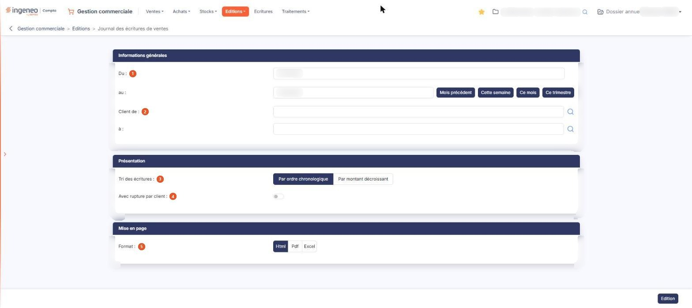

# Journal des écritures de ventes


**Où le trouver :** Menu **Editions › Journal des écritures de ventes**



**En bref** — Cette édition présente les écritures comptables issues de vos factures et avoirs clients sur une période, pour contrôler ce que la gestion commerciale a produit en comptabilité.

* Pour éditer les écritures du trimestre : bouton \[Ce trimestre], puis bouton \[Edition].
* Pour une période libre : renseignez Du : et au :, puis bouton \[Edition].


Cette option édite le journal des écritures comptables issues de vos **ventes** : les écritures correspondant aux factures et aux avoirs clients dont la date est comprise dans la période indiquée. Les écritures des achats font l'objet d'une option distincte, « Journal des écritures d'achats », dans ce même menu.

<figure><figcaption>
Écran « Journal des écritures de ventes » de la nouvelle interface
</figcaption></figure>

Ce journal n'est pas destiné à être utilisé pour exporter les écritures comptables puisqu'elles sont générées et enregistrées dans le logiciel de comptabilité Ingeneo Compta. Il vous sert à contrôler ce que la gestion commerciale a produit en comptabilité sur une période.

L'écran ne présente pas de liste : vous y renseignez des critères, puis vous lancez l'édition. Tous les critères que vous indiquez s'appliquent simultanément.

## Rubrique « Informations générales »

| Champ            | Ce qu'il faut savoir                                                                                                                                                                                                                                                                                                                                                                                                                                                                                                       |
| ---------------- | -------------------------------------------------------------------------------------------------------------------------------------------------------------------------------------------------------------------------------------------------------------------------------------------------------------------------------------------------------------------------------------------------------------------------------------------------------------------------------------------------------------------------- |
| 1. **Du**        | 
<strong>au :</strong> bornes de la période à éditer. Le logiciel vous propose par défaut le mois en cours, mais vous pouvez étendre ou restreindre cette période. Chacune des deux dates se saisit directement ou se choisit dans le calendrier, qui s'ouvre lorsque vous cliquez dans le champ. Quatre boutons de raccourci sont proposés à droite de la seconde date pour renseigner les deux bornes en une fois : Bouton [Mois précédent], Bouton [Cette semaine], Bouton [Ce mois] et Bouton [Ce trimestre].
 |
| 2. **Client de** | **à :** l'édition se lance par défaut pour tous les clients ; vous pouvez la restreindre à un intervalle en indiquant le code du premier et celui du dernier client. Chacune des deux zones fonctionne en autocomplétion sur le code client et propose un pictogramme « Loupe » qui ouvre la fenêtre « Sélection d'un client ».                                                                                                                                                                                            |

Ce sont les deux seuls critères de sélection de cette édition : contrairement au journal des ventes (bêta), elle ne se restreint ni par famille de clients, ni par vendeur, ni par famille d'articles, et elle ne propose pas d'inclure les pièces non validées.

## Rubrique « Présentation »

| Champ                          | Ce qu'il faut savoir                                                                                                                                           |
| ------------------------------ | -------------------------------------------------------------------------------------------------------------------------------------------------------------- |
| 3. **Tri des écritures**       | Choisissez **Par ordre chronologique**, qui est la proposition par défaut, ou **Par montant décroissant**.                                                     |
| 4. **Avec rupture par client** | Activez l'interrupteur pour que l'édition sépare les écritures client par client au lieu de les présenter en continu. L'interrupteur est désactivé par défaut. |

## Rubrique « Mise en page »

| Champ           | Ce qu'il faut savoir                                                                                                                                                                                                                                                                                                                                                                                                                                                                          |
| --------------- | --------------------------------------------------------------------------------------------------------------------------------------------------------------------------------------------------------------------------------------------------------------------------------------------------------------------------------------------------------------------------------------------------------------------------------------------------------------------------------------------- |
| 5. **Format**   | 
Choisissez <strong>Html</strong>, qui est la proposition par défaut, <strong>Pdf</strong> ou <strong>Excel</strong>. Cette rubrique ne présente pas les mêmes champs selon le format demandé, mais elle n'a que deux visages et non trois : les formats <strong>Html</strong> et <strong>Excel</strong> proposent exactement les mêmes champs, et les deux champs suivants n'apparaissent que si vous choisissez le format <strong>Pdf</strong>, le seul des trois qui soit paginé.
 |
| **Orientation** | Choisissez **Portrait**, qui est la proposition par défaut, ou **Paysage**.                                                                                                                                                                                                                                                                                                                                                                                                                   |
| **Largeur**     | Choisissez **Fixe** ou **Ajustée**. Un pictogramme d'information rappelle à droite du champ que le second choix « ajuste la taille si la largeur des colonnes dépasse la largeur de la page ».                                                                                                                                                                                                                                                                                                |


Attention : dès que vous passez au format **Pdf**, le logiciel coche lui-même **Ajustée**, alors que le réglage d'origine du formulaire est **Fixe**, et il ne revient jamais à **Fixe** si vous repassez à un autre format. Si vous voulez une largeur fixe, cochez-la vous-même après avoir choisi le format.


## Bouton \[Edition]

Il lance l'édition dans le format demandé. C'est le seul bouton de cet écran : le journal des écritures de ventes ne permet pas de mémoriser ni de recharger un jeu de critères, contrairement au journal des ventes (bêta).

Ce bouton est soumis à un droit distinct de celui du menu : selon votre profil, il peut ne pas vous être proposé.
