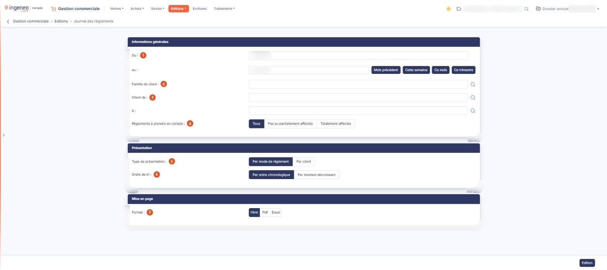

# Journal des règlements


**Où le trouver :** Menu **Editions › Journal des règlements**



**En bref** — Cette édition liste les règlements clients enregistrés sur une période, depuis les factures clients ou depuis l'option « Règlements » du menu « Ventes ».

* Pour éditer les règlements du mois : bouton \[Ce mois], puis bouton \[Edition].
* Pour restreindre l'édition à certains clients : renseignez Client de : et à :, puis bouton \[Edition].


Le journal des règlements indique tous les règlements enregistrés, que ce soit depuis les factures clients ou depuis l'option « Règlements » du menu « Ventes ».

<figure><figcaption>
Écran « Journal des règlements » de la nouvelle interface
</figcaption></figure>

L'écran ne présente pas de liste : vous y renseignez des critères répartis en trois rubriques, puis vous lancez l'édition. Tous les critères que vous indiquez s'appliquent simultanément.

## Rubrique « Informations générales »

| Champ                                 | Ce qu'il faut savoir                                                                                                                                                                                                                                                                                                                                                                                                                                                                            |
| ------------------------------------- | ----------------------------------------------------------------------------------------------------------------------------------------------------------------------------------------------------------------------------------------------------------------------------------------------------------------------------------------------------------------------------------------------------------------------------------------------------------------------------------------------- |
| 1. **Du**                             | 
<strong>au :</strong> bornes de la période à éditer. Par défaut le logiciel vous propose le mois en cours — du premier au dernier jour — mais vous pouvez étendre ou restreindre cette période. Chacune des deux dates se saisit directement ou se choisit dans le calendrier. Quatre boutons de raccourci sont proposés à droite des dates pour renseigner les deux bornes en une fois : Bouton [Mois précédent], Bouton [Cette semaine], Bouton [Ce mois] et Bouton [Ce trimestre].
 |
| 2. **Famille de client**              | Si vous utilisez les familles de clients, vous pouvez restreindre l'édition à une famille. La zone fonctionne en autocomplétion et propose un pictogramme « Loupe » qui ouvre la fenêtre « Sélection d'une famille de clients ».                                                                                                                                                                                                                                                                |
| 3. **Client de**                      | **à :** l'édition se lance par défaut pour tous les clients ; vous pouvez la restreindre à un intervalle de clients en indiquant le code client du premier et du dernier de la liste. Chacune des deux zones fonctionne en autocomplétion et propose un pictogramme « Loupe » qui ouvre la fenêtre de sélection d'un client.                                                                                                                                                                    |
| 4. **Règlements à prendre en compte** | Les règlements clients qui sont saisis dans le menu « Ventes », option « Règlements », ne sont pas systématiquement affectés à une facture. De même, les règlements qui sont saisis dans le menu « Ventes », option « Factures » peuvent avoir un montant supérieur à la facture à laquelle ils sont initialement attachés.                                                                                                                                                                     |

Vous pouvez donc filtrer votre édition en choisissant **Tous**, qui est la proposition par défaut, **Pas ou partiellement affectés** ou **Totalement affectés**.

## Rubrique « Présentation »

| Champ                       | Ce qu'il faut savoir                                                                                                                                                                                                                           |
| --------------------------- | ---------------------------------------------------------------------------------------------------------------------------------------------------------------------------------------------------------------------------------------------- |
| 5. **Type de présentation** | Le type de présentation permet de trier les règlements **Par mode de règlement**, avec un sous-total pour chaque mode de règlement, ou **Par client**, avec un sous-total par client. La proposition par défaut est **Par mode de règlement**. |
| 6. **Ordre de tri**         | En fonction du type de présentation choisi, il permet le tri **Par ordre chronologique** — qui est la proposition par défaut — ou **Par montant décroissant** au sein de chaque mode de règlement ou de chaque client.                         |

Les deux propositions sont les mêmes dans les deux cas, mais le logiciel retient votre choix séparément pour chacun des deux types de présentation : si vous passez de l'un à l'autre, vérifiez l'ordre de tri affiché.

## Rubrique « Mise en page »

| Champ           | Ce qu'il faut savoir                                                                                                                                                                                                                                                                                                                                                                                                                                                                          |
| --------------- | --------------------------------------------------------------------------------------------------------------------------------------------------------------------------------------------------------------------------------------------------------------------------------------------------------------------------------------------------------------------------------------------------------------------------------------------------------------------------------------------- |
| 7. **Format**   | 
Choisissez <strong>Html</strong>, qui est la proposition par défaut, <strong>Pdf</strong> ou <strong>Excel</strong>. Cette rubrique ne présente pas les mêmes champs selon le format demandé, mais elle n'a que deux visages et non trois : les formats <strong>Html</strong> et <strong>Excel</strong> proposent exactement les mêmes champs, et les deux champs suivants n'apparaissent que si vous choisissez le format <strong>Pdf</strong>, le seul des trois qui soit paginé.
 |
| **Orientation** | Choisissez **Portrait**, qui est la proposition par défaut, ou **Paysage**.                                                                                                                                                                                                                                                                                                                                                                                                                   |
| **Largeur**     | Choisissez **Fixe** ou **Ajustée**. Un pictogramme d'information rappelle à droite du champ que le second choix « ajuste la taille si la largeur des colonnes dépasse la largeur de la page ».                                                                                                                                                                                                                                                                                                |


Attention : dès que vous passez au format **Pdf**, le logiciel coche lui-même **Ajustée**, alors que le réglage d'origine du formulaire est **Fixe**, et il ne revient jamais à **Fixe** si vous repassez à un autre format. Si vous voulez une largeur fixe, cochez-la vous-même après avoir choisi le format.


## Bouton \[Edition]

Il lance l'édition dans le format demandé. C'est le seul bouton d'action de cet écran : le journal des règlements ne permet pas de mémoriser ni de recharger un jeu de critères.
