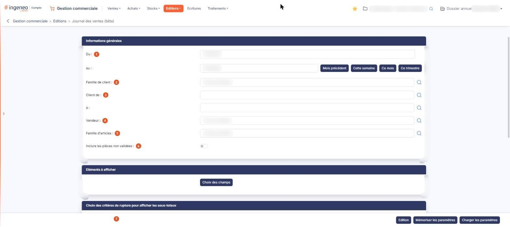
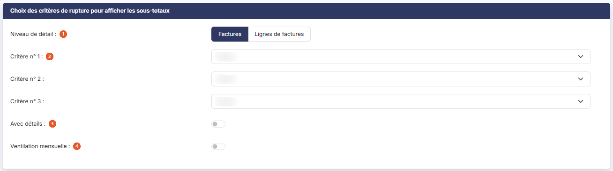
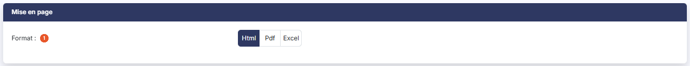

# Journal des ventes (bêta)


**Où le trouver :** Menu **Editions › Journal des ventes (bêta)**



**En bref** — Cette nouvelle version du journal des ventes édite factures et avoirs d'une période, avec le choix des champs, jusqu'à trois niveaux de sous-totaux et la mémorisation de vos paramètres.

* Pour éditer le journal du mois écoulé : bouton \[Mois précédent], puis bouton \[Edition].
* Pour réutiliser vos critères : bouton \[Mémoriser les paramètres], puis, lors d'une prochaine édition, bouton \[Charger les paramètres].


Cette option édite le journal des ventes : elle intègre les éléments provenant des factures et des avoirs dont la date est comprise dans la période indiquée.

<figure><figcaption>
Écran « Journal des ventes (bêta) » de la nouvelle interface
</figcaption></figure>

Il s'agit de la nouvelle version de cette édition, plus riche que l'option « Journal des ventes » du même menu, qui subsiste à côté d'elle (le menu « Éditions » propose les deux options, « Journal des ventes » et « Journal des ventes (bêta) ») : vous y choisissez les champs à faire figurer sur l'état, jusqu'à trois niveaux de sous-totaux, et vous pouvez mémoriser votre paramétrage pour le retrouver d'une édition à l'autre.

L'écran ne présente pas de liste : vous y renseignez des critères répartis en quatre rubriques, puis vous lancez l'édition. Tous les critères que vous indiquez s'appliquent simultanément à l'édition.

## Rubrique « Informations générales »

Aucun critère de cette rubrique n'est obligatoire : renseignés, ils restreignent l'édition ; laissés en l'état, ils la laissent porter sur tout.

| Champ                                  | Ce qu'il faut savoir                                                                                                                                                                                                                                                                                                                                                                                                                                                       |
| -------------------------------------- | -------------------------------------------------------------------------------------------------------------------------------------------------------------------------------------------------------------------------------------------------------------------------------------------------------------------------------------------------------------------------------------------------------------------------------------------------------------------------- |
| 1. **Du**                              | 
<strong>au :</strong> bornes de la période à éditer. Le logiciel vous propose par défaut le mois en cours, mais vous pouvez étendre ou restreindre cette période. Chacune des deux dates se saisit directement ou se choisit dans le calendrier. Quatre boutons de raccourci sont proposés à droite de la seconde date pour renseigner les deux bornes en une fois : Bouton [Mois précédent], Bouton [Cette semaine], Bouton [Ce mois] et Bouton [Ce trimestre].
 |
| 2. **Famille de client**               | Si vous utilisez les familles de clients, vous pouvez restreindre l'édition à une famille. Tant que la zone n'est pas renseignée, elle affiche « Toutes les familles ».                                                                                                                                                                                                                                                                                                    |
| 3. **Client de**                       | **à :** l'édition se lance par défaut pour tous les clients ; vous pouvez la restreindre à un intervalle en indiquant le code du premier et celui du dernier client.                                                                                                                                                                                                                                                                                                       |
| 4. **Vendeur**                         | Si vous utilisez le fichier des vendeurs, vous pouvez restreindre l'édition à un vendeur. Tant que la zone n'est pas renseignée, elle affiche « Tous les vendeurs ».                                                                                                                                                                                                                                                                                                       |
| 5. **Famille d'articles**              | 
Si vous utilisez les familles d'articles, vous pouvez restreindre l'édition à une famille. Tant que la zone n'est pas renseignée, elle affiche « Toutes les familles ». Ces cinq zones fonctionnent en autocomplétion et proposent chacune un pictogramme « Loupe » qui ouvre le fichier correspondant.
                                                                                                                                                          |
| 6. **Inclure les pièces non validées** | Répondez Oui pour que l'édition prenne aussi en compte les factures et les avoirs qui ne sont pas encore validés. La proposition par défaut est Non : seules les pièces validées sont éditées.                                                                                                                                                                                                                                                                             |

## Rubrique « Eléments à afficher »

Cette rubrique ne contient aucun champ : elle ne porte que le Bouton \[Choix des champs], qui ouvre la fenêtre décrite ci-dessous.

## Bouton \[Choix des champs] et fenêtre « Eléments à afficher »

La fenêtre porte le titre « Eléments à afficher », comme la rubrique depuis laquelle vous l'ouvrez. Elle présente un tableau de deux colonnes, **Champ** et **Sélection**, avec une ligne par colonne susceptible de figurer sur l'état.

Les dix-huit lignes sont proposées dans cet ordre : **Date de la pièce**, **Numéro de la pièce**, **Famille du client**, **Code du client**, **Nom du client**, **Code du vendeur**, **Nom du vendeur**, **Montant HT de la pièce**, **Montant TVA de la pièce**, **Montant TTC de la pièce**, **Famille de l'article**, **Code de l'article**, **Libellé de l'article**, **Quantité**, **Montant HT de l'article**, **Taux TVA de l'article**, **Montant TVA de l'article** et **Montant TTC de l'article**.

Six d'entre elles ne sont pas modifiables : les trois montants de la pièce et les trois montants de l'article affichent « Oui » sans interrupteur, et figureront donc toujours sur l'état. Ce sont **Montant HT de la pièce**, **Montant TVA de la pièce**, **Montant TTC de la pièce**, **Montant HT de l'article**, **Montant TVA de l'article** et **Montant TTC de l'article**.

Cinq des douze lignes que vous pouvez régler sont proposées à Oui : **Date de la pièce**, **Numéro de la pièce**, **Nom du client**, **Code de l'article** et **Quantité**. Les sept autres sont proposées à Non.

Deux boutons terminent la fenêtre : Bouton \[Enregistrer], qui conserve votre choix de champs, et Bouton \[Fermer], qui la referme sans rien conserver. Le pictogramme « Croix » de l'en-tête de la fenêtre la referme également.

## Rubrique « Choix des critères de rupture pour afficher les sous-totaux »

<figure><figcaption>
Rubrique « Choix des critères de rupture pour afficher les sous-totaux »
</figcaption></figure>

| Champ                        | Ce qu'il faut savoir                                                                                                                                                                                                                                                                                                                                                                                                                                                                                                                           |
| ---------------------------- | ---------------------------------------------------------------------------------------------------------------------------------------------------------------------------------------------------------------------------------------------------------------------------------------------------------------------------------------------------------------------------------------------------------------------------------------------------------------------------------------------------------------------------------------------- |
| 1. **Niveau de détail**      | Choisissez **Factures**, qui est la proposition par défaut, ou **Lignes de factures**. Ce choix commande la finesse de l'état, et par là les ruptures que vous pouvez demander.                                                                                                                                                                                                                                                                                                                                                                |
| 2. **Critère n° 1**          | 
, <strong>Critère n° 2 :</strong> et <strong>Critère n° 3 :</strong> ce sont les trois niveaux de sous-totaux, du plus général au plus fin. Les trois listes sont proposées à <strong>Aucun</strong>. Elles se renseignent en cascade : tant que le premier critère reste à <strong>Aucun</strong>, les deux suivants ne proposent que cette même valeur, et le deuxième critère ne s'ouvre qu'une fois le premier renseigné. Ces choix ne modifient pas les champs affichés à l'écran : seul le contenu des trois listes change.
 |
| 3. **Avec détails**          | Répondez Oui pour que l'état présente le détail des pièces sous chaque sous-total, et non les seuls sous-totaux. La proposition par défaut est Non.                                                                                                                                                                                                                                                                                                                                                                                            |
| 4. **Ventilation mensuelle** | La proposition par défaut est Non.                                                                                                                                                                                                                                                                                                                                                                                                                                                                                                             |

## Rubrique « Mise en page »

<figure><figcaption>
Rubrique « Mise en page »
</figcaption></figure>

| Champ           | Ce qu'il faut savoir                                                                                                                                                                                                                                                                                                                                                                                                                                                  |
| --------------- | --------------------------------------------------------------------------------------------------------------------------------------------------------------------------------------------------------------------------------------------------------------------------------------------------------------------------------------------------------------------------------------------------------------------------------------------------------------------- |
| 1. **Format**   | 
Choisissez <strong>Html</strong>, qui est la proposition par défaut, <strong>Pdf</strong> ou <strong>Excel</strong>. Cette rubrique ne présente pas les mêmes champs selon le format demandé : les deux champs suivants n'apparaissent que si vous choisissez le format <strong>Pdf</strong>, le seul des trois qui soit paginé. Ils disparaissent de nouveau si vous revenez au format <strong>Html</strong> ou si vous choisissez <strong>Excel</strong>.
 |
| **Orientation** | Choisissez **Portrait**, qui est la proposition par défaut, ou **Paysage**.                                                                                                                                                                                                                                                                                                                                                                                           |
| **Largeur**     | Choisissez **Fixe** ou **Ajustée**. Un pictogramme d'information rappelle à droite du champ que le second choix « ajuste la taille si la largeur des colonnes dépasse la largeur de la page ».                                                                                                                                                                                                                                                                        |


Attention : dès que vous passez au format **Pdf**, le logiciel coche lui-même **Ajustée**, alors que le réglage d'origine du formulaire est **Fixe**, et il ne revient jamais à **Fixe** si vous repassez à un autre format. Si vous voulez une largeur fixe, cochez-la vous-même après avoir choisi le format. Ce forçage se reproduit à chaque nouveau passage au format **Pdf** : il écrase alors la largeur **Fixe** que vous auriez cochée vous-même.


## Bouton \[Edition]

Il lance l'édition dans le format demandé, avec les critères, les champs et les ruptures que vous avez choisis.

Ce bouton est soumis à un droit distinct de celui du menu : selon votre profil, il peut ne pas vous être proposé.

## Bouton \[Mémoriser les paramètres]

Il conserve, sous un libellé de votre choix, l'ensemble des critères saisis dans les quatre rubriques, pour que vous n'ayez pas à les ressaisir à chaque édition.

Il ouvre la fenêtre « Mémoriser les paramètres de l'édition », qui vous invite à indiquer le libellé du modèle d'édition dans la zone **Libellé :**. Ce libellé est obligatoire. Deux boutons terminent la fenêtre : Bouton \[Enregistrer] et Bouton \[Annuler].

## Bouton \[Charger les paramètres]

Il ouvre la fenêtre « Chargement des paramètres », qui liste les paramétrages mémorisés sous une unique colonne **Libellé** ; vous en choisissez un en cliquant sur sa ligne. L'écran est alors renseigné avec ses critères, que vous pouvez ajuster avant de lancer l'édition.

Tant qu'aucun paramétrage n'a été mémorisé, la fenêtre affiche « Aucun élément à afficher. ». Le Bouton \[Fermer] referme la fenêtre.
