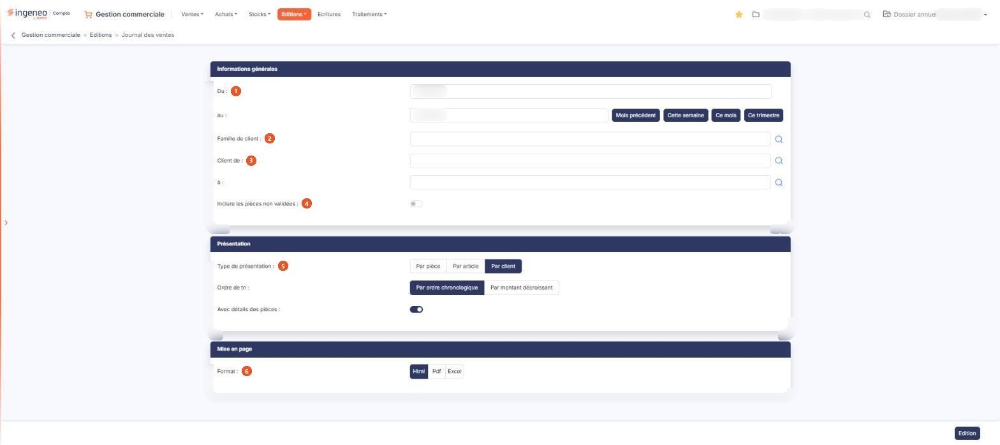

# Journal des ventes


**Où le trouver :** Menu **Editions › Journal des ventes**



**En bref** — Cette édition présente le journal de vos pièces de vente sur une période : les factures en positif, les avoirs en négatif.

* Pour éditer le journal du mois écoulé : bouton \[Mois précédent], puis bouton \[Edition].
* Pour restreindre l'édition à certains clients : renseignez Client de : et à :, puis bouton \[Edition].


L'édition du journal des ventes intègre les éléments provenant des factures (montants affichés en positif) et des avoirs (montants affichés en négatif).

<figure><figcaption>
Écran « Journal des ventes » de la nouvelle interface
</figcaption></figure>

Tous les critères que vous indiquez s'appliquent simultanément à l'édition.

L'écran ne présente pas de liste : vous y renseignez des critères répartis en trois rubriques, puis vous lancez l'édition. Ce journal porte sur vos **pièces de vente** ; les écritures comptables qu'elles ont produites font l'objet d'une option distincte, « Journal des écritures de ventes », et les achats de deux autres options, « Journal des achats » et « Journal des écritures d'achats ». Le menu propose par ailleurs une option « Journal des ventes (bêta) » : c'est un autre écran, avec ses propres critères, et non une variante de celui-ci.

## Rubrique « Informations générales »

| Champ                                  | Ce qu'il faut savoir                                                                                                                                                                                                                                                                                                                                                                                                                                              |
| -------------------------------------- | ----------------------------------------------------------------------------------------------------------------------------------------------------------------------------------------------------------------------------------------------------------------------------------------------------------------------------------------------------------------------------------------------------------------------------------------------------------------- |
| 1. **Du**                              | 
<strong>au :</strong> bornes de la période à éditer. Le logiciel vous propose par défaut le mois en cours, mais vous pouvez étendre ou restreindre cette période. Chacune des deux dates se saisit directement ou se choisit dans le calendrier. Quatre boutons de raccourci sont proposés à droite des dates pour renseigner les deux bornes en une fois : Bouton [Mois précédent], Bouton [Cette semaine], Bouton [Ce mois] et Bouton [Ce trimestre].
 |
| 2. **Famille de client**               | Si vous utilisez les familles de clients, vous pouvez restreindre l'édition à une famille. La zone fonctionne en autocomplétion et propose un pictogramme « Loupe » qui ouvre la fenêtre « Sélection d'une famille de clients ».                                                                                                                                                                                                                                  |
| 3. **Client de**                       | **à :** l'édition se lance par défaut pour tous les clients ; vous pouvez la restreindre à un intervalle en indiquant le code du premier et celui du dernier client. Chacune des deux zones fonctionne en autocomplétion sur le code client et propose un pictogramme « Loupe » qui ouvre la fenêtre « Sélection d'un client ».                                                                                                                                   |
| 4. **Inclure les pièces non validées** | Activez l'interrupteur pour que l'édition tienne compte des pièces qui ne sont pas encore validées. Il est désactivé par défaut : sauf action de votre part, ces pièces sont donc **absentes** de l'édition.                                                                                                                                                                                                                                                      |

## Rubrique « Présentation »

**Type de présentation** : choisissez **Par pièce**, **Par article** ou **Par client**. La proposition par défaut est **Par client**.

C'est le choix qui commande le reste de la rubrique : les champs qui suivent ne sont pas les mêmes selon le type de présentation retenu, et un seul jeu est proposé à la fois.

**Par pièce** — **Ordre de tri :Par ordre chronologique**, qui est la proposition par défaut, ou **Par montant décroissant**. **Avec détails des articles :** activez l'interrupteur pour que chaque pièce soit détaillée article par article ; il est désactivé par défaut.

**Par article** — **Ordre de tri :Par ordre alphabétique**, qui est la proposition par défaut, ou **Par montant décroissant**. **Avec détails par client :** activez l'interrupteur pour que chaque article soit détaillé client par client ; il est désactivé par défaut. **Ventilation mensuelle :** activez l'interrupteur pour obtenir une quantité et un montant par mois, pour chacun des mois présents dans la période retenue ; il est désactivé par défaut.

**Par client** — **Ordre de tri :Par ordre chronologique**, qui est la proposition par défaut, ou **Par montant décroissant**. **Avec détails des pièces :** activez l'interrupteur pour que chaque client soit détaillé pièce par pièce. C'est le seul de ces interrupteurs qui soit **activé** par défaut.

Si vous désactivez cet interrupteur, le logiciel affiche en dessous un champ supplémentaire, **Ventilation mensuelle :** — le même que celui décrit au cas **Par article**, avec le même réglage par défaut (désactivé). Ce champ reste masqué tant que **Avec détails des pièces** est activé : la ventilation mensuelle n'est donc pas réservée à la présentation **Par article**. En revanche elle n'est jamais proposée avec la présentation **Par pièce**.

## Rubrique « Mise en page »

| Champ           | Ce qu'il faut savoir                                                                                                                                                                                                                                                                                                                                                                                                                                                                          |
| --------------- | --------------------------------------------------------------------------------------------------------------------------------------------------------------------------------------------------------------------------------------------------------------------------------------------------------------------------------------------------------------------------------------------------------------------------------------------------------------------------------------------- |
| 6. **Format**   | 
Choisissez <strong>Html</strong>, qui est la proposition par défaut, <strong>Pdf</strong> ou <strong>Excel</strong>. Cette rubrique ne présente pas les mêmes champs selon le format demandé, mais elle n'a que deux visages et non trois : les formats <strong>Html</strong> et <strong>Excel</strong> proposent exactement les mêmes champs, et les deux champs suivants n'apparaissent que si vous choisissez le format <strong>Pdf</strong>, le seul des trois qui soit paginé.
 |
| **Orientation** | Choisissez **Portrait**, qui est la proposition par défaut, ou **Paysage**.                                                                                                                                                                                                                                                                                                                                                                                                                   |
| **Largeur**     | Choisissez **Fixe** ou **Ajustée**. Un pictogramme d'information rappelle à droite du champ que le second choix « ajuste la taille si la largeur des colonnes dépasse la largeur de la page ».                                                                                                                                                                                                                                                                                                |


Attention : dès que vous passez au format **Pdf**, le logiciel coche lui-même **Ajustée**, alors que le réglage d'origine du formulaire est **Fixe**, et il ne revient jamais à **Fixe** si vous repassez à un autre format. Si vous voulez une largeur fixe, cochez-la vous-même après avoir choisi le format.


Le type de présentation retenu dans la rubrique précédente ne change rien à cette rubrique : les champs proposés y sont les mêmes dans les trois cas.

## Bouton \[Edition]

Il lance l'édition dans le format demandé. C'est le seul bouton d'action de cet écran : le journal des ventes ne permet pas de mémoriser ni de recharger un jeu de critères, contrairement à l'option « Journal des ventes (bêta) ».
