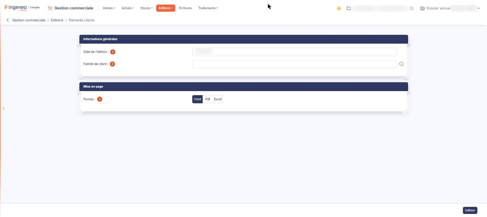

# Palmarès clients


**Où le trouver :** Menu **Editions › Palmarès clients**



**En bref** — Cette édition classe vos clients selon le chiffre d'affaires réalisé avec chacun, du plus élevé au plus faible, pour tout le fichier ou une famille de clients.

* Pour lancer le palmarès : indiquez au besoin une Famille de client, puis bouton \[Edition].


Cette édition classe vos clients selon le chiffre d'affaires réalisé avec chacun d'eux, du plus élevé au plus faible.

<figure><figcaption>
Écran « Palmarès clients » de la nouvelle interface
</figcaption></figure>

Par défaut, elle porte sur la totalité du fichier clients, mais vous avez la possibilité de la restreindre à une famille de clients pour obtenir le palmarès de ce sous-groupe seulement.

L'écran ne présente pas de liste : vous y renseignez deux critères seulement, puis vous lancez l'édition. Il ne propose ni fourchette de clients, ni période à borner, ni choix de tri ou de présentation.

## Rubrique « Informations générales »

| Champ                    | Ce qu'il faut savoir                                                                                                                                                                                                                                                           |
| ------------------------ | ------------------------------------------------------------------------------------------------------------------------------------------------------------------------------------------------------------------------------------------------------------------------------ |
| 1. **Date de l'édition** | Le logiciel vous propose la date du jour. Elle se saisit directement ou se choisit dans le calendrier, qui s'ouvre au clic dans la zone. C'est une date unique, et non une période : cette édition ne propose donc aucun bouton de raccourci de période.                       |
| 2. **Famille de client** | Laissez la zone vide pour éditer le palmarès de tous vos clients, ou indiquez une famille pour restreindre l'édition à ses seuls clients. La zone fonctionne en autocomplétion et propose un pictogramme « Loupe » qui ouvre la fenêtre de sélection d'une famille de clients. |

## Rubrique « Mise en page »

| Champ           | Ce qu'il faut savoir                                                                                                                                                                                                                                                                                                                                                                                                                     |
| --------------- | ---------------------------------------------------------------------------------------------------------------------------------------------------------------------------------------------------------------------------------------------------------------------------------------------------------------------------------------------------------------------------------------------------------------------------------------- |
| 3. **Format**   | 
Choisissez <strong>Html</strong>, qui est la proposition par défaut, <strong>Pdf</strong> ou <strong>Excel</strong>. Cette rubrique ne présente pas les mêmes champs selon le format demandé : les deux champs suivants n'apparaissent que si vous choisissez le format <strong>Pdf</strong>, le seul des trois qui soit paginé. Les formats <strong>Html</strong> et <strong>Excel</strong> présentent donc les mêmes champs.
 |
| **Orientation** | Choisissez **Portrait**, qui est la proposition par défaut, ou **Paysage**.                                                                                                                                                                                                                                                                                                                                                              |
| **Largeur**     | Choisissez **Fixe** ou **Ajustée**. Un pictogramme d'information rappelle à droite du champ que le second choix « ajuste la taille si la largeur des colonnes dépasse la largeur de la page ».                                                                                                                                                                                                                                           |


Attention : dès que vous passez au format **Pdf**, le logiciel coche lui-même **Ajustée**, alors que le réglage d'origine du formulaire est **Fixe**, et il ne revient jamais à **Fixe** si vous repassez à un autre format. Si vous voulez une largeur fixe, cochez-la vous-même après avoir choisi le format.


## Bouton \[Edition]

Il lance l'édition dans le format demandé. C'est le seul bouton de cet écran : le palmarès clients ne permet pas de mémoriser ni de recharger un jeu de critères.

Ce bouton est soumis à un droit distinct de celui du menu : selon votre profil, il peut ne pas vous être proposé.

Le document produit — le nombre de clients retenus, ses colonnes, ses totaux, sa présentation — n'est pas décrit ici.
