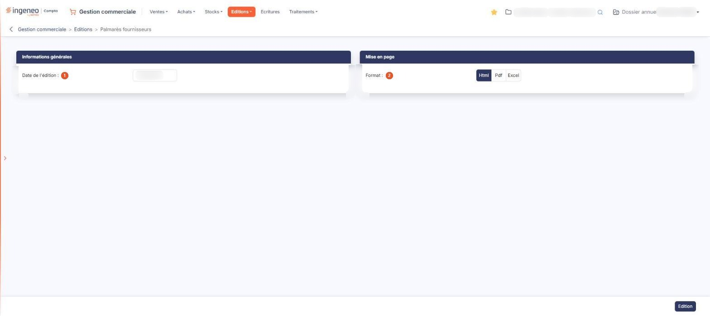

# Palmarès fournisseurs


**Où le trouver :** Menu **Editions › Palmarès fournisseurs**



**En bref** — Cette édition classe tous vos fournisseurs selon le montant des achats réalisés auprès de chacun, du plus élevé au plus faible.

* Pour lancer le palmarès : choisissez le format dans la rubrique « Mise en page », puis bouton \[Edition].


Cette édition classe vos fournisseurs selon le montant des achats réalisés auprès de chacun d'eux, du plus élevé au plus faible.

<figure><figcaption>
Écran « Palmarès fournisseurs » de la nouvelle interface
</figcaption></figure>

La sélection se fait sur la totalité du fichier fournisseurs : c'est l'écran le plus dépouillé de ce menu, et il ne propose aucun moyen de restreindre l'édition à une partie de vos fournisseurs. Ni fourchette de fournisseurs, ni famille de fournisseurs, ni période à borner, ni choix de tri ou de présentation.

L'écran ne présente donc pas de liste : vous y renseignez la date de l'édition et sa mise en page, puis vous la lancez.

## Rubrique « Informations générales »

**Date de l'édition** : c'est le seul champ de cette rubrique. Le logiciel vous propose la date du jour. Elle se saisit directement, ou se choisit dans le calendrier qui s'ouvre d'un clic dans la zone. C'est une date unique, et non une période : cette édition ne propose donc aucun bouton de raccourci de période.

## Rubrique « Mise en page »

| Champ           | Ce qu'il faut savoir                                                                                                                                                                                                                                                                                                                                                                                                                     |
| --------------- | ---------------------------------------------------------------------------------------------------------------------------------------------------------------------------------------------------------------------------------------------------------------------------------------------------------------------------------------------------------------------------------------------------------------------------------------- |
| 2. **Format**   | 
Choisissez <strong>Html</strong>, qui est la proposition par défaut, <strong>Pdf</strong> ou <strong>Excel</strong>. Cette rubrique ne présente pas les mêmes champs selon le format demandé : les deux champs suivants n'apparaissent que si vous choisissez le format <strong>Pdf</strong>, le seul des trois qui soit paginé. Les formats <strong>Html</strong> et <strong>Excel</strong> présentent donc les mêmes champs.
 |
| **Orientation** | Choisissez **Portrait**, qui est la proposition par défaut, ou **Paysage**.                                                                                                                                                                                                                                                                                                                                                              |
| **Largeur**     | Choisissez **Fixe** ou **Ajustée**. Un pictogramme d'information rappelle à droite du champ que le second choix « ajuste la taille si la largeur des colonnes dépasse la largeur de la page ».                                                                                                                                                                                                                                           |


Attention : dès que vous passez au format **Pdf**, le logiciel coche lui-même **Ajustée**, alors que le réglage d'origine du formulaire est **Fixe**, et il ne revient jamais à **Fixe** si vous repassez à un autre format. Si vous voulez une largeur fixe, cochez-la vous-même après avoir choisi le format.


## Bouton \[Edition]

Il lance l'édition dans le format demandé. Il se trouve dans la barre du bas, à droite de l'écran. C'est le seul bouton de cet écran, qui ne comporte par ailleurs aucun pictogramme de recherche, puisqu'il n'y a aucun tiers à sélectionner.

Ce bouton est soumis à un droit distinct de celui du menu : selon votre profil, il peut ne pas vous être proposé.

Le document produit — le nombre de fournisseurs retenus, ses colonnes, ses totaux, sa présentation — n'est pas décrit ici.
