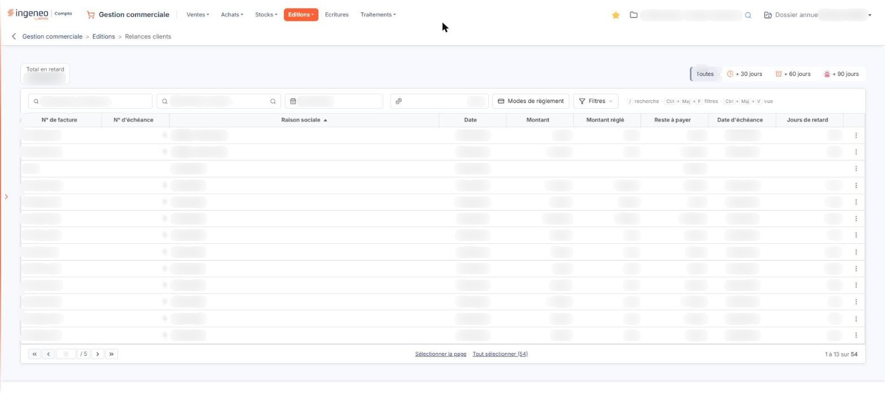
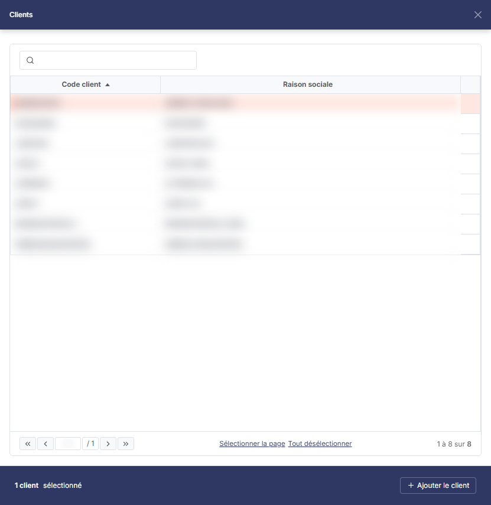
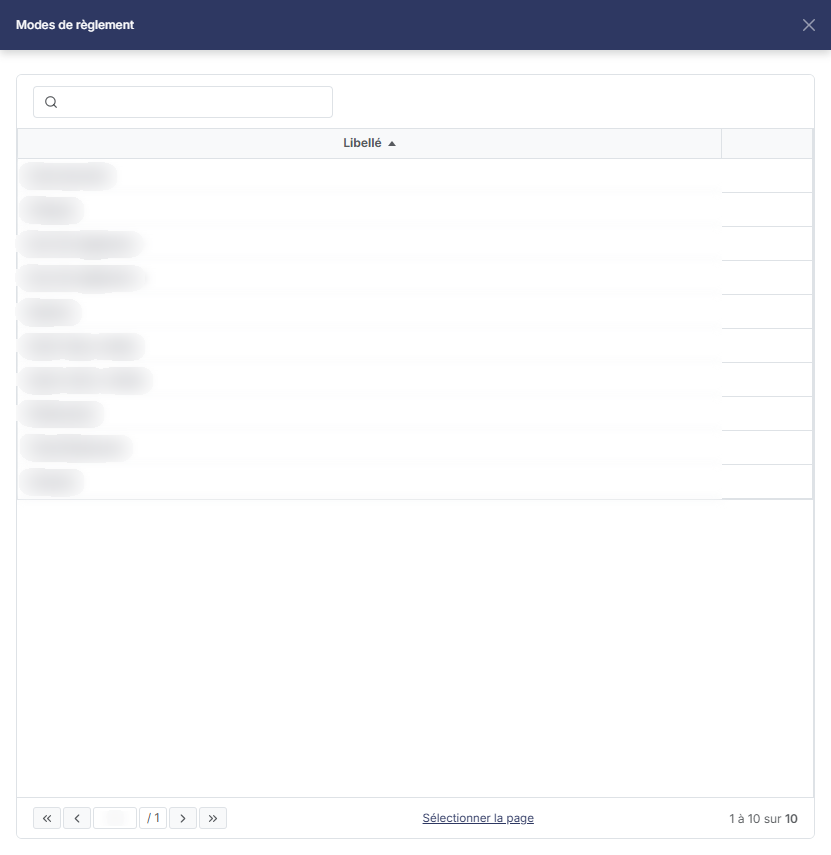
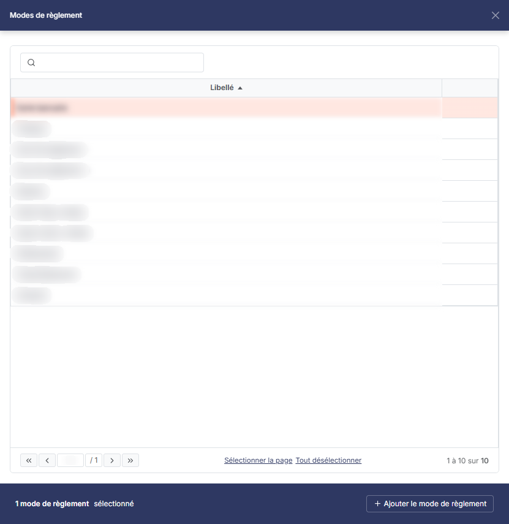

# Relances clients


**Où le trouver :** Menu **Editions › Relances clients**



**En bref** — Cet écran présente les échéances clients en retard et lance des relances manuelles sur tout le fichier. Seuls figurent les clients dont la fiche autorise les relances manuelles.

* Pour relancer : sélectionnez les échéances concernées, puis bouton \[Générer les relances].
* Pour rétablir les filtres d'origine : lien « Tout effacer », qui s'affiche à droite de la barre dès qu'un critère n'est plus à son état initial.


Cette option est équivalente à la fonction de relance de la fiche client, mais elle permet de lancer le traitement sur la totalité du fichier.

<figure><figcaption>
Écran « Relances clients » de la nouvelle interface
</figcaption></figure>

Par opposition aux relances automatiques qui peuvent être paramétrées dans les fiches clients, il s'agit ici de relances dites « manuelles », car déclenchées au moment où vous le décidez.

À la différence des autres options de ce menu, cet écran n'est pas un écran de critères d'édition : il ne propose ni rubrique « Mise en page », ni bouton de lancement d'une édition dans la barre du bas : la liste elle-même s'imprime ou s'exporte par le bouton \[Exporter] de sa barre d'outils. Il présente une grille des échéances clients en retard, dans laquelle vous sélectionnez ce qui doit être relancé, sous la barre d'outils habituelle des listes : une zone « Rechercher une facture… », une zone « Rechercher un client… », les champs propres à cet écran (la date, le seuil et le bouton \[Modes de règlement]) et les boutons \[Filtres], \[Vue] et \[Exporter]. Un compteur « Total en retard » affiche, dans une case encadrée en haut à gauche de l'écran, le montant total des échéances présentées ; à droite du même bandeau, quatre segments choisissent le retard minimal.

Une restriction importante ne se retrouve dans aucun filtre : seules figurent dans cette grille les échéances des clients pour lesquels les relances manuelles ont été autorisées dans leur fiche client. L'infobulle du champ « Rechercher un client… » le rappelle : « Seuls les clients dont les relances manuelles sont autorisées dans leur fiche client peuvent être choisis. » Un client dont la fiche n'autorise pas les relances manuelles n'apparaît donc jamais ici, quel que soit son retard.

## Les filtres

<figure><figcaption>
Bouton [+ Ajouter le client]
</figcaption></figure>

<figure><figcaption>
Bouton [Modes de règlement]
</figcaption></figure>

<figure><figcaption>
Bouton [+ Ajouter le mode de règlement]
</figcaption></figure>

Il n'y a plus de menu « Filtres spéciaux » : les critères propres à cet écran sont visibles directement, dans la barre à droite des deux zones de recherche (date, seuil, \[Modes de règlement]) et dans le bandeau au-dessus (retard). Ils s'appliquent sans bouton d'application, et le bouton \[Réinitialiser] n'existe plus. Le bouton \[Filtres] propose en plus le filtre commun des listes (« + Ajouter un critère sur… », avec les boutons \[Vider les filtres] et \[Filtrer]).

| Champ                      | Ce qu'il faut savoir                                                                                                                                                                                                                                                                                                                                                                                                                                                                                                                                                                                                                                                                                                                                                                                                                                                                                                                                                                                                                                                                                                                                                                                      |
| -------------------------- | --------------------------------------------------------------------------------------------------------------------------------------------------------------------------------------------------------------------------------------------------------------------------------------------------------------------------------------------------------------------------------------------------------------------------------------------------------------------------------------------------------------------------------------------------------------------------------------------------------------------------------------------------------------------------------------------------------------------------------------------------------------------------------------------------------------------------------------------------------------------------------------------------------------------------------------------------------------------------------------------------------------------------------------------------------------------------------------------------------------------------------------------------------------------------------------------------------- |
| **Seuil de déclenchement** | Le champ ne porte que le repère « Seuil » ; une infobulle rappelle qu'il s'agit du montant du retard à partir duquel un client est relancé. Le champ est vide à l'ouverture.                                                                                                                                                                                                                                                                                                                                                                                                                                                                                                                                                                                                                                                                                                                                                                                                                                                                                                                                                                                                                              |
| **Clients**                | Ce critère n'est plus dans le menu des filtres : il se choisit par le pictogramme « Loupe » placé à droite de la zone « Rechercher un client… ». Il ouvre le panneau « Clients », qui s'affiche sur la droite de l'écran : une zone de recherche « Rechercher par client… » filtre la liste à la saisie, et la grille présente deux colonnes, Code client et Raison sociale. Il n'y a pas de case à cocher : un clic sur une ligne la sélectionne, un second clic la désélectionne. Sous la liste, le lien « Sélectionner la page » retient les lignes affichées ; dès qu'une ligne est retenue, le lien « Tout désélectionner » apparaît et le pied du panneau indique le nombre de clients sélectionnés (« 1 client sélectionné », « 2 clients sélectionnés ») avec le bouton **\[+ Ajouter le client]** (« + Ajouter les clients » au pluriel). Le panneau n'a ni bouton **\[Valider]** ni bouton **\[Annuler]** : la croix de son en-tête le ferme. Une info-bulle précise que seuls les clients dont les relances manuelles sont autorisées dans leur fiche client peuvent être choisis. À l'ouverture, aucun client n'est sélectionné, donc tous ceux qui remplissent cette condition sont retenus. |
| **Échéances en retard au** | Le logiciel vous propose la date du jour ; la grille présente les échéances en retard à cette date. Vous pouvez indiquer une autre date de référence, directement ou par le calendrier, qui s'ouvre au clic dans la zone.                                                                                                                                                                                                                                                                                                                                                                                                                                                                                                                                                                                                                                                                                                                                                                                                                                                                                                                                                                                 |
| **Retard**                 | Ce n'est plus une liste déroulante mais quatre segments, placés à droite du bandeau qui surmonte la barre d'outils : **Toutes** (retenu à l'ouverture, toutes les factures en retard), **+ 30 jours**, **+ 60 jours** et **+ 90 jours**, qui restreignent la liste aux factures en retard de plus de 30, de plus de 60 ou de plus de 90 jours. Les segments n'affichent pas de nombre.                                                                                                                                                                                                                                                                                                                                                                                                                                                                                                                                                                                                                                                                                                                                                                                                                    |
| **Total en retard**        | Ce n'est plus un champ des filtres mais un compteur, affiché dans une case encadrée en haut à gauche de l'écran, au-dessus de la barre d'outils, et non saisissable. Le logiciel y restitue le montant total des échéances présentées par la grille.                                                                                                                                                                                                                                                                                                                                                                                                                                                                                                                                                                                                                                                                                                                                                                                                                                                                                                                                                      |

bouton **\[Modes de règlement]**

Il se trouve directement dans la barre d'outils, à droite de la zone du seuil ; son libellé est « Modes de règlement », suivi d'un nombre (« Modes de règlement : 1 ») lorsque des modes sont retenus. Il ouvre le panneau « Modes de règlement », qui s'affiche sur la droite de l'écran et présente la liste des modes de règlement du dossier dans une grille à une seule colonne, **Libellé**, sans case à cocher : un clic sur une ligne la sélectionne, un second clic la désélectionne. Une zone de recherche « Rechercher par mode de règlement… » restreint la liste proposée à la saisie : il n'y a plus de bouton \[Afficher]. Dès qu'un mode est retenu, le pied du panneau indique « 1 mode de règlement sélectionné » et propose le bouton **\[+ Ajouter le mode de règlement]**, tandis que les liens « Sélectionner la page » et « Tout désélectionner » étendent ou annulent la sélection. Le panneau n'a ni bouton **\[Valider]** ni bouton **\[Annuler]** : la croix de son en-tête le ferme.

**Lien « Tout effacer » et bouton \[Vider les filtres]**

L'ancien bouton \[Filtrer les échéances] n'existe plus, pas plus que le bouton \[Réinitialiser]. Le lien « Tout effacer », qui s'affiche à droite de la barre dès qu'un critère n'est plus à son état initial, remet ces filtres dans leur état initial (retard « Toutes », aucun mode de règlement retenu) ; le bouton \[Vider les filtres] du bouton \[Filtres] retire les critères du filtre commun.

## La grille des échéances

Elle présente neuf colonnes, toutes triables et redimensionnables : **N° de facture**, **N° d'échéance**, **Raison sociale**, **Date**, **Montant**, **Montant réglé**, **Reste à payer**, **Date d'échéance** et **Jours de retard**. Il n'y a pas de colonne d'état. À l'ouverture, la grille est classée par **Raison sociale** croissante.

Certaines lignes ne correspondent pas à une facture en retard mais à une somme dont le client dispose et qui n'a pas encore été affectée : la première colonne porte alors la nature de l'élément au lieu d'un numéro de pièce, les colonnes de montants restent vides, et le **Reste à payer** est présenté en négatif. Ces lignes viennent en diminution de ce qui est réclamé au client.

Il n'y a plus de case à cocher : un clic sur une ligne la sélectionne. Sous la grille, « Sélectionner la page » sélectionne les lignes de la page affichée et « Tout sélectionner (n) » les échéances de toutes les pages, n étant leur nombre. Au survol d'une ligne, un seul pictogramme apparaît, « Autres actions » (trois points), dont le menu ne porte que « Supprimer ». La suppression retire l'échéance de la liste des relances : elle est soumise à un droit particulier et peut, selon votre profil, ne pas vous être proposée.

La personnalisation des colonnes se fait par le bouton \[Vue] et l'impression ou l'export de la grille par le bouton \[Exporter], dont le menu propose notamment « Aperçu édition HTML », « Imprimer », « Exporter en Excel », « Exporter en PDF » et « Envoyer la liste par e-mail ».

## Bouton \[Générer les relances]

<figure><figcaption>
Bouton [Générer les relances]
</figcaption></figure>

Il se trouve dans le bandeau de sélection qui s'affiche en bas de l'écran dès qu'une échéance est sélectionnée (« 1 échéance sélectionnée », avec le lien « Tout désélectionner » et bouton **\[Supprimer]**) ; il n'est pas affiché tant qu'aucune ligne n'est sélectionnée. Il ouvre la seconde étape du traitement.

Cette fenêtre et le déroulement de l'envoi ne sont pas décrits ici.

Ce bouton est soumis à un droit particulier : selon votre profil, il peut ne pas vous être proposé.

## Bouton \[Supprimer]

<figure><figcaption>
Bouton [Supprimer]
</figcaption></figure>

Il retire de la liste des relances toutes les échéances que vous avez sélectionnées, comme le fait ligne à ligne la commande « Supprimer » du menu « Autres actions » de la grille. Il se trouve lui aussi dans le bandeau de sélection, et il est soumis au même droit que cette commande.

## Retour

Le bouton \[Retour] n'est plus affiché : on quitte l'écran par la flèche « Revenir en arrière », à gauche du fil d'Ariane, présente aussi quand vous arrivez par le menu.
