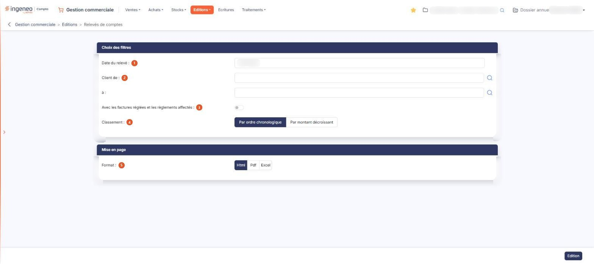

# Relevés de comptes


**Où le trouver :** Menu **Editions › Relevés de comptes**



**En bref** — Le relevé de comptes édite, client par client, les factures non soldées à la date du relevé que vous indiquez.

* Pour éditer le relevé d'un seul client : indiquez son code dans Client de : et à :, puis bouton \[Edition].


Le relevé de comptes permet d'éditer, client par client, la liste de ses factures non soldées. Seules les factures dont la date est antérieure ou égale à la date du relevé que vous indiquez sont retenues.

<figure><figcaption>
Écran « Relevés de comptes » de la nouvelle interface
</figcaption></figure>

**Attention** : cette édition ne fonctionne pas comme celle d'un grand livre comptable dont vous auriez exclu les écritures lettrées avec des éléments hors période. En d'autres termes, si au 15 juin vous demandez un relevé au 31 mars, les factures payées entre le 31 mars et le 15 juin n'apparaissent pas dans la liste.

L'écran ne présente pas de liste : vous y renseignez des critères, répartis en deux rubriques, puis vous lancez l'édition. Tous les critères que vous indiquez s'appliquent simultanément.

## Rubrique « Choix des filtres »

| Champ                                                       | Ce qu'il faut savoir                                                                                                                                                                                                                                                                                                                                                                                           |
| ----------------------------------------------------------- | -------------------------------------------------------------------------------------------------------------------------------------------------------------------------------------------------------------------------------------------------------------------------------------------------------------------------------------------------------------------------------------------------------------- |
| 1. **Date du relevé**                                       | Le logiciel vous propose la date du jour. Elle se saisit directement ou se choisit dans le calendrier, qui s'ouvre au clic dans la zone. C'est une date unique, et non une période : cette édition ne propose donc aucun bouton de raccourci de période.                                                                                                                                                       |
| 2. **Client de**                                            | **à :** l'édition se lance par défaut pour tous les clients ; vous pouvez la restreindre à un intervalle en indiquant le code du premier et celui du dernier client. Chacune des deux zones fonctionne en autocomplétion sur le code client et propose un pictogramme « Loupe » qui ouvre la fenêtre de sélection d'un client. Pour obtenir le relevé d'un seul client, indiquez son code dans les deux zones. |
| 3. **Avec les factures réglées et les règlements affectés** | Activez l'interrupteur pour que le relevé ne se limite pas aux éléments restant dus. Par défaut, l'interrupteur est désactivé.                                                                                                                                                                                                                                                                                 |
| 4. **Classement**                                           | Choisissez **Par ordre chronologique**, qui est la proposition par défaut, ou **Par montant décroissant**.                                                                                                                                                                                                                                                                                                     |

## Rubrique « Mise en page »

| Champ           | Ce qu'il faut savoir                                                                                                                                                                                                                                                                                                                                                                                                                     |
| --------------- | ---------------------------------------------------------------------------------------------------------------------------------------------------------------------------------------------------------------------------------------------------------------------------------------------------------------------------------------------------------------------------------------------------------------------------------------- |
| 5. **Format**   | 
Choisissez <strong>Html</strong>, qui est la proposition par défaut, <strong>Pdf</strong> ou <strong>Excel</strong>. Cette rubrique ne présente pas les mêmes champs selon le format demandé : les deux champs suivants n'apparaissent que si vous choisissez le format <strong>Pdf</strong>, le seul des trois qui soit paginé. Les formats <strong>Html</strong> et <strong>Excel</strong> présentent donc les mêmes champs.
 |
| **Orientation** | Choisissez **Portrait**, qui est la proposition par défaut, ou **Paysage**.                                                                                                                                                                                                                                                                                                                                                              |
| **Largeur**     | Choisissez **Fixe** ou **Ajustée**. Un pictogramme d'information rappelle à droite du champ que le second choix « ajuste la taille si la largeur des colonnes dépasse la largeur de la page ».                                                                                                                                                                                                                                           |


Attention : dès que vous passez au format **Pdf**, le logiciel coche lui-même **Ajustée**, alors que le réglage d'origine du formulaire est **Fixe**, et il ne revient jamais à **Fixe** si vous repassez à un autre format. Si vous voulez une largeur fixe, cochez-la vous-même après avoir choisi le format.


## Bouton \[Edition]

Il se trouve en bas à droite de l'écran. Il lance l'édition dans le format demandé, et c'est le seul bouton de la barre du bas lorsque vous accédez à l'écran par le menu.

**Attention, ce bouton ne se borne pas à imprimer** : avant de produire le relevé, le logiciel importe dans la gestion commerciale les règlements et remboursements présents en comptabilité et non encore importés, pour la fourchette de clients indiquée — c'est ce qui permet aux encaissements saisis en comptabilité ou issus des relevés bancaires de figurer au relevé. Cet import **enregistre** donc des éléments dans votre dossier. Il n'a lieu que si votre dossier est relié à la comptabilité Ingeneo Compta, ce qui se paramètre dans le menu « Paramètres », option « Connexion comptabilité ».

Ce bouton est soumis à un droit distinct de celui du menu : selon votre profil, il peut ne pas vous être proposé.

Retour : cet écran ne propose pas de bouton \[Retour] dans la barre du bas ; pour le quitter, utilisez la flèche « Revenir en arrière », à gauche du fil d'Ariane.

Le document produit — ses colonnes, ses totaux, sa présentation — n'est pas décrit ici.
