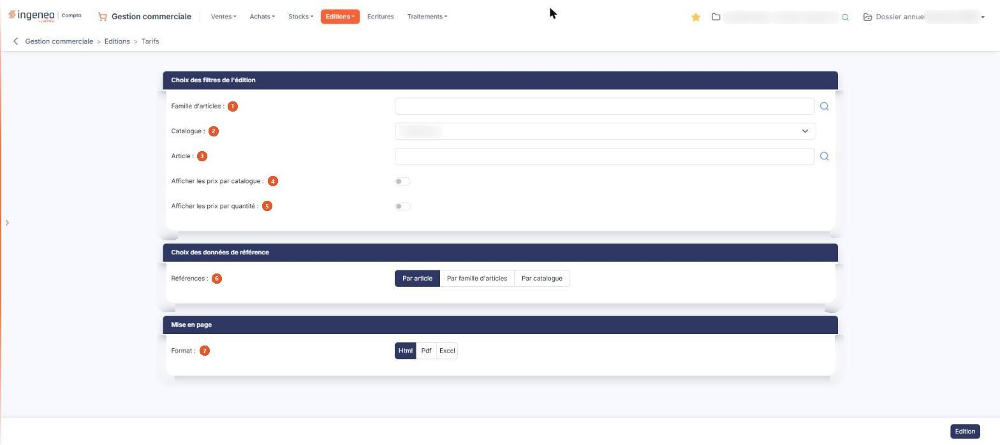

# Tarifs


**Où le trouver :** Menu **Editions › Tarifs**



**En bref** — Cette édition présente les tarifs de vos articles, y compris les tarifs par catalogue et les tarifs par quantité.

* Pour éditer les tarifs d'une seule famille : renseignez Famille d'articles, puis bouton \[Edition].


Cette édition permet d'éditer tous les tarifs des articles, y compris les tarifs par catalogue et les tarifs par quantité.

<figure><figcaption>
Écran « Tarifs » de la nouvelle interface
</figcaption></figure>

L'écran ne présente pas de liste : vous y renseignez des critères, puis vous lancez l'édition. Tous les critères que vous indiquez s'appliquent simultanément.

## Rubrique « Choix des filtres de l'édition »

Cette rubrique ne propose pas toujours les mêmes champs : plusieurs d'entre eux n'apparaissent que si la gestion correspondante est activée dans **Paramètres > Articles**. Le champ **Famille d'articles** suppose **Utiliser les familles d'articles** à Oui ; les champs **Catalogue** et **Afficher les prix par catalogue** supposent **Gérer les catalogues** à Oui ; le champ **Afficher les prix par quantité** suppose **Gérer les prix par quantités** à Oui. Seul le champ **Article** est proposé dans tous les cas.

Un champ **Sous-famille d'articles** peut également s'ajouter sous la famille, lorsque **Utiliser les sous-familles d'articles** est à Oui.

| Champ                                  | Ce qu'il faut savoir                                                                                                                                                                                                                                                               |
| -------------------------------------- | ---------------------------------------------------------------------------------------------------------------------------------------------------------------------------------------------------------------------------------------------------------------------------------- |
| 1. **Famille d'articles**              | Par défaut, le logiciel édite les tarifs de toutes les familles ; vous pouvez restreindre l'édition à une seule famille. La zone se saisit directement et propose à sa droite un pictogramme « Loupe » qui ouvre une fenêtre de recherche dans le fichier des familles d'articles. |
| 2. **Catalogue**                       | La liste propose « Sélectionnez », qui laisse le critère inactif, puis les catalogues que vous avez créés dans le fichier des catalogues. Choisissez-en un pour ne retenir que ses tarifs.                                                                                         |
| 3. **Article**                         | L'édition se lance par défaut pour tout le fichier des articles, mais vous pouvez la restreindre à un seul article. Comme pour la famille, la zone se saisit directement et propose un pictogramme « Loupe » qui ouvre une fenêtre de recherche dans le fichier des articles.      |
| 4. **Afficher les prix par catalogue** | Activez l'interrupteur pour que l'édition fasse figurer, pour chaque article, le prix de vente propre à chaque catalogue en plus de son prix de vente par défaut. L'interrupteur est désactivé par défaut.                                                                         |
| 5. **Afficher les prix par quantité**  | Activez l'interrupteur pour que l'édition fasse figurer les tranches de quantité et le prix correspondant à chacune. L'interrupteur est désactivé par défaut.                                                                                                                      |

## Rubrique « Choix des données de référence »

**Références** : ce choix commande la façon dont l'édition regroupe les tarifs. Choisissez **Par article**, qui est la proposition par défaut, **Par famille d'articles** ou **Par catalogue**.

Ce choix ne modifie pas les critères que vous avez indiqués dans la rubrique précédente : ceux-ci restent proposés à l'identique quelle que soit la référence retenue.

Les trois choix ne sont pas toujours proposés : **Par famille d'articles** n'apparaît que si **Utiliser les familles d'articles** est à Oui, et **Par catalogue** que si **Gérer les catalogues** est à Oui, dans **Paramètres > Articles**. **Par article** est toujours proposé.

## Rubrique « Mise en page »

| Champ           | Ce qu'il faut savoir                                                                                                                                                                                                                                                                                    |
| --------------- | ------------------------------------------------------------------------------------------------------------------------------------------------------------------------------------------------------------------------------------------------------------------------------------------------------- |
| 7. **Format**   | 
Choisissez <strong>Html</strong>, qui est la proposition par défaut, <strong>Pdf</strong> ou <strong>Excel</strong>. Cette rubrique ne présente pas les mêmes champs selon le format demandé : les deux champs suivants n'apparaissent que si vous choisissez le format <strong>Pdf</strong>.
 |
| **Orientation** | Choisissez **Portrait**, qui est la proposition par défaut, ou **Paysage**.                                                                                                                                                                                                                             |
| **Largeur**     | Choisissez **Fixe** ou **Ajustée**. Un pictogramme d'information rappelle à droite du champ que le second choix « ajuste la taille si la largeur des colonnes dépasse la largeur de la page ».                                                                                                          |


Attention : dès que vous passez au format **Pdf**, le logiciel coche lui-même **Ajustée**, alors que le réglage d'origine du formulaire est **Fixe**, et il ne revient jamais à **Fixe** si vous repassez à un autre format. Si vous voulez une largeur fixe, cochez-la vous-même après avoir choisi le format.


## Bouton \[Edition]

Il lance l'édition dans le format demandé. Il se trouve dans la barre du bas, à droite de l'écran, et c'est le seul bouton de cet écran : les critères que vous avez renseignés ne se mémorisent pas d'une édition à l'autre.

Ce bouton est soumis à un droit distinct de celui du menu : selon votre profil, il peut ne pas vous être proposé.

L'édition se contente de lire vos données : ni son lancement ni l'ouverture de cet écran ne modifient quoi que ce soit dans votre dossier.
