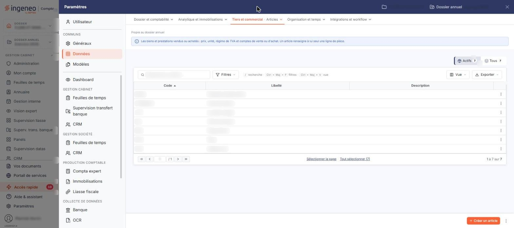
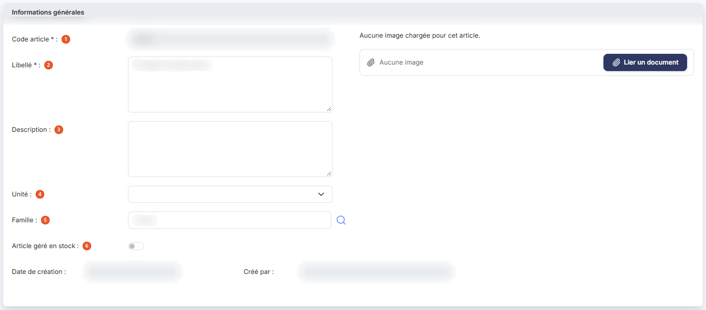
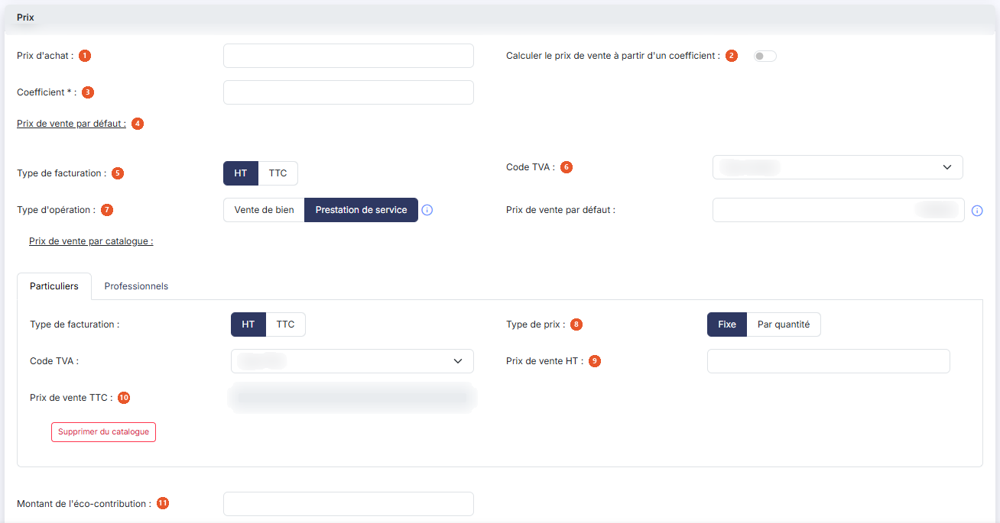
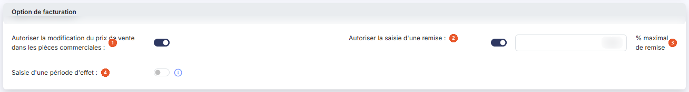
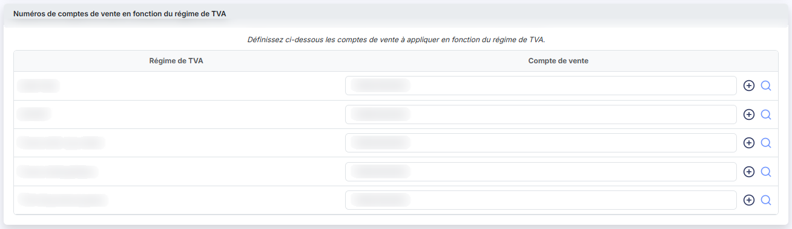
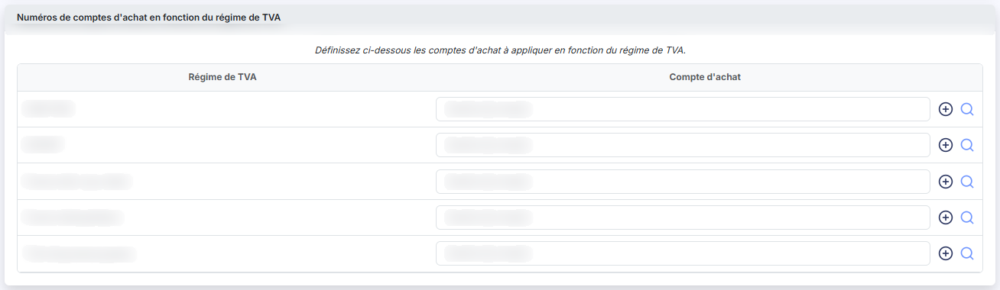
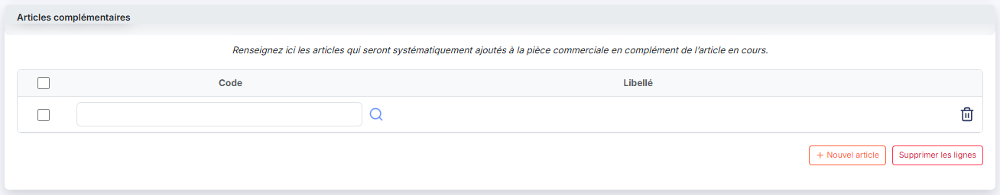
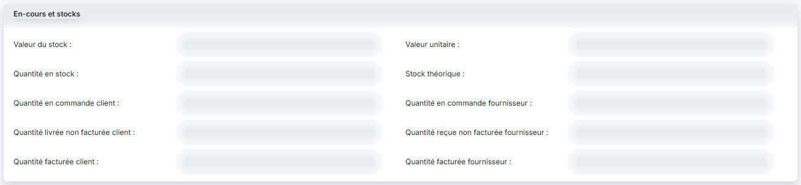
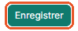

# Articles — fichier des articles


**Où le trouver :** Panneau **Paramètres** › **Gestion commerciale** › **Articles**



**En bref** — Cet écran tient le fichier de vos articles, marchandises comme prestations. La fiche article alimente les lignes de vos pièces commerciales : libellé, prix, code TVA, compte de vente.

* Pour créer un article : bouton \[Créer un article], complétez la fiche, puis bouton \[Enregistrer].
* Pour enchaîner plusieurs créations : bouton \[Enregistrer et créer un nouvel article].


Cet écran s'ouvre depuis le panneau « Paramètres » : « Paramètres > Données > Tiers et commercial > Articles ».

<figure><figcaption>
Écran « Articles » de la nouvelle interface
</figcaption></figure>

Cette option permet de tenir le fichier de vos articles : tout ce que vous vendez ou achetez, marchandise comme prestation. C'est la fiche article qui alimente les lignes de vos pièces commerciales — le libellé, le prix, le code TVA, le compte de vente — et qui évite de ressaisir ces informations pièce après pièce.

La composition de la fiche dépend de ce que vous avez activé dans le panneau « Paramètres » : « Paramètres > Gestion commerciale > Articles », par des interrupteurs : la gestion des familles, celle des sous-familles, celle des catalogues, celle des prix par quantités et la gestion analytique. Si l'une de ces options est désactivée, les champs correspondants ne figurent pas dans la fiche : c'est normal, ce n'est pas un droit qui vous manque.

La fiche article s'appuie sur trois autres fichiers du panneau « Paramètres », rubrique « Données » : les unités, les familles d'articles (groupe « Tiers et commercial »), et les codes TVA et régimes de TVA (groupe « Dossier et comptabilité »). Renseignez-les avant de créer vos articles.

## La liste des articles

L'écran s'ouvre sur la liste de vos articles, triée par ordre croissant de code. Elle présente les colonnes suivantes :

| Champ           | Ce qu'il faut savoir                                                                                          |
| --------------- | ------------------------------------------------------------------------------------------------------------- |
| **Code**        | Le code que vous avez donné à l'article. C'est lui que vous saisissez dans les lignes de pièces commerciales. |
| **Libellé**     | Le libellé de l'article, celui qui est repris dans les pièces commerciales.                                   |
| **Description** | Le complément d'information saisi dans la fiche. Il n'est pas repris dans les pièces commerciales.            |

Au-dessus de la liste, le bouton \[Vue] permet de choisir les colonnes affichées et d'enregistrer des vues, et le bouton \[Exporter] donne accès à l'aperçu, à l'impression et aux exports de la liste. Sous la liste, « Sélectionner la page » et « Tout sélectionner (N) » étendent la sélection à la page affichée ou à tous les articles. Le fonctionnement des listes du logiciel, la personnalisation des colonnes et la barre de pagination sont décrits dans le chapitre « Généralités » en tête de la présente aide.

## La recherche et les filtres au-dessus de la liste

| Champ                                   | Ce qu'il faut savoir                                                                                                                                                                                                                                                                                                                                                                                                                                                                                                                                                                                                                                                                                                                                                                                     |
| --------------------------------------- | -------------------------------------------------------------------------------------------------------------------------------------------------------------------------------------------------------------------------------------------------------------------------------------------------------------------------------------------------------------------------------------------------------------------------------------------------------------------------------------------------------------------------------------------------------------------------------------------------------------------------------------------------------------------------------------------------------------------------------------------------------------------------------------------------------- |
| **Rechercher un article…**              | La barre de recherche permet de retrouver un article dans la liste ; le raccourci « / » y place le curseur.                                                                                                                                                                                                                                                                                                                                                                                                                                                                                                                                                                                                                                                                                              |
| **Le bouton \[Filtres]**                | Il ouvre un volet « Filtrer » qui indique « Aucun critère. Choisissez une colonne pour commencer. » et propose la liste « + Ajouter un critère sur… » : Code, Libellé, Description, Unité, Famille, Sous-famille, Image, Géré en stock, Facturation, Type d'opération, TVA, Prix de vente HT, Prix de vente TTC, Eco-contribution, Prix modifiable, Remise autorisée, Taux max. de remise autorisée, Avec période d'effet, les quantités et valeurs de stock et de commandes, Prix d'achat, Avec coefficient, Coefficient, Date de création, Créé par, Date d'archivage et Archivé par. Le volet se termine par le lien « Vider les filtres » et par le bouton \[Filtrer], qui applique les critères choisis. Dès qu'un critère est posé, le lien « Tout effacer » apparaît à côté du bouton \[Filtres]. |
| **Les segments « Actifs » et « Tous »** | Il n'y a plus de bouton \[Filtres spéciaux] ni d'interrupteur « Articles archivés ». Deux segments, au-dessus de la barre d'outils, à droite, indiquent chacun le nombre d'articles qu'ils retiennent. « Actifs », retenu à l'ouverture, masque vos articles archivés ; « Tous » les fait apparaître dans la liste.                                                                                                                                                                                                                                                                                                                                                                                                                                                                                      |

## Les commandes de chaque ligne

Un clic sur une ligne la sélectionne. Au survol d'une ligne, un pictogramme « Autres actions » (trois points) apparaît à son extrémité droite et ouvre un menu à trois entrées.

L'entrée « Modifier » ouvre la fiche de l'article.

L'entrée « Supprimer » supprime l'article, après confirmation.

L'entrée « Dupliquer » crée un nouvel article en reprenant le contenu de celui de la ligne. Le code n'est pas vidé : vous partez de celui de l'article d'origine et vous n'en modifiez que la partie utile. Son unicité est vérifiée à l'enregistrement.

Selon les droits qui vous sont accordés, l'une ou l'autre de ces commandes peut ne pas vous être proposée.

## Bouton \[Créer un article]

Situé dans la barre du bas, à droite, hors du tableau, il ouvre une fiche vierge pour créer un article.

## Bouton \[Archiver]

Il apparaît dans le bandeau de sélection, avec le bouton \[Supprimer], dès qu'au moins une ligne est sélectionnée : il archive en une fois tous les articles sélectionnés.

L'archivage vous permet de mettre de côté les articles que vous ne vendez plus, sans les supprimer : un article archivé n'est plus proposé dans les lignes de pièces commerciales, ni par l'autocomplétion du code, ni par la fenêtre de recherche. Il reste consultable dans cette liste en retenant le segment « Tous », au-dessus de la barre d'outils.

## Entrée « Champs dynamiques » du menu « Autres actions »

L'entrée « Champs dynamiques » se trouve dans le menu que porte le pictogramme « Autres actions » (trois points) de la barre du bas, à droite de \[Créer un article].

Les champs dynamiques sont présents dans plusieurs fichiers du logiciel. Leur fonctionnement est décrit en détail dans l'aide en ligne du module Vision : rendez-vous sur votre page d'accueil, cliquez sur le pictogramme d'aide « ? » et reportez-vous au chapitre « Fonctionnement général », rubrique « Champs dynamiques ».

Tous les champs dynamiques créés dans le fichier des articles sont accessibles dans les lignes de détail de toutes les pièces commerciales. Ils peuvent y être imprimés si vos modèles d'impression ont été modifiés en conséquence.

## Bouton \[Supprimer]

Il apparaît dans le bandeau de sélection, qui s'affiche au bas de l'écran dès qu'une ligne est sélectionnée (« 1 article sélectionnée », avec le lien « Tout désélectionner ») et remplace alors la barre où figure \[Créer un article]. Il supprime en une fois, après confirmation, tous les articles sélectionnés.

Préférez l'archivage à la suppression pour un article que vous avez déjà employé dans vos pièces commerciales.

## Rubrique « Informations générales »

<figure><figcaption>
Rubrique « Informations générales »
</figcaption></figure>

| Champ                        | Ce qu'il faut savoir                                                                                                                                                                                                                                                                                                                                                                            |
| ---------------------------- | ----------------------------------------------------------------------------------------------------------------------------------------------------------------------------------------------------------------------------------------------------------------------------------------------------------------------------------------------------------------------------------------------- |
| 1. **Code article**          | Il doit être unique et peut compter jusqu'à 40 caractères. Il n'est plus modifiable une fois l'article créé.                                                                                                                                                                                                                                                                                    |
| 2. **Libellé**               | Il peut contenir jusqu'à 1.024 caractères. C'est ce libellé qui est repris dans les pièces commerciales.                                                                                                                                                                                                                                                                                        |
| 3. **Description**           | Facultative. Elle n'est pas reprise dans les pièces commerciales.                                                                                                                                                                                                                                                                                                                               |
| 4. **Unité**                 | Facultative. C'est l'unité indicative de mesure des quantités de l'article ; le sélecteur propose les unités du fichier « Unités ».                                                                                                                                                                                                                                                             |
| 5. **Famille**               | Facultative ou obligatoire selon votre paramétrage. Ce champ n'est présent que si vous avez activé la gestion des familles dans « Paramètres > Gestion commerciale > Articles ». Saisissez le libellé de la famille ou cliquez sur le pictogramme « Loupe » pour la rechercher.                                                                                                                 |
| 6. **Article géré en stock** | 
Interrupteur désactivé par défaut. Activé, l'article est suivi en stock : ses mouvements alimentent la rubrique « En-cours et stocks » décrite plus bas. <strong>Date de création</strong> et <strong>Créé par :</strong> renseignés par le logiciel, ils ne sont pas saisissables. Ils n'apparaissent qu'en modification : la fiche d'un article que vous créez ne les comporte pas.
 |
| **Fichier image**            | Vous pouvez associer une image à l'article : cliquez sur le bouton \[Lier un document] pour la sélectionner. Tant qu'aucune image n'est chargée, le logiciel affiche « Aucune image chargée pour cet article. » et, à côté du bouton, « Aucune image ».                                                                                                                                         |

## Rubrique « Prix »

<figure><figcaption>
Rubrique « Prix »
</figcaption></figure>

| Champ                                                      | Ce qu'il faut savoir                                                                                                                                                                                                                                                                                                                                                                                                                                                                                                                                             |
| ---------------------------------------------------------- | ---------------------------------------------------------------------------------------------------------------------------------------------------------------------------------------------------------------------------------------------------------------------------------------------------------------------------------------------------------------------------------------------------------------------------------------------------------------------------------------------------------------------------------------------------------------- |
| 1. **Prix d'achat**                                        | —                                                                                                                                                                                                                                                                                                                                                                                                                                                                                                                                                                |
| 2. **Calculer le prix de vente à partir d'un coefficient** | Interrupteur ; activé, le prix de vente est calculé en multipliant le prix d'achat par le coefficient que vous saisissez.                                                                                                                                                                                                                                                                                                                                                                                                                                        |
| 3. **Coefficient**                                         | 
Obligatoire si vous avez indiqué que le prix de vente était calculé à partir d'un coefficient. Le champ reste affiché dans le cas contraire, mais il est grisé. Vient ensuite la zone <strong>« Prix de vente par défaut »</strong>. C'est le prix appliqué lorsqu'une pièce commerciale ne se voit affecter aucun catalogue : renseignez-le même si vous travaillez par catalogues.
                                                                                                                                                                   |
| 4. **Prix de vente par défaut**                            | 
C'est le montant appliqué hors catalogue, exprimé selon le type de facturation choisi. Vient enfin la zone <strong>« Prix de vente par catalogue »</strong>, présente si vous avez activé la gestion des catalogues dans « Paramètres > Gestion commerciale > Articles ». Elle comporte autant d'onglets que vous avez de catalogues, et vous renseignez les prix de chaque catalogue en naviguant d'un onglet à l'autre. Chaque onglet porte les mêmes champs :
                                                                                       |
| 5. **Type de facturation**                                 | Il définit si le prix est indiqué en HT ou en TTC. Si vous choisissez « HT », le prix TTC est calculé en appliquant le taux de TVA, et éventuellement arrondi ; si vous choisissez « TTC », c'est le prix HT qui est calculé et éventuellement arrondi. De cette manière, le prix que vous saisissez ne risque jamais d'être arrondi par un calcul fait en sens inverse dans une pièce commerciale.                                                                                                                                                              |
| 5. **Type de facturation**                                 | « HT » ou « TTC », comme ci-dessus.                                                                                                                                                                                                                                                                                                                                                                                                                                                                                                                              |
| 6. **Code TVA**                                            | Le sélecteur propose les codes du fichier « Codes TVA », positionné sur le code par défaut, que vous pouvez modifier. Il détermine le taux appliqué pour passer du HT au TTC.                                                                                                                                                                                                                                                                                                                                                                                    |
| 6. **Code TVA**                                            | Le code TVA retenu pour ce catalogue.                                                                                                                                                                                                                                                                                                                                                                                                                                                                                                                            |
| 7. **Type d'opération**                                    | Le choix entre « Vente de bien » et « Prestation de service » conditionne le compte de TVA employé pour la génération des écritures comptables : le compte de TVA sur les débits pour les ventes de biens, le compte de TVA sur les encaissements pour les prestations de services.                                                                                                                                                                                                                                                                              |
| 8. **Type de prix**                                        | Ce champ n'est présent que si vous avez activé les prix par quantités dans « Paramètres > Gestion commerciale > Articles ». À « Fixe », vous saisissez un seul prix de vente. À « Par quantité », les deux champs de prix sont grisés et le logiciel affiche à la place une grille de tranches, dont vous ajoutez les lignes avec le bouton « Nouvelle ligne » : indiquez pour chacune la quantité minimale, la quantité maximale et le prix de vente. Deux tranches ne peuvent pas se chevaucher. Le pictogramme « Croix » de chaque ligne supprime la tranche. |
| 9. **Prix de vente HT**                                    | Quand vous le modifiez, le prix de vente TTC est recalculé et éventuellement arrondi en fonction du taux de TVA.                                                                                                                                                                                                                                                                                                                                                                                                                                                 |
| 10. **Prix de vente TTC**                                  | 
Il est calculé par le logiciel et n'est pas saisissable. Le bouton « Supprimer du catalogue » retire l'article du catalogue de l'onglet en cours.
                                                                                                                                                                                                                                                                                                                                                                                                      |
| 11. **Montant de l'éco-contribution**                      | Il est repris dans les lignes de pièces commerciales portant cet article.                                                                                                                                                                                                                                                                                                                                                                                                                                                                                        |

## Rubrique « Option de facturation »

<figure><figcaption>
Rubrique « Option de facturation »
</figcaption></figure>

| Champ                                                                          | Ce qu'il faut savoir                                                                                                                                                                                                                                                                                                                                                                                                                                            |
| ------------------------------------------------------------------------------ | --------------------------------------------------------------------------------------------------------------------------------------------------------------------------------------------------------------------------------------------------------------------------------------------------------------------------------------------------------------------------------------------------------------------------------------------------------------- |
| 1. **Autoriser la modification du prix de vente dans les pièces commerciales** | Lors de la création d'une ligne d'article dans une pièce commerciale, le prix de vente affecté peut avoir plusieurs origines : le prix de vente par défaut de la fiche article, le prix du catalogue de la pièce, ou le prix de la tranche de quantité. Si cet interrupteur est désactivé, le prix proposé par le logiciel n'est pas modifiable dans la pièce ; activé, il l'est sur toutes les pièces commerciales, par tous les utilisateurs qui y ont accès. |
| 2. **Autoriser la saisie d'une remise**                                        | Interrupteur ; activé, vous pourrez saisir une remise sur la ligne d'article dans les pièces commerciales, à concurrence du taux indiqué ci-dessous.                                                                                                                                                                                                                                                                                                            |
| 3. **% maximal de remise**                                                     | Le taux de remise le plus élevé que l'on puisse saisir sur une ligne portant cet article. Le libellé de ce champ est affiché à sa droite, sans deux-points.                                                                                                                                                                                                                                                                                                     |
| 4. **Saisie d'une période d'effet**                                            | Interrupteur désactivé par défaut. Activé, vous pourrez saisir une date de début d'effet et une date de fin d'effet pour chaque ligne d'article dans les pièces commerciales ; ces dates seront reprises dans les écritures. Cette option ne modifie rien dans la fiche article elle-même : son effet ne se voit que dans les pièces commerciales.                                                                                                              |

## Rubrique « Numéros de comptes de vente en fonction du régime de TVA »

<figure><figcaption>
Rubrique « Numéros de comptes de vente en fonction du régime de TVA »
</figcaption></figure>

Le logiciel affiche une ligne par régime de TVA du fichier « Régimes de TVA » ; indiquez pour chacun le compte de vente à employer pour cet article. Le même compte peut être repris sur plusieurs régimes. Saisissez le numéro de compte, ou cliquez sur le pictogramme « Loupe » de la ligne pour le rechercher au plan comptable ; le pictogramme « Créer » (un « + » cerclé) permet de créer le compte s'il n'existe pas encore. Tant qu'une ligne n'est pas renseignée, le logiciel y affiche « Numéro de compte » en grisé.

Si vous avez demandé la génération des écritures de vente dans le panneau « Paramètres » : « Paramètres > Gestion commerciale > Connexion comptabilité », ces comptes deviennent obligatoires : à l'enregistrement, le logiciel refuse la fiche et affiche « Les comptes de ventes sont obligatoires compte tenu de vos paramétrages ».

## Rubrique « Numéros de comptes d'achat en fonction du régime de TVA »

<figure><figcaption>
Rubrique « Numéros de comptes d'achat en fonction du régime de TVA »
</figcaption></figure>

Même principe pour les achats : une ligne par régime de TVA, dans laquelle vous indiquez le compte d'achat à employer pour cet article, avec la même loupe de recherche et le même pictogramme de création de compte.

## Rubrique « Articles complémentaires »

<figure><figcaption>
Rubrique « Articles complémentaires »
</figcaption></figure>

Renseignez ici les articles qui seront systématiquement ajoutés à la pièce commerciale en complément de l'article en cours — un contenant vendu avec son contenu, une prestation de pose vendue avec un matériel.

Le bouton « Nouvel article » ajoute une ligne de saisie, dans laquelle vous indiquez le code de l'article ; son libellé s'affiche à côté. La liste ne peut pas contenir l'article en cours.

Le bouton « Supprimer les lignes » retire de la liste les lignes que vous avez cochées.

## Rubrique « En-cours et stocks »

<figure><figcaption>
Rubrique « En-cours et stocks »
</figcaption></figure>

Cette rubrique affiche, en lecture seule, les opérations commerciales en cours sur l'article ainsi que son stock s'il est géré en stock : valeur du stock, valeur unitaire, quantité en stock, stock théorique, quantités en commande client et fournisseur, quantités livrées ou reçues non facturées, quantités facturées client et fournisseur.

Ces informations sont calculées par le logiciel ; elles restent vides pour un article qui n'est pas géré en stock et qui n'a pas encore été employé.

## Bouton \[Enregistrer]

<figure><figcaption>
Bouton [Enregistrer]
</figcaption></figure>

Il enregistre la fiche et vous ramène à la liste des articles.

Si aucun régime de TVA n'est indiqué comme régime par défaut, le logiciel refuse l'enregistrement et affiche « Vous devez définir un régime de TVA par défaut dans le menu Fichiers > Régimes de TVA » (message cité tel qu'il est écrit : le fichier des régimes de TVA se trouve désormais dans « Paramètres > Données > Dossier et comptabilité > Régimes de TVA »).

## Bouton \[Enregistrer et créer un nouvel article]

Ce bouton n'est proposé qu'en création. Il enregistre l'article et rouvre aussitôt une fiche vierge : c'est le bouton à employer pour saisir vos articles à la chaîne.

## Entrée « Archiver » du menu « Autres actions »

Le menu « Autres actions » (trois points), à droite de \[Enregistrer] dans la barre du bas, n'est proposé qu'en modification et regroupe les entrées « Archiver », « Consulter l'historique » et « Consulter les statistiques ». « Archiver » archive l'article de la fiche en cours ; l'archivage a les mêmes effets que depuis la liste.

## Entrée « Consulter l'historique » du menu « Autres actions »

Cette entrée n'est proposée qu'en modification. Elle permet de visualiser toutes les lignes de pièces commerciales dans lesquelles l'article apparaît.

## Retour à la liste

Le bouton \[Retour] n'est plus affiché dans la fiche : la flèche « Retour » (chevron), à gauche de la barre d'onglets du panneau, ferme la fiche sans enregistrer et vous ramène à la liste des articles.
