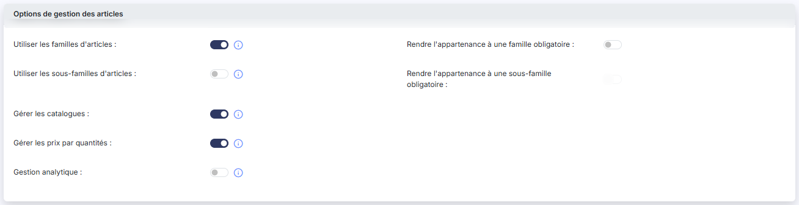

# Articles — paramètres


**Où le trouver :** Panneau **Paramètres** › **Gestion commerciale** › **Articles**



**En bref** — Cet écran rassemble les options de gestion de votre fichier des articles : familles, sous-familles, catalogues, prix par quantités, analytique. Réglez-les avant de créer vos articles.

* Pour utiliser les familles d'articles : activez l'interrupteur Utiliser les familles d'articles, puis bouton \[Enregistrer].


Cet écran s'ouvre depuis le panneau « Paramètres » : « Paramètres > Gestion commerciale > Articles ».

<figure><figcaption>
Écran « Articles » de la nouvelle interface
</figcaption></figure>

Il rassemble les choix de gestion qui s'appliquent à votre fichier des articles pour le dossier en cours. Ce sont eux qui déterminent la présence de plusieurs fichiers dans « Paramètres > Données > Tiers et commercial » et de plusieurs rubriques de la fiche article : commencez donc par ce paramétrage avant de créer vos articles.

L'écran ne comporte ni liste ni critère de recherche : un seul volet, intitulé « Options de gestion des articles », présenté sur deux colonnes. La colonne de gauche porte les cinq options principales, chacune suivie d'un pictogramme « Information » qui en rappelle l'objet ; la colonne de droite porte deux options complémentaires, placées en regard des deux premières lignes de gauche.

Toutes ces options sont des interrupteurs sans texte : activé ou désactivé. À la création d'un dossier, elles sont toutes désactivées.

Une option complémentaire reste affichée même lorsque l'option dont elle dépend est désactivée : elle apparaît alors grisée et vous ne pouvez pas la régler. La liste des options affichées ne varie donc jamais.

## Utiliser les familles d'articles

<figure><figcaption>
Rubrique « Utiliser les familles d'articles »
</figcaption></figure>

Le pictogramme « Information » indique : « Permet de regrouper les articles en fonction de leur nature. »

Si vous activez cet interrupteur, vous disposez du fichier des familles d'articles dans « Paramètres > Données > Tiers et commercial > Familles d'articles », et du champ « Famille » dans la fiche article. Vous pouvez alors effectuer des tris et des sélections sur ce critère.

## Rendre l'appartenance à une famille obligatoire

Cet interrupteur n'est réglable que si l'interrupteur « Utiliser les familles d'articles » est activé ; dans le cas contraire, elle reste affichée mais grisée. Elle n'a pas de pictogramme « Information ».

Si vous l'activez, vous ne pouvez plus enregistrer un article sans l'affecter à une famille.

## Utiliser les sous-familles d'articles

Le pictogramme « Information » indique : « Permet de subdiviser les familles d'articles en groupes plus précis. »

Les sous-familles s'ajoutent aux familles pour affiner le classement de vos articles ; la gestion des familles doit donc elle aussi être activée.

Tant que cet interrupteur est désactivé, l'écran « Paramètres > Données > Tiers et commercial > Sous-familles d'articles » n'affiche que le message « Vous n'avez pas activé la gestion des sous-familles. », sans liste ni bouton de création, et le champ « Sous-famille » n'apparaît pas dans vos fiches articles.

## Rendre l'appartenance à une sous-famille obligatoire

Cet interrupteur n'est réglable que si l'interrupteur « Utiliser les sous-familles d'articles » est activé ; dans le cas contraire, elle reste affichée mais grisée. Elle n'a pas de pictogramme « Information ».

Si vous l'activez, vous ne pouvez plus enregistrer un article sans l'affecter à une sous-famille.

## Gérer les catalogues

Le pictogramme « Information » indique : « Permet de gérer des catalogues d'articles avec des prix différents en fonction du type de vente. »

Un catalogue permet d'affecter à un même article des valeurs différentes selon le contexte de la vente : mode de calcul HT ou TTC, taux de TVA et prix de vente. À chaque client peut être affecté un catalogue par défaut.

Si vous activez cet interrupteur, vous disposez du fichier des catalogues dans « Paramètres > Données > Tiers et commercial > Catalogues », et la fiche article présente un onglet par catalogue.

## Gérer les prix par quantités

Le pictogramme « Information » indique : « Permet de définir un niveau de prix variable en fonction des quantités vendues. »

Si vous activez cet interrupteur, vous pouvez définir pour un article donné — et par catalogue si la gestion des catalogues est elle aussi activée — une série de prix s'appliquant selon la quantité indiquée dans la pièce commerciale. C'est ainsi que se gèrent les prix dégressifs. La fiche article présente alors le champ « Type de prix », qui permet de choisir entre un prix unique et des prix par quantités.

## Gestion analytique

Le pictogramme « Information » indique : « Permet de ventiler les opérations en comptabilité analytique. »

Tant que cet interrupteur est désactivé, aucune rubrique de ventilation analytique n'est proposée, ni dans la fiche article, ni dans les pièces commerciales.

## Bouton \[Enregistrer]

<figure><figcaption>
Bouton [Enregistrer]
</figcaption></figure>

C'est le seul bouton de l'écran, placé en bas à droite : il n'y a pas de bouton de retour. Il enregistre les sept options pour le dossier en cours.
