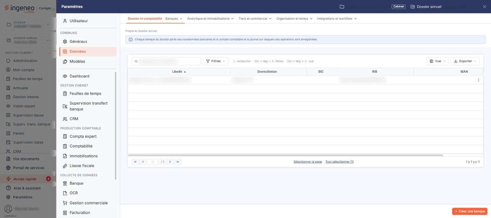
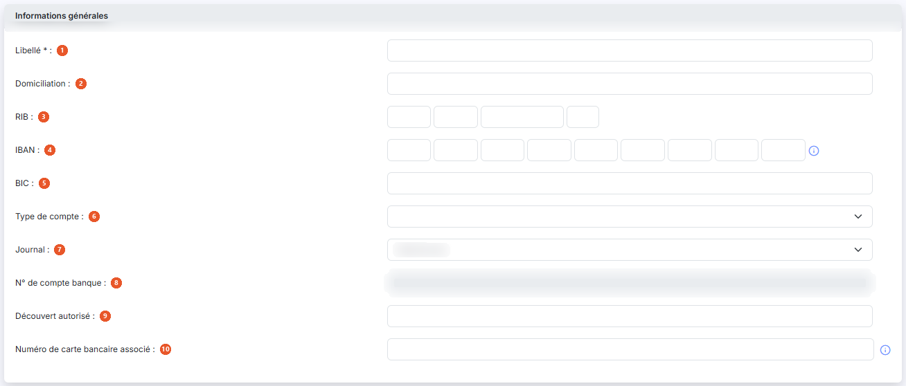
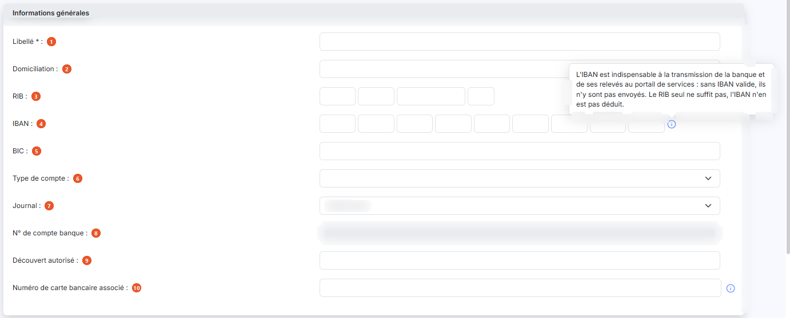
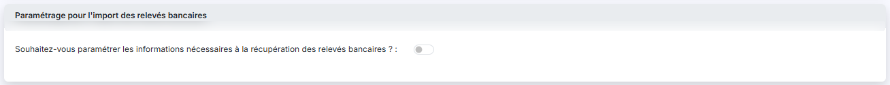
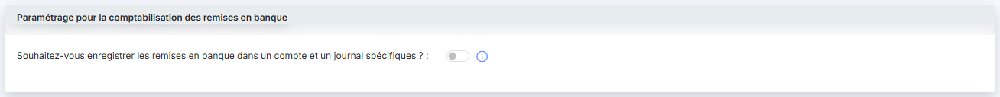
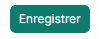

# Banques


**Où le trouver :** Panneau **Paramètres** › **Données** › **Dossier et comptabilité** › **Banques**



**En bref** — Ce fichier, commun à plusieurs modules, tient les banques de votre société. En gestion commerciale, il fait figurer vos coordonnées bancaires sur les pièces et les remises de chèques.

* Pour créer une banque : bouton \[Créer une banque], renseignez la fiche, puis bouton \[Enregistrer].


Le fichier « Banques » est utilisé dans plusieurs modules Ingeneo Compta (Comptabilité, Caisse, Gestion commerciale, etc.) et a plusieurs utilités (gestion des remises en banque, des virements SEPA, de la récupération automatique des écritures, etc.). Il est donc commun à tous les modules qui l'utilisent.

<figure><figcaption>
Écran « Banques » de la nouvelle interface
</figcaption></figure>

Pour ce qui concerne la facturation, il permet de faire figurer les coordonnées bancaires de votre société sur les pièces commerciales ainsi que sur les remises de chèques.

Les banques peuvent être créées manuellement dans ce fichier ou automatiquement lors du paramétrage des comptes dont vous souhaitez récupérer les écritures. Si la banque a été créée automatiquement, plusieurs de ses informations seront déjà renseignées.

Cet écran s'ouvre par le panneau « Paramètres » : rubrique « Données », groupe « Dossier et comptabilité », entrée « Banques ». Un bandeau bleu en haut de l'écran rappelle que chaque banque du dossier porte ses coordonnées bancaires, ainsi que le compte comptable et le journal sur lesquels ses opérations sont enregistrées.

L'écran présente la liste des banques du dossier, une ligne par banque, avec cinq colonnes : **Libellé**, **Domiciliation**, **BIC**, **RIB** et **IBAN**. Les cinq colonnes sont triables ; d'autres colonnes peuvent être ajoutées ou retirées à l'aide du bouton \[Vue].

Au-dessus de la liste, la barre « Rechercher une banque… » et les boutons \[Filtres], \[Vue] et \[Exporter] permettent de chercher une banque, de filtrer la liste, de personnaliser les colonnes et de l'imprimer ou de l'exporter.

Il n'y a pas de case à cocher : un clic sur une ligne la sélectionne, un second clic la désélectionne. Sous la liste, le lien « Sélectionner la page » sélectionne toutes les lignes affichées et le lien « Tout sélectionner (10) » étend la sélection à toutes les pages (le nombre entre parenthèses est celui des banques de la liste). Tant qu'une ligne est sélectionnée, un bandeau « 1 banque sélectionnée » avec le lien « Tout désélectionner » et le bouton \[Supprimer] remplace le bouton de création.

Au survol d'une ligne, le pictogramme « Autres actions » (trois points verticaux) apparaît à droite de la ligne. Il ouvre deux entrées : « Modifier », qui ouvre la fiche de la banque, et « Supprimer », qui la supprime.

Le relevé d'identité bancaire et l'IBAN figurent en clair dans cette liste comme dans la fiche : soyez attentif aux impressions et aux exports que vous en faites.

bouton **\[Créer une banque]**

Il est en bas à droite de l'écran, hors de la liste, et ouvre une fiche vierge pour créer une banque manuellement.

bouton **\[Supprimer]**

Il se trouve dans le bandeau de sélection et supprime les banques sélectionnées dans la liste.

La fiche d'une banque comporte trois rubriques, présentées ci-dessous dans leur ordre d'affichage. La première est toujours affichée en entier ; les deux autres ne présentent au départ qu'une question assortie d'un interrupteur, et ne déplient leurs champs que si vous activez cet interrupteur.

## Rubrique « Informations générales »

<figure><figcaption>
Rubrique « Informations générales »
</figcaption></figure>

<figure><figcaption>
Rubrique « Informations générales »
</figcaption></figure>

| Champ                                    | Ce qu'il faut savoir                                                                                                                                                                                                                                                                                                                                                                                                                                                                                                     |
| ---------------------------------------- | ------------------------------------------------------------------------------------------------------------------------------------------------------------------------------------------------------------------------------------------------------------------------------------------------------------------------------------------------------------------------------------------------------------------------------------------------------------------------------------------------------------------------ |
| 1. **Libellé**                           | Champ obligatoire. Il permet de différencier les différentes banques entre elles, il doit donc être unique.                                                                                                                                                                                                                                                                                                                                                                                                              |
| 2. **Domiciliation**                     | —                                                                                                                                                                                                                                                                                                                                                                                                                                                                                                                        |
| 3. **RIB**                               | Il se saisit en quatre zones accolées : code banque, code guichet, numéro de compte et clé.                                                                                                                                                                                                                                                                                                                                                                                                                              |
| 4. **IBAN**                              | Il se saisit en plusieurs zones accolées, à la suite du code pays. Un pictogramme d'information, à droite des cases de l'IBAN, rappelle par son infobulle que l'IBAN est indispensable à la transmission de la banque et de ses relevés au portail de services : sans IBAN valide, ils n'y sont pas envoyés, et le RIB seul ne suffit pas, l'IBAN n'en étant pas déduit.                                                                                                                                                 |
| 5. **BIC**                               | —                                                                                                                                                                                                                                                                                                                                                                                                                                                                                                                        |
| 6. **Type de compte**                    | Le sélecteur propose une nature de compte : compte chèque, compte de dépôt, compte épargne, compte joint, compte titres, carte bancaire, emprunt, ainsi que différents produits d'épargne salariale et d'assurance.                                                                                                                                                                                                                                                                                                      |
| 7. **Journal**                           | Le sélecteur ne propose que les journaux **de type banque** du dossier, sous la forme « Code - Libellé ». C'est le journal dans lequel seront enregistrées les écritures relatives à cette banque.                                                                                                                                                                                                                                                                                                                       |
| 8. **N° de compte banque**               | Cette zone n'est pas saisissable. Il s'agit du numéro de compte banque associé au journal, que le logiciel reprend depuis le fichier « Journaux ».                                                                                                                                                                                                                                                                                                                                                                       |
| 9. **Découvert autorisé**                | 
Ce montant peut être utilisé dans les indicateurs ou dans les alertes du module Vision. <strong>Date de création</strong>, <strong>Créée par</strong>, <strong>Date de modification</strong> et <strong>Modifiée par</strong> : ces quatre zones ne sont pas saisissables. Le logiciel y indique quand la fiche a été créée et modifiée pour la dernière fois, et par qui. Ces quatre zones n'apparaissent qu'en modification : la fiche que vous ouvrez par le bouton [Créer une banque] ne les présente pas.
 |
| 10. **Numéro de carte bancaire associé** | Le pictogramme « Information » placé à côté du champ précise que ce numéro est notamment utile en cas d'import de fichier OFX — un relevé de carte bancaire n'étant pas identifié par un numéro de compte, c'est ce numéro de carte qui permet de rattacher les lignes à la bonne banque.                                                                                                                                                                                                                                |

## Rubrique « Paramétrage pour l'import des relevés bancaires »

<figure><figcaption>
Rubrique « Paramétrage pour l'import des relevés bancaires »
</figcaption></figure>

Cette rubrique ne présente au départ qu'une question : **Souhaitez-vous paramétrer les informations nécessaires à la récupération des relevés bancaires ?**

Si ce compte banque est utilisé pour la récupération automatique des relevés bancaires, vous devez impérativement activer l'interrupteur de cette question. Le logiciel affiche alors quatre informations supplémentaires.

| Champ                                  | Ce qu'il faut savoir                                                                                                                                                                                                                                                                                                                                                                                                                                                         |
| -------------------------------------- | ---------------------------------------------------------------------------------------------------------------------------------------------------------------------------------------------------------------------------------------------------------------------------------------------------------------------------------------------------------------------------------------------------------------------------------------------------------------------------- |
| **Date de début de récupération**      | Cette zone n'est pas saisissable. Son pictogramme « Information » précise qu'il s'agit de la date que vous avez indiquée lors du premier import pour cette banque.                                                                                                                                                                                                                                                                                                           |
| **Date de dernière récupération**      | Cette zone n'est pas saisissable. Son pictogramme « Information » précise qu'il s'agit de la date de la dernière récupération d'écriture automatique, ou de la date de la dernière demande d'import manuel.                                                                                                                                                                                                                                                                  |
| **Compte d'attente**                   | Dès que vous avez activé l'interrupteur. Entrez le numéro de compte qui sera affecté à toutes les lignes de contrepartie des lignes d'écritures de banque pour lesquelles aucune règle de traduction n'a été prévue. Ainsi les écritures seront bien générées et vous devrez les reclasser dans le logiciel de comptabilité. Vous pouvez saisir directement le numéro, le rechercher à l'aide du pictogramme « Loupe », ou créer le compte à l'aide du pictogramme « Plus ». |
| **Référence par défaut des écritures** | Entrez la référence par défaut qui sera affectée à toutes les écritures ventilées dans le compte d'attente.                                                                                                                                                                                                                                                                                                                                                                  |

## Rubrique « Paramétrage pour la comptabilisation des remises en banque »

<figure><figcaption>
Rubrique « Paramétrage pour la comptabilisation des remises en banque »
</figcaption></figure>

<figure><figcaption>
Bouton [Enregistrer]
</figcaption></figure>

Cette rubrique ne présente au départ qu'une question : **Souhaitez-vous enregistrer les remises en banque dans un compte et un journal spécifiques ?**

Son pictogramme « Information » vous l'explique ainsi : si vous répondez « Non », les remises en banque saisies dans la saisie de caisse et les paiements SEPA seront enregistrées dans le compte et le journal de la banque ; si vous répondez « Oui », il vous faut paramétrer le compte comptable et le journal dans lesquels ces opérations seront comptabilisées. Le logiciel affiche alors deux champs, tous deux obligatoires.

| Champ            | Ce qu'il faut savoir                                                                                                                                                               |
| ---------------- | ---------------------------------------------------------------------------------------------------------------------------------------------------------------------------------- |
| **N° de compte** | Vous pouvez saisir directement le numéro, le rechercher à l'aide du pictogramme « Loupe », ou créer le compte à l'aide du pictogramme « Plus ».                                    |
| **Journal**      | Le sélecteur propose ici un choix plus large que celui de la première rubrique : les journaux **de type banque, caisse et opérations diverses**, sous la forme « Code - Libellé ». |

A quoi sert ce paramétrage ? Les remises en banque sont enregistrées par défaut dans le compte banque associé au journal. Mais si vous récupérez aussi vos relevés bancaires automatiquement, vous allez récupérer une nouvelle fois les écritures de remise en banque.

Pour éviter cette double comptabilisation, vous avez la possibilité de paramétrer un autre compte (compte de transit) et un autre journal d'intégration des écritures de remise en banque.

Ainsi, quand vous validerez une remise en banque, les comptes clients seront crédités et le compte de transit sera débité du total. Quand vous récupérerez l'écriture de remise en banque depuis le relevé, la contrepartie de votre banque devra être enregistrée dans le compte de transit.

bouton **\[Enregistrer]**

Enregistre la fiche de la banque et vous ramène à la liste.

**Retour à la liste**

Le bouton \[Retour] est masqué dans la fiche : le chevron « Retour », à gauche de la barre d'onglets du panneau, revient à la liste sans enregistrer les modifications en cours.
