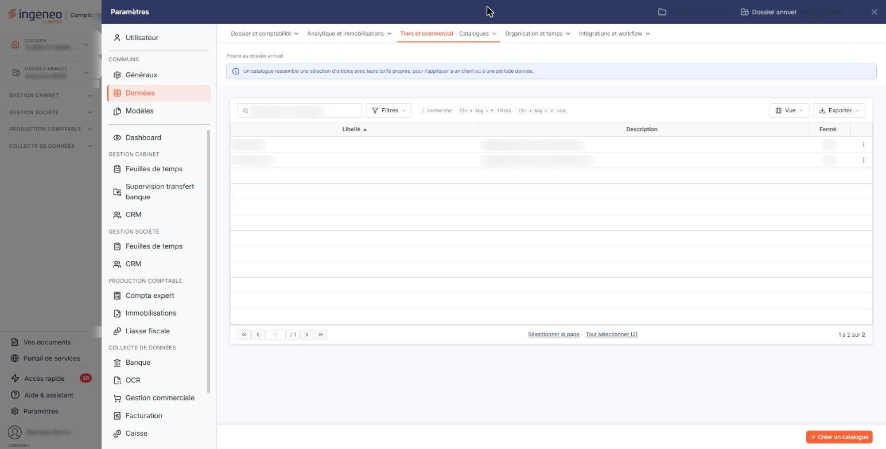
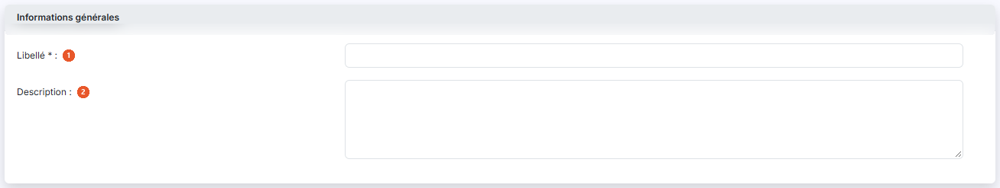

# Catalogues


**Où le trouver :** Panneau **Paramètres** › **Données** › **Tiers et commercial** › **Catalogues**



**En bref** — Les catalogues permettent d'appliquer des prix de vente différents selon le contexte de la vente : nature du client, promotions. Un catalogue peut être fermé puis rouvert à tout moment.

* Pour créer un catalogue : bouton \[Créer un catalogue], renseignez son libellé, puis bouton \[Enregistrer].


Cet écran s'ouvre depuis le panneau « Paramètres » : « Paramètres > Données > Tiers et commercial > Catalogues ».

<figure><figcaption>
Écran « Catalogues » de la nouvelle interface
</figcaption></figure>

Les catalogues permettent d'affecter des prix de vente différents aux articles en fonction du contexte de la vente : nature du client, promotions, etc. Vous avez la possibilité de les fermer et de les rouvrir à tout moment pour en contrôler l'utilisation.

Pour utiliser les catalogues, il faut les activer dans le panneau « Paramètres » : « Paramètres > Gestion commerciale > Articles ». Activez l'interrupteur « Gérer les catalogues ».

Dans chaque fiche article, vous pouvez définir un prix de l'article pour chaque catalogue créé.

Pour chaque client, vous pouvez affecter un catalogue de prix par défaut ; ce sont les prix de ce catalogue qui seront systématiquement affectés lors de la réalisation de toute pièce commerciale (devis, factures, etc.) pour ce client.

L'écran présente la liste des catalogues du dossier, une ligne par catalogue, avec trois colonnes : **Libellé**, **Description** et **Fermé**, cette dernière indiquant Oui ou Non. Les trois colonnes sont triables ; la liste est triée par défaut sur le libellé, par ordre croissant.

Au-dessus de la liste, la barre « Rechercher un catalogue… » et le bouton \[Filtres] permettent de restreindre l'affichage. Le bouton \[Vue] permet de choisir les colonnes affichées et d'enregistrer des vues, et le bouton \[Exporter] donne accès à l'aperçu, à l'impression et aux exports de la liste. Sous la liste, « Sélectionner la page » et « Tout sélectionner (N) » étendent la sélection à la page affichée ou à tous les catalogues.

Un clic sur une ligne la sélectionne. Au survol d'une ligne, un pictogramme « Autres actions » (trois points) apparaît à son extrémité droite et ouvre un menu à trois entrées : « Modifier » pour modifier le catalogue, « Dupliquer » pour le dupliquer et « Supprimer » pour le supprimer. La duplication reprend les informations du catalogue d'origine dans une nouvelle fiche que vous complétez avant de l'enregistrer.

bouton **\[Créer un catalogue]**

Situé dans la barre du bas, à droite, hors du tableau, il ouvre une fiche vierge pour créer un nouveau catalogue.

bouton **\[Supprimer]**

Il apparaît dans le bandeau de sélection, qui s'affiche au bas de l'écran dès qu'une ligne est sélectionnée (« 1 catalogue sélectionné », avec le lien « Tout désélectionner ») et remplace alors la barre où figure \[Créer un catalogue]. Il supprime les catalogues sélectionnés.

## Rubrique « Informations générales »

<figure><figcaption>
Rubrique « Informations générales »
</figcaption></figure>

La fiche d'un catalogue ne comporte que cette rubrique, et son contenu n'est pas le même à la création et à la modification.

A la création, la fiche présente deux champs :

| Champ               | Ce qu'il faut savoir                                                                                                                                               |
| ------------------- | ------------------------------------------------------------------------------------------------------------------------------------------------------------------ |
| 1. **Libellé**      | C'est ce libellé qui figurera dans les fiches articles et dans le sélecteur de choix pour l'affectation aux clients.                                               |
| 2. **Description**  | 
Facultative. Elle est reprise dans la colonne « Description » de la liste. En modification, la fiche présente les mêmes deux champs, plus un troisième :
 |
| **Catalogue fermé** | Interrupteur, désactivé pour un catalogue ouvert. Il ne se règle donc que sur un catalogue déjà enregistré : un catalogue nouvellement créé est toujours ouvert.   |

Le champ **Libellé** n'est plus modifiable en modification : il apparaît grisé. Le libellé d'un catalogue se fixe donc à la création.

bouton **\[Enregistrer]**

Enregistre le catalogue et vous ramène à la liste.

**Retour à la liste**

Le bouton \[Retour] n'est plus affiché dans la fiche : la flèche « Retour » (chevron), à gauche de la barre d'onglets du panneau, revient à la liste sans enregistrer les modifications en cours.
