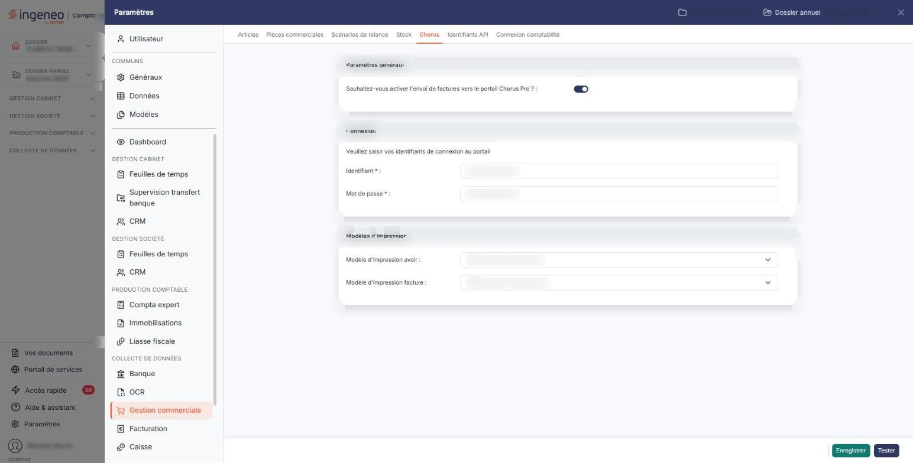
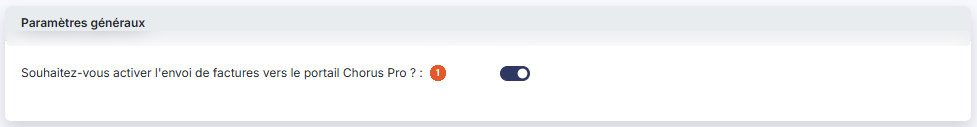
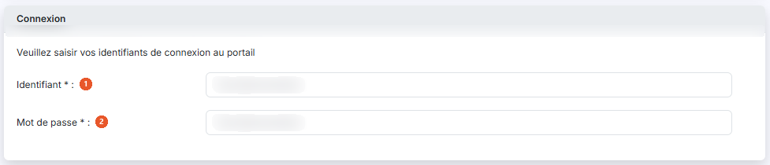
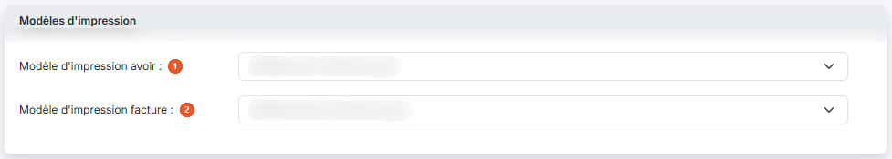
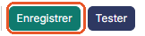
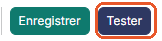

# Chorus — paramètres


**Où le trouver :** Panneau **Paramètres** › **Gestion commerciale** › **Chorus**



**En bref** — Cet écran paramètre l'envoi de vos factures et avoirs vers le portail Chorus Pro : activation pour la société, identifiants de connexion et modèles d'impression des documents transmis.

* Pour activer l'envoi : activez l'interrupteur Souhaitez-vous activer l'envoi de factures vers le portail Chorus Pro ?, renseignez les identifiants, puis bouton \[Enregistrer].


Cette option vous permet de paramétrer l'envoi de vos factures et de vos avoirs vers le portail Chorus Pro, la plateforme de facturation des marchés publics. Vous y indiquez si l'envoi est actif pour la société, les identifiants avec lesquels le logiciel se connecte au portail, et les modèles d'impression employés pour les documents transmis.

<figure><figcaption>
Écran « Chorus » de la nouvelle interface
</figcaption></figure>

Il n'y a qu'un seul jeu de paramètres par société : cet écran ne présente donc pas de liste, mais un formulaire que vous complétez puis enregistrez.

Deux conditions doivent être remplies avant de venir sur cet écran : le cabinet doit avoir ouvert le connecteur « Chorus Pro » dans le module « Supervision datas », et vous devez disposer d'un compte Chorus Pro ainsi que d'un compte technique Chorus Pro créés sur le portail. Reportez-vous au chapitre « Chorus Pro », option « Activation de Chorus Pro », pour le détail de ces préalables, et à l'option « Utilisation de Chorus Pro » pour l'envoi et le suivi des factures.

Cet écran se trouve dans le panneau « Paramètres » : rubrique « Gestion commerciale », puis onglet « Chorus ».

## Rubrique « Paramètres généraux »

<figure><figcaption>
Rubrique « Paramètres généraux »
</figcaption></figure>

**Souhaitez-vous activer l'envoi de factures vers le portail Chorus Pro ?** : interrupteur sans texte, activé ou désactivé. Il commande l'envoi des documents vers le portail pour la société en cours ; il est activé à l'ouverture lorsque l'envoi est déjà actif pour la société. L'interrupteur porte toujours l'une de ses deux positions : il n'y a pas de réponse vide possible, et donc aucun message d'obligation sur ce champ. Si vous le désactivez, les deux rubriques suivantes sont masquées : il n'y a rien d'autre à paramétrer.

## Rubrique « Connexion »

<figure><figcaption>
Rubrique « Connexion »
</figcaption></figure>

Le logiciel affiche en tête de cette rubrique l'invitation « Veuillez saisir vos identifiants de connexion au portail ».


Attention : ces identifiants sont ceux du **compte technique** que vous avez créé au préalable sur le portail Chorus Pro, et non ceux de votre compte utilisateur. Le logiciel ne les crée pas et ne peut pas les retrouver à votre place.


| Champ               | Ce qu'il faut savoir                                                            |
| ------------------- | ------------------------------------------------------------------------------- |
| 1. **Identifiant**  | 80 caractères au maximum. C'est le compte utilisé pour se connecter au portail. |
| 2. **Mot de passe** | 50 caractères au maximum. C'est le mot de passe associé à cet identifiant.      |

Ces deux champs portent à l'écran l'astérisque qui signale un champ obligatoire.

## Rubrique « Modèles d'impression »

<figure><figcaption>
Rubrique « Modèles d'impression »
</figcaption></figure>

Ces deux listes déroulantes déterminent la présentation des documents transmis au portail. Chacune vous propose les modèles d'impression créés pour la société, précédés d'une entrée « Sélectionnez » qui vous permet de n'en choisir aucun.

| Champ                              | Ce qu'il faut savoir          |
| ---------------------------------- | ----------------------------- |
| 1. **Modèle d'impression avoir**   | Modèle appliqué aux avoirs.   |
| 2. **Modèle d'impression facture** | Modèle appliqué aux factures. |

Ces modèles peuvent être les mêmes que ceux que vous employez habituellement, à une réserve près : ils ne doivent pas contenir de fichier « image », un logo par exemple, car Chorus Pro ne les accepte pas.

## Bouton \[Enregistrer]

<figure><figcaption>
Bouton [Enregistrer]
</figcaption></figure>

Placé dans la barre du bas, à droite de l'écran, il valide le paramétrage saisi pour la société en cours.

## Bouton \[Tester]

<figure><figcaption>
Bouton [Tester]
</figcaption></figure>

Placé à côté de \[Enregistrer], il vérifie que le logiciel parvient à se connecter au portail Chorus Pro.

Ces deux boutons peuvent ne pas apparaître selon les droits attachés à votre profil.
