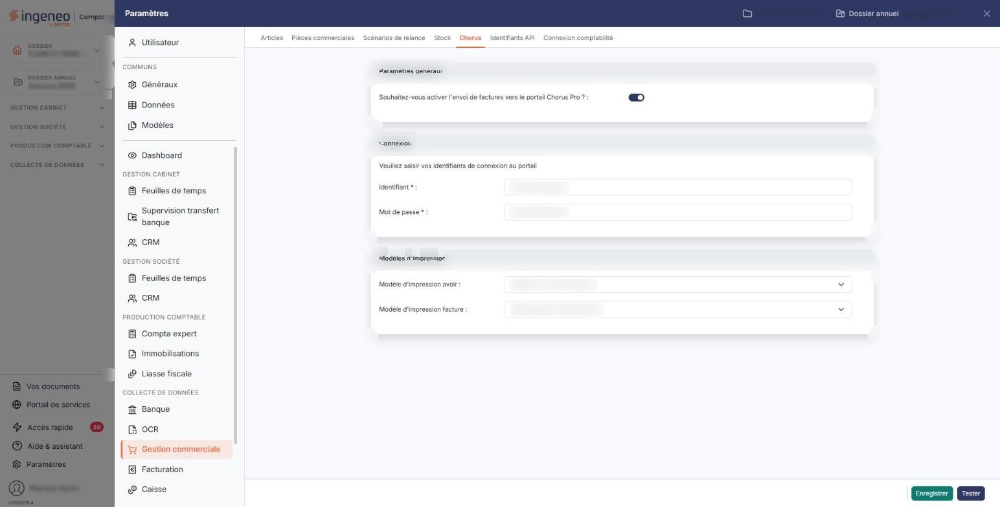
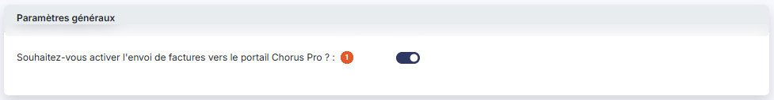
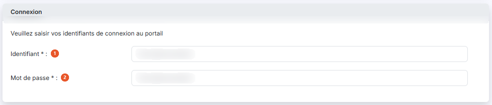
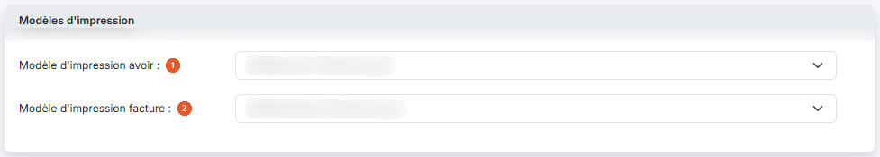

# Chorus — utilisation


**Où le trouver :** Panneau **Paramètres** › **Gestion commerciale** › **Chorus**



**En bref** — Cette page décrit comment adresser vos factures et avoirs validés au portail Chorus Pro, puis en suivre le traitement, une fois le paramétrage réalisé.

* Pour désigner plusieurs clients destinataires à la fois : depuis la liste des clients, bouton \[Modification groupée].
* Pour transmettre une facture validée : bouton \[Envoyer vers Chorus Pro] en bas de la pièce, puis bouton \[Envoyer].


Cette option décrit ce que vous faites, une fois le paramétrage réalisé, pour adresser vos factures et vos avoirs au portail Chorus Pro et en suivre le traitement. Si le paramétrage n'est pas encore fait, reportez-vous à l'option « Activation de Chorus Pro ».

<figure><figcaption>
Écran « Chorus » de la nouvelle interface
</figcaption></figure>

À partir d'ici, la notion de client ne désigne plus les clients du cabinet, mais les clients facturés par le module « Facturation » ou « Gestion commerciale ».

## Identification des destinataires potentiels

Pour chacun des clients à qui vous souhaitez adresser des factures via Chorus Pro, ouvrez la fiche du client et, dans la rubrique « Chorus Pro », répondez « Oui » à la question « Indiquez si les factures et avoirs de ce client peuvent être adressés via le portail Chorus Pro ? ». La réponse est « Non » par défaut.

Vous pouvez également porter cette réponse sur plusieurs clients à la fois, depuis la liste des clients, à l'aide du bouton **\[Modification groupée]**.

Pour que l'envoi soit possible, il faut aussi que le **N° de Siret** soit renseigné dans l'adresse du client qui sera retenue comme destinataire de la facture.

La rubrique « Chorus Pro » de la fiche client n'apparaît que si l'envoi vers le portail a été activé pour la société.

## Envoi des factures à Chorus Pro

Lorsque vous avez validé une facture, ou un avoir, pour un client concerné par Chorus Pro, vous disposez, en bas de la pièce, du bouton **\[Envoyer vers Chorus Pro]**. Il n'apparaît pas sur une pièce encore au brouillon : la validation est un préalable.

Ce bouton peut ne pas vous apparaître selon les droits attachés à votre profil : adressez-vous alors à l'administrateur de votre logiciel.

## Suivi des factures envoyées à Chorus Pro

Pour toutes les pièces commerciales — factures et avoirs — envoyées à Chorus Pro, vous pouvez suivre le statut correspondant au stade de traitement par le portail et par le destinataire.

Dans la rubrique « Paiement » de la pièce figure le champ **Statut Chorus Pro :**, que le logiciel renseigne lui-même et que vous ne pouvez pas modifier. Il indique le statut qu'avait la pièce lors de la dernière consultation du portail.

La consultation de Chorus Pro se fait à l'aide du pictogramme « Œil » placé à droite de ce champ, dont l'infobulle indique « Visualiser l'historique des statuts Chorus Pro ». Il affiche, de plus, l'historique du traitement de la pièce.

## Autres vues de l'écran

<figure><figcaption>
Paramètres généraux
</figcaption></figure>

<figure><figcaption>
Connexion
</figcaption></figure>

<figure><figcaption>
Modèles d'impression
</figcaption></figure>
