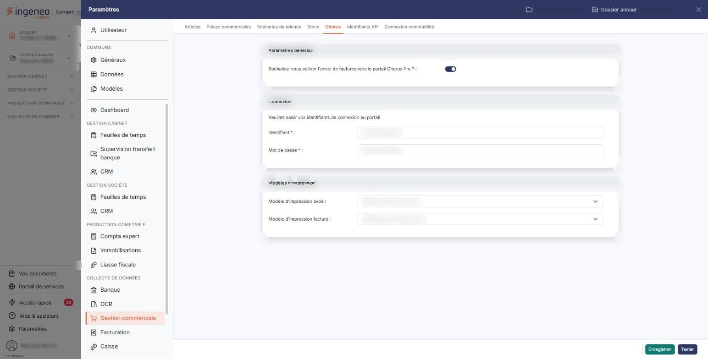
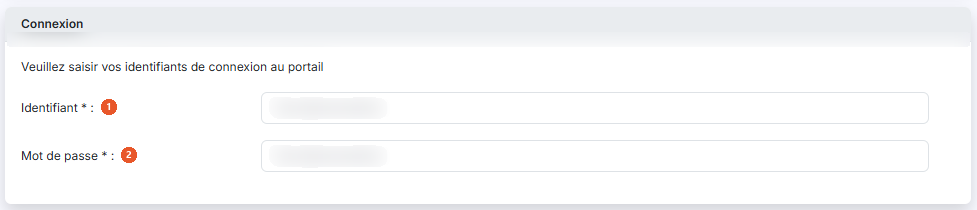
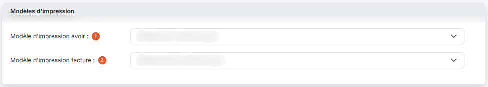
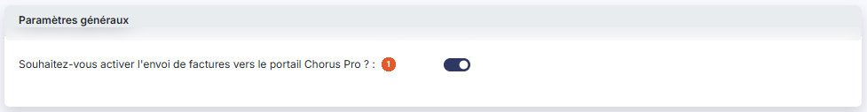

# Chorus — activation


**Où le trouver :** Panneau **Paramètres** › **Gestion commerciale** › **Chorus**



**En bref** — Cette page décrit les paramétrages à effectuer, par le cabinet puis pour chaque société gérée, pour communiquer avec le portail Chorus Pro des marchés publics.

* Pour ouvrir l'API côté cabinet : module « Supervision datas », menu « Connecteurs », bouton \[Nouveau], puis choisissez l'option « Chorus Pro ».


Les modules « Facturation » et « Gestion commerciale » peuvent communiquer avec le portail Chorus Pro, la plateforme de facturation des marchés publics.

<figure><figcaption>
Écran « Chorus » de la nouvelle interface
</figcaption></figure>

Pour ce faire, un certain nombre de paramétrages doivent être effectués dans différents modules, par le cabinet d'abord, puis pour chacune de ses sociétés gérées.

## Activation de l'API pour chaque client du cabinet (société gérée)

<figure><figcaption>
Rubrique « Connexion »
</figcaption></figure>

<figure><figcaption>
Rubrique « Modèles d'impression »
</figcaption></figure>

Une fois l'API activée par le cabinet, chaque client (société gérée) qui souhaite s'en servir doit lui aussi l'activer, afin de renseigner ses propres informations.

Avant de pouvoir connecter l'API, vous devez avoir créé un compte Chorus Pro et un compte technique Chorus Pro. Pour créer ces deux comptes, consultez les informations aux adresses suivantes :

Compte Chorus Pro : https://communaute.chorus-pro.gouv.fr/documentation/creer-un-compte-utilisateur-et-sauthentifier/

Compte technique Chorus Pro : https://communaute.chorus-pro.gouv.fr/documentation/creation-dun-compte-technique-pour-un-acces-api-en-production/#1507810474441-5a4906aa-1dca

Pour chaque client du cabinet (société gérée), un utilisateur — collaborateur du cabinet ou utilisateur de la société gérée — doit ensuite activer l'API Chorus Pro :

* ouvrez le panneau « Paramètres », puis la rubrique « Facturation » ou « Gestion commerciale »,
* choisissez l'onglet « Chorus »,
* activez l'interrupteur de la question qui vous demande si vous souhaitez activer l'envoi de factures vers le portail Chorus Pro,
* saisissez vos identifiants de connexion au portail,
* indiquez quels modèles d'impression seront employés pour les factures et les avoirs envoyés,
* enregistrez.

Le détail de chacun de ces champs, ainsi que les précautions à prendre sur le choix des identifiants et des modèles d'impression, figurent dans le panneau « Paramètres », onglet « Chorus » des rubriques « Facturation » et « Gestion commerciale ».

Une fois ce paramétrage enregistré, reportez-vous à l'option « Utilisation de Chorus Pro » pour désigner les clients concernés, envoyer vos factures et en suivre le traitement.

## Autres vues de l'écran

<figure><figcaption>
Paramètres généraux
</figcaption></figure>
