# Clients


**Où le trouver :** Panneau **Paramètres** › **Données** › **Tiers et commercial** › **Clients**



**En bref** — Cet écran tient le fichier des clients, commun à plusieurs modules d'Ingeneo Compta : identification, adresses, informations comptables, facturation, relances et coordonnées bancaires de chaque client.

* Pour créer un client : bouton \[Créer un client], en bas à droite de l'écran, puis complétez les rubriques de la fiche.
* Pour remplir la fiche à partir du numéro de Siren : saisissez le N° de Siren, puis bouton \[Lire Siren].
* Pour retrouver un client archivé : bouton \[Filtres spéciaux], puis activez l'interrupteur « Inclure les clients archivés ».


Le fichier « Clients » est commun à plusieurs modules d'Ingeneo Compta. Ainsi, où que vous ayez créé ou modifié un client, il sera visible de la même manière dans tous les modules.

<figure>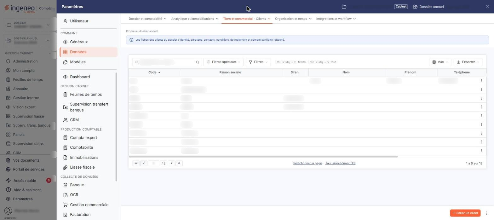<figcaption>
Écran « Clients » de la nouvelle interface
</figcaption></figure>

Un client ne peut être supprimé s'il a été affecté à une pièce commerciale.

C'est la fiche la plus riche du module : elle est organisée en onze rubriques qui se présentent l'une sous l'autre, sans onglet, dans l'ordre suivant : « Identification », « Adresses », « Informations comptables », « Informations générales », « Facturation », « Gestion analytique », « Relances », « Coordonnées bancaires », « Documents », « Editions » et « Chorus Pro ». Vous retrouvez ces mêmes rubriques, dans le même ordre, en création comme en modification.

## La liste des clients et ses filtres

La liste présente sept colonnes : **Code**, **Raison sociale**, **Siren**, **Nom**, **Prénom**, **Téléphone** et **E-mail pro.** Elle est triée par défaut sur le code du client, dans l'ordre croissant.

Au-dessus de la liste, la barre « Rechercher un client… » permet de retrouver un client ; le bouton \[Filtres spéciaux] ouvre un menu qui porte l'interrupteur « Inclure les clients archivés », désactivé lorsque l'écran s'ouvre : les clients que vous avez archivés ne figurent donc PAS dans la liste que vous voyez en arrivant, et vous devez l'activer pour les faire réapparaître. Le bouton \[Filtres] ouvre le volet de filtres. Il n'y a plus de bouton \[Afficher] : la liste se recharge dès que vous modifiez un critère, et le lien « Tout effacer » apparaît à côté de \[Filtres] lorsqu'un critère est posé. L'écran porte la mention « Propre au dossier annuel » et un bandeau d'information qui rappelle l'objet du fichier.

Un clic sur une ligne la sélectionne. Au survol, la ligne porte en fin de ligne un pictogramme « Autres actions » (trois points), qui ouvre un menu de deux entrées : « Modifier » ouvre la fiche du client en modification et « Supprimer » le supprime. Sous la liste, les liens « Sélectionner la page » et « Tout sélectionner » permettent d'étendre la sélection ; le bouton \[Vue], à droite au-dessus de la liste, ouvre le menu des vues et des colonnes affichées, qui permet d'afficher d'autres informations que les sept colonnes proposées par défaut ; le bouton \[Exporter] ouvre le menu d'aperçu, d'impression et d'export de la liste.

## Rubrique « Identification »

<figure>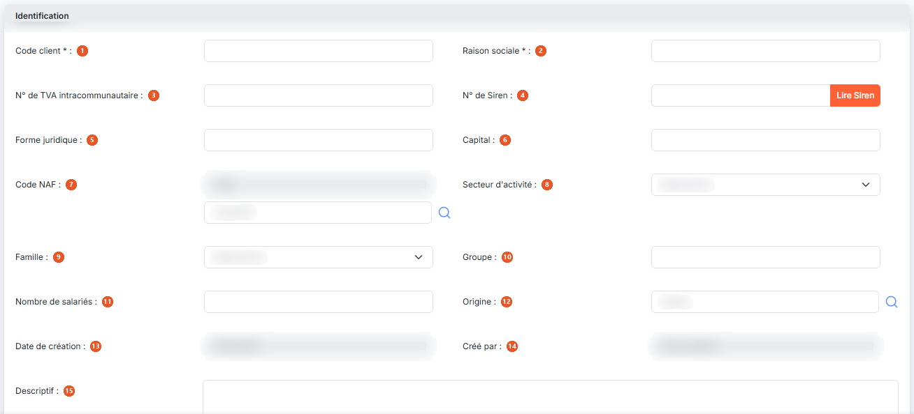<figcaption>
Rubrique « Identification »
</figcaption></figure>

<figure>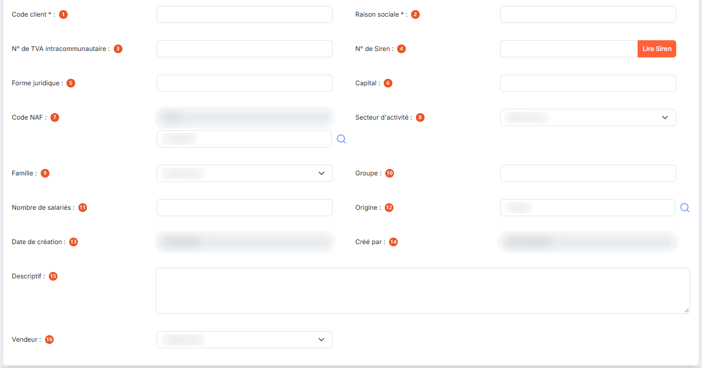<figcaption>
Rubrique « Identification »
</figcaption></figure>

| Champ                               | Ce qu'il faut savoir                                                                                                                                                                                                                                                                                                                               |
| ----------------------------------- | -------------------------------------------------------------------------------------------------------------------------------------------------------------------------------------------------------------------------------------------------------------------------------------------------------------------------------------------------- |
| 1. **Code client**                  | Il doit être unique. Les caractères autorisés sont les lettres majuscules et les chiffres. Vous ne le saisissez qu'à la création : lorsque vous ouvrez un client existant, ce champ n'est plus modifiable.                                                                                                                                         |
| 2. **Raison sociale**               | —                                                                                                                                                                                                                                                                                                                                                  |
| 3. **N° de TVA intracommunautaire** | —                                                                                                                                                                                                                                                                                                                                                  |
| 4. **N° de Siren**                  | —                                                                                                                                                                                                                                                                                                                                                  |
| 5. **Forme juridique**              | Facultative.                                                                                                                                                                                                                                                                                                                                       |
| 6. **Capital**                      | —                                                                                                                                                                                                                                                                                                                                                  |
| 7. **Code NAF**                     | Ce champ est double : le code proprement dit, que vous ne saisissez pas directement, et son libellé, avec une loupe qui vous permet de choisir le code dans la nomenclature.                                                                                                                                                                       |
| 8. **Secteur d'activité**           | Liste déroulante des secteurs paramétrés pour la société, gérés dans le panneau Paramètres, rubrique « Données », groupe « Tiers et commercial », onglet « Secteurs d'activité ».                                                                                                                                                                  |
| 9. **Famille**                      | Facultative. Liste déroulante des familles paramétrées pour la société, gérées dans le panneau Paramètres, rubrique « Données », groupe « Tiers et commercial », onglet « Familles de clients ».                                                                                                                                                   |
| 10. **Groupe**                      | —                                                                                                                                                                                                                                                                                                                                                  |
| 11. **Nombre de salariés**          | —                                                                                                                                                                                                                                                                                                                                                  |
| 12. **Origine**                     | Facultative, choisie à l'aide d'une loupe.                                                                                                                                                                                                                                                                                                         |
| 13. **Date de création**            | Renseignée automatiquement, non modifiable. C'est la date de création de la fiche client ; en création, elle est préremplie au jour courant.                                                                                                                                                                                                       |
| 14. **Créé par**                    | Renseigné automatiquement, non modifiable. C'est le nom de l'utilisateur ayant créé la fiche client ; en création, il est prérempli avec votre nom.                                                                                                                                                                                                |
| 15. **Descriptif**                  | Zone de texte.                                                                                                                                                                                                                                                                                                                                     |
| 16. **Vendeur**                     | Liste déroulante des vendeurs paramétrés pour la société. S'il est renseigné, il sera proposé par défaut dans les pièces commerciales où il restera modifiable.                                                                                                                                                                                    |
| **Bouton \[Lire Siren]**            | Placé à droite du numéro de Siren, il permet, grâce à une API, de remplir plusieurs champs de la fiche : le numéro de TVA intracommunautaire, la forme juridique, le capital, le code NAF, le nombre de salariés, l'activité (renseignée dans le champ **Descriptif**), l'adresse avec le libellé « Adresse principale » suivi du numéro de Siren. |

## Rubrique « Adresses »

<figure>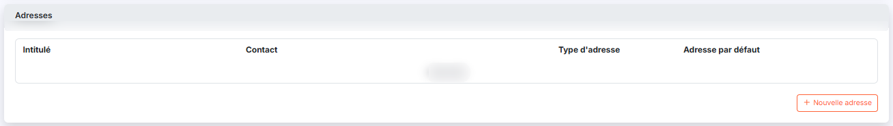<figcaption>
Rubrique « Adresses »
</figcaption></figure>

<figure>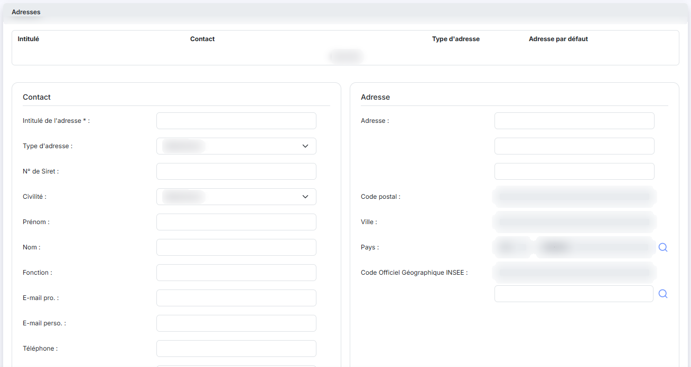<figcaption>
Rubrique « Adresses »
</figcaption></figure>

<figure>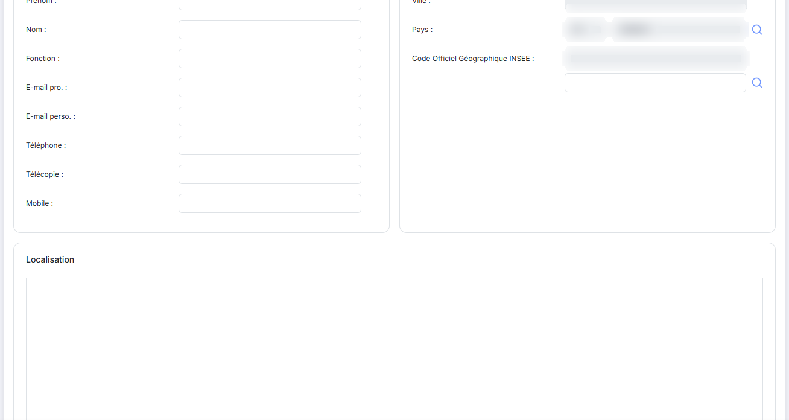<figcaption>
Rubrique « Adresses »
</figcaption></figure>

<figure>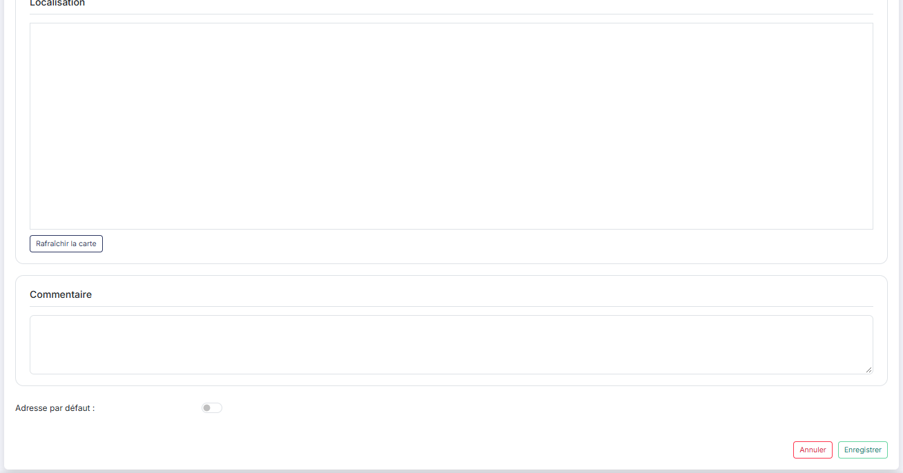<figcaption>
Rubrique « Adresses »
</figcaption></figure>

Une fiche client peut contenir autant d'adresses que vous le souhaitez. La liste des adresses présente quatre colonnes : **Intitulé**, **Contact**, **Type d'adresse** et **Adresse par défaut**. Tant qu'aucune adresse n'a été créée, la mention « Liste vide » s'affiche à la place des lignes.

Lorsque vous indiquez qu'une adresse est l'adresse par défaut, c'est elle qui sera affectée lors de la création de toute nouvelle pièce commerciale.

Les adresses sont communes aux fichiers clients et comptes auxiliaires.

Le bouton **\[Nouvelle adresse]** de la rubrique (son libellé est précédé d'un « + ») déplie sous la liste le formulaire d'une adresse vierge. Il ne s'agit pas d'une fenêtre : la saisie se fait dans la fiche elle-même.

Le formulaire d'une adresse comporte les champs suivants :

| Champ                                                        | Ce qu'il faut savoir                                                                                                                                                                                                                                                                                                                                                                                 |
| ------------------------------------------------------------ | ---------------------------------------------------------------------------------------------------------------------------------------------------------------------------------------------------------------------------------------------------------------------------------------------------------------------------------------------------------------------------------------------------- |
| **Intitulé de l'adresse**                                    | C'est lui qui permet de distinguer les adresses entre elles.                                                                                                                                                                                                                                                                                                                                         |
| **Type d'adresse**                                           | 
Les adresses peuvent être de trois types : • <strong>Facturation</strong> : elles seront proposées dans toutes les pièces commerciales sauf les bons de livraison, • <strong>Livraison</strong> : elles seront proposées uniquement dans les bons de livraison, • <strong>Facturation et livraison</strong> : elles seront proposées dans toutes les pièces commerciales.
            |
| **Commentaire**                                              | Zone de texte.                                                                                                                                                                                                                                                                                                                                                                                       |
| **N° de Siret**                                              | Il se saisit au niveau de l'adresse, et non dans la rubrique « Identification ».                                                                                                                                                                                                                                                                                                                     |
| **Civilité, Prénom, Nom, Fonction**                          | S. Ils identifient le contact rattaché à cette adresse ; c'est le nom du contact qui s'affiche dans la colonne **Contact** de la liste.                                                                                                                                                                                                                                                              |
| **E-mail pro., E-mail perso., Téléphone, Télécopie, Mobile** | S. Coordonnées du contact.                                                                                                                                                                                                                                                                                                                                                                           |
| **Adresse**                                                  | Facultative, sur trois lignes de saisie.                                                                                                                                                                                                                                                                                                                                                             |
| **Code postal, Ville**                                       | S. Lorsque le pays est la France, ces deux zones sont grisées et affichent « Déduit de la commune » : on ne les saisit pas à la main. Si la commune choisie est absente du référentiel postal, un message s'affiche en haut de l'écran (« Commune absente du référentiel postal (ancienne commune fusionnée ?) : saisissez le code postal et la ville. ») et les deux zones deviennent saisissables. |
| **Pays**                                                     | Le code (FR par défaut) et le libellé (FRANCE) ne sont pas saisissables directement : la loupe ouvre le panneau « Sélection d'un pays » (zone « Rechercher par pays… », colonnes Code et Pays).                                                                                                                                                                                                      |
| **Code Officiel Géographique INSEE et Commune**              | S. Le code, grisé, n'est pas saisissable directement ; il se renseigne par le champ **Commune** placé juste dessous, dont la loupe ouvre le panneau « Sélection d'un code COG Insee » (zone « Rechercher par commune ou code INSEE… », colonnes Code INSEE, Ville et Département) : vous retenez une ligne, puis le bouton **\[Sélectionner]** du pied du panneau la reporte dans la fiche.          |
| **Adresse par défaut**                                       | Positionné sur Non par défaut. Passez-le à Oui pour que cette adresse soit celle proposée automatiquement dans les nouvelles pièces commerciales.                                                                                                                                                                                                                                                    |

Trois boutons ferment ce formulaire : le bouton **\[Rafraîchir la carte]**, qui remet à jour le plan affiché à partir de l'adresse saisie, le bouton **\[Enregistrer]**, qui ajoute l'adresse à la liste, et le bouton **\[Annuler]**, qui referme le formulaire sans rien conserver.

## Rubrique « Informations comptables »

| Champ                       | Ce qu'il faut savoir                                                                                                                                                                                                                                                                                                                                                                                                                                                                                                                                                       |
| --------------------------- | -------------------------------------------------------------------------------------------------------------------------------------------------------------------------------------------------------------------------------------------------------------------------------------------------------------------------------------------------------------------------------------------------------------------------------------------------------------------------------------------------------------------------------------------------------------------------- |
| **N° de compte auxiliaire** | 
C'est ce numéro de compte qui sera repris lors de la création des écritures de vente. Vous le renseignez à la création de la fiche, à l'aide de la loupe de recherche ; une fois la fiche créée, le numéro et l'intitulé du compte s'affichent sans être modifiables. Le logiciel vous propose comme numéro de compte les n premiers caractères du code client (n étant le nombre de caractères que doit contenir un numéro de compte tel que défini également dans le panneau Paramètres, rubrique « Gestion commerciale », onglet « Connexion comptabilité »).
 |
| **Compte collectif**        | C'est le compte général auquel doit être rattaché le compte auxiliaire. Son numéro et son intitulé s'affichent sans être modifiables sur une fiche existante.                                                                                                                                                                                                                                                                                                                                                                                                              |

Le logiciel vous propose comme numéro de compte celui que vous avez indiqué dans le panneau Paramètres, rubrique « Gestion commerciale », onglet « Pièces commerciales ». Ce numéro par défaut reste modifiable.

## Rubrique « Informations générales »

<figure>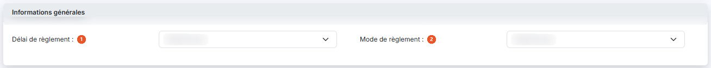<figcaption>
Rubrique « Informations générales »
</figcaption></figure>

Cette rubrique ne comporte que deux listes déroulantes.

| Champ                     | Ce qu'il faut savoir                                                                                                                                                                                                                                                                                                                            |
| ------------------------- | ----------------------------------------------------------------------------------------------------------------------------------------------------------------------------------------------------------------------------------------------------------------------------------------------------------------------------------------------- |
| 1. **Délai de règlement** | Au niveau de la fiche client, le délai de règlement est obligatoire dans toutes les pièces commerciales et permet de calculer l'échéance à partir de la date d'une pièce. S'il est renseigné ici, il sera affecté par défaut lors de la création de toute pièce commerciale pour ce client mais restera modifiable.                             |
| 2. **Mode de règlement**  | S'il est renseigné, il sera affecté par défaut lors de la création de toute pièce commerciale pour ce client mais restera modifiable. Outre les modes de paiement usuels, cette liste comprend les modes techniques utilisés par le logiciel pour les écarts de règlement et pour les règlements et remboursements importés de la comptabilité. |

## Rubrique « Facturation »

<figure>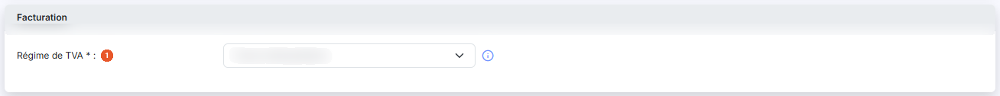<figcaption>
Rubrique « Facturation »
</figcaption></figure>

| Champ                    | Ce qu'il faut savoir                                                                                                                                                                                                                                                                                                                                                                                                                                                                               |
| ------------------------ | -------------------------------------------------------------------------------------------------------------------------------------------------------------------------------------------------------------------------------------------------------------------------------------------------------------------------------------------------------------------------------------------------------------------------------------------------------------------------------------------------- |
| 1. **Régime de TVA**     | Le régime de TVA permet de gérer tous les cas de facturation en local ou à l'export, que l'entreprise soit domiciliée en France métropolitaine ou en France d'outre-mer. Il sera affecté par défaut lors de la création de toute pièce commerciale pour ce client mais restera modifiable.                                                                                                                                                                                                         |
| **Catalogue par défaut** | Cette option n'est présente que si la gestion des catalogues a été activée. S'il est renseigné, il sera affecté par défaut lors de la création de toute pièce commerciale pour ce client mais restera modifiable.                                                                                                                                                                                                                                                                                  |
| **Remise systématique**  | Positionné sur Non par défaut. Passez-le à Oui pour accorder à ce client une remise appliquée d'office dans ses pièces commerciales. Cette remise est appliquée par défaut et reste modifiable lors de l'édition d'une pièce commerciale. Pour être enregistrée, elle suppose que les remises globales soient autorisées dans le panneau Paramètres, rubrique « Gestion commerciale », onglet « Pièces commerciales », et que le taux saisi ne dépasse pas le taux maximal défini au même endroit. |
| **Taux de remise**       | C'est le pourcentage de la remise. Il n'est saisissable que si la remise systématique est à Oui ; sinon, il reste grisé. Il n'est jamais prérempli, même à la création de la fiche.                                                                                                                                                                                                                                                                                                                |

Sous le taux, un couple de boutons vous permet de choisir où la remise s'applique : **Ligne** pour l'appliquer sur toutes les lignes d'article de la pièce, **Pièce** pour l'appliquer une seule fois, en pied de pièce. Le choix porte sur **Pièce** par défaut, et ces deux boutons ne sont actifs, comme le taux, que si la remise systématique est à Oui.

## Rubrique « Gestion analytique »

**Gérer les comptes de contrepartie analytiquement** : positionné sur Non par défaut. Si vous le passez à Oui, la répartition que vous saisissez juste en dessous est appliquée automatiquement, à la validation des factures, aux comptes de produit gérés analytiquement. Cela n'active pas l'analytique sur le compte auxiliaire du client.

Le tableau de répartition qui apparaît alors comporte une ligne par axe analytique de la société, sur laquelle vous cochez l'axe concerné, puis une ligne vous permettant de choisir la ventilation type à appliquer. Cette dernière liste reste vide si aucune ventilation type n'a été paramétrée pour la société. Ce tableau fonctionne comme celui du paramétrage d'un compte, dans le panneau Paramètres, rubrique « Données », groupe « Dossier et comptabilité », onglet « Plan comptable ».

Cette répartition vous évite d'avoir à valider vos factures une par une pour indiquer une ventilation analytique déjà connue.

## Rubrique « Relances »

<figure>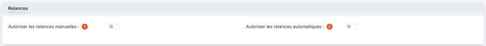<figcaption>
Rubrique « Relances »
</figcaption></figure>

| Champ                                      | Ce qu'il faut savoir                                                                                                                                                                                                                                                                                                                                                                                                                                                                                                                                                                                                                                                                                                         |
| ------------------------------------------ | ---------------------------------------------------------------------------------------------------------------------------------------------------------------------------------------------------------------------------------------------------------------------------------------------------------------------------------------------------------------------------------------------------------------------------------------------------------------------------------------------------------------------------------------------------------------------------------------------------------------------------------------------------------------------------------------------------------------------------- |
| 1. **Autoriser les relances manuelles**    | 
Positionné sur Non par défaut. Si vous activez cette option, l'entrée « Relancer » apparaît dans le menu « Autres actions » de la fiche et vous pourrez effectuer des relances manuelles depuis la fiche client ou depuis le menu « Editions », option « Relances clients ». Un champ <strong>Scénario</strong> apparaît également, qui n'affiche que les scénarios dont la périodicité a été définie comme « Manuelle ». Les scénarios sont gérés dans le panneau Paramètres, rubrique « Gestion commerciale », onglet « Scénarios de relance » ; reportez-vous à l'aide en ligne traitant de cette section pour plus de détails. Tant qu'aucun scénario n'a été paramétré pour la société, cette liste est vide.
 |
| 2. **Autoriser les relances automatiques** | Positionné sur Non par défaut. Les relances automatiques sont envoyées toutes les nuits en fonction des scénarios de relance paramétrés. Si vous activez cette option, un champ **Scénario** apparaît et vous devrez obligatoirement indiquer le scénario de relance que vous souhaitez appliquer. Le fait de choisir un scénario automatique n'empêche pas l'activation des relances manuelles.                                                                                                                                                                                                                                                                                                                             |
| **Date de la dernière relance**            | Non modifiable. Elle est renseignée automatiquement à chaque envoi de relance.                                                                                                                                                                                                                                                                                                                                                                                                                                                                                                                                                                                                                                               |

## Rubrique « Coordonnées bancaires »

<figure>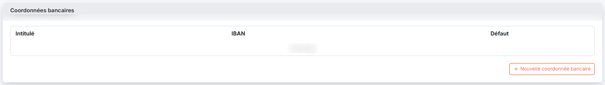<figcaption>
Rubrique « Coordonnées bancaires »
</figcaption></figure>

<figure>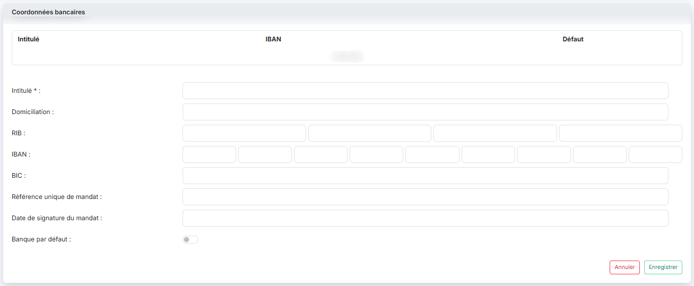<figcaption>
Rubrique « Coordonnées bancaires »
</figcaption></figure>

Un client peut disposer de plusieurs banques. La liste présente trois colonnes : **Intitulé**, **IBAN** et **Défaut**. Tant qu'aucune banque n'a été saisie, la mention « Liste vide » s'affiche à la place des lignes. Le bouton **\[Nouvelle coordonnée bancaire]** de la rubrique (son libellé est précédé d'un « + ») déplie le formulaire de saisie sous la liste.

Pour chaque banque, seul l'intitulé permettant la différenciation est obligatoire. Vous saisissez ensuite la domiciliation, le RIB en quatre parties (code banque, code guichet, numéro de compte et clé), l'IBAN et le BIC.

La **Référence unique de mandat** est un numéro que vous devez attribuer à chaque client et qui doit figurer sur le mandat remis au client pour pouvoir effectuer des prélèvements SEPA.

La **Date de signature du mandat** est celle figurant sur le mandat SEPA ; un calendrier vous aide à la saisir.

Un modèle de mandat SEPA est disponible dans les modèles d'impression, dans la catégorie « Courriers clients ».

Le champ **Banque par défaut**, positionné sur Non, vous permet de désigner la banque à retenir en priorité. Le formulaire se referme par le bouton **\[Enregistrer]** ou par le bouton **\[Annuler]**.

## Rubrique « Documents »

<figure>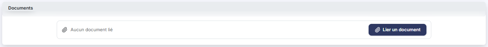<figcaption>
Rubrique « Documents »
</figcaption></figure>

Vous pouvez rattacher à la fiche du client autant de documents que nécessaire, par exemple un contrat ou un mandat signé. La liste présente quatre colonnes : **Description**, **Nom du fichier**, **Date** et **Créé par**. Tant qu'aucun document n'a été rattaché, la mention « Aucun document lié » s'affiche à la place des lignes.

Un bouton unique, le bouton **\[Lier un document]**, permet d'ajouter un document, quel que soit l'endroit où il se trouve.

## Rubrique « Editions »

<figure>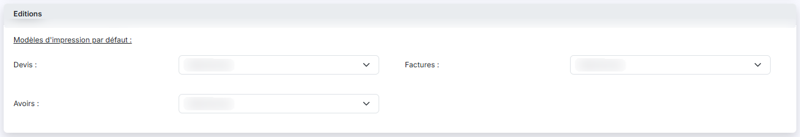<figcaption>
Rubrique « Editions »
</figcaption></figure>

Sous l'intitulé « Modèles d'impression par défaut : », cinq listes déroulantes vous permettent de choisir, pour chaque type de pièce commerciale, le modèle qui sera affecté par défaut pour ce client : **Devis**, **Factures**, **Avoirs**, **Bons de commande** et **Bons de livraison**. Ce modèle restera modifiable dans chaque pièce commerciale créée pour le client.

Chaque liste ne propose que les modèles paramétrés pour le type de pièce correspondant.

## Rubrique « Chorus Pro »

Cette rubrique ne comporte qu'une seule question : **Indiquez si les factures et avoirs de ce client peuvent être adressés via le portail Chorus Pro ?**, positionnée sur Non par défaut.

Répondez Oui si ce client est un organisme public qui reçoit ses factures par le portail Chorus Pro. Aucun autre champ n'apparaît lorsque vous répondez Oui, mais c'est cette réponse qui commande l'affichage des boutons de suivi Chorus Pro dans les pièces commerciales du client.

Cette rubrique n'est présente que si l'envoi vers Chorus Pro a été activé dans le panneau Paramètres, rubrique « Gestion commerciale », onglet « Chorus » : si vous ne la voyez pas en bas de la fiche, c'est que ce paramétrage n'a pas été fait.

## Bouton \[Créer un client]

<figure><figcaption>
Bouton [Créer un client]
</figcaption></figure>

Placé en bas à droite de l'écran, il ouvre une fiche vierge pour créer un nouveau client. Les onze rubriques sont les mêmes qu'en modification ; seuls le code client et le numéro de compte auxiliaire, non modifiables sur une fiche existante, y sont saisissables. Le menu « Autres actions » de la fiche est également moins fourni qu'en modification : il ne propose que « Courriers » et « Tarifs dédiés », et ni l'édition du relevé de comptes ni l'archivage tant que le client n'existe pas.

## Bouton \[Enregistrer]

<figure>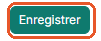<figcaption>
Bouton [Enregistrer]
</figcaption></figure>

Il valide la création ou la modification de la fiche client.

## Entrée « Courriers »

<figure>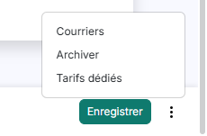<figcaption>
Rubrique « Entrée « Courriers » »
</figcaption></figure>

Entrée du menu « Autres actions » de la fiche (trois points, en bas de la fiche, à côté de \[Enregistrer]), elle permet d'imprimer un document client sur la base des modèles paramétrés dans la rubrique « Modèles » du panneau Paramètres, avec la catégorie « Courrier client ». L'impression ne concerne que la fiche client en cours.

## Entrée « Éditer le relevé de comptes »

Cette entrée du menu « Autres actions » de la fiche, présente uniquement lorsque vous modifiez un client existant, lance l'édition du relevé de comptes du client de la même manière que si vous l'aviez lancée depuis le menu « Editions », option « Relevés de comptes », avec le code du client prérempli. Reportez-vous à cette section de l'aide pour plus de détails.

## Entrée « Tarifs dédiés »

<figure>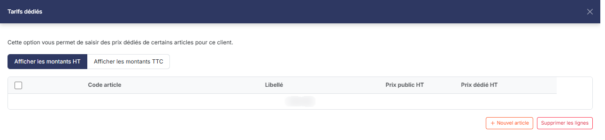<figcaption>
Rubrique « Entrée « Tarifs dédiés » »
</figcaption></figure>

Entrée du menu « Autres actions » de la fiche (en création comme en modification), elle ouvre un panneau latéral « Tarifs dédiés », affiché à droite de l'écran, dans lequel vous saisissez des prix dédiés à ce client pour certains articles. La liste présente les colonnes Code article et Libellé, puis, selon la bascule ci-dessous, Prix public HT et Prix dédié HT, ou Prix public TTC et Prix dédié TTC. Un couple de boutons, **Afficher les montants HT** et **Afficher les montants TTC**, est positionné sur **Afficher les montants HT** à l'ouverture du panneau. Tant qu'aucun tarif dédié n'a été saisi, la mention « Liste vide » s'affiche à la place des lignes.

Seuls le code de l'article et le prix dédié sont saisissables, et le prix dédié doit être supérieur ou égal à zéro. Un bouton **\[Nouvel article]** (son libellé est précédé d'un « + ») et un bouton **\[Supprimer les lignes]**, alignés à droite sous la liste, vous permettent d'ajouter ou de retirer des lignes, et chaque ligne offre une case à cocher, une commande de duplication et une croix de suppression. Il n'y a pas de bouton \[Fermer] : la croix de l'en-tête du panneau le referme.

Un même article ne peut figurer qu'une fois : sinon, à l'enregistrement, le logiciel affiche le message « L'article est présent plus d'une fois ; veuillez ne laisser qu'une occurrence. »

Lors de la création d'une pièce commerciale pour ce client, le prix dédié est prioritaire sur les prix du catalogue, sur les prix par quantité et sur le prix de la fiche de l'article.

## Retour à la liste

Le chevron « Retour », à gauche de la barre d'onglets du panneau Paramètres, vous ramène à la liste des clients sans enregistrer la fiche en cours.

## Entrée « Champs dynamiques »

Entrée du menu « Autres actions » (trois points) de la barre du bas de la liste, elle vous permet d'ajouter au fichier clients des informations qui vous sont propres, en complément des champs proposés en standard dans la fiche. Les champs dynamiques ainsi définis sont ensuite exploitables dans les pièces de vente du client.

La fenêtre « Champs dynamiques » présente la liste de ceux déjà définis, avec cinq colonnes : **Libellé**, **Obligatoire**, **Type**, **Taille** et **Nom**. Tant qu'aucun champ n'a été créé, la mention « Aucun élément à afficher. » s'affiche à la place des lignes. Le bouton \[Créer un champ dynamique] ouvre la définition d'un champ et la croix en haut à droite referme la fenêtre.

## Bouton \[Supprimer]

Dès qu'une ligne est sélectionnée, un bandeau de sélection (« 1 client sélectionné », « Tout désélectionner ») remplace la barre du bas et porte le bouton \[Supprimer], qui supprime tous les clients sélectionnés. Rappel : un client affecté à une pièce commerciale ne peut pas être supprimé ; s'il ne doit plus être utilisé, archivez-le.
