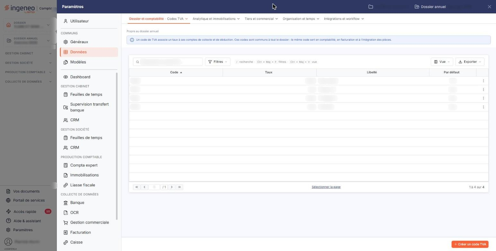
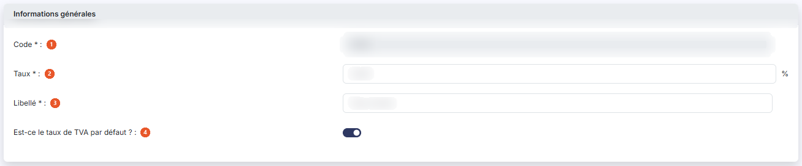
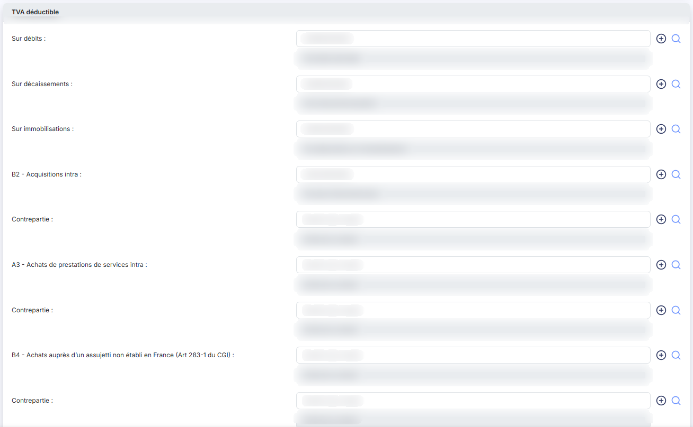
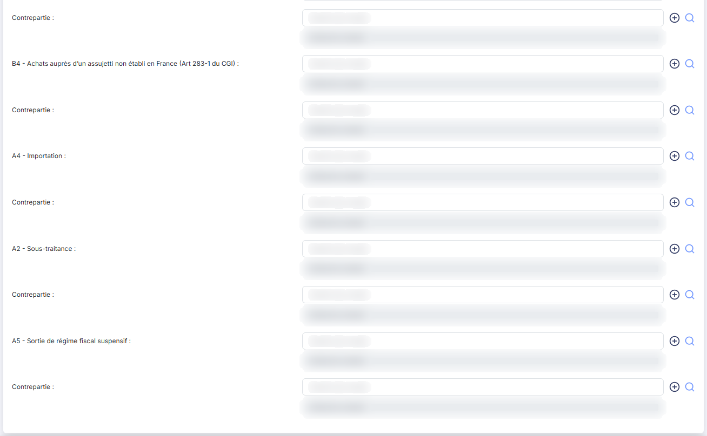
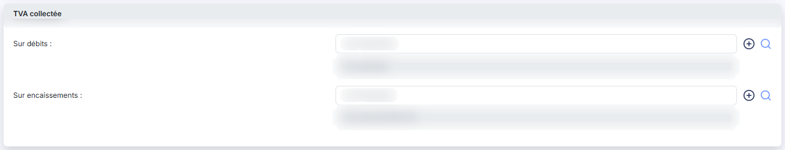
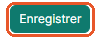

# Codes TVA


**Où le trouver :** Panneau **Paramètres** › **Données** › **Dossier et comptabilité** › **Codes TVA**



**En bref** — Cet écran tient vos codes TVA : chacun porte un taux et ses comptes, sert au calcul de la TVA de vos pièces et à la génération des écritures. Ces codes sont communs au dossier.

* Pour créer un code TVA : bouton \[Créer un code TVA], renseignez la fiche, puis bouton \[Enregistrer].


Cette option permet de tenir la liste de vos codes TVA. Un code TVA porte un taux et les comptes comptables qui vont avec : c'est lui que vous affectez à vos articles, et que le logiciel emploie pour calculer la TVA de vos pièces commerciales puis pour générer les écritures de TVA déductible et de TVA collectée.

<figure><figcaption>
Écran « Codes TVA » de la nouvelle interface
</figcaption></figure>

Cet écran s'ouvre par le panneau « Paramètres » : rubrique « Données », groupe « Dossier et comptabilité », entrée « Codes TVA ». Un bandeau bleu en haut de l'écran rappelle que ces codes sont communs à tout le dossier : le même code sert en comptabilité, en facturation et à l'intégration des pièces.

Les codes TVA sont utilisés par plusieurs modules du logiciel ; toute modification faite ici est donc immédiatement visible dans les autres modules.

## La liste des codes TVA

L'écran s'ouvre directement sur la liste de vos codes TVA, triée par ordre croissant de code. Il n'y a pas d'onglet. Au-dessus de la liste, la barre « Rechercher un code TVA… » et les boutons \[Filtres], \[Vue] et \[Exporter] permettent de chercher un code, de filtrer la liste, de personnaliser les colonnes et de l'imprimer ou de l'exporter.

Elle présente les colonnes suivantes :

| Champ          | Ce qu'il faut savoir                                                                          |
| -------------- | --------------------------------------------------------------------------------------------- |
| **Code**       | Le code que vous avez donné, par exemple « TN20 » pour le taux normal.                        |
| **Taux**       | Le taux de TVA, cadré à droite.                                                               |
| **Libellé**    | Le libellé du code, celui qui est proposé dans le sélecteur « Code TVA » des fiches articles. |
| **Par défaut** | « Oui » sur le code retenu comme code par défaut, « Non » sur les autres.                     |

Il n'y a pas de case à cocher : un clic sur une ligne la sélectionne, un second clic la désélectionne, et le lien « Sélectionner la page », sous la liste, sélectionne toutes les lignes affichées. Tant qu'une ligne est sélectionnée, un bandeau « 1 code TVA sélectionné » avec le lien « Tout désélectionner » remplace le bouton de création ; il ne porte aucun autre bouton. Le fonctionnement des listes du logiciel, la personnalisation des colonnes et la barre de pagination sont décrits dans le chapitre « Généralités » en tête de la présente aide.


Notez que le sélecteur « Code TVA » des fiches articles propose une entrée « Sans TVA » qui ne figure pas dans cette liste : ce n'est pas un code TVA, c'est l'absence de code.


## Les commandes de chaque ligne

Au survol d'une ligne, le pictogramme « Autres actions » (trois points verticaux) apparaît à droite de la ligne. Il ouvre trois entrées :

« Modifier » ouvre la fiche du code TVA.

« Dupliquer » crée un nouveau code TVA en reprenant le contenu de celui de la ligne — ses comptes notamment, ce qui vous évite de tous les ressaisir pour un taux voisin.

« Supprimer » supprime le code TVA.

Ce menu est proposé sur toutes les lignes, y compris sur le code retenu comme code par défaut. Selon les droits qui vous sont accordés, l'une ou l'autre de ces entrées peut ne pas vous être proposée.

## Bouton \[Créer un code TVA]

Il est en bas à droite de l'écran, hors de la liste, et ouvre une fiche vierge pour créer un code TVA. C'est le seul bouton de la barre du bas : la suppression se fait ligne par ligne, avec l'entrée « Supprimer » du menu « Autres actions ».

## Rubrique « Informations générales »

<figure><figcaption>
Rubrique « Informations générales »
</figcaption></figure>

| Champ                                     | Ce qu'il faut savoir                                                                                                                                                                                                                                                    |
| ----------------------------------------- | ----------------------------------------------------------------------------------------------------------------------------------------------------------------------------------------------------------------------------------------------------------------------- |
| 1. **Code**                               | Il doit être unique et n'est plus modifiable une fois le code TVA créé.                                                                                                                                                                                                 |
| 2. **Taux**                               | Le symbole « % » est affiché à droite de la zone de saisie.                                                                                                                                                                                                             |
| 3. **Libellé**                            | C'est ce libellé, et non le code, qui est proposé dans les sélecteurs de code TVA des fiches articles et des pièces commerciales : choisissez-le parlant.                                                                                                               |
| 4. **Est-ce le taux de TVA par défaut ?** | L'interrupteur activé, ce code est proposé chaque fois qu'un code TVA est demandé, par exemple à la création d'un article. Un seul code peut être le code par défaut : en désigner un nouveau retire ce statut au précédent. En création, l'interrupteur est désactivé. |

## Rubrique « TVA déductible »

<figure><figcaption>
Rubrique « TVA déductible »
</figcaption></figure>

<figure><figcaption>
Rubrique « TVA déductible »
</figcaption></figure>

Indiquez ici tous les numéros de comptes qui devront être utilisés lors de la génération d'écritures de TVA déductible liées à ce code TVA. Pour chaque ligne, saisissez le numéro de compte ou cliquez sur le pictogramme « Loupe » pour le rechercher ; le logiciel affiche à côté l'intitulé du compte retenu, en lecture seule, ce qui vous permet de vérifier votre saisie. Le pictogramme « + » permet de créer le compte s'il n'existe pas encore au plan comptable.

La recherche ne vous propose que les comptes dont le paramétrage correspond à la ligne : pour la ligne « Sur débits », les seuls comptes de type « TVA déductible sur débits », et ainsi de suite.

Les trois premières lignes concernent la TVA déductible ordinaire :

* **Sur débits** : le compte de TVA déductible sur les débits.
* **Sur décaissements** : le compte employé lorsque la TVA est déductible au paiement.
* **Sur immobilisations** : le compte de TVA déductible sur les acquisitions d'immobilisations.

Les lignes suivantes concernent les opérations pour lesquelles vous êtes redevable de la TVA à la place de votre fournisseur — l'autoliquidation. Leur intitulé commence par le repère de la ligne correspondante de la déclaration de TVA :

* **B2 - Acquisitions intra** : acquisitions intracommunautaires de biens.
* **A3 - Achats de prestations de services intra** : prestations de services intracommunautaires.
* **B4 - Achats auprès d'un assujetti non établi en France (Art 283-1 du CGI)**
* **A4 - Importation**
* **A2 - Sous-traitance**
* **A5 - Sortie de régime fiscal suspensif**

Chacune de ces lignes porte, à droite du compte de TVA, un second compte intitulé **Contrepartie :** avec sa propre loupe de recherche et son intitulé en lecture seule. C'est le compte de TVA collectée qui fait face au compte de TVA déductible dans l'écriture d'autoliquidation. Il est repris de la fiche du compte de TVA déductible ; si vous le modifiez ici, il est également modifié dans la fiche du compte.

## Rubrique « TVA collectée »

<figure><figcaption>
Rubrique « TVA collectée »
</figcaption></figure>

Indiquez ici tous les numéros de comptes qui devront être utilisés lors de la génération d'écritures de TVA collectée liées à ce code TVA. Les deux lignes fonctionnent comme celles de la rubrique précédente — saisie, loupe, pictogramme de création, intitulé en lecture seule — mais sans compte de contrepartie :

* **Sur débits** : le compte de TVA collectée sur les débits, employé pour les ventes de biens.
* **Sur encaissements** : le compte de TVA collectée sur les encaissements, employé pour les prestations de services.


Attention, l'intitulé « Sur débits » figure dans les deux rubriques de la fiche : celui qui vous intéresse est celui de la rubrique où vous vous trouvez. Notez également que la TVA déductible parle de « décaissements » là où la TVA collectée parle d'« encaissements ».


C'est le champ « Type d'opération » de la fiche article qui décide, entre ces deux comptes, lequel sera employé pour une vente donnée.

## Bouton \[Enregistrer]

<figure><figcaption>
Bouton [Enregistrer]
</figcaption></figure>

Il enregistre la fiche et vous ramène à la liste des codes TVA.

## Retour à la liste

Le bouton \[Retour] est masqué dans la fiche : le chevron « Retour », à gauche de la barre d'onglets du panneau, ferme la fiche sans enregistrer et vous ramène à la liste des codes TVA.
