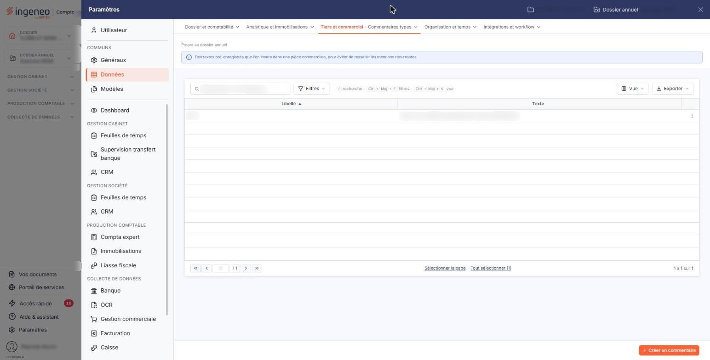
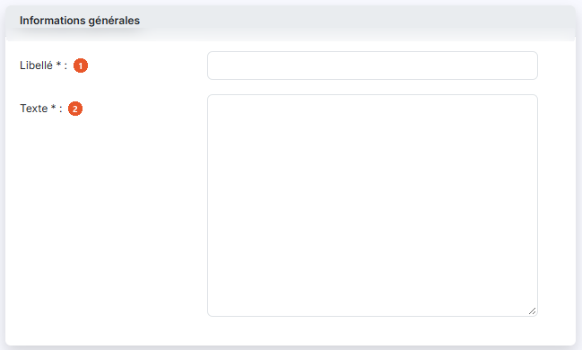

# Commentaires types


**Où le trouver :** Panneau **Paramètres** › **Données** › **Tiers et commercial** › **Commentaires types**



**En bref** — Ce fichier facultatif tient des blocs de texte réutilisables, à insérer dans vos pièces commerciales comme des articles.

* Pour créer un commentaire type : bouton \[Créer un commentaire], renseignez son libellé et son texte, puis bouton \[Enregistrer].


La gestion du fichier des « Commentaires types » est facultative.

<figure><figcaption>
Écran « Commentaires types » de la nouvelle interface
</figcaption></figure>

Les commentaires types sont utilisés dans les pièces commerciales. Ils permettent de créer des blocs de texte qui sont ensuite insérables dans les pièces commerciales comme des articles.

Dans une pièce commerciale, une ligne de commentaire se saisit dans une fenêtre d'où vous pouvez rechercher l'un de vos commentaires types : son texte y est repris, vous pouvez l'adapter, puis il est recopié dans la ligne. Il n'y reste aucun lien avec ce fichier : modifier un commentaire type par la suite ne change pas les pièces déjà établies.

Dans le panneau Paramètres, cet écran se trouve dans la rubrique « Données », onglet « Tiers et commercial », entrée « Commentaires types ».

L'écran présente la liste des commentaires types du dossier, une ligne par commentaire, avec deux colonnes : **Libellé** et **Texte**. Les deux colonnes sont triables ; la liste est triée par défaut sur le libellé, par ordre croissant.

Au-dessus de cette liste, la barre « Rechercher un commentaire… » permet de retrouver un commentaire type par saisie, et le bouton \[Filtres] de poser des critères sur les colonnes ; à l'extrémité droite, le bouton \[Vue] permet de gérer vos vues et de choisir les colonnes affichées, et le bouton \[Exporter] ouvre le menu d'édition de la liste. Si la liste vous paraît courte alors qu'aucun critère n'est posé, c'est donc qu'elle contient réellement peu de commentaires types, et non qu'un filtre en masque une partie.

Un clic sur une ligne la sélectionne. Sous la liste, « Sélectionner la page » et « Tout sélectionner (N) » sélectionnent d'un coup les commentaires de la page ou tous les commentaires. Dès qu'une ligne est sélectionnée, un bandeau apparaît au bas de l'écran, à la place de la barre du bas : il propose « Tout désélectionner » et le bouton \[Supprimer].

Au survol d'une ligne, un pictogramme « Autres actions » (trois points) apparaît en dernière colonne et ouvre un menu à trois entrées : « Modifier », pour modifier le commentaire type, « Dupliquer », pour le dupliquer, et « Supprimer », pour le supprimer. La duplication reprend les informations du commentaire d'origine dans une nouvelle fiche que vous complétez avant de l'enregistrer ; le libellé y est proposé sous la forme « Copie de » suivi du libellé d'origine, et rien n'est créé tant que vous n'avez pas cliqué sur \[Enregistrer].

bouton **\[Créer un commentaire]**

Situé en bas à droite de l'écran, il ouvre une fiche vierge pour créer un nouveau commentaire type.

bouton **\[Supprimer]**

Il s'affiche dans le bandeau de sélection, en bas de l'écran, dès qu'une ligne au moins est sélectionnée, et supprime les commentaires types sélectionnés.

## Rubrique « Informations générales »

<figure><figcaption>
Rubrique « Informations générales »
</figcaption></figure>

La fiche d'un commentaire type ne comporte que cette rubrique, et deux champs, tous deux obligatoires.

| Champ          | Ce qu'il faut savoir                                                                                          |
| -------------- | ------------------------------------------------------------------------------------------------------------- |
| 1. **Libellé** | C'est lui qui vous servira à retrouver le commentaire type au moment de l'insérer dans une pièce commerciale. |
| 2. **Texte**   | C'est le bloc de texte qui sera inséré dans la pièce commerciale. La zone accepte plusieurs lignes.           |

Ces deux champs sont les mêmes à la création et en modification. Seule différence : le champ **Libellé** n'est plus modifiable une fois le commentaire type enregistré. Le libellé se fixe donc à la création.

bouton **\[Enregistrer]**

Enregistre le commentaire type et vous ramène à la liste.

**Retour à la liste**

Le bouton \[Retour] n'est plus affiché dans la fiche : pour revenir à la liste sans enregistrer les modifications en cours, utilisez le chevron « Retour » à gauche de la barre d'onglets du panneau Paramètres.
