# Comptes auxiliaires


**Où le trouver :** Panneau **Paramètres** › **Données** › **Dossier et comptabilité** › **Comptes auxiliaires**



**En bref** — Cet écran administre les comptes auxiliaires du dossier annuel en cours : clients, fournisseurs, salariés et tiers divers, chacun rattaché à un compte collectif.

* Pour créer un compte auxiliaire : bouton \[Créer un compte auxiliaire], renseignez la fiche, puis bouton \[Enregistrer].
* Pour remplir la fiche à partir du numéro de Siren : bouton \[Lire Siren].


Cette option permet d'administrer les comptes auxiliaires de l'exercice (dossier annuel) en cours : vos clients, vos fournisseurs, vos salariés et les tiers divers, tels que la comptabilité les connaît.

<figure>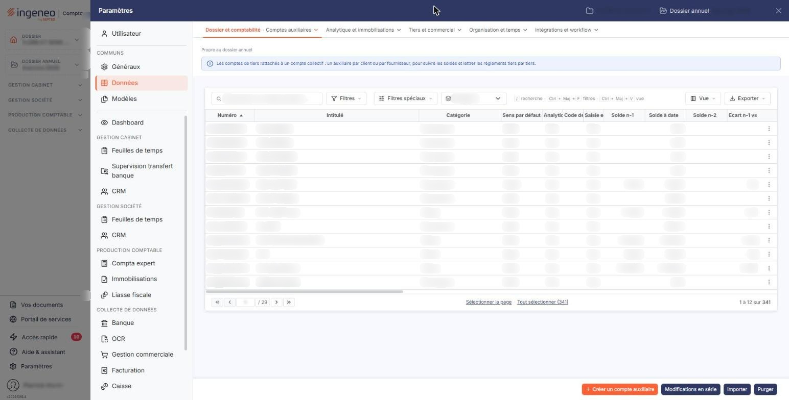<figcaption>
Écran « Comptes auxiliaires » de la nouvelle interface
</figcaption></figure>

Cet écran s'ouvre par le panneau « Paramètres » : rubrique « Données », puis onglet « Dossier et comptabilité » et, dans son menu déroulant, entrée « Comptes auxiliaires ». Un bandeau bleu en haut de l'écran, sous la mention « Propre au dossier annuel », indique : « Les comptes de tiers rattachés à un compte collectif : un auxiliaire par client ou par fournisseur, pour suivre les soldes et lettrer les règlements tiers par tiers. »

Un compte auxiliaire est obligatoirement rattaché à un seul compte collectif du plan comptable, et c'est ce rattachement qui détermine sa catégorie.

## La liste des comptes auxiliaires

La liste est très large : une barre de défilement horizontal vous permet d'atteindre les dernières colonnes.

Les colonnes proposées sont, dans l'ordre : **Numéro**, **Intitulé**, **Catégorie**, **Sens par défaut**, **Analytique**, **Code devise**, **Saisie en devise**, **Solde n-1**, **Solde à date**, **Solde n-2**, **Ecart n-1 vs n-2**, **N° de tva intracommunautaire**, **N° de siren**, **Capital**, **Code Naf**, **Soumis TVA autoliquidée**, **Contrepartie (Accélérateur)**, **Code TVA (Accélérateur)**, **N° de compte TVA (Accélérateur)**, **Gérer les échéances**, **Unité 1**, **Mode de règlement**, **Code DGFIP** et **Code juridique usuel**.

Chaque colonne reprend, pour tous les comptes à la fois, une information de la fiche décrite plus bas. Comme toutes les listes du logiciel, celle-ci se personnalise à l'aide du bouton \[Vue] : 24 colonnes sont affichées d'origine sur les 47 proposées, et vous pouvez masquer celles qui ne vous servent pas et en afficher d'autres.

## Les critères de recherche

Au-dessus de la liste se trouvent la barre « Rechercher un compte auxiliaire… », les boutons \[Filtres] et \[Filtres spéciaux] et un sélecteur « Catégorie ». La barre de recherche remplace la zone « N° de compte » ; la colonne sur laquelle elle porte n'a pas été relevée sur cet écran.

| Champ                   | Ce qu'il faut savoir                                                                                                                                                       |
| ----------------------- | -------------------------------------------------------------------------------------------------------------------------------------------------------------------------- |
| **Catégorie**           | Sélecteur dont le choix neutre porte le nom de la colonne, « Catégorie », retenu à l'ouverture de l'écran, puis **Divers**, **Clients**, **Fournisseurs** et **Salariés**. |
| **\[Filtres spéciaux]** | Ce menu propose, sous le titre « Comptes », deux choix exclusifs : **Tous**, retenu à l'ouverture, et **Mouvementés**.                                                     |

Aucun critère n'est donc actif à l'ouverture : la totalité des comptes auxiliaires du dossier est affichée.

Le bouton \[Filtrer] se trouve dans le menu \[Filtres] et applique à la liste les critères que vous y avez ajoutés.

## Les commandes de la ligne

Il n'y a pas de case à cocher : un clic sur une ligne la sélectionne. Sous la liste, le lien « Sélectionner la page » sélectionne toutes les lignes affichées et le lien « Tout sélectionner (341) » étend la sélection à toutes les pages (le nombre entre parenthèses est celui des comptes de la liste). Tant qu'une ligne est sélectionnée, un bandeau « 1 compte auxiliaire sélectionné », avec le lien « Tout désélectionner », remplace la barre de boutons du bas et porte les boutons \[Supprimer], \[Modifications en série] et \[Réaffectation].

Au survol d'une ligne, le pictogramme « Autres actions » (trois points verticaux) apparaît à droite de la ligne. Il ouvre trois entrées :

* « Modifier » ouvre la fiche du compte ;
* « Dupliquer » prépare la création d'un nouveau compte à partir de celui-ci ;
* « Supprimer » ouvre la fenêtre de suppression du compte.

Selon votre profil, certaines de ces entrées peuvent ne pas apparaître.

La fiche d'un compte auxiliaire est organisée en rubriques, présentées dans cet ordre : « Informations générales », « Adresses », « Propriétés », « Accélérateur de saisie », « Échéances », « Quantités », « Multi établissement », « Gestion analytique », « Prestataire », « Coordonnées bancaires », « Devises », « Approbation », « Soldes » et « Documents ».

Chaque rubrique est une carte, présentée l'une sous l'autre ; deux boutons fléchés au-dessus de la première, « Compte précédent » (Ctrl + ↑) et « Compte suivant » (Ctrl + ↓), passent au compte voisin dans la liste.

Toutes ne sont pas proposées sur tous les comptes : sur un compte de catégorie « Clients », les rubriques « Prestataire » et « Approbation » ne sont pas affichées, la seconde n'existant pas du tout. Sur le dossier relevé, la fiche d'un fournisseur affiche treize rubriques et celle d'un client onze. La rubrique « Multi établissement » n'est affichée que si l'option « Activer la comptabilité multi-établissement » est activée dans les paramètres multimodules ; elle est masquée sur les deux fiches relevées.

## Rubrique « Informations générales »

<figure>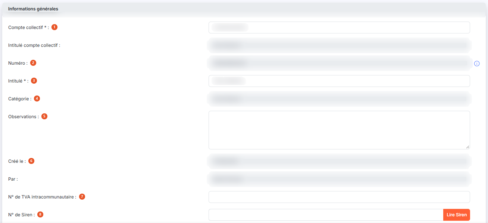<figcaption>
Rubrique « Informations générales »
</figcaption></figure>

<figure>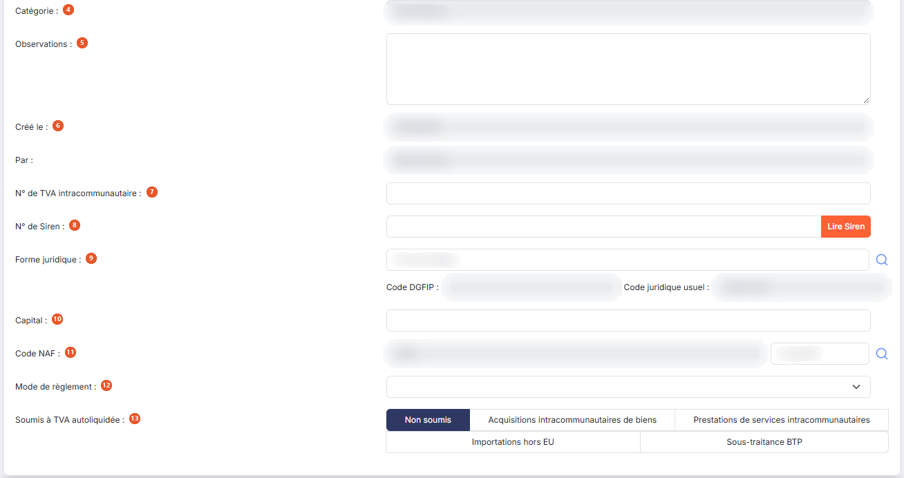<figcaption>
Rubrique « Informations générales »
</figcaption></figure>

| Champ                               | Ce qu'il faut savoir                                                                                                                                                                                                                                                                                                                      |
| ----------------------------------- | ----------------------------------------------------------------------------------------------------------------------------------------------------------------------------------------------------------------------------------------------------------------------------------------------------------------------------------------- |
| 1. **Compte collectif**             | Un compte auxiliaire est obligatoirement rattaché à un seul compte collectif. L'**Intitulé compte collectif :** est affiché à sa droite, en lecture seule, pour contrôle.                                                                                                                                                                 |
| 2. **Numéro**                       | Le numéro de compte doit être unique et n'est plus modifiable après création du compte. Les caractères autorisés sont les lettres majuscules et les chiffres. Cette zone ne devient saisissable qu'une fois le compte collectif désigné : le logiciel y place alors un préfixe déduit de ce compte, que vous complétez.                   |
| 3. **Intitulé**                     | Ce champ pourra être automatiquement repris dans les libellés d'écritures et reste modifiable à tout moment.                                                                                                                                                                                                                              |
| 4. **Catégorie**                    | Non modifiable. Elle est renseignée par le logiciel en fonction du compte collectif auquel vous avez rattaché le compte. Quatre catégories sont gérées : Clients, Fournisseurs, Salariés et Divers.                                                                                                                                       |
| 5. **Observations**                 | Zone de texte libre sur plusieurs lignes.                                                                                                                                                                                                                                                                                                 |
| 6. **Créé le**                      | **Par :** date de création et nom de l'utilisateur qui a créé le compte, en lecture seule. Sur un compte qui a déjà été modifié, le logiciel affiche en plus **Modifié le :** et **Par :**.                                                                                                                                               |
| 7. **N° de TVA intracommunautaire** | Ce numéro, unique à chaque entreprise, est obligatoire sur toutes les factures, aussi bien pour l'émetteur que pour le destinataire. Il sert également à la reconnaissance des fournisseurs dans le module « OCR ».                                                                                                                       |
| 8. **N° de Siren**                  | Voir le bouton \[Lire Siren] ci-dessous.                                                                                                                                                                                                                                                                                                  |
| 9. **Forme juridique**              | Facultative. Le pictogramme « Loupe » donne accès à la liste des formes juridiques. Les deux zones qui suivent, **Code DGFIP :** et **Code juridique usuel :**, sont alimentées par le logiciel en lecture seule.                                                                                                                         |
| 10. **Capital**                     | —                                                                                                                                                                                                                                                                                                                                         |
| 11. **Code NAF**                    | Le code est en lecture seule ; son libellé se recherche à l'aide du pictogramme « Loupe ».                                                                                                                                                                                                                                                |
| 12. **Mode de règlement**           | Il s'agit du mode de règlement par défaut, qui sera repris en différents lieux du logiciel.                                                                                                                                                                                                                                               |
| 13. **Soumis à TVA autoliquidée**   | Cinq choix exclusifs — **Non soumis**, **Acquisitions intracommunautaires de biens**, **Prestations de services intracommunautaires**, **Importations hors EU** et **Sous-traitance BTP**. Ce choix sert notamment à générer les écritures d'autoliquidation de la TVA. Il n'est proposé que sur un compte de catégorie « Fournisseurs ». |

## Bouton \[Lire Siren]

Placé à droite du **N° de Siren**, il interroge un annuaire des entreprises et complète la fiche à partir du numéro que vous avez saisi.

## Rubrique « Adresses »

<figure>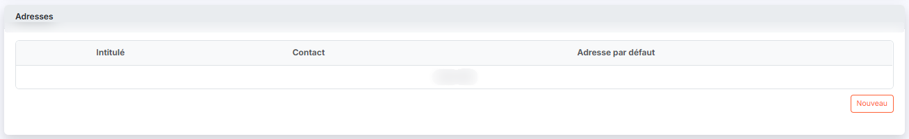<figcaption>
Rubrique « Adresses »
</figcaption></figure>

Une fiche peut contenir autant d'adresses que vous le souhaitez. Le tableau en présente trois colonnes : **Intitulé**, **Contact** et **Adresse par défaut**. Un bouton \[Nouveau] permet d'en ajouter une. Chaque ligne porte trois pictogrammes, dans cet ordre : « Modifier » (crayon), « Dupliquer » (deux feuilles) et « Supprimer » (corbeille). Tant qu'aucune adresse n'est saisie, le tableau affiche « Liste vide ».

Lorsqu'une adresse est désignée comme adresse par défaut, c'est elle qui sera affectée lors de la création de toute nouvelle pièce commerciale.

Les adresses sont communes aux fichiers clients et aux comptes auxiliaires.

## Rubrique « Propriétés »

<figure><figcaption>
Rubrique « Propriétés »
</figcaption></figure>

Cette rubrique ne contient qu'une seule information.

**Sens par défaut** : deux choix, **Débit** et **Crédit**. Il définit si, lors de la saisie, le curseur se positionnera par défaut sur un montant au débit ou au crédit.

## Rubrique « Accélérateur de saisie »

<figure>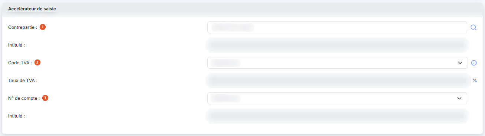<figcaption>
Rubrique « Accélérateur de saisie »
</figcaption></figure>

Cette rubrique vous permet de préparer l'écriture que le logiciel proposera automatiquement lorsque ce compte sera saisi sur la première ligne d'un mouvement.

| Champ               | Ce qu'il faut savoir                                                                                                                                    |
| ------------------- | ------------------------------------------------------------------------------------------------------------------------------------------------------- |
| 1. **Contrepartie** | Compte utilisé pour générer l'écriture. Son **Intitulé :** est rappelé en lecture seule.                                                                |
| 2. **Code TVA**     | Indiquez un code TVA si vous souhaitez générer automatiquement une ligne de TVA. Le **Taux de TVA :** correspondant est alors rappelé en lecture seule. |
| 3. **N° de compte** | Choisissez parmi les comptes de TVA celui qui devra être repris dans l'écriture ; son **Intitulé :** est rappelé en lecture seule.                      |

## Rubrique « Échéances »

<figure>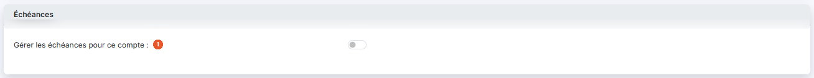<figcaption>
Rubrique « Échéances »
</figcaption></figure>

| Champ                                     | Ce qu'il faut savoir                                                                                                                                                                |
| ----------------------------------------- | ----------------------------------------------------------------------------------------------------------------------------------------------------------------------------------- |
| 1. **Gérer les échéances pour ce compte** | Interrupteur désactivé à l'ouverture de la fiche.                                                                                                                                   |
| **Renseigner automatiquement l'échéance** | Indiquez si le logiciel doit calculer lui-même la date d'échéance.                                                                                                                  |
| **Délai de règlement**                    | Délai à retenir pour ce calcul. Les délais se définissent dans le panneau « Paramètres », rubrique « Données », onglet « Dossier et comptabilité », entrée « Délais de règlement ». |

## Rubrique « Quantités »

<figure>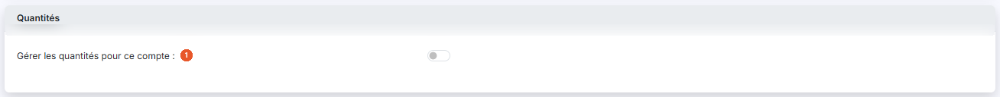<figcaption>
Rubrique « Quantités »
</figcaption></figure>

**Gérer les quantités pour ce compte** : interrupteur désactivé à l'ouverture de la fiche.

Les unités se définissent dans le panneau « Paramètres », rubrique « Données », onglet « Tiers et commercial », entrée « Unités ».

## Rubrique « Multi établissement »

Cette rubrique, qui ne s'affiche pas sur tous les comptes, ne contient qu'un sélecteur, **Établissement :**, permettant de rattacher le compte à l'un des établissements de la société gérée.

## Rubrique « Gestion analytique »

<figure>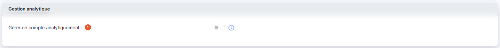<figcaption>
Rubrique « Gestion analytique »
</figcaption></figure>

**Gérer ce compte analytiquement** : interrupteur désactivé à l'ouverture de la fiche.

## Rubrique « Prestataire »

<figure>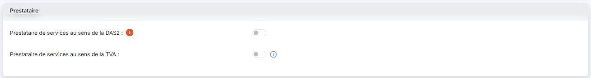<figcaption>
Rubrique « Prestataire »
</figcaption></figure>

Cette rubrique n'est proposée que sur un compte de catégorie « Fournisseurs ».

**Prestataire de services au sens de la DAS2** : interrupteur désactivé à l'ouverture de la fiche.

Un second interrupteur, **Prestataire de services au sens de la TVA :**, est affiché dès l'ouverture de la rubrique, sous le premier, sans qu'il faille activer le précédent. Son infobulle dit : « A activer uniquement pour les prestataires de services qui n'ont pas opté pour la TVA sur les débits. » Il est à activer pour les prestataires de services qui n'ont pas opté pour la TVA sur les débits.

## Rubrique « Coordonnées bancaires »

<figure>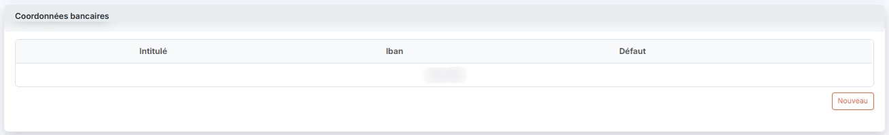<figcaption>
Rubrique « Coordonnées bancaires »
</figcaption></figure>

Vous avez la possibilité de créer autant de coordonnées bancaires que nécessaire pour un tiers. Le tableau en présente trois colonnes : **Intitulé**, **Iban** et **Défaut**. Un bouton \[Nouveau] permet d'en ajouter, et deux pictogrammes de ligne, « Modifier » (crayon) et « Supprimer » (corbeille), permettent de modifier ou de retirer celles de la ligne.

L'intitulé permet de différencier les coordonnées bancaires entre elles ; celles marquées par défaut sont systématiquement proposées pour le tiers chaque fois que cela est nécessaire.

## Rubrique « Devises »

<figure>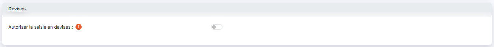<figcaption>
Rubrique « Devises »
</figcaption></figure>

**Autoriser la saisie en devises** : interrupteur désactivé à l'ouverture de la fiche.

## Rubrique « Approbation »

<figure>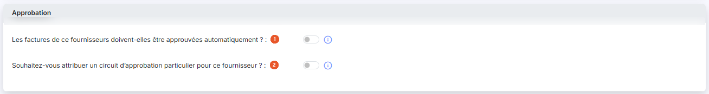<figcaption>
Rubrique « Approbation »
</figcaption></figure>

Cette rubrique n'existe que sur un compte de catégorie « Fournisseurs », et seulement si le circuit de validation est activé dans les paramètres généraux de l'OCR. Elle règle la façon dont les factures de ce tiers passent par un circuit d'approbation.

| Champ                                                                                      | Ce qu'il faut savoir                                                                                                                                                                                                                                                              |
| ------------------------------------------------------------------------------------------ | --------------------------------------------------------------------------------------------------------------------------------------------------------------------------------------------------------------------------------------------------------------------------------- |
| 1. **Les factures de ce fournisseurs doivent-elles être approuvées automatiquement ?**     | Interrupteur activé à l'ouverture de la fiche. Tant qu'il est activé, les factures du fournisseur ne sont pas soumises à approbation, et c'est la seule information affichée de la rubrique. Les suivantes apparaissent l'une après l'autre, chacune commandée par la précédente. |
| 2. **Souhaitez-vous attribuer un circuit d'approbation particulier pour ce fournisseur ?** | Interrupteur désactivé. Il n'apparaît que si vous avez désactivé l'interrupteur précédent.                                                                                                                                                                                        |
| **Libellé du circuit d'approbation**                                                       | Sélecteur du circuit à appliquer. Il n'apparaît que si vous avez activé l'interrupteur précédent et répondu « Non » à la question du circuit de validation personnalisé ci-dessous.                                                                                               |
| **Souhaitez-vous mettre en place un circuit de validation personnalisé ?**                 | Interrupteur désactivé. Il apparaît en même temps que le sélecteur ci-dessus.                                                                                                                                                                                                     |

Un tableau, en bas de la rubrique, présente le circuit retenu en trois colonnes : **Niveau**, **Poste** et **Utilisateur**. Les boutons \[Nouveau] et \[Supprimer] de la rubrique permettent d'y ajouter et d'en retirer des niveaux.

## Rubrique « Soldes »

<figure>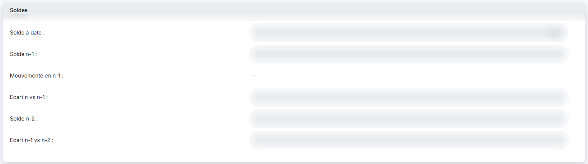<figcaption>
Rubrique « Soldes »
</figcaption></figure>

Cette rubrique ne se saisit pas.

Elle présente le **Solde à date :**, le **Solde n-1 :**, **Mouvementé en n-1 :** (une case en lecture seule, affichée sur les deux fiches relevées), l'**Ecart n vs n-1 :**, le **Solde n-2 :** et l'**Ecart n-1 vs n-2 :**.

Cette rubrique garde ces champs en lecture seule, l'un sous l'autre ; elle n'a pas la présentation en tableau de celle d'un compte du plan comptable.

## Rubrique « Documents »

<figure>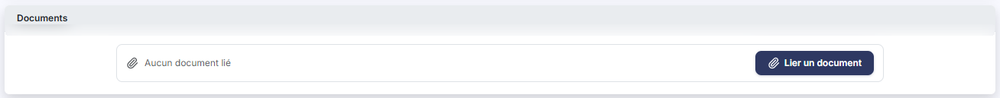<figcaption>
Rubrique « Documents »
</figcaption></figure>

Cette rubrique vous permet de conserver des documents attachés au tiers. Le tableau en présente quatre colonnes : **Description**, **Nom du fichier**, **Date** et **Créé par**.

Le bouton \[Lier un document] alimente seul cette rubrique. Tant qu'aucun document n'est lié, la rubrique affiche « Aucun document lié ».

Ces documents sont les mêmes que ceux de la fiche du tiers : ceux d'un compte client sont partagés avec la fiche client du module « Facturation », ceux d'un compte fournisseur avec la fiche fournisseur du panneau « Paramètres » (rubrique « Données », onglet « Tiers et commercial », entrée « Fournisseurs »).

## Les boutons de la fiche

Un seul bouton : le bouton \[Enregistrer], en bas à droite de l'écran, valide votre saisie.

Le bouton \[Retour] est masqué dans la fiche : le chevron « Retour », à gauche de la barre d'onglets du panneau, revient à la liste ; si la fiche a été modifiée, une fenêtre « Modifications non enregistrées » propose les boutons \[Continuer sans enregistrer] et \[Enregistrer et quitter].

La barre du bas propose quatre boutons, de gauche à droite : \[Créer un compte auxiliaire], \[Modifications en série], \[Importer] et \[Purger]. Les boutons \[Supprimer], \[Modifications en série] et \[Réaffectation] se trouvent dans le bandeau de sélection, qui remplace cette barre dès qu'une ligne est sélectionnée. Selon votre profil, certains peuvent ne pas apparaître.

## Bouton \[Créer un compte auxiliaire]

Il est en bas à droite de l'écran, hors de la liste, et ouvre la fiche d'un nouveau compte auxiliaire.

## Bouton \[Modifications en série]

Il figure dans la barre du bas et dans le bandeau de sélection. Il permet d'appliquer simultanément les mêmes modifications à une sélection de comptes.

## Bouton \[Réaffectation]

Il se trouve dans le bandeau de sélection. Il permet de réaffecter toutes les écritures d'un compte auxiliaire à un autre compte.

## Bouton \[Importer]

Il permet d'importer des comptes auxiliaires à partir d'un fichier, selon un modèle d'import.

## Bouton \[Purger]

Il permet de supprimer les comptes auxiliaires.

## Bouton \[Supprimer]

Il se trouve dans le bandeau de sélection. Il supprime en une seule fois tous les comptes que vous avez sélectionnés dans la liste.
