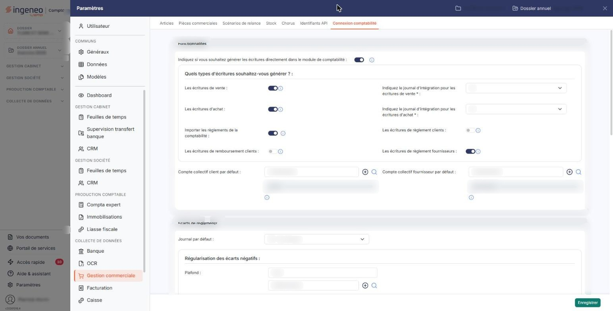
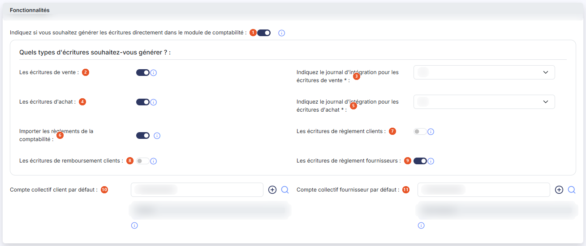
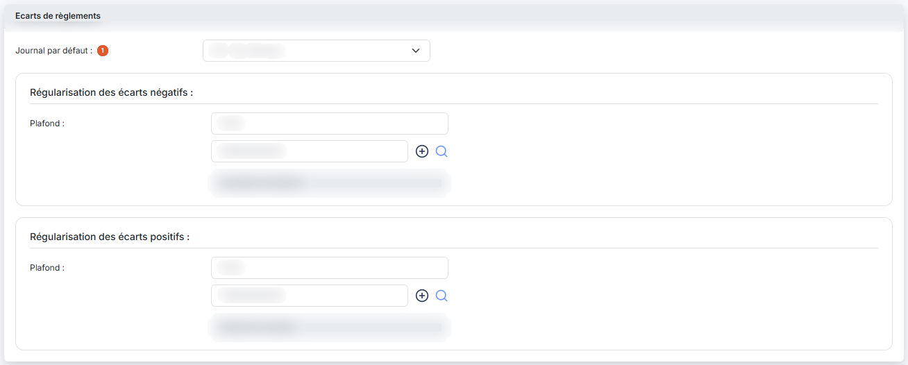
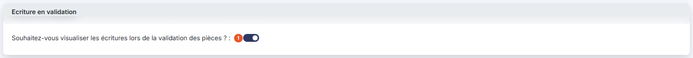
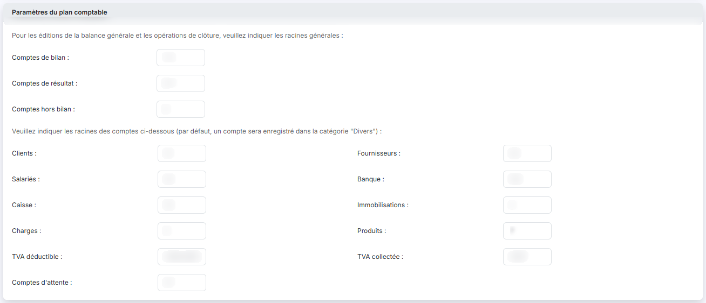
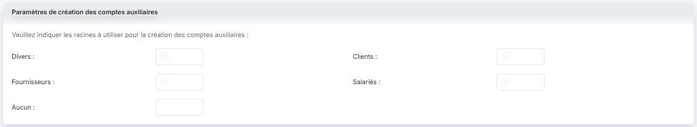

# Connexion comptabilité


**Où le trouver :** Panneau **Paramètres** › **Gestion commerciale** › **Connexion comptabilité**



**En bref** — Cet écran commande les échanges entre la gestion commerciale et la comptabilité : écritures générées, journaux, comptes, régularisation des écarts de règlement et racines de comptes.

* Pour modifier le paramétrage comptable : complétez les rubriques concernées, puis bouton \[Enregistrer].


Cette page commande tout ce qui passe entre la gestion commerciale et la comptabilité : quelles écritures sont générées, dans quels journaux, sur quels comptes, et comment les petits écarts de règlement sont régularisés. C'est ici aussi que sont déclarées les racines de comptes qui servent aux propositions du logiciel et aux éditions de la balance.

<figure><figcaption>
Écran « Connexion comptabilité » de la nouvelle interface
</figcaption></figure>

Cet écran s'ouvre par le panneau « Paramètres » : rubrique « Gestion commerciale », onglet « Connexion comptabilité », le dernier de la barre d'onglets (après Articles, Pièces commerciales, Scénarios de relance, Stock, Chorus et Identifiants API). Il n'y a pas de bandeau d'information en tête.

Elle se présente en six rubriques, toutes affichées les unes sous les autres : « Fonctionnalités », « Ecarts de règlements », « Ecriture en validation », « Paramètres du plan comptable », « Paramètres de création des comptes auxiliaires » et « Eco-contribution ». Il n'y a ni liste, ni fiche, ni bouton de retour : le seul bouton de l'écran est bouton **\[Enregistrer]**, en bas.

Plusieurs champs de comptes fonctionnent par couples : vous saisissez le numéro du compte, et le logiciel affiche à côté son libellé, que vous ne pouvez pas modifier ici. Chacun de ces couples porte un bouton **+** pour créer le compte et un pictogramme « Loupe » pour le rechercher dans le référentiel comptable. L'écran compte cinq de ces couples, et tous les cinq portent les deux commandes.

## Rubrique « Fonctionnalités »

<figure><figcaption>
Rubrique « Fonctionnalités »
</figcaption></figure>

| Champ                                                                                              | Ce qu'il faut savoir                                                                                                                                                                                                                                                                                                                                                                                                                                                                                                                                                                                                                                                                                                                                                                                                                                                                                                                                                                                                                                                                                                                                                                                                                                                                                                                                                                                             |
| -------------------------------------------------------------------------------------------------- | ---------------------------------------------------------------------------------------------------------------------------------------------------------------------------------------------------------------------------------------------------------------------------------------------------------------------------------------------------------------------------------------------------------------------------------------------------------------------------------------------------------------------------------------------------------------------------------------------------------------------------------------------------------------------------------------------------------------------------------------------------------------------------------------------------------------------------------------------------------------------------------------------------------------------------------------------------------------------------------------------------------------------------------------------------------------------------------------------------------------------------------------------------------------------------------------------------------------------------------------------------------------------------------------------------------------------------------------------------------------------------------------------------------------- |
| 1. **Indiquez si vous souhaitez générer les écritures directement dans le module de comptabilité** | 
Interrupteur. Si vous l'activez, dès qu'une pièce sera validée et qu'une écriture sera générée depuis le module de facturation ou de gestion commerciale, elle sera automatiquement enregistrée dans le journal idoine du logiciel de comptabilité. Si vous le désactivez, les écritures seront générées dans un fichier distinct consultable dans le menu « Ecritures », d'où vous pourrez les exporter vers le module Comptabilité ou vers un autre logiciel de comptabilité. Vient ensuite un sous-titre, <strong>Quels types d'écritures souhaitez-vous générer ?</strong>, qui introduit les interrupteurs suivants, rangés sur deux colonnes : à gauche « Les écritures de vente », « Les écritures d'achat », « Importer les règlements de la comptabilité » et « Les écritures de remboursement clients » ; à droite le journal d'intégration des ventes, celui des achats, « Les écritures de règlement clients » et « Les écritures de règlement fournisseurs ». Vous les réglez un par un : c'est le moyen de faire tenir par la gestion commerciale le suivi de vos factures et de vos règlements sans produire d'écriture en double avec une autre source, un import de relevé bancaire par exemple.
                                                                                                                                                                                      |
| 2. **Les écritures de vente**                                                                      | Interrupteur. L'écriture de vente est générée à la validation d'une facture ou d'un avoir, dans le journal indiqué juste en dessous. Si vous le désactivez, la pièce n'est connue que de la facturation. Activé, en revanche, les comptes de vente deviennent obligatoires dans les fiches articles : le logiciel refuse d'enregistrer un article qui n'en porte pas, en vous indiquant qu'ils sont obligatoires compte tenu de vos paramétrages.                                                                                                                                                                                                                                                                                                                                                                                                                                                                                                                                                                                                                                                                                                                                                                                                                                                                                                                                                                |
| 3. **Indiquez le journal d'intégration pour les écritures de vente**                               | La liste ne propose que les journaux de votre dossier.                                                                                                                                                                                                                                                                                                                                                                                                                                                                                                                                                                                                                                                                                                                                                                                                                                                                                                                                                                                                                                                                                                                                                                                                                                                                                                                                                           |
| 4. **Les écritures d'achat**                                                                       | Interrupteur. L'écriture d'achat est générée à la validation d'une facture ou d'un avoir fournisseur, dans le journal indiqué juste en dessous. Comme pour les ventes, ce choix activé rend obligatoires les comptes d'achat des fiches articles.                                                                                                                                                                                                                                                                                                                                                                                                                                                                                                                                                                                                                                                                                                                                                                                                                                                                                                                                                                                                                                                                                                                                                                |
| 5. **Indiquez le journal d'intégration pour les écritures d'achat**                                | La liste ne propose que les journaux de votre dossier.                                                                                                                                                                                                                                                                                                                                                                                                                                                                                                                                                                                                                                                                                                                                                                                                                                                                                                                                                                                                                                                                                                                                                                                                                                                                                                                                                           |
| 6. **Importer les règlements de la comptabilité**                                                  | 
Interrupteur. À l'ouverture de la fiche de pointage d'un client, les écritures de son compte en comptabilité sont relues : les encaissements y deviennent des règlements, les décaissements des remboursements. Si l'écriture est lettrée en comptabilité avec une facture, le règlement est automatiquement affecté à cette facture. Ce paramètre s'accompagne de deux fenêtres, l'une à l'activation et l'autre à l'abandon de l'import. À l'activation, le logiciel vous demande <strong>à partir de quand importer les règlements</strong>. Sans date, tout l'historique du compte de chaque client remonte dans l'écran de pointage, y compris des encaissements anciens déjà traités autrement : c'est le moyen d'éviter des doublons avec ce que vous avez saisi à la main. Vous pouvez aussi demander l'import de tout l'historique. Si vous abandonnez l'import, le logiciel vous propose de <strong>purger les règlements importés de la comptabilité</strong> sur une période que vous choisissez. Les règlements et remboursements déjà importés restent en effet présents dans l'écran de pointage même après désactivation de l'import ; la purge les supprime sur la période choisie et rétablit les soldes des factures concernées. Les écritures comptables ne sont jamais supprimées et aucun lettrage n'est défait : la comptabilité reste la source. La purge est immédiate.
 |
| 7. **Les écritures de règlement clients**                                                          | Interrupteur. L'écriture d'encaissement est générée dès la création d'un règlement : débit de la trésorerie, crédit du compte client. Le journal et le compte viennent du mode de règlement, pas de cet écran.                                                                                                                                                                                                                                                                                                                                                                                                                                                                                                                                                                                                                                                                                                                                                                                                                                                                                                                                                                                                                                                                                                                                                                                                   |
| 8. **Les écritures de remboursement clients**                                                      | Interrupteur. L'écriture de décaissement est générée dès la création d'un remboursement : débit du compte client, crédit de la trésorerie. Le journal et le compte viennent du mode de règlement. En revanche le lettrage dépend de l'option « Les écritures de règlement clients ».                                                                                                                                                                                                                                                                                                                                                                                                                                                                                                                                                                                                                                                                                                                                                                                                                                                                                                                                                                                                                                                                                                                             |
| 9. **Les écritures de règlement fournisseurs**                                                     | Interrupteur. L'écriture du règlement fournisseur est générée dès sa création, dans le journal du mode de règlement.                                                                                                                                                                                                                                                                                                                                                                                                                                                                                                                                                                                                                                                                                                                                                                                                                                                                                                                                                                                                                                                                                                                                                                                                                                                                                             |
| 10. **Compte collectif client par défaut**                                                         | Le compte collectif défini ici sera proposé pour créer le compte auxiliaire correspondant en comptabilité, donc à la création de vos clients. Son libellé s'affiche à côté du numéro, sans être modifiable.                                                                                                                                                                                                                                                                                                                                                                                                                                                                                                                                                                                                                                                                                                                                                                                                                                                                                                                                                                                                                                                                                                                                                                                                      |
| 11. **Compte collectif fournisseur par défaut**                                                    | Même rôle pour vos fournisseurs. Son libellé s'affiche à côté du numéro, sans être modifiable.                                                                                                                                                                                                                                                                                                                                                                                                                                                                                                                                                                                                                                                                                                                                                                                                                                                                                                                                                                                                                                                                                                                                                                                                                                                                                                                   |

Un exemple de réglage utile : si vous importez vos relevés bancaires par ailleurs, activez la génération des écritures de vente et désactivez celle des écritures de règlement et de remboursement clients. Vous saisissez alors vos règlements en gestion commerciale, vous suivez vos paiements facture par facture et vous utilisez les relances automatiques, sans qu'aucune écriture de banque ne soit générée en double.

## Rubrique « Ecarts de règlements »

<figure><figcaption>
Rubrique « Ecarts de règlements »
</figcaption></figure>

Cette rubrique traite les petites différences qui empêchent de solder une facture ou un règlement au centime près. Elle s'ouvre sur un champ, **Journal par défaut**, puis se divise en deux sous-titres, **Régularisation des écarts négatifs** et **Régularisation des écarts positifs**.

| Champ                                  | Ce qu'il faut savoir                                                                                                                                                                                                                                                                                                                                                                                                                                                                 |
| -------------------------------------- | ------------------------------------------------------------------------------------------------------------------------------------------------------------------------------------------------------------------------------------------------------------------------------------------------------------------------------------------------------------------------------------------------------------------------------------------------------------------------------------ |
| 1. **Journal par défaut**              | 
Le journal dans lequel les écritures de régularisation seront passées. La liste ne propose que les journaux de votre dossier. Chacune des deux sous-rubriques suivantes comporte les mêmes champs : un <strong>Plafond</strong>, puis le numéro du compte de régularisation, dont le libellé s'affiche à côté sans être modifiable. Le libellé <strong>Plafond</strong> apparaît donc deux fois dans la rubrique : c'est le sous-titre qui vous dit lequel vous saisissez.
 |
| **Régularisation des écarts négatifs** | Lors de l'affectation d'un règlement à une facture, si le solde de la facture est inférieur au plafond indiqué, le logiciel vous proposera de passer une écriture de régularisation afin de solder la facture, qui n'apparaîtra alors plus dans la liste. Indiquez un compte de charges — 658 pour « Charges diverses de gestion courante », par exemple.                                                                                                                            |
| **Régularisation des écarts positifs** | Lors de l'affectation d'un règlement à une facture, si le montant du règlement restant à affecter est inférieur au plafond indiqué, le logiciel vous proposera de passer une écriture de régularisation afin de solder le règlement, c'est-à-dire de l'affecter totalement pour qu'il n'apparaisse plus dans la liste. Indiquez un compte de produits — 758 pour « Produits divers de gestion courante », par exemple.                                                               |

## Rubrique « Ecriture en validation »

<figure><figcaption>
Rubrique « Ecriture en validation »
</figcaption></figure>

**Souhaitez-vous visualiser les écritures lors de la validation des pièces ?** : interrupteur. Activé, le logiciel vous montre l'écriture générée au moment où vous validez une pièce, dans une fenêtre où vous pouvez compléter ce que la pièce ne portait pas — la ventilation analytique, les périodes d'effet. Désactivé, la validation se fait sans cet affichage.

## Rubrique « Paramètres du plan comptable »

<figure><figcaption>
Rubrique « Paramètres du plan comptable »
</figcaption></figure>

La rubrique s'ouvre sur deux consignes affichées à l'écran : « Pour les éditions de la balance générale et les opérations de clôture, veuillez indiquer les racines générales », puis « Veuillez indiquer les racines des comptes ci-dessous (par défaut, un compte sera enregistré dans la catégorie "Divers") ».

Les trois premiers champs sont les racines générales : **Comptes de bilan**, **Comptes de résultat** et **Comptes hors bilan**. Un intervalle s'y écrit avec un tiret — par exemple 1-5 pour les classes 1 à 5.

Viennent ensuite les racines par nature de compte, dans cet ordre : **Clients**, **Fournisseurs**, **Salariés**, **Banque**, **Caisse**, **Immobilisations**, **Charges**, **Produits**, **TVA déductible**, **TVA collectée** et **Comptes d'attente**.

Une nature peut réunir plusieurs racines : elles s'écrivent alors séparées par un point-virgule, comme la TVA déductible qui peut réunir les racines 4452 et 4456.

Un compte dont la racine ne figure dans aucune de ces natures est enregistré dans la catégorie « Divers ».

## Rubrique « Paramètres de création des comptes auxiliaires »

<figure><figcaption>
Rubrique « Paramètres de création des comptes auxiliaires »
</figcaption></figure>

La rubrique s'ouvre sur la consigne affichée « Veuillez indiquer les racines à utiliser pour la création des comptes auxiliaires ».

Les comptes auxiliaires étant tenus dans un fichier distinct des comptes généraux, cette rubrique dit par quoi commence le numéro d'un compte auxiliaire selon la nature du tiers. Cinq champs, dans cet ordre : **Divers**, **Clients**, **Fournisseurs**, **Salariés** et **Aucun**. La valeur usuelle est une lettre — C pour les clients, F pour les fournisseurs, S pour les salariés, D pour les divers.

Ces racines sont reprises par le logiciel au moment de créer un compte auxiliaire, en même temps que le compte collectif indiqué dans la rubrique « Fonctionnalités ».

## Rubrique « Eco-contribution »

<figure><figcaption>
Rubrique « Eco-contribution »
</figcaption></figure>

La rubrique s'ouvre sur la consigne affichée « Si certains des articles vendus sont soumis à l'éco-contribution, indiquez le numéro de compte de comptabilisation de la taxe. Si vous ne le renseignez pas, elle sera comptabilisée dans le compte de vente de chaque article. »

**Numéro de compte de l'éco-contribution** : facultatif. Son libellé s'affiche à côté du numéro, sans être modifiable. Un bouton **+** vous permet de créer le compte si nécessaire, et le pictogramme « Loupe » de le rechercher.

Laissé vide, ce champ n'empêche donc rien : l'éco-contribution suit simplement le compte de vente de l'article.

Renseigné, il change la comptabilisation : le montant de l'éco-contribution est retiré du hors taxes de la ligne et porté sur ce compte, en une seule ligne par facture.

bouton **\[Enregistrer]**

Enregistre les six rubriques en une fois. L'écran ne comporte pas de bouton de retour : fermez le panneau « Paramètres » (croix en haut à droite) ou choisissez un autre onglet pour le quitter.
