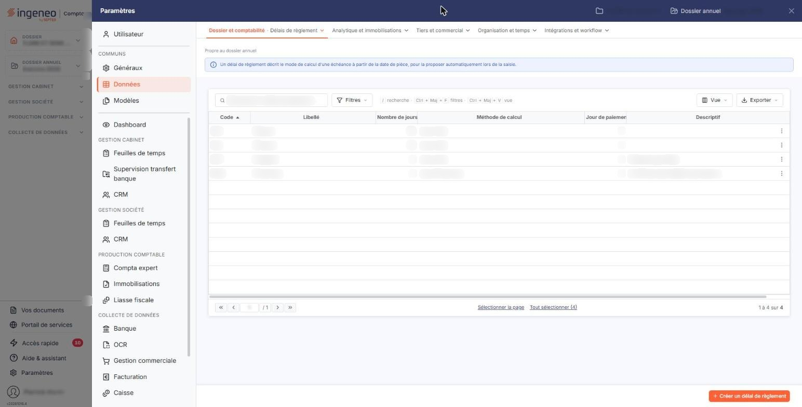
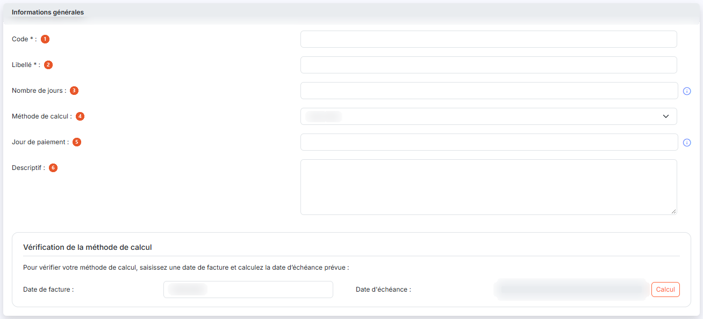

# Délais de règlement


**Où le trouver :** Panneau **Paramètres** › **Données** › **Dossier et comptabilité** › **Délais de règlement**



**En bref** — Cet écran définit les délais de règlement qui servent à calculer les échéances à partir de la date d'une pièce.

* Pour créer un délai : bouton \[Créer un délai de règlement], renseignez la fiche, puis bouton \[Enregistrer].


Cette option permet de définir les délais de règlement qui seront utilisés pour calculer les échéances à partir de la date d’une pièce comptable.

<figure><figcaption>
Écran « Délais de règlement » de la nouvelle interface
</figcaption></figure>

Cet écran s'ouvre par le panneau « Paramètres » : rubrique « Données », groupe « Dossier et comptabilité », entrée « Délais de règlement ». Un bandeau bleu en haut de l'écran rappelle qu'un délai de règlement décrit le mode de calcul d'une échéance à partir de la date de pièce, pour la proposer automatiquement lors de la saisie.

L'écran présente la liste des délais de règlement du dossier, une ligne par délai. Les colonnes affichées sont, dans l'ordre : **Code**, **Libellé**, **Nombre de jours**, **Méthode de calcul**, **Jour de paiement** et **Descriptif**. Elles reprennent les informations saisies dans la fiche du délai et sont toutes triables ; la liste est triée par défaut sur le code, par ordre croissant.

Au-dessus de la liste, la barre « Rechercher un délai de règlement… » et les boutons \[Filtres], \[Vue] et \[Exporter] permettent de chercher un délai, de filtrer la liste, de personnaliser les colonnes et de l'imprimer ou de l'exporter (voir plus bas le bouton \[Exporter] de la barre d'outils).

Il n'y a pas de case à cocher : un clic sur une ligne la sélectionne, un second clic la désélectionne. Sous la liste, le lien « Sélectionner la page » sélectionne toutes les lignes affichées et le lien « Tout sélectionner (4) » étend la sélection à toutes les pages (le nombre entre parenthèses est celui des délais de la liste). Tant qu'une ligne est sélectionnée, un bandeau « 1 délai de règlement sélectionné » avec le lien « Tout désélectionner » et les boutons \[Supprimer] et \[Exporter] remplace le bouton de création.

Au survol d'une ligne, le pictogramme « Autres actions » (trois points verticaux) apparaît à droite de la ligne. Il ouvre deux entrées : « Modifier », qui ouvre la fiche du délai, et « Supprimer », qui le supprime.

bouton **\[Créer un délai de règlement]**

Il est en bas à droite de l'écran, hors de la liste, et ouvre une fiche vierge pour créer un nouveau délai de règlement.

bouton **\[Exporter]** (deux emplacements)

Le bouton \[Exporter] de la barre d'outils, au-dessus de la liste, ouvre un menu qui porte l'en-tête « La liste affichée » suivi du nombre de délais, puis les entrées « Aperçu » (édition HTML), « Imprimer », « Exporter en Excel », « Exporter en PDF » et « Envoyer la liste par e-mail » : il sert à éditer la liste, pas à copier des données.

Le bouton \[Exporter] du bandeau de sélection, lui, permet de copier les délais de règlement sélectionnés dans la liste vers d'autres sociétés que vous gérez ; il n'apparaît qu'une fois au moins une ligne sélectionnée.

La fenêtre « Exporter » rappelle le nombre d'enregistrements sélectionnés, puis vous demande d'indiquer les sociétés vers lesquelles les données seront copiées. Trois choix vous sont proposés : **Toutes les sociétés** exporte vers toutes les sociétés auxquelles vous avez accès ; **Liées à ce modèle** exporte vers toutes les sociétés créées sur la base de ce modèle ; **Autres** exporte vers les sociétés que vous choisissez dans la liste présentée en dessous, dont les colonnes sont **Code client**, **Raison sociale** et **Accès autorisé**, et que le champ « Société » permet de filtrer à la saisie.

La copie des données se fera lors de la prochaine utilisation de la société gérée concernée, par exemple en la sélectionnant dans le menu ou lors de la connexion d'un utilisateur. Le bouton « Valider » lance l'export ; la croix en haut à droite de la fenêtre la referme sans rien exporter.

bouton **\[Supprimer]**

Il se trouve dans le bandeau de sélection, à gauche du bouton \[Exporter], et supprime les délais de règlement sélectionnés dans la liste.

## Rubrique « Informations générales »

<figure><figcaption>
Rubrique « Informations générales »
</figcaption></figure>

La fiche d'un délai de règlement ne comporte que cette rubrique.

| Champ                    | Ce qu'il faut savoir                                                                                                                                                                                                                                                                                                                                                                                                                                                                                                                                                                                                                                                                                                                                                                                                                                                                                                                                                                                                                                                                                                                                                                                                                                                                                                                                                                                                                                                                                                                                                                                                                                                                                                                                                                                                                                                                             |
| ------------------------ | ------------------------------------------------------------------------------------------------------------------------------------------------------------------------------------------------------------------------------------------------------------------------------------------------------------------------------------------------------------------------------------------------------------------------------------------------------------------------------------------------------------------------------------------------------------------------------------------------------------------------------------------------------------------------------------------------------------------------------------------------------------------------------------------------------------------------------------------------------------------------------------------------------------------------------------------------------------------------------------------------------------------------------------------------------------------------------------------------------------------------------------------------------------------------------------------------------------------------------------------------------------------------------------------------------------------------------------------------------------------------------------------------------------------------------------------------------------------------------------------------------------------------------------------------------------------------------------------------------------------------------------------------------------------------------------------------------------------------------------------------------------------------------------------------------------------------------------------------------------------------------------------------ |
| 1. **Code**              | Doit être unique. Il est saisissable à la création, puis n'est plus modifiable ensuite.                                                                                                                                                                                                                                                                                                                                                                                                                                                                                                                                                                                                                                                                                                                                                                                                                                                                                                                                                                                                                                                                                                                                                                                                                                                                                                                                                                                                                                                                                                                                                                                                                                                                                                                                                                                                          |
| 2. **Libellé**           | 
Doit être unique. Les champs suivants permettent de définir la manière dont est calculé le délai de règlement. Ces champs sont combinés entre eux.
                                                                                                                                                                                                                                                                                                                                                                                                                                                                                                                                                                                                                                                                                                                                                                                                                                                                                                                                                                                                                                                                                                                                                                                                                                                                                                                                                                                                                                                                                                                                                                                                                                                                                                                                     |
| 3. **Nombre de jours**   | Nombre de jours à ajouter au jour de votre pièce comptable et pris en compte par le champ « Méthode de calcul ». Si ce champ est laissé vide ou si « 0 » est saisi, les champs suivants prendront comme base le jour de la pièce comptable. Le pictogramme « Information » placé à côté du champ rappelle que, pour une période d'un mois fixe, il faut saisir « 30 » jours.                                                                                                                                                                                                                                                                                                                                                                                                                                                                                                                                                                                                                                                                                                                                                                                                                                                                                                                                                                                                                                                                                                                                                                                                                                                                                                                                                                                                                                                                                                                     |
| 4. **Méthode de calcul** | 
Six options sont possibles : • <strong>Jours nets</strong> : cette option ajoute à la date de la pièce le nombre de jours défini dans le champ « Nombre de jours ». Exemple : 15 jours nets pour une pièce du 15/01/N renvoie au 30/01/N. Si le nombre de jours saisi est « 30 », un mois fixe est ajouté à la date de la pièce. Exemple : 30 jours nets pour une pièce du 15/02/N renvoie au 15/03/N. - <strong>Jours fin de mois</strong> : cette option ajoute à la date de la pièce le nombre de jours défini dans le champ « Nombre de jours » et renvoie à la fin du mois du mois obtenu. Exemple : 20 jours fin de mois pour une pièce du 15/03/N renvoie au 30/04/N. - <strong>Fin de décade</strong> : cette option ajoute à la date de la pièce le nombre de jours défini dans le champ « Nombre de jours » et renvoie à la fin de la décade (tranche de 10 jours) dans laquelle se situe le jour obtenu. Exemple : Fin de décade pour une pièce du 01/03/N renvoie au 10/03/N. - <strong>Fin de mois + N jours</strong> : cette option renvoie à la fin du mois du mois et ajoute le nombre de jours défini dans le champ « Nombre de jours ». Exemple : Fin de mois + 20 jours pour une pièce du 15/03/N renvoie au 20/04/N. - <strong>Fin de trimestre</strong> : cette option renvoie à la fin du trimestre civil dans lequel se situe le jour obtenu. - <strong>Fin de trimestre + N jours</strong> : cette option renvoie à la fin du trimestre civil et ajoute le nombre de jours défini dans le champ « Nombre de jours ». Ces deux dernières options ont été ajoutées pour les échéances d'impôts et de taxes du budget de trésorerie ; elles sont utilisables de la même façon en facturation. Le choix de la méthode de calcul ne change pas la liste des champs de la fiche : les mêmes champs restent affichés quelle que soit l'option retenue.
 |
| 5. **Jour de paiement**  | Renvoie au jour du prochain mois ayant le rang défini dans ce champ suivant le jour obtenu par l’application des critères définis dans « Nombre de jours » et « Méthode de calcul ». Exemple : 20 jours fin de mois le 15 pour une pièce du 15/03/N renvoie : 04/04 (20 jours), puis 30/04 (Fin de mois), et enfin 15/05/N (prochain jour ayant le 15ème rang dans un mois). Le pictogramme « Information » placé à côté du champ rappelle qu'il définit un jour fixe dans le mois.                                                                                                                                                                                                                                                                                                                                                                                                                                                                                                                                                                                                                                                                                                                                                                                                                                                                                                                                                                                                                                                                                                                                                                                                                                                                                                                                                                                                              |
| 6. **Descriptif**        | Il est repris dans la colonne « Descriptif » de la liste.                                                                                                                                                                                                                                                                                                                                                                                                                                                                                                                                                                                                                                                                                                                                                                                                                                                                                                                                                                                                                                                                                                                                                                                                                                                                                                                                                                                                                                                                                                                                                                                                                                                                                                                                                                                                                                        |

## Vérifier votre méthode de calcul

Le bas de la rubrique vous propose de contrôler les critères saisis sur un exemple : « Pour vérifier votre méthode de calcul, saisissez une date de facture et calculez la date d'échéance prévue ».

| Champ               | Ce qu'il faut savoir                                                                                   |
| ------------------- | ------------------------------------------------------------------------------------------------------ |
| **Date de facture** | Préremplie avec la date du jour, modifiable directement ; le calendrier s'ouvre au clic dans le champ. |
| **Date d'échéance** | Cette zone n'est pas saisissable ; c'est le logiciel qui l'alimente.                                   |

bouton **\[Calcul]**

Applique au champ « Date de facture » les critères que vous venez de saisir et affiche le résultat dans le champ « Date d'échéance ».

bouton **\[Enregistrer]**

Enregistre le délai de règlement et vous ramène à la liste.

**Retour à la liste**

Le bouton \[Retour] est masqué dans la fiche : le chevron « Retour », à gauche de la barre d'onglets du panneau, revient à la liste sans enregistrer les modifications en cours.
