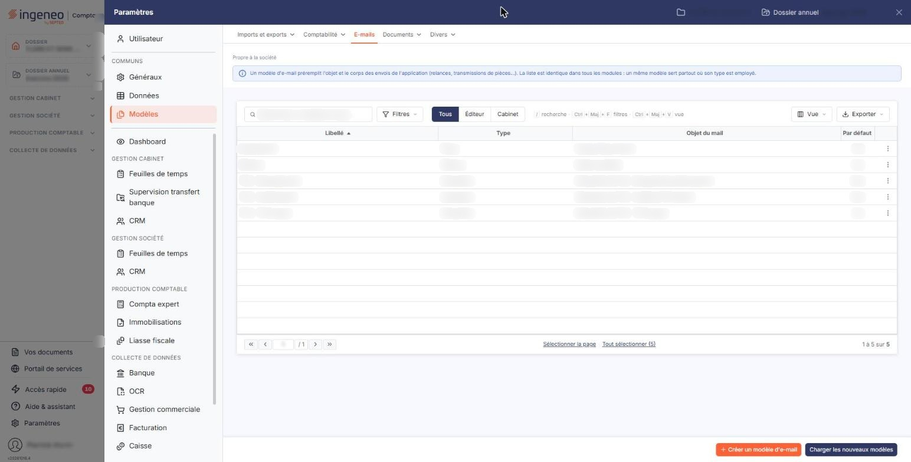
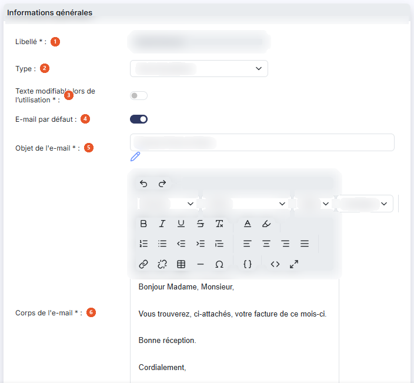
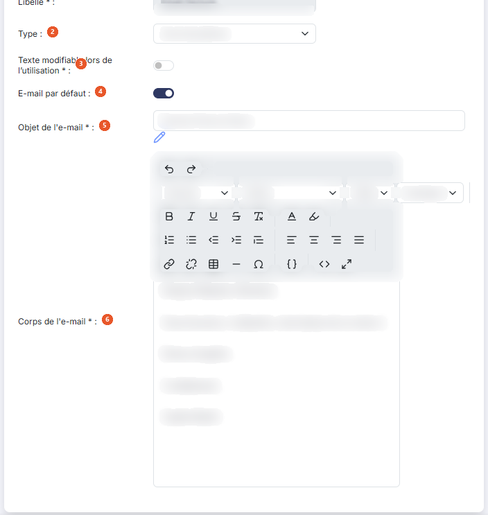
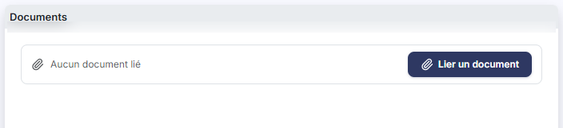

# E-mails


**Où le trouver :** Panneau **Paramètres** › **Modèles** › **E-mails**



**En bref** — Cet écran prépare l'objet et le texte des e-mails proposés lors des envois : pièces commerciales, relances, courriers. Il est commun à tous les modules.

* Pour créer un modèle : bouton \[Créer un modèle d'e-mail], renseignez la fiche, puis bouton \[Enregistrer].
* Pour récupérer les modèles mis à disposition par l'éditeur : bouton \[Charger les nouveaux modèles].


Cette option permet de préparer à l'avance l'objet et le texte des e-mails que le logiciel vous proposera lors de ses différents envois : envoi d'une pièce commerciale à un client, relance d'un client, envoi d'un courrier, et selon vos modules envoi d'une déclaration ou d'un dossier.

<figure><figcaption>
Écran « E-mails » de la nouvelle interface
</figcaption></figure>

Chaque modèle porte un type, qui détermine où il vous sera proposé : vous pouvez ainsi préparer plusieurs textes de relance, et moduler votre message selon le type de client ou le nombre de relances déjà envoyées.

L'option présente la liste de vos modèles ; l'ouverture d'un modèle donne accès à sa fiche.

Dans le panneau Paramètres, cet écran se trouve dans la rubrique « Modèles », onglet « E-mails ». Il est commun à tous les modules : la liste est la même quel que soit le module d'où vous ouvrez le panneau, et un même modèle sert partout où son type est employé.

## La liste des modèles

La liste présente quatre colonnes : **Libellé**, **Type**, **Objet du mail** et **Par défaut**, cette dernière indiquant Oui ou Non. Elle est triée par défaut sur le libellé, par ordre croissant.

Au-dessus de la liste, la barre « Rechercher un modèle d'e-mail… » et le bouton \[Filtres] permettent de retrouver un modèle. Les trois boutons « Tous », « Éditeur » et « Cabinet » qui les suivent limitent l'affichage selon l'origine des modèles ; « Tous » est actif à l'ouverture. À l'extrémité droite, le bouton \[Vue] permet de gérer vos vues et de choisir les colonnes affichées, et le bouton \[Exporter] ouvre le menu d'édition de la liste. Tant qu'aucun critère n'est posé, tous les modèles du dossier figurent dans la liste, quel que soit leur type.

Un clic sur une ligne la sélectionne. Au survol d'une ligne, un pictogramme « Autres actions » (trois points) apparaît en dernière colonne et ouvre un menu dont les entrées sont « Modifier », « Dupliquer » et « Supprimer ». Sous la liste, « Sélectionner la page » et « Tout sélectionner (N) » sélectionnent d'un coup les modèles de la page ou tous les modèles. Dès qu'une ligne est sélectionnée, un bandeau apparaît au bas de l'écran, à la place de la barre du bas : il propose « Tout désélectionner » et le bouton \[Supprimer].

L'entrée « Modifier » n'est pas proposée pour tous les modèles : certains modèles ne peuvent pas être ouverts, et vous ne pouvez alors que les dupliquer ou les supprimer.

## Bouton \[Créer un modèle d'e-mail]

Situé en bas à droite de l'écran, il ouvre une fiche vierge pour créer un nouveau modèle.

## Bouton \[Charger les nouveaux modèles]

Il récupère les modèles d'e-mails mis à disposition par l'éditeur du logiciel et qui ne sont pas encore présents dans votre dossier.

## Bouton \[Exporter]

Situé à droite de la barre qui surmonte la liste, il exporte la liste de vos modèles.

## Bouton \[Supprimer]

Il s'affiche dans le bandeau de sélection, en bas de l'écran, dès qu'une ligne au moins est sélectionnée, et supprime tous les modèles sélectionnés.

## Rubrique « Informations générales »

<figure><figcaption>
Rubrique « Informations générales »
</figcaption></figure>

<figure><figcaption>
Rubrique « Informations générales »
</figcaption></figure>

| Champ                                                                                     | Ce qu'il faut savoir                                                                                                                                                                                                                                                                                                                                                                              |
| ----------------------------------------------------------------------------------------- | ------------------------------------------------------------------------------------------------------------------------------------------------------------------------------------------------------------------------------------------------------------------------------------------------------------------------------------------------------------------------------------------------- |
| 
1. <strong>Libellé</strong> <em>Obligatoire</em>
                                | 20 caractères au maximum. C'est sous ce libellé que le modèle vous sera proposé dans les fenêtres d'envoi et dans les paramètres des pièces commerciales.                                                                                                                                                                                                                                         |
| 2. **Type**                                                                               | Liste déroulante qui détermine où le modèle est proposé. Les choix sont, dans l'ordre où ils s'affichent : Changement de mot de passe, Courrier client, Création utilisateur, Demandes infos client, Envoi de pièces, Envoi déclarations, Envoi dossier CAC et Relance. Le type ne change pas les champs de la fiche : quel que soit votre choix, vous saisissez un objet et un corps de message. |
| 
3. <strong>Texte modifiable lors de l'utilisation</strong> <em>Obligatoire</em>
 | Interrupteur, obligatoire.                                                                                                                                                                                                                                                                                                                                                                        |
| 4. **E-mail par défaut**                                                                  | Interrupteur.                                                                                                                                                                                                                                                                                                                                                                                     |
| 
5. <strong>Objet de l'e-mail</strong> <em>Obligatoire</em>
                      | 50 caractères au maximum. C'est l'objet du message reçu par votre destinataire. Un pictogramme « Insérer un champ dynamique », placé sous le champ.                                                                                                                                                                                                                                               |
| 
6. <strong>Corps de l'e-mail</strong> <em>Obligatoire</em>
                      | C'est le texte du message, saisi dans un éditeur de texte enrichi : vous disposez d'une barre d'outils complète de mise en forme, dont l'icône « Code source HTML », qui affiche le code du message pour les utilisateurs qui souhaitent le composer eux-mêmes.                                                                                                                                   |

## Rubrique « Documents »

<figure><figcaption>
Rubrique « Documents »
</figcaption></figure>

Cette rubrique, placée à droite de la rubrique « Informations générales », vous permet de joindre systématiquement un ou plusieurs documents aux e-mails envoyés avec ce modèle. Ils s'ajoutent aux pièces que le logiciel joint déjà de lui-même.

Elle affiche « Aucun document lié » tant que vous n'avez rien joint. Le bouton \[Lier un document], à droite de ce message, permet d'ajouter un document.

## Bouton \[Enregistrer] et retour à la liste

<figure><figcaption>
Bouton [Enregistrer] et retour à la liste
</figcaption></figure>

Le bouton **\[Enregistrer]** valide la création ou la modification du modèle ; le bouton \[Retour] n'est plus affiché dans la fiche : pour revenir à la liste sans enregistrer la fiche en cours, utilisez le chevron « Retour » à gauche de la barre d'onglets du panneau Paramètres.

Cet écran ne sert qu'à préparer vos textes : il ne comporte aucun bouton d'envoi ni d'essai. Un e-mail ne part que depuis l'écran où vous en avez besoin — la pièce commerciale, la relance, la fiche client.
