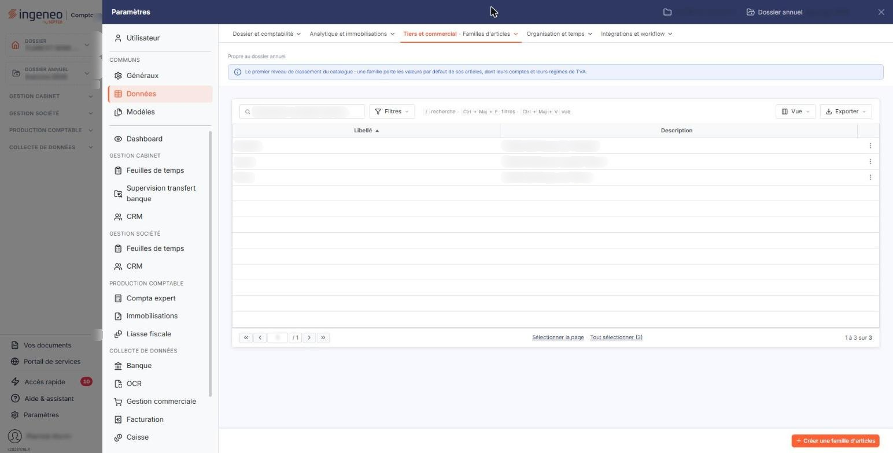
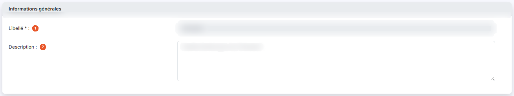
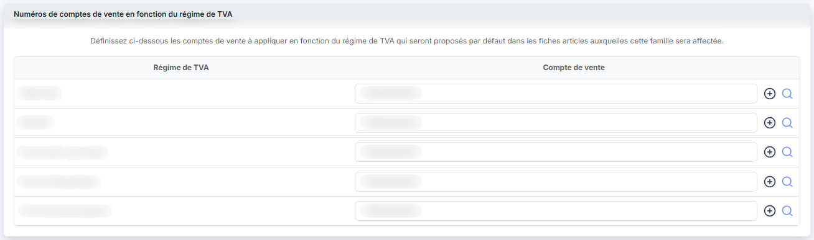
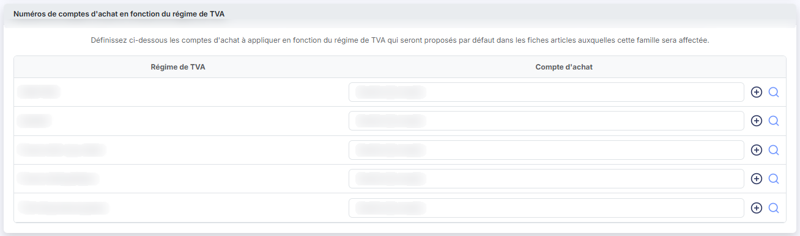
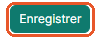

# Familles d'articles


**Où le trouver :** Panneau **Paramètres** › **Données** › **Tiers et commercial** › **Familles d'articles**



**En bref** — Cet écran permet de regrouper vos articles par famille. Une famille porte des comptes de vente et d'achat proposés par défaut dans les fiches articles qui lui sont rattachées.

* Pour créer une famille : bouton \[Créer une famille d'articles], renseignez son libellé, puis bouton \[Enregistrer].


Cet écran s'ouvre depuis le panneau « Paramètres » : « Paramètres > Données > Tiers et commercial > Familles d'articles ».

<figure><figcaption>
Écran « Familles d'articles » de la nouvelle interface
</figcaption></figure>

Cette option permet de regrouper vos articles par famille : les arbustes, les fleurs, les prestations de pose. La famille vous sert à retrouver et à éditer vos articles par groupe, et elle porte des comptes de vente et d'achat qui seront proposés par défaut dans les fiches articles auxquelles vous l'affecterez.

Ce fichier n'est accessible que si vous avez activé la gestion des familles d'articles dans le panneau « Paramètres » : « Paramètres > Gestion commerciale > Articles », interrupteur « Utiliser les familles d'articles ». C'est aussi dans ce paramétrage que vous décidez si l'appartenance à une famille est obligatoire ou facultative dans la fiche article.

Une famille ne comporte qu'un libellé et une description, plus ses comptes par régime de TVA. Deux familles ne peuvent pas avoir le même libellé.

## La liste des familles d'articles

L'écran s'ouvre directement sur la liste de vos familles, triée par ordre croissant de libellé. Au-dessus de la liste, la barre « Rechercher une famille d'articles… » et le bouton \[Filtres] permettent de restreindre l'affichage ; sans critère, elle est présentée en entier.

Elle présente deux colonnes :

| Champ           | Ce qu'il faut savoir                                                                                                |
| --------------- | ------------------------------------------------------------------------------------------------------------------- |
| **Libellé**     | Le nom que vous avez donné à la famille. C'est ce libellé qui est proposé dans les fiches articles.                 |
| **Description** | Le complément d'information que vous y avez associé. Il ne sert qu'ici, à vous rappeler ce que recouvre la famille. |

Il n'y a pas de colonne « Code » : si vous souhaitez numéroter vos familles, faites-le à l'intérieur du libellé.

Le bouton \[Vue] permet de choisir les colonnes affichées et d'enregistrer des vues, et le bouton \[Exporter] donne accès à l'aperçu, à l'impression et aux exports de la liste. Sous la liste, « Sélectionner la page » et « Tout sélectionner (N) » étendent la sélection à la page affichée ou à toutes les familles. Le fonctionnement des listes du logiciel, la personnalisation des colonnes et la barre de pagination sont décrits dans le chapitre « Généralités » en tête de la présente aide.

## Les commandes de chaque ligne

Un clic sur une ligne la sélectionne. Au survol d'une ligne, un pictogramme « Autres actions » (trois points) apparaît à son extrémité droite et ouvre un menu à trois entrées.

L'entrée « Modifier » ouvre la fiche de la famille.

Selon les droits qui vous sont accordés, l'une ou l'autre de ces commandes peut ne pas vous être proposée.

## Bouton \[Créer une famille d'articles]

Situé dans la barre du bas, à droite, hors du tableau, il ouvre une fiche vierge pour créer une famille.

## Bouton \[Supprimer]

Il apparaît dans le bandeau de sélection, qui s'affiche au bas de l'écran dès qu'une ligne est sélectionnée (« 1 famille d'articles sélectionnée », avec le lien « Tout désélectionner ») et remplace alors la barre où figure \[Créer une famille d'articles]. Il supprime en une fois, après confirmation, toutes les familles sélectionnées. Les règles de suppression décrites ci-dessus s'appliquent de la même façon.

## Rubrique « Informations générales »

<figure><figcaption>
Rubrique « Informations générales »
</figcaption></figure>

| Champ              | Ce qu'il faut savoir                                                                                                                                                                                          |
| ------------------ | ------------------------------------------------------------------------------------------------------------------------------------------------------------------------------------------------------------- |
| 1. **Libellé**     | Il n'est plus modifiable une fois la famille créée : le champ vous est présenté en lecture seule quand vous rouvrez la fiche. C'est ce libellé qui est proposé dans le champ « Famille » des fiches articles. |
| 2. **Description** | Facultative.                                                                                                                                                                                                  |

La fiche ne comporte aucun autre champ : ni code, ni date de création.

## Rubrique « Numéros de comptes de vente en fonction du régime de TVA »

<figure><figcaption>
Rubrique « Numéros de comptes de vente en fonction du régime de TVA »
</figcaption></figure>

Le logiciel affiche une ligne par régime de TVA du fichier « Régimes de TVA » ; indiquez pour chacun le compte de vente à appliquer. Ces comptes seront proposés par défaut dans les fiches articles auxquelles cette famille sera affectée : vous n'aurez donc pas à les ressaisir article par article.

Saisissez le numéro de compte, ou cliquez sur le pictogramme « Loupe » pour le rechercher au plan comptable. Le pictogramme « Créer » (un « + » cerclé) permet de créer le compte s'il n'existe pas encore. Le même compte peut être repris sur plusieurs régimes de TVA.

## Rubrique « Numéros de comptes d'achat en fonction du régime de TVA »

<figure><figcaption>
Rubrique « Numéros de comptes d'achat en fonction du régime de TVA »
</figcaption></figure>

Même principe pour les achats : une ligne par régime de TVA, dans laquelle vous indiquez le compte d'achat à appliquer, avec la même loupe de recherche et le même pictogramme de création de compte. Ces comptes sont eux aussi proposés par défaut dans les fiches articles de la famille.

## Bouton \[Enregistrer]

<figure><figcaption>
Bouton [Enregistrer]
</figcaption></figure>

Il enregistre la fiche et vous ramène à la liste des familles.

## Retour à la liste

Le bouton \[Retour] n'est plus affiché dans la fiche : la flèche « Retour » (chevron), à gauche de la barre d'onglets du panneau, ferme la fiche sans enregistrer et vous ramène à la liste des familles.
