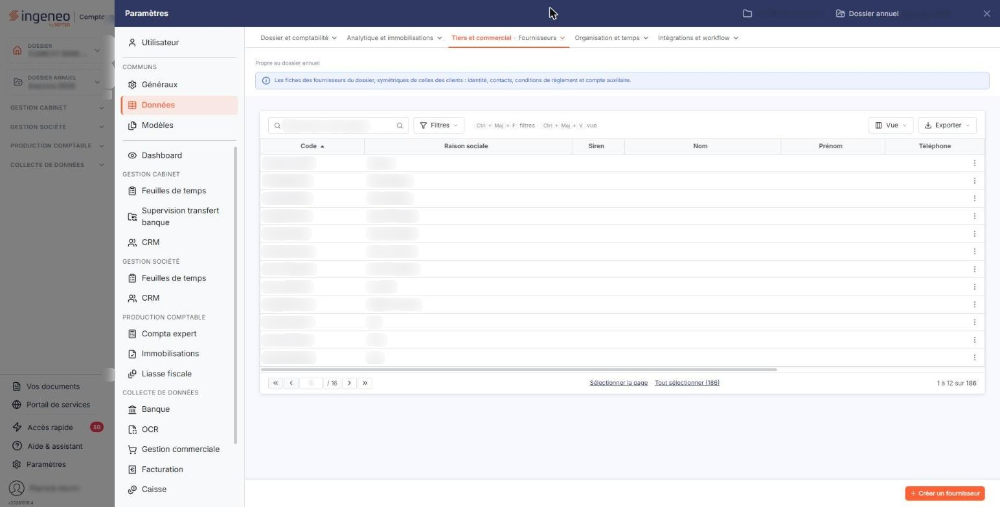
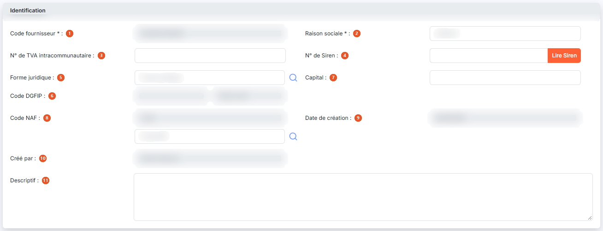
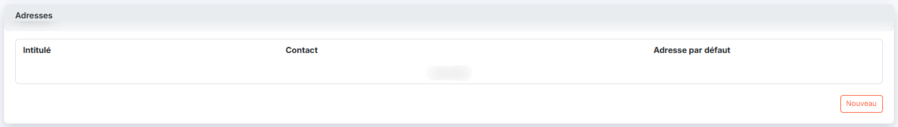
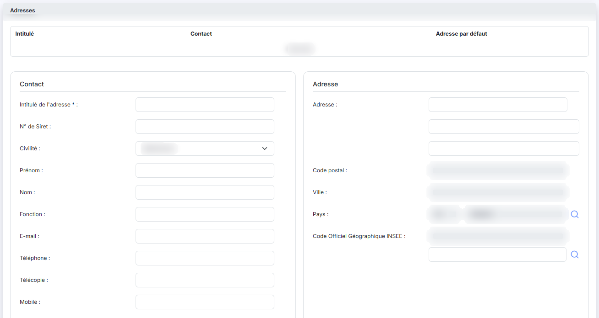
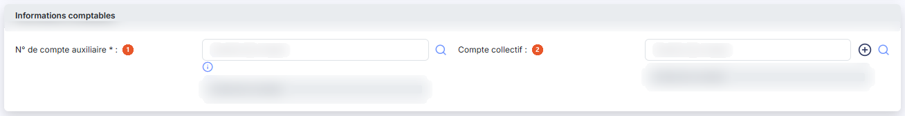
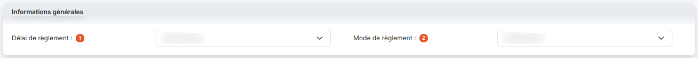
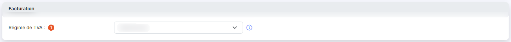
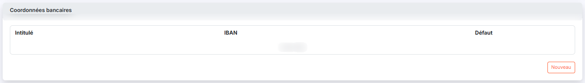
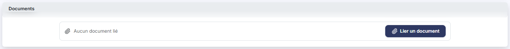
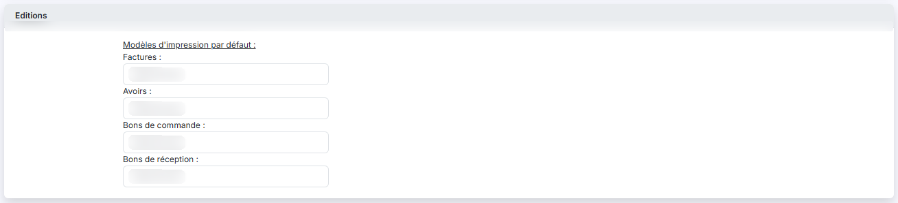

# Fournisseurs


**Où le trouver :** Panneau **Paramètres** › **Données** › **Tiers et commercial** › **Fournisseurs**



**En bref** — Cet écran tient le fichier des fournisseurs, commun à plusieurs modules : identification, adresses, informations comptables, facturation et coordonnées bancaires.

* Pour créer un fournisseur : bouton \[Créer un fournisseur], puis complétez les rubriques de la fiche.
* Pour remplir la fiche à partir du numéro de Siren : bouton \[Lire Siren].


Le fichier « Fournisseurs » est commun à plusieurs modules. Ainsi, où que vous ayez créé ou modifié un fournisseur, il sera visible de la même manière dans tous les modules.

<figure><figcaption>
Écran « Fournisseurs » de la nouvelle interface
</figcaption></figure>

La fiche d'un fournisseur est organisée en huit rubriques qui se présentent l'une sous l'autre, sans onglet : « Identification », « Adresses », « Informations comptables », « Informations générales », « Facturation », « Coordonnées bancaires », « Documents » et « Editions ». Vous retrouvez ces mêmes rubriques, dans le même ordre, en création comme en modification.

## La liste des fournisseurs

La liste présente huit colonnes : **Code**, **Raison sociale**, **Siren**, **Nom**, **Prénom**, **Téléphone**, **Créé le** et **Créé par**. Elle est triée par défaut sur le code du fournisseur, dans l'ordre croissant, et chaque colonne peut servir de critère de tri.

Au-dessus de la liste, la barre « Rechercher un fournisseur… » permet de retrouver un fournisseur ; le bouton \[Filtres] ouvre le volet de filtres, le bouton \[Vue] le menu des vues et le bouton \[Exporter] le menu d'aperçu, d'impression et d'export de la liste. Il n'y a plus de bouton \[Afficher] : la liste se recharge dès que vous modifiez un critère. L'écran porte la mention « Propre au dossier annuel » et un bandeau d'information qui rappelle l'objet du fichier.

Un clic sur une ligne la sélectionne. Au survol, la ligne porte en fin de ligne un pictogramme « Autres actions » (trois points), qui ouvre un menu de deux entrées : « Modifier » ouvre la fiche du fournisseur en modification et « Supprimer » le supprime. Sous la liste, les liens « Sélectionner la page » et « Tout sélectionner » permettent d'étendre la sélection.

## Bouton \[Créer un fournisseur]

Placé en bas à droite de l'écran, il ouvre une fiche vierge pour créer un nouveau fournisseur.

## Bouton \[Supprimer]

Dès qu'une ligne est sélectionnée, un bandeau de sélection (« 1 fournisseur sélectionné », « Tout désélectionner ») remplace la barre du bas et porte le bouton \[Supprimer], qui supprime tous les fournisseurs sélectionnés.

## Rubrique « Identification »

<figure><figcaption>
Rubrique « Identification »
</figcaption></figure>

| Champ                               | Ce qu'il faut savoir                                                                                                                                                                                                                                                                                            |
| ----------------------------------- | --------------------------------------------------------------------------------------------------------------------------------------------------------------------------------------------------------------------------------------------------------------------------------------------------------------- |
| 1. **Code fournisseur**             | Il doit être unique. Vous ne le saisissez qu'à la création : lorsque vous ouvrez un fournisseur existant, ce champ n'est plus modifiable.                                                                                                                                                                       |
| 2. **Raison sociale**               | —                                                                                                                                                                                                                                                                                                               |
| 3. **N° de TVA intracommunautaire** | —                                                                                                                                                                                                                                                                                                               |
| 4. **N° de Siren**                  | —                                                                                                                                                                                                                                                                                                               |
| 5. **Forme juridique**              | Facultative. Une loupe vous aide à la choisir.                                                                                                                                                                                                                                                                  |
| 6. **Code DGFIP**                   | Non saisissable. Il est renseigné par le logiciel à partir de la forme juridique.                                                                                                                                                                                                                               |
| 7. **Capital**                      | —                                                                                                                                                                                                                                                                                                               |
| 8. **Code NAF**                     | Ce champ est double : le code proprement dit, que vous ne saisissez pas directement, et son libellé, avec une loupe qui vous permet de choisir le code dans la nomenclature.                                                                                                                                    |
| 9. **Date de création**             | Renseignée automatiquement, non modifiable. C'est la date de création de la fiche fournisseur.                                                                                                                                                                                                                  |
| 10. **Créé par**                    | Renseigné automatiquement, non modifiable. C'est le nom de l'utilisateur ayant créé la fiche fournisseur.                                                                                                                                                                                                       |
| 11. **Descriptif**                  | Zone de texte.                                                                                                                                                                                                                                                                                                  |
| **Bouton \[Lire Siren]**            | Il permet, grâce à une API, de remplir plusieurs champs de la fiche : le numéro de TVA intracommunautaire, la forme juridique, le capital, le code NAF, le nombre de salariés, l'activité (renseignée dans le champ **Descriptif**), l'adresse avec le libellé « Adresse principale » suivi du numéro de Siren. |
| **Code juridique usuel**            | Non saisissable. Il est lui aussi renseigné par le logiciel à partir de la forme juridique.                                                                                                                                                                                                                     |

## Rubrique « Adresses »

<figure><figcaption>
Rubrique « Adresses »
</figcaption></figure>

<figure><figcaption>
Rubrique « Adresses »
</figcaption></figure>

Une fiche fournisseur peut contenir autant d'adresses que vous le souhaitez. La liste des adresses présente trois colonnes : **Intitulé**, **Contact** et **Adresse par défaut**. Tant qu'aucune adresse n'a été créée, la mention « Liste vide » s'affiche à la place des lignes.

Lorsque vous indiquez qu'une adresse est l'adresse par défaut, c'est elle qui sera affectée lors de la création de toute nouvelle pièce commerciale.

Les adresses sont communes aux fichiers fournisseurs et comptes auxiliaires.

Le bouton **\[Nouveau]** de la rubrique déplie sous la liste le formulaire d'une adresse vierge. Il ne s'agit pas d'une fenêtre : la saisie se fait dans la fiche elle-même.

Le formulaire comporte les champs suivants : **Intitulé de l'adresse**, seul champ obligatoire, **N° de Siret**, puis **Civilité**, **Prénom**, **Nom** et **Fonction**, qui identifient le contact rattaché à cette adresse, puis **E-mail**, **Téléphone**, **Télécopie** et **Mobile**, puis l'**Adresse** sur trois lignes de saisie, le **Code postal** et la **Ville** — grisés et affichant « Déduit de la commune » lorsque le pays est la France ; si la commune choisie est absente du référentiel postal, un message s'affiche en haut de l'écran (« Commune absente du référentiel postal (ancienne commune fusionnée ?) : saisissez le code postal et la ville. ») et ces deux zones deviennent saisissables —, le **Pays** et le **Code Officiel Géographique INSEE** — pour ces deux derniers, le code n'est pas saisissable directement : le pays se choisit par sa loupe, qui ouvre le panneau « Sélection d'un pays », et le code INSEE se renseigne par le champ **Commune** placé juste dessous, dont la loupe ouvre le panneau « Sélection d'un code COG Insee » (vous retenez une ligne, puis le bouton **\[Sélectionner]** du pied la reporte dans la fiche) — et enfin **Adresse par défaut**, positionné sur Non.

Le formulaire d'adresse d'un fournisseur est plus court que celui d'une fiche client : il ne comporte ni champ **Type d'adresse**, ni champ **Commentaire**, et il ne propose qu'un seul champ **E-mail** là où la fiche client en propose deux, un professionnel et un personnel. Il se ferme par le bouton **\[Enregistrer]**, qui ajoute l'adresse à la liste, ou par le bouton **\[Annuler]**, qui le referme sans rien conserver.

## Rubrique « Informations comptables »

<figure><figcaption>
Rubrique « Informations comptables »
</figcaption></figure>

| Champ                          | Ce qu'il faut savoir                                                                                                                                                                                                                                                                                                                                                                                                                                                                                                                             |
| ------------------------------ | ------------------------------------------------------------------------------------------------------------------------------------------------------------------------------------------------------------------------------------------------------------------------------------------------------------------------------------------------------------------------------------------------------------------------------------------------------------------------------------------------------------------------------------------------ |
| 1. **N° de compte auxiliaire** | 
C'est ce numéro de compte qui sera repris lors de la création des écritures d'achats. Une loupe vous permet de le choisir dans le plan comptable auxiliaire, et l'intitulé du compte s'affiche à côté du numéro, sans être modifiable. Le logiciel vous propose comme numéro de compte les n premiers caractères du code fournisseur (n étant le nombre de caractères que doit contenir un numéro de compte tel que défini également dans le panneau Paramètres, rubrique « Gestion commerciale », onglet « Connexion comptabilité »).
 |
| 2. **Compte collectif**        | C'est le compte général auquel doit être rattaché le compte auxiliaire. Comme pour le compte auxiliaire, l'intitulé du compte s'affiche à côté du numéro sans être modifiable, une loupe vous permet de choisir le compte, et un bouton portant le signe plus vous permet de créer un compte qui n'existerait pas encore.                                                                                                                                                                                                                        |

Le logiciel vous propose comme numéro de compte celui que vous avez indiqué dans le panneau Paramètres, rubrique « Gestion commerciale », onglet « Pièces commerciales ». Ce numéro par défaut reste modifiable.

## Rubrique « Informations générales »

<figure><figcaption>
Rubrique « Informations générales »
</figcaption></figure>

Cette rubrique ne comporte que deux listes déroulantes.

| Champ                     | Ce qu'il faut savoir                                                                                                                                                                                                                                                                                                          |
| ------------------------- | ----------------------------------------------------------------------------------------------------------------------------------------------------------------------------------------------------------------------------------------------------------------------------------------------------------------------------- |
| 1. **Délai de règlement** | Au niveau de la fiche fournisseur, le délai de règlement est obligatoire dans toutes les pièces commerciales et permet de calculer l'échéance à partir de la date d'une pièce. S'il est renseigné ici, il sera affecté par défaut lors de la création de toute pièce commerciale pour ce fournisseur mais restera modifiable. |
| 2. **Mode de règlement**  | S'il est renseigné, il sera affecté par défaut lors de la création de toute pièce commerciale pour ce fournisseur mais restera modifiable.                                                                                                                                                                                    |

## Rubrique « Facturation »

<figure><figcaption>
Rubrique « Facturation »
</figcaption></figure>

**Régime de TVA** : facultatif au niveau de la fiche fournisseur, le régime de TVA est obligatoire dans toutes les pièces commerciales et permet de gérer tous les cas de facturation en local ou à l'import que l'entreprise soit domiciliée en France métropolitaine ou en France d'outre-mer.

S'il est renseigné ici, il sera affecté par défaut lors de la création de toute pièce commerciale pour ce fournisseur mais restera modifiable.

## Rubrique « Coordonnées bancaires »

<figure><figcaption>
Rubrique « Coordonnées bancaires »
</figcaption></figure>

Un fournisseur peut disposer de plusieurs banques. La liste présente trois colonnes : **Intitulé**, **IBAN** et **Défaut**. Tant qu'aucune banque n'a été saisie, la mention « Liste vide » s'affiche à la place des lignes.

## Rubrique « Documents »

<figure><figcaption>
Rubrique « Documents »
</figcaption></figure>

Vous pouvez rattacher à la fiche du fournisseur autant de documents que nécessaire, par exemple un contrat ou des conditions tarifaires. Tant qu'aucun document n'a été rattaché, la mention « Aucun document lié » s'affiche à la place des lignes.

Un bouton unique, le bouton **\[Lier un document]**, permet d'ajouter un document.

## Rubrique « Editions »

<figure><figcaption>
Rubrique « Editions »
</figcaption></figure>

Sous l'intitulé « Modèles d'impression par défaut : », quatre listes déroulantes vous permettent de choisir, pour chaque type de pièce d'achat, le modèle qui sera affecté par défaut pour ce fournisseur : **Factures**, **Avoirs**, **Bons de commande** et **Bons de réception**. Ce modèle restera modifiable dans chaque pièce commerciale créée pour le fournisseur.

Chaque liste ne propose que les modèles paramétrés pour le type de pièce correspondant : elle reste sur « Sélectionnez » et n'offre aucun choix tant qu'aucun modèle n'a été créé.

## Bouton \[Enregistrer]

<figure><figcaption>
Bouton [Enregistrer]
</figcaption></figure>

Il valide la création ou la modification de la fiche fournisseur.

## Retour à la liste

Le chevron « Retour », à gauche de la barre d'onglets du panneau Paramètres, vous ramène à la liste des fournisseurs sans enregistrer la fiche en cours.

Le bouton \[Enregistrer] est le seul bouton de bas de fiche, en création comme en modification : la fiche fournisseur ne propose ni archivage, ni duplication, ni suppression. La suppression se fait depuis la liste.
