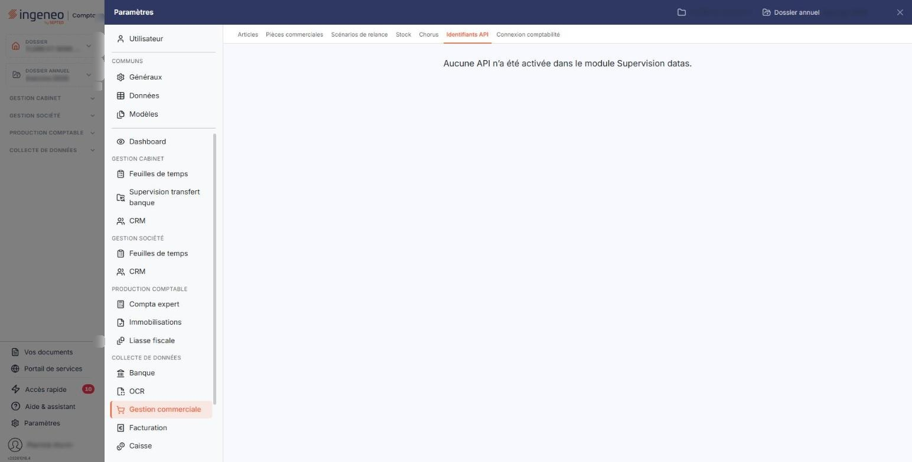

# Identifiants API


**Où le trouver :** Panneau **Paramètres** › **Gestion commerciale** › **Identifiants API**



**En bref** — Cet écran sert à saisir les identifiants de connexion des API activées pour votre abonnement dans le module « Supervision datas ».

* Pour vérifier la connexion : bouton \[Tester la connexion].
* Pour créer des factures depuis les ordres de mission Dashdoc : bouton \[Importer les factures].


Cette option vous permet de renseigner les identifiants de connexion aux API qui ont été activées pour votre abonnement, afin que le logiciel puisse échanger des données avec ces services.

<figure><figcaption>
Écran « Identifiants API » de la nouvelle interface
</figcaption></figure>

Une API doit d'abord être activée par le cabinet dans le module « Supervision datas » : cet écran ne sert qu'à saisir les identifiants d'une API déjà ouverte, il ne permet pas de l'ouvrir.

On y accède par le panneau « Paramètres » : rubrique « Gestion commerciale », puis onglet « Identifiants API ». La même option existe dans la rubrique « Facturation » du panneau : c'est le même écran, avec le même paramétrage.

## Aucune API activée

Tant qu'aucune API n'a été activée pour votre abonnement, l'écran n'affiche qu'une phrase, au centre de la page : « Aucune API n’a été activée dans le module Supervision datas. ». Il ne comporte alors ni rubrique, ni champ, ni bouton — pas même le bouton d'enregistrement.

Ce n'est pas une anomalie et ce n'est pas une déconnexion : c'est l'état normal de l'écran lorsque aucun connecteur n'est ouvert. Adressez-vous à l'administrateur de votre logiciel pour faire activer l'API souhaitée dans le module « Supervision datas ».

## Une API activée

Lorsque au moins une API a été activée, le logiciel affiche le texte « Cette page vous permet de renseigner les identifiants de connexion aux API qui ont été activées. » puis la rubrique de l'API concernée. À ce jour, seule l'API « Dashdoc » est prise en charge par cet écran, et l'écran ne comporte donc qu'une seule rubrique, intitulée « Paramètres Dashdoc ».

| Champ                                             | Ce qu'il faut savoir                                                                                                                                                                                             |
| ------------------------------------------------- | ---------------------------------------------------------------------------------------------------------------------------------------------------------------------------------------------------------------- |
| **Token**                                         | C'est le jeton de connexion que Dashdoc vous a communiqué pour votre compte. Le curseur se place dans ce champ à l'ouverture de l'écran. Ce jeton est un élément confidentiel, au même titre qu'un mot de passe. |
| **Date de dernière synchronisation des fichiers** | Ce champ n'est pas saisissable et n'apparaît qu'une fois une première synchronisation effectuée. Il vous indique quand les clients et les articles ont été rapatriés pour la dernière fois.                      |
| **Date du dernier import des factures**           | Ce champ n'est pas saisissable et n'apparaît qu'une fois un premier import effectué. Il vous indique quand les factures ont été importées pour la dernière fois.                                                 |

## Bouton \[Tester la connexion]

Situé dans la rubrique de l'API, il vérifie que le logiciel parvient à se connecter au service avec le jeton saisi.

## Bouton \[Synchroniser les fichiers]

Ce bouton fait circuler les données dans les **deux sens**, et il est important de le savoir avant de l'employer :

* les **clients** sont importés de Dashdoc vers le logiciel : le logiciel crée chez vous les clients de Dashdoc qui n'existent pas encore ;
* les **articles** suivent le chemin inverse : le logiciel envoie vers Dashdoc les articles de votre fichier qui n'y figurent pas encore, en les rapprochant sur le code article.

Dans les deux sens, la synchronisation ne fait que **créer ce qui manque** : elle ne met jamais à jour un élément déjà présent. Une modification faite d'un côté après la synchronisation n'est donc pas répercutée de l'autre.

## Bouton \[Importer les factures]

Il crée des factures à partir des ordres de mission trouvés chez Dashdoc et non encore importés. Chaque facture créée porte la référence de l'ordre de mission d'origine, ce qui évite qu'il soit importé deux fois ; si vous supprimez ou modifiez cette référence dans la facture, l'ordre de mission sera de nouveau importé au prochain appel.

## Bouton \[Enregistrer]

Situé en bas de page, il enregistre les identifiants saisis. Ce bouton peut ne pas apparaître selon les droits attachés à votre profil.
