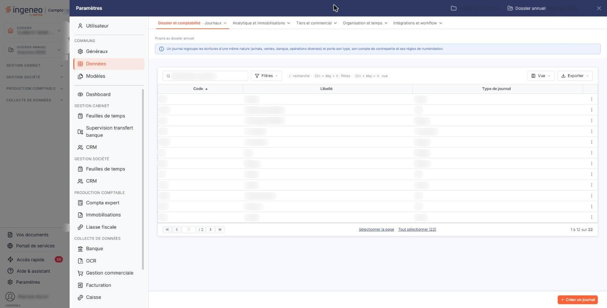
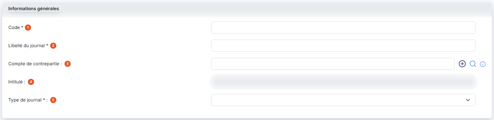
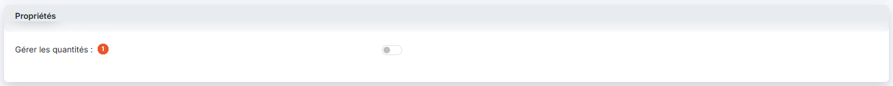

# Journaux


**Où le trouver :** Panneau **Paramètres** › **Données** › **Dossier et comptabilité** › **Journaux**



**En bref** — Cet écran administre les journaux du dossier annuel en cours, les mêmes que ceux de la comptabilité. Attention : supprimer un journal supprime toutes ses écritures de l'exercice.

* Pour créer un journal : bouton \[Créer un journal], renseignez la fiche, puis bouton \[Enregistrer].


Cette option permet d'administrer les journaux utilisés pour la saisie comptable. Vous pouvez créer autant de journaux que nécessaire.

<figure><figcaption>
Écran « Journaux » de la nouvelle interface
</figcaption></figure>

Cet écran s'ouvre par le panneau « Paramètres » : rubrique « Données », puis onglet « Dossier et comptabilité » et, dans son menu déroulant, entrée « Journaux ». Un bandeau bleu en haut de l'écran, sous la mention « Propre au dossier annuel », indique : « Un journal regroupe les écritures d'une même nature (achats, ventes, banque, opérations diverses) et porte son type, son compte de contrepartie et ses règles de numérotation. »

Il s'agit des journaux de l'exercice (dossier annuel) en cours : ce sont les mêmes que ceux de la comptabilité.

L'écran présente la liste des journaux du dossier, une ligne par journal. Les colonnes affichées sont, dans l'ordre : **Code**, **Libellé** et **Type de journal**. Elles reprennent les informations saisies dans la fiche du journal, décrite plus bas. Les trois colonnes sont triables et redimensionnables ; la liste est triée par défaut sur le code, par ordre croissant.

Au-dessus de la liste se trouvent la barre « Rechercher un journal… » et les boutons \[Filtres], \[Vue] et \[Exporter] ; il n'y a pas de bouton \[Filtres spéciaux]. Aucun critère n'est actif à l'ouverture : la totalité des journaux du dossier est donc affichée à l'ouverture de l'écran (22 journaux sur le dossier relevé).

Il n'y a pas de case à cocher : un clic sur une ligne la sélectionne. Sous la liste, le lien « Sélectionner la page » sélectionne toutes les lignes affichées et le lien « Tout sélectionner (22) » étend la sélection à toutes les pages (le nombre entre parenthèses est celui des journaux de la liste). Tant qu'une ligne est sélectionnée, un bandeau « 1 journal sélectionné », avec le lien « Tout désélectionner » et le bouton \[Supprimer], remplace le bouton de création.

Au survol d'une ligne, le pictogramme « Autres actions » (trois points verticaux) apparaît à droite de la ligne. Il ouvre trois entrées : « Modifier », qui ouvre la fiche du journal, « Dupliquer », qui prépare la création d'un nouveau journal à partir de celui-ci, et « Supprimer ».

bouton **\[Créer un journal]**

Il est en bas à droite de l'écran, hors de la liste, et ouvre la fiche d'un nouveau journal.

bouton **\[Supprimer]**

Il se trouve dans le bandeau de sélection. Il supprime en une seule fois tous les journaux que vous avez sélectionnés dans la liste.

La fiche d'un journal est organisée en deux rubriques, présentées dans cet ordre : « Informations générales » et « Propriétés ».

Le logiciel gère d'autres paramètres de journal, qui concernent la saisie comptable elle-même : ils ne sont pas proposés sur l'écran relevé (panneau ouvert depuis la Gestion commerciale) : la rubrique « Saisie » est présente dans la page mais masquée. Les deux rubriques sont des cartes l'une sous l'autre, avec le bouton \[Enregistrer] en bas à droite de l'écran.

## Rubrique « Informations générales »

<figure><figcaption>
Rubrique « Informations générales »
</figcaption></figure>

| Champ                         | Ce qu'il faut savoir                                                                                                                                                                                                                                                                                                                                                                                                           |
| ----------------------------- | ------------------------------------------------------------------------------------------------------------------------------------------------------------------------------------------------------------------------------------------------------------------------------------------------------------------------------------------------------------------------------------------------------------------------------ |
| 1. **Code**                   | Sur 4 caractères au maximum. Il est saisissable à la création, puis n'est plus modifiable ensuite : sur la fiche d'un journal déjà enregistré, il apparaît grisé.                                                                                                                                                                                                                                                              |
| 2. **Libellé du journal**     | Sur 25 caractères au maximum. Il reste saisissable après enregistrement du journal.                                                                                                                                                                                                                                                                                                                                            |
| 3. **Compte de contrepartie** | 
Sur 12 caractères au maximum. Le pictogramme « Information » placé à droite du champ rappelle qu'il s'agit du « Compte utilisé pour solder l'écriture en saisie ». Deux pictogrammes vous aident à renseigner ce champ : le pictogramme « Plus » ouvre la création d'un compte, et le pictogramme « Loupe » ouvre la recherche dans le plan comptable, également accessible par le raccourci clavier Ctrl + Alt + R.
 |
| 4. **Intitulé**               | Ce champ n'est pas saisissable ; c'est le logiciel qui l'alimente avec l'intitulé du compte de contrepartie, sur 20 caractères au maximum.                                                                                                                                                                                                                                                                                     |
| 5. **Type de journal**        | Le type d'un journal indique la nature des opérations qui y seront saisies. La liste déroulante vous propose : **Achat**, **Vente**, **OD**, **Banque**, **Caisse**, **Reprise de balance**, **Divers** et **A-nouveaux**. Elle est vide sur la fiche d'un nouveau journal, et reste sélectionnable sur un journal déjà enregistré.                                                                                            |

## Rubrique « Propriétés »

<figure><figcaption>
Rubrique « Propriétés »
</figcaption></figure>

| Champ                             | Ce qu'il faut savoir                                                                                                                  |
| --------------------------------- | ------------------------------------------------------------------------------------------------------------------------------------- |
| 1. **Gérer les quantités**        | Interrupteur désactivé sur la fiche d'un nouveau journal.                                                                             |
| 2. **Nombre de champs de saisie** | Deux choix vous sont proposés, **1 champ** et **2 champs**. Ils déterminent le nombre de quantités saisissables par ligne d'écriture. |

Ce choix n'apparaît que si vous avez activé l'interrupteur « Gérer les quantités » : sur un journal qui ne gère pas les quantités, la rubrique ne comporte que l'interrupteur.

bouton **\[Enregistrer]**

Il enregistre le journal.

**Retour à la liste**

Le bouton \[Retour] est masqué dans la fiche : le chevron « Retour », à gauche de la barre d'onglets du panneau, revient à la liste sans enregistrer les modifications en cours.
