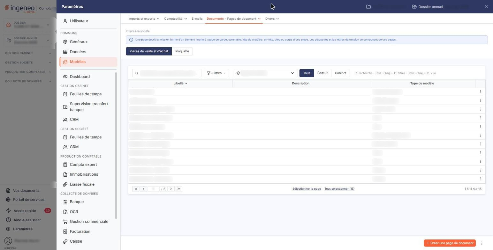
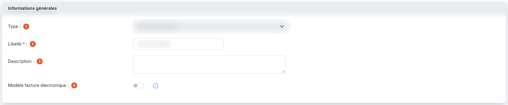
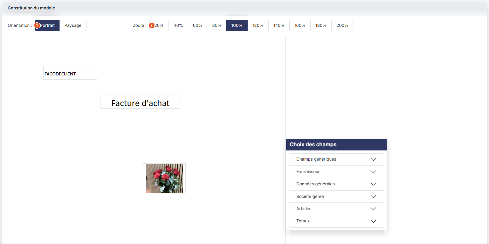

# Modèles d'impression


**Où le trouver :** Panneau **Paramètres**



**En bref** — Cet écran gère les modèles d'impression qui déterminent la présentation de vos pièces commerciales, lettres de relance et courriers clients.

* Pour créer votre modèle à partir d'un existant : menu de la ligne, entrée « Dupliquer », puis adaptez la copie.
* Pour partir d'un modèle vierge : bouton \[Créer une page de document], puis choisissez le type.


Les modèles d'impression déterminent la présentation de vos pièces commerciales : factures, devis, avoirs, bons de commande, bons de livraison, mais aussi lettres de relance et courriers clients. Le logiciel en contient déjà un certain nombre ; si vous souhaitez créer le vôtre, dupliquez plutôt l'un de ceux qui existent puis modifiez-le : cela vous prendra moins de temps que de le composer entièrement.

<figure><figcaption>
Écran « Modèles d'impression » de la nouvelle interface
</figcaption></figure>

L'outil est puissant, car il permet de régler de nombreux détails ; il demande donc un certain temps pour être maîtrisé.

L'option présente d'abord la liste de vos modèles ; l'ouverture d'un modèle donne accès à l'écran de composition.

Dans le panneau Paramètres, cet écran se trouve dans la rubrique « Modèles », onglet « Documents », entrée « Pages de document » : c'est sous ce nom que l'écran est présenté, et il s'ouvre sur la pastille « Pièces de vente et d'achat », celle que décrit cette page. La pastille « Plaquette », à côté, concerne les pages des plaquettes et n'est pas décrite ici.

## La liste des modèles

Au-dessus de la liste, la barre « Rechercher une page de document… » et le bouton \[Filtres] permettent de retrouver un modèle. La liste déroulante **Type de modèle** vous permet de n'afficher que les modèles d'un type donné ; elle est posée à l'ouverture sur son choix neutre « Type de modèle » et propose : Avoir, Avoir fournisseur, Bon de commande client, Bon de commande fournisseur, Bon de livraison, Bon de réception, Courrier client, Demandes infos client, Devis, Facture, Facture fournisseur et Lettre de relance. Les trois boutons « Tous », « Éditeur » et « Cabinet » qui la suivent limitent l'affichage selon l'origine des modèles : « Tous » est actif à l'ouverture ; sur le dossier observé, « Éditeur » n'affiche aucun modèle et « Cabinet » les affiche tous. Dès que l'un de ces deux boutons est actif, le lien « Tout effacer » apparaît à côté.

La liste présente trois colonnes : **Libellé**, **Description** et **Type de modèle**. Les trois sont triables et redimensionnables ; la liste est triée par défaut sur le libellé, par ordre croissant.

À l'extrémité droite de la barre, le bouton \[Vue] permet de gérer vos vues et de choisir les colonnes affichées, et le bouton \[Exporter] ouvre le menu d'édition de la liste.

Un clic sur une ligne la sélectionne. Au survol d'une ligne, un pictogramme « Autres actions » (trois points) apparaît en dernière colonne et ouvre un menu à trois entrées : « Modifier », qui ouvre le modèle en modification, « Dupliquer », qui en crée une copie, et « Supprimer ». Sous la liste, « Sélectionner la page » et « Tout sélectionner (N) » sélectionnent d'un coup les modèles de la page ou tous les modèles. Dès qu'une ligne est sélectionnée, un bandeau apparaît au bas de l'écran, à la place de la barre du bas : il indique le nombre de pages de document sélectionnées et propose « Tout désélectionner » et les boutons \[Supprimer] et \[Exporter].

## Bouton \[Créer une page de document]

Situé en bas à droite de l'écran, il ouvre l'écran de composition sur un modèle vierge. La liste déroulante **Type :** y est positionnée sur sa première valeur, « Avoir » : pensez à choisir le type qui vous convient avant de commencer.

## Bouton \[Exporter]

Si vous avez plusieurs sociétés gérées, il vous permet de copier dans les autres les modèles que vous avez créés dans l'une d'entre elles.

Sélectionnez les modèles à exporter dans la liste en cliquant sur leur ligne, puis cliquez sur le bouton \[Exporter] du bandeau de sélection (à ne pas confondre avec le bouton \[Exporter] de la barre située au-dessus de la liste, qui édite la liste elle-même).

## Commande « Imprimer la liste des champs »

Située dans le menu « Autres actions » (trois points) à droite de la barre du bas.

## Bouton \[Supprimer]

Il s'affiche dans le bandeau de sélection, en bas de l'écran, dès qu'une ligne au moins est sélectionnée, et supprime tous les modèles sélectionnés.

## Rubrique « Informations générales »

<figure><figcaption>
Rubrique « Informations générales »
</figcaption></figure>

| Champ                                                      | Ce qu'il faut savoir                                                                                                                                                                                                                                                                                                                |
| ---------------------------------------------------------- | ----------------------------------------------------------------------------------------------------------------------------------------------------------------------------------------------------------------------------------------------------------------------------------------------------------------------------------- |
| 1. **Type**                                                | Liste déroulante proposant les mêmes valeurs que le filtre de la liste, sans le choix neutre « Type de modèle ». C'est le type qui détermine à quelles pièces le modèle s'applique et quels champs vous seront proposés. Une fois la composition commencée par le positionnement d'un premier champ, le type n'est plus modifiable. |
| 
2. <strong>Libellé</strong> <em>Obligatoire</em>
 | 30 caractères au maximum. C'est sous ce libellé que le modèle est proposé partout ailleurs : dans la liste, dans les paramètres des pièces commerciales et à l'édition d'une pièce.                                                                                                                                                 |
| 3. **Description**                                         | Facultative, sur plusieurs lignes. Elle est reprise dans la colonne « Description » de la liste.                                                                                                                                                                                                                                    |
| 4. **Modèle facture électronique**                         | Interrupteur (désactivé par défaut), accompagné d'un pictogramme « Information » qui indique : « Si vous répondez « Oui » un fichier de type XML (au format Factur-X répondant à la norme de la facture électronique) sera joint au PDF. »                                                                                          |

## Rubrique « Constitution du modèle »

<figure><figcaption>
Rubrique « Constitution du modèle »
</figcaption></figure>

Elle porte deux réglages, puis la page de conception.

| Champ              | Ce qu'il faut savoir                                                                                                 |
| ------------------ | -------------------------------------------------------------------------------------------------------------------- |
| 1. **Orientation** | Deux boutons, « Portrait » et « Paysage ».                                                                           |
| 2. **Zoom**        | Dix boutons, de « 20% » à « 200% », par pas de 20. Ce réglage ne change que votre confort de travail, pas le modèle. |

Sous ces deux réglages s'affiche la **page de conception** : c'est le cadre dans lequel se trouve le modèle à proprement parler. C'est là que vous positionnez chacun des éléments du modèle, et c'est également là que vous sélectionnez un élément déjà posé pour le modifier.

## Encadré « Choix des champs »

Cet encadré, placé à côté de la page de conception, contient tous les champs que vous pouvez poser sur votre modèle. Ils sont classés par rubrique : cliquez sur le libellé d'une rubrique pour la déplier, toutes étant repliées à l'ouverture. Chaque champ est présenté par son libellé en clair, suivi de son code — plus court, et donc plus commode à afficher dans le modèle.

Les rubriques sont au nombre de six :

| Champ                 | Ce qu'il faut savoir                                                                                                                                                                                                                     |
| --------------------- | ---------------------------------------------------------------------------------------------------------------------------------------------------------------------------------------------------------------------------------------- |
| **Champs génériques** | Les champs qui ne dépendent pas du type de pièce et sont donc disponibles dans tous les modèles : saisie libre, numéro de page, nombre de pages, date et heure système, image.                                                           |
| **Emetteur**          | L'identification de celui qui émet la pièce — civilité, nom, raison sociale, adresse, coordonnées, numéro de TVA intracommunautaire, SIREN, code NAF, forme juridique, capital social.                                                   |
| **Données générales** | Toutes les données qui n'appartiennent pas à une autre rubrique : numéro et date de la pièce, objet, dates de création, de modification et de validation.                                                                                |
| **Client**            | L'identification du destinataire de la pièce, avec les coordonnées de son contact.                                                                                                                                                       |
| **Articles**          | Les éléments des lignes d'articles de la pièce — code et désignation du produit, code et taux de TVA, quantité, unité, prix unitaires, remise, montants. Il s'agit bien des lignes de la pièce, et non du fichier des articles lui-même. |
| **Totaux**            | Toutes les valeurs totalisées de la pièce, qui figurent en général en pied de page : totaux HT, de TVA et TTC, avant et après remise, taux et montants de remise, ventilation par code de TVA, quantité totale.                          |

Pour poser un champ sur votre modèle, faites-le glisser depuis cette liste jusqu'à l'endroit voulu de la page de conception.

## Les boutons de l'écran de composition

Trois boutons, dans la barre du bas à droite, présents à l'identique en création et en modification.

bouton **\[Enregistrer]** : il enregistre le modèle.

bouton **\[Visualiser]** : il vous montre le résultat de votre composition.

bouton **\[Annuler la dernière action]** : il défait la dernière modification apportée au modèle.

Le bouton \[Retour] n'est plus affiché : pour revenir à la liste des modèles, utilisez le chevron « Retour » à gauche de la barre d'onglets du panneau Paramètres.
