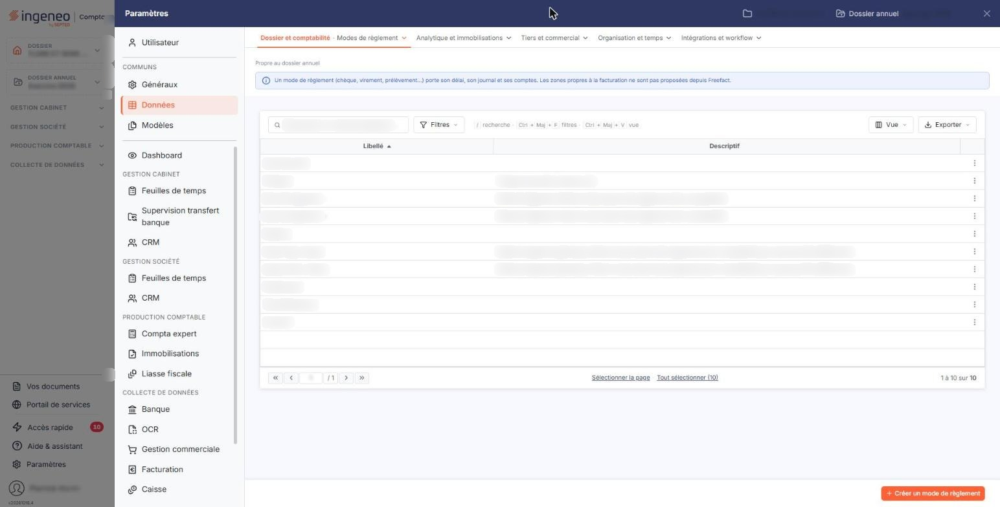
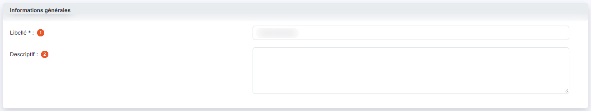
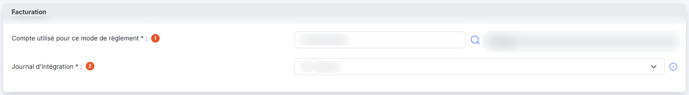
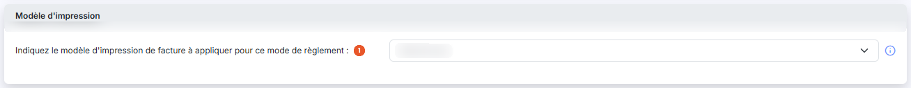
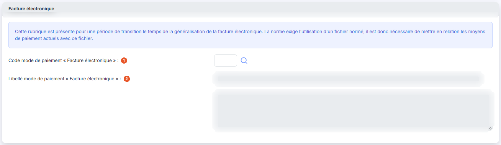

# Modes de règlement


**Où le trouver :** Panneau **Paramètres** › **Données** › **Dossier et comptabilité** › **Modes de règlement**



**En bref** — Cet écran définit les modes de règlement (espèces, chèques…) associés aux pièces comptables et commerciales. Le mode « Espèces » n'est pas supprimable.

* Pour créer un mode de règlement : bouton \[Créer un mode de règlement], renseignez la fiche, puis bouton \[Enregistrer].


Cette option permet de définir les modes de règlement (espèces, chèques, etc.), qui pourront être associés aux pièces comptables et commerciales.

<figure><figcaption>
Écran « Modes de règlement » de la nouvelle interface
</figcaption></figure>

Cet écran s'ouvre par le panneau « Paramètres » : rubrique « Données », groupe « Dossier et comptabilité », entrée « Modes de règlement ». Un bandeau bleu en haut de l'écran rappelle qu'un mode de règlement (chèque, virement, prélèvement…) porte son délai, son journal et ses comptes.

Un mode de règlement ne peut pas être supprimé s'il est utilisé dans au moins une fiche client, une pièce commerciale ou un compte auxiliaire.

Le mode de règlement « Espèces » est indispensable à la gestion de la caisse ; il n'est donc pas supprimable.

L'entrée du panneau, la liste et le bandeau d'information parlent de **mode de règlement** ; la fiche et ses rubriques emploient le mot **paiement** — « Code mode de paiement », « Libellé mode de paiement ». Il s'agit bien du même élément : ne vous inquiétez pas de cette différence de vocabulaire.

L'écran présente la liste des modes de règlement du dossier, une ligne par mode, avec deux colonnes : **Libellé** et **Descriptif**. Elles reprennent les informations de la rubrique « Informations générales » de la fiche et sont toutes deux triables ; la liste est triée par défaut sur le libellé, par ordre croissant.

Au-dessus de la liste, la barre « Rechercher un mode de règlement… » et les boutons \[Filtres], \[Vue] et \[Exporter] permettent de chercher un mode, de filtrer la liste, de personnaliser les colonnes et de l'imprimer ou de l'exporter (voir plus bas le bouton \[Exporter] de la barre d'outils).

Il n'y a pas de case à cocher : un clic sur une ligne la sélectionne, un second clic la désélectionne. Sous la liste, le lien « Sélectionner la page » sélectionne toutes les lignes affichées et le lien « Tout sélectionner (10) » étend la sélection à toutes les pages (le nombre entre parenthèses est celui des modes de la liste). Tant qu'une ligne est sélectionnée, un bandeau « 1 mode de règlement sélectionné » avec le lien « Tout désélectionner » et les boutons \[Supprimer] et \[Exporter] remplace le bouton de création.

Au survol d'une ligne, le pictogramme « Autres actions » (trois points verticaux) apparaît à droite de la ligne. Il ouvre deux entrées : « Modifier », qui ouvre la fiche du mode de règlement, et « Supprimer », qui le supprime.

Certains modes de règlement sont créés par le logiciel et servent à ses propres traitements : « Ecart de règlement + », « Ecart de règlement - », « Import règl. compta » et « Import remb. compta » sont utilisés lors de l'import des règlements depuis la comptabilité, comme l'indique leur descriptif.

bouton **\[Créer un mode de règlement]**

Il est en bas à droite de l'écran, hors de la liste, et ouvre une fiche vierge pour créer un nouveau mode de règlement.

bouton **\[Exporter]** (deux emplacements)

Le bouton \[Exporter] de la barre d'outils, au-dessus de la liste, ouvre un menu qui porte l'en-tête « La liste affichée » suivi du nombre de modes, puis les entrées « Aperçu » (édition HTML), « Imprimer », « Exporter en Excel », « Exporter en PDF » et « Envoyer la liste par e-mail » : il sert à éditer la liste, pas à copier des données.

Le bouton \[Exporter] du bandeau de sélection, lui, permet de copier les modes de règlement sélectionnés dans la liste vers d'autres sociétés que vous gérez ; il n'apparaît qu'une fois au moins une ligne sélectionnée.

La fenêtre « Exporter » rappelle le nombre d'enregistrements sélectionnés, puis vous demande d'indiquer les sociétés vers lesquelles les données seront copiées. Trois choix vous sont proposés : **Toutes les sociétés** exporte vers toutes les sociétés auxquelles vous avez accès ; **Liées à ce modèle** exporte vers toutes les sociétés créées sur la base de ce modèle ; **Autres** exporte vers les sociétés que vous choisissez dans la liste présentée en dessous, dont les colonnes sont **Code client**, **Raison sociale** et **Accès autorisé**, et que le champ « Société » permet de filtrer à la saisie.

La copie des données se fera lors de la prochaine utilisation de la société gérée concernée, par exemple en la sélectionnant dans le menu ou lors de la connexion d'un utilisateur. Le bouton « Valider » lance l'export ; la croix en haut à droite de la fenêtre la referme sans rien exporter.

bouton **\[Supprimer]**

Il se trouve dans le bandeau de sélection, à gauche du bouton \[Exporter], et supprime les modes de règlement sélectionnés dans la liste.

La fiche comporte quatre rubriques, présentées ci-dessous dans leur ordre d'affichage. Elles sont toutes les quatre affichées, aussi bien en création qu'en modification, et aucun champ n'apparaît ou ne disparaît d'un cas à l'autre. Le bandeau bleu en haut de l'écran précise toutefois que les zones propres à la facturation ne sont pas proposées depuis Freefact ; depuis la Gestion commerciale, les quatre rubriques sont affichées.

## Rubrique « Informations générales »

<figure><figcaption>
Rubrique « Informations générales »
</figcaption></figure>

| Champ             | Ce qu'il faut savoir |
| ----------------- | -------------------- |
| 1. **Libellé**    | Il doit être unique. |
| 2. **Descriptif** | Champ facultatif.    |

## Rubrique « Facturation »

<figure><figcaption>
Rubrique « Facturation »
</figcaption></figure>

Ces informations ne sont utiles que si vous utilisez le module « Facturation » et que vous gérez les règlements dans ce module.

| Champ                                           | Ce qu'il faut savoir                                                                                                                                                                                                                                                                                                                                                        |
| ----------------------------------------------- | --------------------------------------------------------------------------------------------------------------------------------------------------------------------------------------------------------------------------------------------------------------------------------------------------------------------------------------------------------------------------- |
| 1. **Compte utilisé pour ce mode de règlement** | C'est le compte dans lequel les écritures de règlement seront générées à partir du module Facturation pour ce mode de règlement. Saisissez directement le numéro de compte, ou cliquez sur le pictogramme « Loupe » pour le rechercher dans le plan comptable. Le logiciel affiche à côté du numéro l'intitulé du compte retenu ; cette seconde zone n'est pas saisissable. |
| 2. **Journal d'intégration**                    | C'est le journal dans lequel les écritures de règlement seront générées à partir du module Facturation pour ce mode de règlement. Le sélecteur propose les journaux du dossier sous la forme « Code - Libellé ». Le pictogramme « Information » placé à côté du champ rappelle qu'il s'agit du journal utilisé pour comptabiliser les règlements issus de la facturation.   |

## Rubrique « Modèle d'impression »

<figure><figcaption>
Rubrique « Modèle d'impression »
</figcaption></figure>

**Indiquez le modèle d'impression de facture à appliquer pour ce mode de règlement** : facultatif. Cette fonctionnalité permet d'associer un modèle d'impression au mode de règlement. Ainsi, pour les clients en prélèvement automatique, par exemple, vous pourrez affecter un modèle qui contient toutes les informations nécessaires et spécifiques à ce type de paiement.

Si vous avez aussi indiqué un modèle d'impression de facture par défaut, c'est le modèle d'impression du mode de règlement qui s'appliquera en priorité.

Le sélecteur propose les modèles d'impression de facture existants ; laissé sur « Sélectionnez », aucun modèle particulier n'est associé au mode de règlement.

Un pictogramme « Information » est placé sous le libellé du champ : il reprend l'explication ci-dessus.

## Rubrique « Facture électronique »

<figure><figcaption>
Rubrique « Facture électronique »
</figcaption></figure>

Le logiciel rappelle en tête de rubrique : « Cette rubrique est présente pour une période de transition le temps de la généralisation de la facture électronique. La norme exige l'utilisation d'un fichier normé, il est donc nécessaire de mettre en relation les moyens de paiement actuels avec ce fichier. »

| Champ                                                    | Ce qu'il faut savoir                                                                                                                                                                                          |
| -------------------------------------------------------- | ------------------------------------------------------------------------------------------------------------------------------------------------------------------------------------------------------------- |
| 1. **Code mode de paiement « Facture électronique »**    | Entrez ici le code normé qui correspond à ce mode de règlement, ou cliquez sur le pictogramme « Loupe » pour le choisir dans la liste des codes prévus par la norme.                                          |
| 2. **Libellé mode de paiement « Facture électronique »** | Cette zone n'est pas saisissable ; le logiciel y reporte le libellé normé du code retenu. Elle est suivie d'une seconde zone, également non saisissable, qui en affiche la suite lorsque le libellé est long. |

bouton **\[Enregistrer]**

Enregistre le mode de règlement et vous ramène à la liste.

**Retour à la liste**

Le bouton \[Retour] est masqué dans la fiche : le chevron « Retour », à gauche de la barre d'onglets du panneau, revient à la liste sans enregistrer les modifications en cours.
