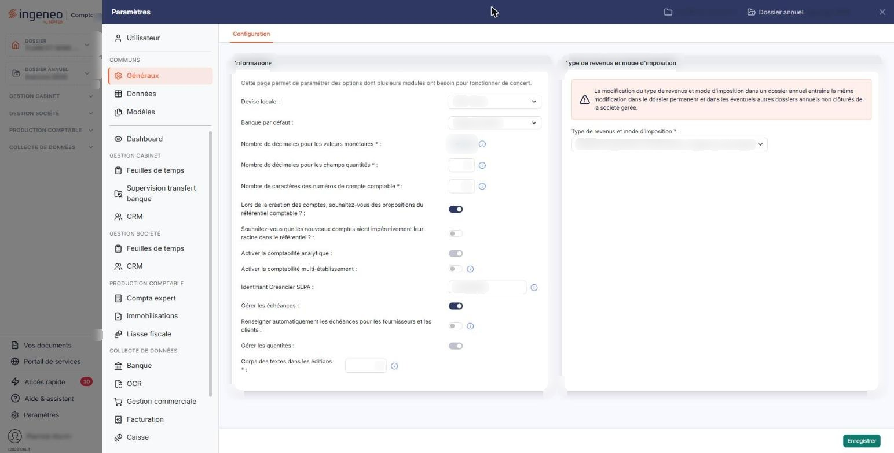
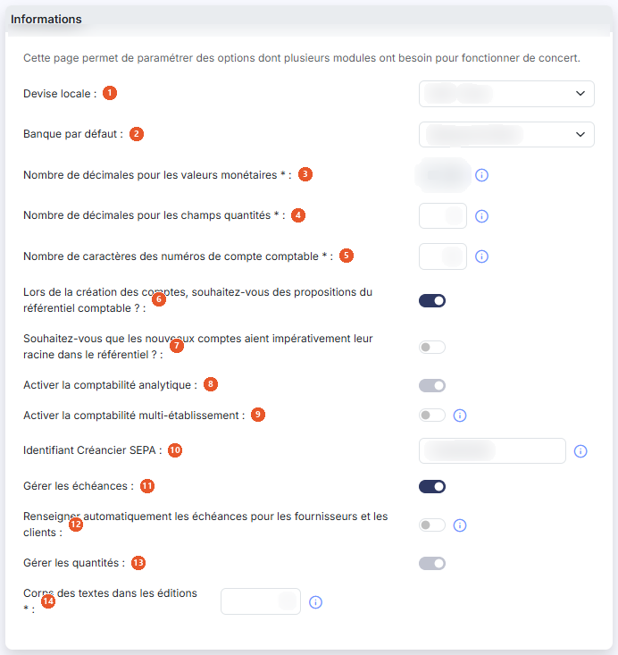
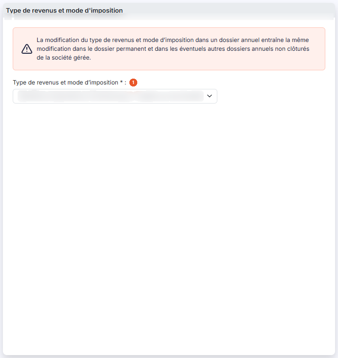

# Multimodules


**Où le trouver :** Panneau **Paramètres** › **Généraux** › **Configuration**



**En bref** — Cet écran règle les paramètres partagés par plusieurs modules : devise, décimales, longueur des comptes, échéances, analytique, quantités et régime fiscal. Toute modification vaut aussitôt pour tous ces modules.

* Pour modifier un paramètre commun : changez la valeur dans la carte « Informations », puis bouton \[Enregistrer].


Cette page permet de paramétrer des options dont plusieurs modules ont besoin pour fonctionner de concert. C'est ce qui explique son nom : un paramètre modifié ici, quel que soit le module d'où l'on ouvre l'écran, l'est aussi, immédiatement, pour la comptabilité, les feuilles de temps ou les autres modules qui s'en servent.

<figure><figcaption>
Écran « Multimodules » de la nouvelle interface
</figcaption></figure>

C'est de loin l'écran de paramétrage dont les effets portent le plus loin : le format des montants et des quantités, la longueur des numéros de compte, l'existence des échéances, la présence des ventilations analytiques et des quantités sur les écritures, la devise, la taille des textes dans les éditions, et le régime fiscal du dossier. Avant de modifier l'un de ces paramètres, sachez donc que vous n'agissez pas sur le seul écran que vous avez sous les yeux.

Cet écran s'ouvre par le panneau « Paramètres » : rubrique « Généraux », onglet « Configuration », seul onglet de la rubrique. Il comporte deux cartes, côte à côte, « Informations » à gauche et « Type de revenus et mode d'imposition » à droite, et un seul bouton, bouton **\[Enregistrer]**, en bas à droite de l'écran. Il n'y a ni liste, ni fiche, ni bouton de retour.

## Rubrique « Informations »

<figure><figcaption>
Rubrique « Informations »
</figcaption></figure>

La carte s'ouvre sur la phrase « Cette page permet de paramétrer des options dont plusieurs modules ont besoin pour fonctionner de concert. » À l'écran, les champs se présentent dans cet ordre : Devise locale, Banque par défaut, Nombre de décimales pour les valeurs monétaires, Nombre de décimales pour les champs quantités, Nombre de caractères des numéros de compte comptable, les deux questions sur le référentiel comptable, Activer la comptabilité analytique, Activer la comptabilité multi-établissement, Identifiant Créancier SEPA, Gérer les échéances, Renseigner automatiquement les échéances pour les fournisseurs et les clients, Gérer les quantités et Corps des textes dans les éditions. Les paragraphes ci-dessous gardent l'ordre de la version précédente de la page.

| Champ                                                                                                 | Ce qu'il faut savoir                                                                                                                                                                                                                                                                                                                                                                                                                                                                                                                                                                                                                                                                                                                                                                                                                                                                                                                                                                                              |
| ----------------------------------------------------------------------------------------------------- | ----------------------------------------------------------------------------------------------------------------------------------------------------------------------------------------------------------------------------------------------------------------------------------------------------------------------------------------------------------------------------------------------------------------------------------------------------------------------------------------------------------------------------------------------------------------------------------------------------------------------------------------------------------------------------------------------------------------------------------------------------------------------------------------------------------------------------------------------------------------------------------------------------------------------------------------------------------------------------------------------------------------- |
| 1. **Devise locale**                                                                                  | La devise de référence du dossier, dans laquelle s'entendent tous les montants. La liste propose les devises internationales ; la valeur usuelle est l'euro. C'est cette devise que reprennent les champs de devise des modèles d'impression.                                                                                                                                                                                                                                                                                                                                                                                                                                                                                                                                                                                                                                                                                                                                                                     |
| 2. **Banque par défaut**                                                                              | La banque proposée par défaut chaque fois que le logiciel en a besoin — écrans de règlement, remises de chèques — et dont les coordonnées bancaires sont reprises dans les éditions qui en portent. La liste ne propose que les banques du dossier, celles que vous avez créées dans le panneau « Paramètres », rubrique « Données », onglet « Dossier et comptabilité », entrée « Banques ».                                                                                                                                                                                                                                                                                                                                                                                                                                                                                                                                                                                                                     |
| 3. **Nombre de décimales pour les valeurs monétaires**                                                | Ce paramètre détermine avec combien de décimales sont saisies et affichées toutes les valeurs monétaires, dans tous vos modules Ingeneo Compta. Il peut prendre les valeurs 0, 1, 2, 3 et 4. La zone est affichée grisée et n'est pas saisissable : pour modifier ce paramètre, veuillez prendre contact avec le service technique.                                                                                                                                                                                                                                                                                                                                                                                                                                                                                                                                                                                                                                                                               |
| 4. **Nombre de décimales pour les champs quantités**                                                  | Il détermine de la même façon combien de décimales portent tous les champs de quantité, dans les pièces commerciales comme dans les écritures comptables. De 0 à 4.                                                                                                                                                                                                                                                                                                                                                                                                                                                                                                                                                                                                                                                                                                                                                                                                                                               |
| 5. **Nombre de caractères des numéros de compte comptable**                                           | 
Il s'agit du nombre de caractères que comportent tous les comptes de votre plan comptable, et donc tous ceux utilisés en gestion commerciale pour le lien avec la comptabilité. La valeur doit être comprise entre 6 et 12 caractères. Afin de conserver les possibilité de comparaison, la modification sera effectuée sur le dossier annuel en cours et sur les deux dossiers annuels précédents. Retenez ce dernier point : la modification ne reste pas cantonnée à l'exercice que vous avez ouvert, elle touche aussi les deux dossiers annuels qui le précèdent. Si vous allongez les numéros de compte, les comptes existants sont complétés à droite par des zéros jusqu'à la longueur indiquée. Un numéro de compte saisi trop court ailleurs dans le logiciel est complété de la même façon. Un nombre de décimales ne se réduit pas librement : si des montants déjà saisis comportent plus de décimales que la valeur demandée, le logiciel refuse la modification et vous l'indique.
 |
| 6. **Lors de la création des comptes, souhaitez-vous des propositions du référentiel comptable ?**    | Interrupteur. Activé, le logiciel vous fait des propositions au moment de créer un compte dans le plan comptable général, en fonction des premiers caractères que vous saisissez, à partir du référentiel comptable.                                                                                                                                                                                                                                                                                                                                                                                                                                                                                                                                                                                                                                                                                                                                                                                              |
| 7. **Souhaitez-vous que les nouveaux comptes aient impérativement leur racine dans le référentiel ?** | Interrupteur. Activé, la racine d'un compte nouvellement créé doit exister dans le référentiel comptable.                                                                                                                                                                                                                                                                                                                                                                                                                                                                                                                                                                                                                                                                                                                                                                                                                                                                                                         |
| 8. **Activer la comptabilité analytique**                                                             | Interrupteur. Activé, les lignes de pièces et d'écritures portent une ventilation analytique.                                                                                                                                                                                                                                                                                                                                                                                                                                                                                                                                                                                                                                                                                                                                                                                                                                                                                                                     |
| 9. **Activer la comptabilité multi-établissement**                                                    | Interrupteur. En activant cette option, vous devrez affecter les écritures à un établissement. Les établissements doivent être créés dans le module « Dossier permanent », menu « Social », option « Etablissements ». Les fiches clients et fournisseurs portent alors, elles aussi, un établissement, dans leur rubrique des informations comptables.                                                                                                                                                                                                                                                                                                                                                                                                                                                                                                                                                                                                                                                           |
| 10. **Identifiant Créancier SEPA**                                                                    | L'Identifiant Créancier SEPA, ou ICS, est obligatoire si vous souhaitez générer des ordres de prélèvements SEPA. Cette information est à récupérer auprès de votre banque. Il est unique pour chaque entreprise réalisant des prélèvements.                                                                                                                                                                                                                                                                                                                                                                                                                                                                                                                                                                                                                                                                                                                                                                       |
| 11. **Gérer les échéances**                                                                           | Interrupteur. C'est le socle du suivi des paiements : activé, les factures clients et fournisseurs portent des échéances.                                                                                                                                                                                                                                                                                                                                                                                                                                                                                                                                                                                                                                                                                                                                                                                                                                                                                         |
| 12. **Renseigner automatiquement les échéances pour les fournisseurs et les clients**                 | 
Interrupteur. L'échéance est renseignée automatiquement pour les comptes dont les échéances sont gérées. Activé, deux champs supplémentaires vous sont demandés, <strong>Délai de règlement par défaut des fournisseurs</strong> et <strong>Délai de règlement par défaut des clients</strong>, chacun avec les choix <strong>Comptant</strong>, <strong>Fin de mois</strong>, <strong>30 jours</strong> et <strong>45 Jours</strong>. Désactivé, ces deux champs n'apparaissent pas : si vous les cherchez à l'écran sans les trouver, c'est que cet interrupteur est désactivé. Ces deux délais servent de recours : ils s'appliquent aux clients et aux fournisseurs pour lesquels aucun délai de règlement propre n'a été renseigné. Les délais eux-mêmes se créent dans le panneau « Paramètres », rubrique « Données », onglet « Dossier et comptabilité », entrée « Délais de règlement ».
                                                                                                       |
| 13. **Gérer les quantités**                                                                           | Interrupteur. Activé, les écritures et les éditions portent des colonnes de quantité.                                                                                                                                                                                                                                                                                                                                                                                                                                                                                                                                                                                                                                                                                                                                                                                                                                                                                                                             |
| 14. **Corps des textes dans les éditions**                                                            | Ce paramètre détermine la taille d'affichage des textes standards dans les éditions ; sa valeur doit être comprise entre 8 et 18. Il est préparamétré avec la valeur 11, celle avec laquelle ont été élaborées toutes les éditions proposées en standard. Il vaut pour toutes les éditions du module, et non pour une seule : c'est là qu'il faut agir si vos éditions vous paraissent globalement trop denses ou trop aérées.                                                                                                                                                                                                                                                                                                                                                                                                                                                                                                                                                                                    |

## Des paramètres que vous ne pourrez pas modifier

**Activer la comptabilité analytique** et **Gérer les quantités** peuvent se présenter grisés : leur valeur est lisible, mais l'interrupteur ne réagit pas. Aucun message ne vous l'explique à l'écran, et ces deux paramètres ne portent pas d'infobulle.

Si vous devez revenir sur l'un de ces deux choix, prenez contact avec votre interlocuteur habituel.

À ces deux paramètres s'ajoute le **Nombre de décimales pour les valeurs monétaires**, dont la zone s'affiche grisée et n'est pas saisissable : celui-là ne se modifie pas depuis cet écran, et son infobulle vous renvoie au service technique. Les autres paramètres de la rubrique restent modifiables.

## Rubrique « Type de revenus et mode d'imposition »

<figure><figcaption>
Rubrique « Type de revenus et mode d'imposition »
</figcaption></figure>

Cette carte est placée à droite de la précédente. Un avertissement s'affiche en rouge en tête de cette rubrique : « La modification du type de revenus et mode d'imposition dans un dossier annuel entraîne la même modification dans le dossier permanent et dans les éventuels autres dossiers annuels non clôturés de la société gérée. »

Lisez-le avant de toucher au champ : votre modification sort du dossier annuel où vous êtes.

**Type de revenus et mode d'imposition** : obligatoire. Les choix proposés sont **Bénéfices Agricoles**, **Bénéfices Industriels et Commerciaux / Impôts sur le Revenu**, **Bénéfices Industriels et Commerciaux / Impôts sur les Sociétés**, **Bénéfices Non Commerciaux**, **Non imposable**, **Nouvelle-Calédonie**, **Revenus Fonciers**, **Revenus Fonciers Professionnels** et **Revenus Fonciers professionnels et non professionnels**.

bouton **\[Enregistrer]**

Enregistre les paramètres de la page. L'écran ne comporte pas de bouton de retour : fermez le panneau « Paramètres » (croix en haut à droite) ou choisissez un autre onglet pour le quitter.
