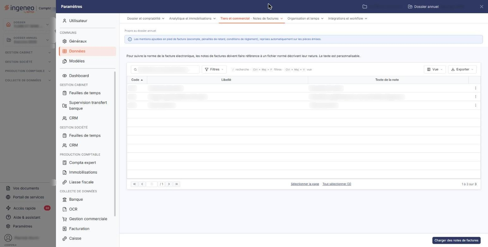
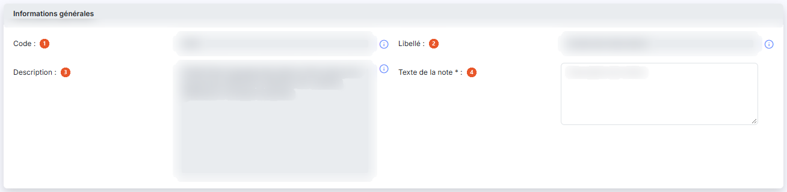

# Notes de factures


**Où le trouver :** Panneau **Paramètres** › **Données** › **Tiers et commercial** › **Notes de factures**



**En bref** — Cet écran tient les notes de factures, commentaires conformes au fichier normé de la facture électronique, rattachables à une facture entière ou à l'une de ses lignes d'articles.

* Pour garnir le fichier : bouton \[Charger des notes de factures], puis adaptez le texte des notes à votre activité.


Cet écran s'ouvre depuis le panneau « Paramètres » : « Paramètres > Données > Tiers et commercial > Notes de factures ».

<figure><figcaption>
Écran « Notes de factures » de la nouvelle interface
</figcaption></figure>

Il tient le fichier des notes de factures, c'est-à-dire des commentaires que vous pouvez rattacher à une facture entière ou à l'une de ses lignes d'articles.

La norme de la facture électronique n'admet pas n'importe quel commentaire : chaque note doit se rattacher à une nature de note prévue par un fichier normé. C'est ce fichier normé que cette option vous permet de consulter, et dont vous pouvez personnaliser les textes. Le logiciel rappelle ce point au-dessus de la liste : « Pour suivre la norme de la facture électronique, les notes de factures doivent faire référence à un fichier normé décrivant leur nature. Le texte est personnalisable. »

Ce fichier étant normé, il ne se crée pas : vous chargez les natures de notes dont vous avez besoin, puis vous adaptez leur texte à votre activité. Les notes ainsi disponibles se retrouvent ensuite dans la rubrique « Notes de factures » d'une facture et dans les notes de lignes de la rubrique « Articles ».

## La liste des notes de factures

La liste présente une ligne par note de facture, avec trois colonnes, toutes triables : **Code**, le code sur trois caractères issu du fichier normé, **Libellé**, la nature de la note, et **Texte de la note**, le texte qui sera repris dans vos factures.

Au-dessus de la liste figurent une barre « Rechercher une note de facture… » et les boutons \[Filtres], \[Vue] et \[Exporter]. La liste se pagine comme les autres listes du logiciel, et le nombre de lignes est rappelé sous la liste.

Les libellés du fichier normé sont en anglais, langue dans laquelle la norme est publiée ; c'est le texte de la note, lui, qui est destiné à vos factures et que vous pouvez récrire.

## Les commandes de la ligne

Le menu « Autres actions » (trois points), à droite de chaque ligne, propose trois commandes :

* « Modifier » ouvre la fiche de la note, où se personnalise son texte ;
* « Supprimer » retire la note du fichier du dossier ;
* « Dupliquer » ouvre une fiche pré-remplie des données de celle-ci.

Chacune de ces commandes est soumise à un droit distinct : selon votre profil, certaines peuvent ne pas apparaître dans le menu.

## La barre d'outils et le pied de la liste

La barre d'outils porte les commandes habituelles des listes du logiciel : la recherche, \[Filtres], \[Vue] pour personnaliser les colonnes et \[Exporter]. Le menu \[Exporter] propose notamment « Envoyer la liste par e-mail ». Sous la liste, les liens « Sélectionner la page » et « Tout sélectionner (3) » permettent de sélectionner toutes les lignes de la page ou de toutes les pages ; il n'y a plus de case à cocher.

## Bouton \[Charger des notes de factures]

C'est par ce bouton, placé en bas à droite de l'écran, que le fichier se garnit : il vous propose les natures de notes du fichier normé et les ajoute à votre dossier.

Le bouton ouvre la fenêtre « Chargement des notes de factures », qui rappelle : « Sélectionner les seules notes de factures que vous utiliserez dans ce dossier annuel ». Une zone **Note de facture :** suivie du Bouton \[Afficher] permet de filtrer la liste proposée. Celle-ci présente deux colonnes, **Code** et **Libellé**, avec une case à cocher par ligne et une case d'en-tête (la fenêtre garde ses cases à cocher) ; elle porte l'intégralité du fichier normé et se pagine donc sur plusieurs pages. Les notes déjà chargées dans le dossier y restent proposées. Le Bouton \[Enregistrer] ajoute au dossier les notes cochées, le Bouton \[Annuler] referme la fenêtre sans rien ajouter, de même que le pictogramme « Croix » de son en-tête.

## Bouton \[Supprimer]

Il apparaît dans le bandeau de sélection, au bas de l'écran, dès qu'une note est sélectionnée par un clic sur sa ligne (le bandeau indique le nombre de notes sélectionnées, propose « Tout désélectionner » et remplace alors le bouton de chargement). Il supprime en une seule fois toutes les notes de factures sélectionnées.

## La fiche d'une note de facture

<figure><figcaption>
Rubrique « La fiche d'une note de facture »
</figcaption></figure>

La commande « Modifier » du menu « Autres actions » d'une ligne ouvre la fiche de la note, qui ne comporte qu'une rubrique, « Informations générales », et quatre zones.

Les trois premières ne sont pas modifiables : elles viennent du fichier normé, et un pictogramme d'information le rappelle à droite de chacune — « Ce champ est issu du fichier normé pour la facture électronique. ».

| Champ                   | Ce qu'il faut savoir                                                                                                                                                                                                  |
| ----------------------- | --------------------------------------------------------------------------------------------------------------------------------------------------------------------------------------------------------------------- |
| 1. **Code**             | Le code de la nature de note, sur trois caractères.                                                                                                                                                                   |
| 2. **Libellé**          | La nature de la note, dans le libellé anglais de la norme.                                                                                                                                                            |
| 3. **Description**      | La définition que la norme donne de cette nature de note, précédée de son numéro entre crochets. C'est à elle que vous vous reportez pour savoir si la nature convient à la note que vous voulez porter.              |
| 4. **Texte de la note** | Seule zone modifiable, et **obligatoire** : c'est le texte qui sera repris dans vos factures. Vous l'écrivez dans votre langue et dans les termes de votre activité, la nature normalisée restant portée par le code. |

Bouton \[Enregistrer], en bas à droite, enregistre la fiche. Pour revenir à la liste, utilisez le chevron « Retour » à gauche de la barre d'onglets du panneau.
