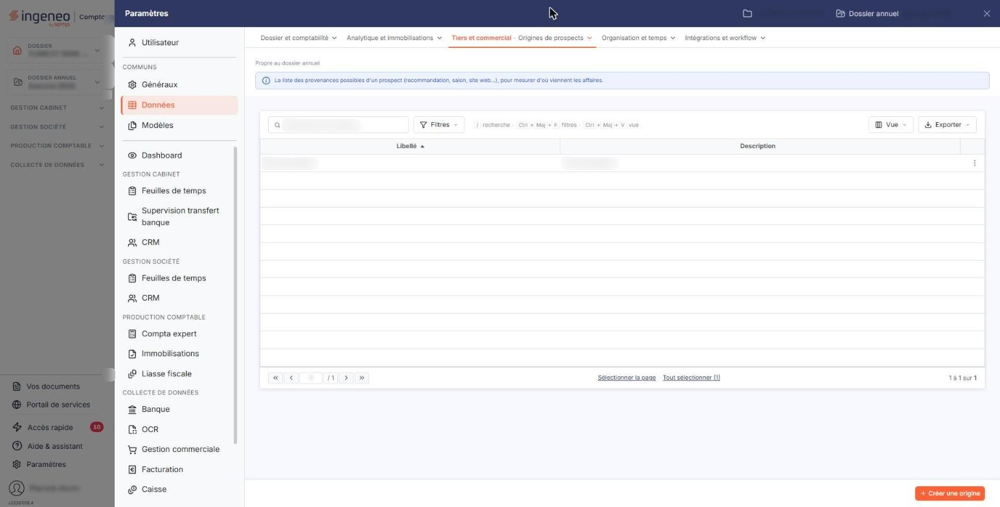
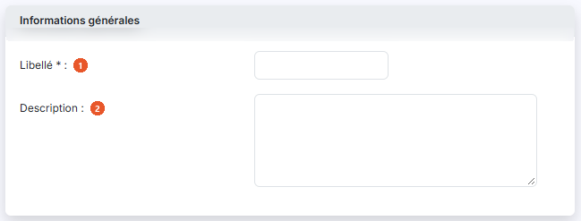

# Origines de prospects


**Où le trouver :** Panneau **Paramètres** › **Données** › **Tiers et commercial** › **Origines de prospects**



**En bref** — Ce fichier facultatif tient les origines de vos prospects (recommandation, salon, campagne…), pour savoir d'où viennent vos affaires.

* Pour créer une origine : bouton \[Créer une origine], renseignez son libellé, puis bouton \[Enregistrer].


Cette option tient le fichier des origines, c'est-à-dire la liste des façons dont vous entrez en relation avec un prospect : une recommandation, un salon, une campagne, un appel entrant… Vous les créez une fois ici, puis vous les affectez à vos prospects, ce qui vous permet ensuite de savoir d'où viennent vos affaires.

<figure><figcaption>
Écran « Origines de prospects » de la nouvelle interface
</figcaption></figure>

## La liste des origines

La liste présente une ligne par origine, avec deux colonnes, toutes deux triables : **Libellé** et **Description**. Elle s'ouvre triée sur le libellé, par ordre alphabétique croissant.

Au-dessus de la liste, la barre « Rechercher une origine… » permet de retrouver une origine, le bouton \[Filtres] ouvre le volet de filtres, le bouton \[Vue] le menu des vues et le bouton \[Exporter] le menu d'aperçu, d'impression et d'export de la liste. La liste se pagine comme les autres listes du logiciel, et le nombre de lignes est rappelé sous la liste, avec les liens « Sélectionner la page » et « Tout sélectionner ».

Un clic sur une ligne la sélectionne, pour une suppression groupée. Au survol, la ligne porte en fin de ligne un pictogramme « Autres actions » (trois points), qui ouvre un menu de deux entrées : « Modifier » ouvre la fiche de l'origine et « Supprimer » la supprime. Chacune est soumise à un droit distinct : selon votre profil, certaines peuvent ne pas apparaître. Il n'y a pas d'entrée « Dupliquer » sur cette liste.

L'écran porte la mention « Propre au dossier annuel » et un bandeau d'information qui rappelle l'objet du fichier : « La liste des provenances possibles d'un prospect (recommandation, salon, site web…), pour mesurer d'où viennent les affaires. »

## Bouton \[Créer une origine]

Placé en bas à droite de l'écran, il ouvre la fiche d'une nouvelle origine, décrite ci-dessous.

## Bouton \[Supprimer]

Dès qu'une ligne est sélectionnée, un bandeau de sélection (« 1 origine sélectionnée · toutes les pages », « Tout désélectionner ») remplace la barre du bas et porte le bouton \[Supprimer], qui supprime en une seule fois toutes les origines sélectionnées dans la liste. Ce bouton n'est pas proposé si votre profil n'a pas le droit de suppression, tout comme le Bouton \[Créer une origine] n'apparaît qu'avec le droit de création.

Une origine déjà affectée à un prospect au moins n'est pas supprimable : le logiciel refuse alors l'opération avec le message « Une des origines prospects ne peut être supprimée car elle est affectée à un prospect au moins. ». Cette règle vaut pour la suppression groupée comme pour la suppression d'une seule ligne depuis l'entrée « Supprimer » de sa ligne.

## Rubrique « Informations générales »

<figure><figcaption>
Rubrique « Informations générales »
</figcaption></figure>

C'est la seule rubrique de la fiche, et elle ne comporte que deux champs. Il n'y a ni onglet, ni champ calculé, ni champ en lecture seule.

| Champ              | Ce qu'il faut savoir                                                                                                                                                                                                                                                                                                                                                                                                    |
| ------------------ | ----------------------------------------------------------------------------------------------------------------------------------------------------------------------------------------------------------------------------------------------------------------------------------------------------------------------------------------------------------------------------------------------------------------------- |
| 1. **Libellé**     | Trente caractères au plus. C'est ce libellé qui sera proposé dans la fiche d'un prospect ou d'un client. Si vous l'omettez, le logiciel affiche le message « Le champ "Libellé" est obligatoire. » et n'enregistre pas la fiche. Le libellé doit être unique dans le fichier : s'il est déjà pris, le logiciel répond « Le libellé que vous indiquez est déjà utilisé, veuillez en choisir un autre s'il vous plait. ». |
| 2. **Description** | Zone de texte libre sur plusieurs lignes, mille vingt-quatre caractères au plus, destinée à préciser ce que recouvre l'origine pour votre cabinet.                                                                                                                                                                                                                                                                      |

## Les boutons de la fiche

Un bouton figure en bas de la fiche : Bouton \[Enregistrer], qui enregistre l'origine. Pour revenir à la liste sans rien conserver, utilisez le chevron « Retour » à gauche de la barre d'onglets du panneau Paramètres.
