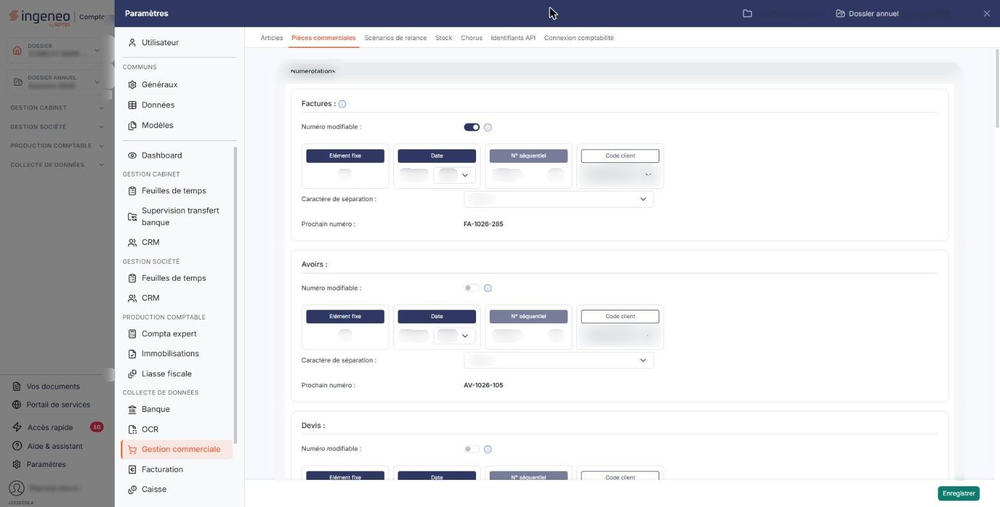
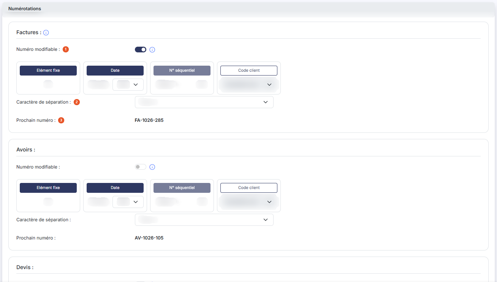
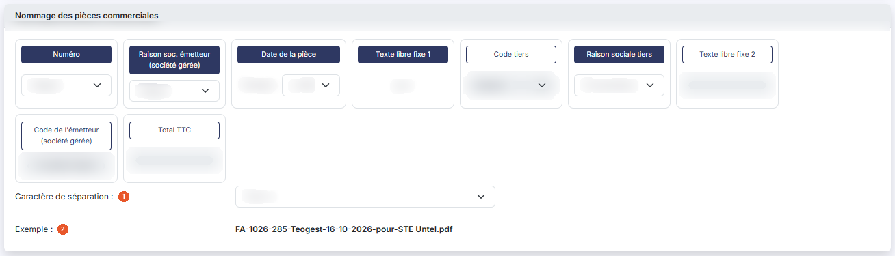
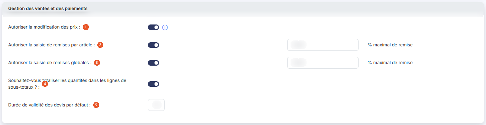
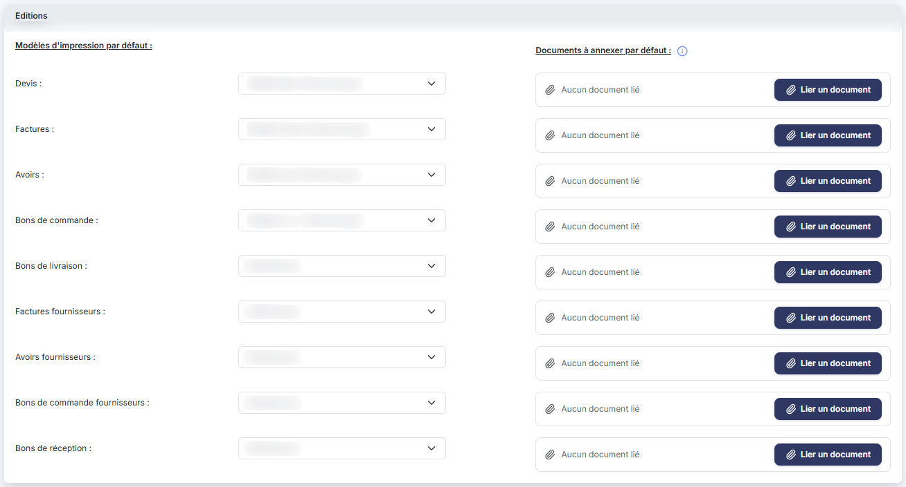
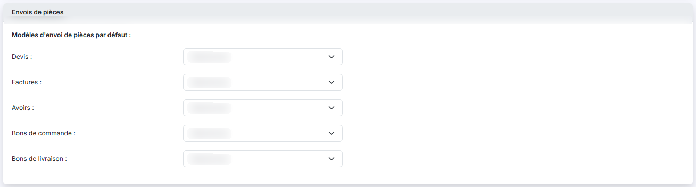

# Pièces commerciales


**Où le trouver :** Panneau **Paramètres** › **Gestion commerciale** › **Pièces commerciales**



**En bref** — Cet écran règle ce qui vaut pour toutes vos pièces commerciales : numérotation, nommage des PDF, droits de modification en saisie, modèles d'impression et d'envoi, archivage dans la GED.

* Pour composer le numéro d'un type de pièce : complétez son bloc dans le volet « Numérotations », puis bouton \[Enregistrer].
* Pour annexer un document PDF à un type de pièce : bouton \[Lier un document], puis bouton \[Enregistrer].


Cet écran s'ouvre depuis le panneau « Paramètres » : « Paramètres > Gestion commerciale > Pièces commerciales ».

<figure><figcaption>
Écran « Pièces commerciales » de la nouvelle interface
</figcaption></figure>

Il rassemble les choix qui s'appliquent à toutes vos pièces commerciales pour le dossier en cours : la façon dont leurs numéros sont composés, le nom des fichiers PDF produits, ce que vos utilisateurs sont autorisés à modifier lors de la saisie, les modèles d'impression et d'envoi proposés par défaut, et l'archivage automatique dans la GED.

L'écran ne comporte ni liste ni critère de recherche. Il présente six volets, dans cet ordre : « Numérotations », « Nommage des pièces commerciales », « Gestion des ventes et des paiements », « Editions », « Envois de pièces » et « Archivage des pièces ». Un seul bouton, bouton **\[Enregistrer]**, placé en bas à droite, enregistre l'ensemble : il n'y a pas de bouton de retour.

## Volet « Numérotations »

<figure><figcaption>
Rubrique « Numérotations »
</figcaption></figure>

Vous y composez le numéro de chacun de vos types de pièce, indépendamment les uns des autres. Le volet présente un bloc par type de pièce : « Factures », « Avoirs », « Devis », « Bons de commande » et « Bons de livraison ».

Les pièces de la chaîne des achats — « Factures d'achat », « Avoirs d'achat », « Bons de commandes d'achat » et « Bons de réception » — disposent elles aussi d'un bloc de numérotation.

Chaque bloc se compose de deux parties. À gauche, un tableau de composition du numéro : quatre éléments, présentés chacun dans une petite carte dont l'en-tête tient lieu de case à cocher (la case elle-même est masquée) et dont la zone de réglage est juste en dessous. Un en-tête rempli en bleu marine signale un élément incorporé au numéro ; un en-tête simplement cerclé signale un élément non incorporé, dont la zone de réglage est grisée. Pour incorporer un élément, cochez son en-tête, puis renseignez sa valeur dessous. L'en-tête « N° séquentiel » est grisé : il reste coché et ne peut pas être décoché. Un pictogramme « Information », placé à droite du nom du type de pièce, rappelle : « Vous pouvez changer l'ordre des éléments en cliquant sur un libellé et en utilisant la fonction glisser-déposer de la souris. La longueur totale d'un numéro de pièce ne peut excéder 20 caractères pour être compatible avec la norme de la facture électronique. »

L'ordre des quatre éléments n'est donc pas le même d'un bloc à l'autre : c'est celui que vous leur avez donné.

| Champ                          | Ce qu'il faut savoir                                                                                                                                                                                                                                                                                                                       |
| ------------------------------ | ------------------------------------------------------------------------------------------------------------------------------------------------------------------------------------------------------------------------------------------------------------------------------------------------------------------------------------------ |
| 1. **Numéro modifiable**       | Interrupteur sans texte (activé ou désactivé), accompagné d'un pictogramme « Information » qui indique : « Si vous indiquez "Oui", la numérotation définie ici s'appliquera par défaut, mais restera modifiable. » Le numéro proposé par le logiciel reste alors saisissable dans la pièce.                                                |
| 2. **Caractère de séparation** | Liste déroulante qui inscrit le caractère choisi entre chacun des éléments retenus. Les choix sont : Aucun, Espace, Tiret (-), Point, +, Souligné (\_) et Slash (/).                                                                                                                                                                       |
| 3. **Prochain numéro**         | Ce n'est pas une zone de saisie mais un aperçu : le logiciel y affiche le numéro qui sera attribué à la prochaine pièce de ce type, et le recalcule à chaque modification de votre paramétrage.                                                                                                                                            |
| **Elément fixe**               | Une zone de saisie. C'est un texte que vous souhaitez voir figurer à l'identique dans tous les numéros de ce type de pièce, « FA » pour vos factures par exemple.                                                                                                                                                                          |
| **Date**                       | Un champ **Format :** suivi d'une liste déroulante, qui vous permet de n'incorporer qu'une partie de la date. Les formats proposés sont : AAAA, MMAAAA, JJMMAAAA, AAAAMMJJ, AAAAMM, AAMM, MMAA, AA, MM-AAAA, JJ-MM-AAAA, AAAA-MM-JJ, AAAA-MM, AA-MM, MM-AA, JJ-MM et MM-JJ. La date retenue est celle de la pièce, et non la date du jour. |
| **N° séquentiel**              | Un champ **Début \* :**, obligatoire, dans lequel vous indiquez le nombre entier à partir duquel la numérotation démarre. Il s'incrémente à chaque création d'une pièce de ce type. Si vous modifiez cette valeur, les pièces créées ensuite sont numérotées à partir du nouveau numéro.                                                   |
| **Code client**                | 
Une liste déroulante qui vous permet de reprendre les premiers caractères du code du tiers, de « 2 premiers car. » à « 14 premiers car. ». À droite du tableau de composition, trois lignes complètent le bloc :
                                                                                                                 |

La norme de la facture électronique impose un numéro de pièce de 20 caractères au maximum. Le logiciel calcule donc cette longueur à chaque modification, en retenant la taille maximale de chaque élément coché et les caractères de séparation. Si votre paramétrage peut produire un numéro trop long, il affiche à droite du nom du type de pièce le message « Le paramétrage que vous avez indiqué peut engendrer des numéros de pièce d'une taille supérieure à 20 caractères. Veuillez modifier vos choix. », et l'enregistrement est refusé jusqu'à correction.

## Volet « Nommage des pièces commerciales »

<figure><figcaption>
Rubrique « Nommage des pièces commerciales »
</figcaption></figure>

Ce volet ne concerne pas le numéro de la pièce mais le **nom du fichier PDF** produit lorsque vous éditez ou envoyez une pièce. Il se compose sur le même principe que les numéros : un tableau d'éléments, chacun avec sa case à cocher et son réglage, que vous réordonnez par glisser-déposer. Un élément non incorporé reste affiché : son en-tête est simplement cerclé et sa zone de réglage est grisée. Les neuf cartes se répartissent sur plusieurs lignes.

Les neuf éléments proposés sont les suivants (leur ordre d'affichage est celui que vous leur avez donné) :

**Numéro**, **Raison soc. émetteur (société gérée)**, **Code tiers** et **Raison sociale tiers** : chacun accompagné d'une liste déroulante de longueur, avec les choix « Intégral », « 5 caractères » et « 10 caractères ».

| Champ                          | Ce qu'il faut savoir                                                                                                                                                                                                                                                                                                                                                                                                                                                                      |
| ------------------------------ | ----------------------------------------------------------------------------------------------------------------------------------------------------------------------------------------------------------------------------------------------------------------------------------------------------------------------------------------------------------------------------------------------------------------------------------------------------------------------------------------- |
| 1. **Caractère de séparation** | Liste déroulante qui inscrit le caractère choisi entre chacun des éléments retenus. Les choix sont ici plus restreints que pour les numéros de pièce : Aucun, Espace, Tiret (-) et Point.                                                                                                                                                                                                                                                                                                 |
| 2. **Exemple**                 | Le logiciel affiche un exemple de nom de fichier, recalculé à chaque modification de votre paramétrage.                                                                                                                                                                                                                                                                                                                                                                                   |
| **Date de la pièce**           | 
Un champ <strong>Format :</strong> suivi d'une liste déroulante proposant AAAA, MM-AAAA, JJ-MM-AAAA, AAAA-MM-JJ, AAAA-MM, AA-MM, MM-AA et AA. <strong>Texte libre fixe 1</strong> et <strong>Texte libre fixe 2</strong> : deux zones de saisie, pour insérer un mot de votre choix, « pour » par exemple. <strong>Code de l'émetteur (société gérée)</strong> et <strong>Total TTC</strong> : deux zones de saisie. Sous le tableau, deux éléments complètent le volet :
 |

## Volet « Gestion des ventes et des paiements »

<figure><figcaption>
Rubrique « Gestion des ventes et des paiements »
</figcaption></figure>

| Champ                                                                          | Ce qu'il faut savoir                                                                                                                                                                                                                                                                                                                                                                                                                                                                             |
| ------------------------------------------------------------------------------ | ------------------------------------------------------------------------------------------------------------------------------------------------------------------------------------------------------------------------------------------------------------------------------------------------------------------------------------------------------------------------------------------------------------------------------------------------------------------------------------------------ |
| 1. **Autoriser la modification des prix**                                      | 
Interrupteur sans texte, accompagné d'un pictogramme « Information » qui indique : « Permet de modifier le prix unitaire lors de la saisie d'articles dans des pièces commerciales. » Lorsque vous créez une ligne d'article dans une pièce, le prix retenu est celui de la fiche article, éventuellement affiné par la gestion des catalogues ou celle des prix par quantités. Si cet interrupteur est activé, ce prix reste modifiable dans la ligne, quelle que soit sa provenance.
 |
| 2. **Autoriser la saisie de remises par article**                              | Interrupteur sans texte, suivi d'une zone de saisie **% maximal de remise**. Si l'interrupteur est activé, vos utilisateurs peuvent affecter un taux de remise propre à chaque ligne d'article, dans la limite du pourcentage indiqué.                                                                                                                                                                                                                                                           |
| 3. **Autoriser la saisie de remises globales**                                 | Interrupteur sans texte, suivi lui aussi d'une zone de saisie **% maximal de remise**. Si l'interrupteur est activé, vos utilisateurs peuvent affecter une remise à la pièce entière, dans la limite du pourcentage indiqué.                                                                                                                                                                                                                                                                     |
| 4. **Souhaitez-vous totaliser les quantités dans les lignes de sous-totaux ?** | Interrupteur sans texte. Si vous placez des lignes de sous-total dans vos pièces, ce paramètre décide si les quantités des articles y sont totalisées en plus des montants. Le laisser désactivé évite d'additionner des quantités exprimées dans des unités différentes.                                                                                                                                                                                                                        |
| 5. **Durée de validité des devis par défaut**                                  | Zone de saisie, préremplie avec la valeur 30. C'est le nombre de jours au terme duquel un devis nouvellement créé cesse d'être valide ; le logiciel s'en sert pour calculer la date de fin de validité. La valeur attendue est comprise entre 1 et 999.                                                                                                                                                                                                                                          |

## Volet « Editions »

<figure><figcaption>
Rubrique « Editions »
</figcaption></figure>

Ce volet évite d'avoir à choisir un modèle d'impression pièce par pièce. Il présente deux colonnes, « Modèles d'impression par défaut : » et « Documents à annexer par défaut : », et neuf lignes, une par type de pièce, dans cet ordre : « Devis », « Factures », « Avoirs », « Bons de commande », « Bons de livraison », « Factures fournisseurs », « Avoirs fournisseurs », « Bons de commande fournisseurs » et « Bons de réception ».

Un pictogramme « Information » accompagne la seconde colonne : « Si vous souhaitez annexer un document à vos pièces commerciales (des CGV, par exemple), veuillez le sélectionner. Ce document sera ajouté, lors de l'édition de la pièce, à la suite de cette dernière. Seul le format PDF est accepté. »

Chaque ligne porte deux éléments, l'un à gauche, l'autre à droite :

* une **liste déroulante** de modèle d'impression. Elle ne propose que les modèles du dossier dont le type correspond à celui de la ligne : si vous n'en avez aucun, elle ne contient que l'option vide « Sélectionnez ». Les modèles se créent dans la rubrique « Modèles » du panneau « Paramètres ». Le modèle retenu ici est celui que le logiciel présélectionne à l'édition, et il reste modifiable dans chaque pièce ;
* à droite, une zone « document » qui affiche un trombone et le texte « Aucun document lié » tant que rien n'est annexé, puis le nom du document annexé ; elle porte un bouton **\[Lier un document]**, pour choisir le document PDF à annexer aux pièces de ce type, et un bouton à pictogramme dont l'infobulle est « Retirer ce document », qui n'apparaît que si un document a effectivement été annexé et qui le retire.

À l'édition d'une pièce, le logiciel assemble donc le PDF dans cet ordre : la pièce elle-même à partir de son modèle d'impression, puis le document annexé par défaut pour ce type de pièce, puis le document éventuellement joint à la pièce en cours.

## Volet « Envois de pièces »

<figure><figcaption>
Rubrique « Envois de pièces »
</figcaption></figure>

Sur le même principe, ce volet définit le modèle d'e-mail proposé par défaut lors de l'envoi d'une pièce. La colonne s'intitule « Modèles d'envoi de pièces par défaut : » et ne présente que cinq lignes, celles des pièces de vente : « Devis », « Factures », « Avoirs », « Bons de commande » et « Bons de livraison ». Il n'y a pas de ligne pour les pièces d'achat, contrairement au volet « Editions ».

Chaque ligne porte une liste déroulante contenant les modèles d'e-mails du dossier, précédés de l'option vide « Sélectionnez ». Ces modèles se créent dans la rubrique « Modèles » du panneau « Paramètres ».

## Volet « Archivage des pièces »

<figure><figcaption>
Rubrique « Archivage des pièces »
</figcaption></figure>

Ce volet ne comporte qu'un paramètre.

**Souhaitez-vous archiver dans la GED les factures validées ?** : interrupteur sans texte, accompagné d'un pictogramme « Information » qui indique : « Si vous indiquez "Oui", chaque pièce validée sera automatiquement classée dans la GED ».

Le classement est automatique : le logiciel crée le répertoire nécessaire dans la GED à la première validation d'une pièce, puis un répertoire par tiers à la première validation d'une pièce pour ce tiers.

## Bouton \[Enregistrer]

<figure><figcaption>
Bouton [Enregistrer]
</figcaption></figure>

Placé en bas à droite, il enregistre en une seule fois les six volets pour le dossier en cours. Tant qu'un numéro de pièce peut dépasser 20 caractères, l'enregistrement est refusé.
