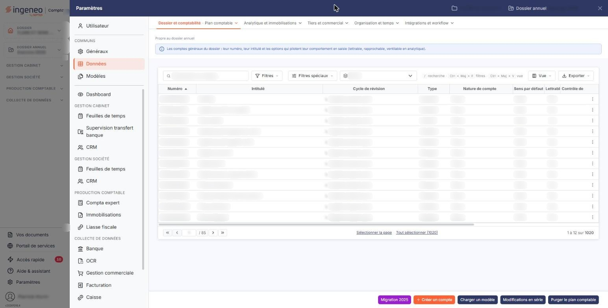
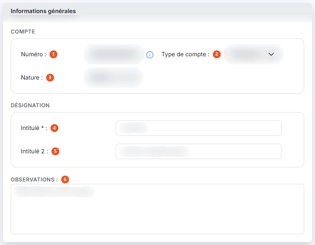
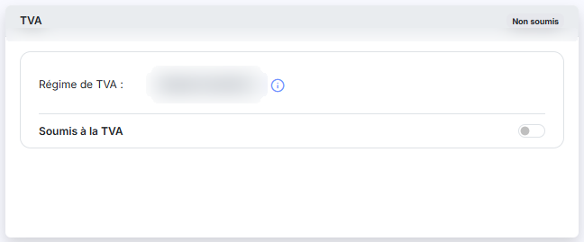
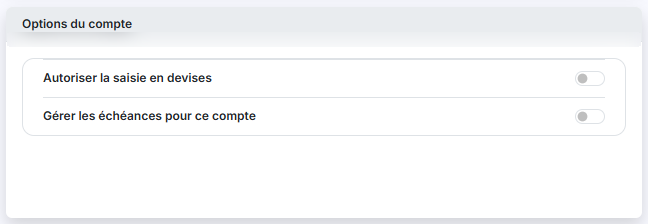
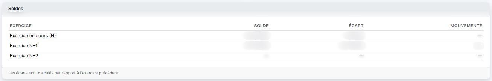

# Plan comptable


**Où le trouver :** Panneau **Paramètres** › **Données** › **Dossier et comptabilité** › **Plan comptable**



**En bref** — Cet écran administre les comptes généraux du plan comptable du dossier annuel en cours, le même que celui de la comptabilité.

* Pour créer un compte : bouton \[Créer un compte], renseignez la fiche, puis bouton \[Enregistrer].
* Pour modifier plusieurs comptes à la fois : sélectionnez-les, puis bouton \[Modifications en série].


Cette option permet d'administrer les comptes généraux du plan comptable.

<figure><figcaption>
Écran « Plan comptable » de la nouvelle interface
</figcaption></figure>

Il s'agit du plan comptable de l'exercice (dossier annuel) en cours : c'est le même que celui de la comptabilité.

Cet écran s'ouvre par le panneau « Paramètres » : rubrique « Données », puis onglet « Dossier et comptabilité » et, dans son menu déroulant, entrée « Plan comptable ». Un bandeau bleu en haut de l'écran, sous la mention « Propre au dossier annuel », rappelle qu'il s'agit des comptes généraux du dossier : leur numéro, leur intitulé et les options qui pilotent leur comportement en saisie.

## La liste des comptes

La liste s'ouvre triée sur le numéro de compte, par ordre croissant. Elle est large : une barre de défilement horizontal vous permet d'atteindre les dernières colonnes.

Les colonnes proposées sont, dans l'ordre : **Numéro**, **Intitulé**, **Cycle de révision**, **Type**, **Nature de compte**, **Sens par défaut**, **Lettrable**, **Contrôle de cycle**, **Analytique**, **Période d'effet**, **Code devise**, **Saisie en devise**, **Solde n-1**, **Solde n-2** et **Ecart n-1 vs n-2**.

Chaque colonne reprend, pour tous les comptes à la fois, un paramètre de la fiche décrite plus bas. Comme toutes les listes du logiciel, celle-ci se personnalise à l'aide du bouton \[Vue] : 15 colonnes sont affichées d'origine sur les 44 proposées, et vous pouvez masquer celles qui ne vous servent pas et en afficher d'autres.

## Les critères de recherche

Au-dessus de la liste se trouvent la barre « Rechercher un compte… », les boutons \[Filtres] et \[Filtres spéciaux] et un sélecteur « Cycle ».

| Champ                   | Ce qu'il faut savoir                                                                                                                                                                                                                                                                                                                                                       |
| ----------------------- | -------------------------------------------------------------------------------------------------------------------------------------------------------------------------------------------------------------------------------------------------------------------------------------------------------------------------------------------------------------------------- |
| **Recherche**           | La saisie dans la barre pose un critère « Numéro Contient » suivi de votre saisie, affiché sous la barre, et la liste se recharge aussitôt. Attention, la recherche porte sur le numéro entier et non sur son début : la valeur « 411 » remonte aussi bien le compte 411000 que le compte 214110000000. Le lien « Tout effacer », à côté de \[Filtres], retire le critère. |
| **\[Filtres]**          | Ce menu s'ouvre sur « Filtrer » et sur « Aucun critère. Choisissez une colonne pour commencer. » ; « + Ajouter un critère sur… » permet de choisir une colonne, « Vider les filtres » retire les critères posés et le bouton \[Filtrer] les applique.                                                                                                                      |
| **\[Filtres spéciaux]** | Ce menu propose, sous le titre « Comptes », trois choix exclusifs : **Tous**, retenu à l'ouverture de l'écran, **Mouvementés** et **Non mouvementés**. Le choix s'applique dès qu'on le fait, sans autre bouton, et un repère chiffré s'affiche alors sur \[Filtres spéciaux].                                                                                             |
| **Cycle**               | Sélecteur des cycles de révision paramétrés pour la comptabilité. Son choix neutre porte le nom de la colonne, « Cycle », et il est retenu à l'ouverture de l'écran.                                                                                                                                                                                                       |

Aucun critère n'est donc actif à l'ouverture : la totalité du plan comptable est affichée.

## Bouton \[Filtrer]

Situé en bas du menu \[Filtres], il applique à la liste les critères que vous y avez ajoutés. La recherche et les choix de \[Filtres spéciaux] s'appliquent sans lui.

## Les commandes de la ligne

Il n'y a pas de case à cocher : un clic sur une ligne la sélectionne, un second clic la désélectionne. Sous la liste, le lien « Sélectionner la page » sélectionne toutes les lignes affichées et le lien « Tout sélectionner (1020) » étend la sélection à toutes les pages (le nombre entre parenthèses est celui des comptes de la liste). Tant qu'une ligne est sélectionnée, un bandeau « 1 compte sélectionnée », avec le lien « Tout désélectionner », remplace la barre de boutons du bas et porte les boutons \[Supprimer], \[Modifications en série], \[Réaffectation] et \[Auxiliariser].

Au survol d'une ligne, le pictogramme « Autres actions » (trois points verticaux) apparaît à droite de la ligne. Il ouvre trois entrées :

* « Modifier » ouvre la fiche du compte ;
* « Dupliquer » prépare la création d'un nouveau compte à partir de celui-ci ;
* « Supprimer » ouvre la fenêtre de suppression du compte.

Selon votre profil, certaines de ces entrées peuvent ne pas apparaître.

La fiche d'un compte s'ouvre par l'entrée « Modifier » du menu « Autres actions » ou par le bouton \[Créer un compte]. Elle présente quatre rubriques sous forme de cartes, sur deux colonnes : « Informations générales » à gauche, « TVA » puis « Options du compte » à droite, et « Soldes » en dessous.

Un bandeau en tête de fiche rappelle le numéro et l'intitulé du compte et, en dessous, son type, sa nature, son cycle de révision et, sur un compte déjà modifié, la date et l'auteur de la dernière modification (« modifié le … par … »). Il porte à droite deux pastilles, « Compte utilisable » et « Solde » suivi du solde de l'exercice. Sur la fiche de création, il affiche « Nouveau compte ». Deux boutons fléchés au-dessus de la fiche, « Compte précédent » (Ctrl + ↑) et « Compte suivant » (Ctrl + ↓), passent au compte voisin dans la liste.

Les rubriques « Propriétés », « Accélérateur de saisie », « Gestion analytique » et « Échéances » ne sont pas affichées sur l'écran relevé (panneau ouvert depuis la Gestion commerciale).

## Rubrique « Informations générales »

<figure><figcaption>
Rubrique « Informations générales »
</figcaption></figure>

| Champ                 | Ce qu'il faut savoir                                                                                                                                                                                                                                                                                                                                                                                                                                                                                                                                            |
| --------------------- | --------------------------------------------------------------------------------------------------------------------------------------------------------------------------------------------------------------------------------------------------------------------------------------------------------------------------------------------------------------------------------------------------------------------------------------------------------------------------------------------------------------------------------------------------------------- |
| 1. **Numéro**         | Le numéro de compte doit être unique et n'est plus modifiable après création du compte. Les caractères autorisés sont les lettres majuscules et les chiffres, et le numéro doit commencer par 3 chiffres. À la création, une loupe à droite de la zone (raccourci Ctrl + Alt + R) ouvre une fenêtre « Recherche » dans le référentiel comptable, avec une zone « Contenu recherché » et deux colonnes, **Racine** et **Intitulé** ; la zone grisée « Description du référentiel », en lecture seule, figure sous « Nature » sur la fiche de création seulement. |
| 2. **Type de compte** | Un compte peut être « Standard » ou « Collectif ». Ce choix se fait à la création du compte ; sur un compte déjà enregistré, il n'est plus modifiable.                                                                                                                                                                                                                                                                                                                                                                                                          |
| 3. **Nature**         | Non modifiable. La nature du compte est attribuée par le logiciel en fonction des racines de comptes définies dans les paramètres généraux du dossier.                                                                                                                                                                                                                                                                                                                                                                                                          |
| 4. **Intitulé**       | —                                                                                                                                                                                                                                                                                                                                                                                                                                                                                                                                                               |
| 5. **Intitulé 2**     | Il permet, par exemple, de faire figurer l'intitulé du compte dans une autre langue.                                                                                                                                                                                                                                                                                                                                                                                                                                                                            |
| 6. **Observations**   | Zone de texte libre sur plusieurs lignes.                                                                                                                                                                                                                                                                                                                                                                                                                                                                                                                       |
| **Cycle**             | Non modifiable. Le cycle de révision est attribué par le logiciel si les cycles ont été paramétrés pour la comptabilité. Il n'est plus un champ de la fiche : il figure dans le bandeau d'en-tête.                                                                                                                                                                                                                                                                                                                                                              |

La date et l'auteur de la création ou, sur un compte qui a déjà été modifié, de la dernière modification ne sont plus des champs de la fiche : ils figurent dans le bandeau d'en-tête (« modifié le … par … »). Le libellé affiché sur un compte jamais modifié n'a pas été vu.

## Rubrique « TVA »

<figure><figcaption>
Rubrique « TVA »
</figcaption></figure>

La carte « TVA » porte, en haut à droite, une étiquette d'état (« Non soumis » sur le compte ouvert). Elle contient la zone grisée **Régime de TVA :**, dont l'infobulle indique comment le modifier : « Si vous souhaitez modifier le régime de TVA, veuillez vous rendre dans le menu "Paramètres", sous-option "Paramètres généraux", rubrique "Régime de TVA". », et un interrupteur **Soumis à la TVA**, désactivé sur le compte ouvert. Les champs que l'activation de cet interrupteur fait apparaître n'ont pas été vus : l'interrupteur n'a pas été basculé.

## Rubrique « Options du compte » : quantités

<figure><figcaption>
Rubrique « Options du compte »
</figcaption></figure>

| Champ                                  | Ce qu'il faut savoir                                                                                                                                                                                                                  |
| -------------------------------------- | ------------------------------------------------------------------------------------------------------------------------------------------------------------------------------------------------------------------------------------- |
| **Gérer les quantités pour ce compte** | Interrupteur désactivé par défaut. Il figure dans la carte « Options du compte », sous « Autoriser la saisie en devises » (voir h).                                                                                                   |
| **Unité 1**                            | **Unité 2 :** deux sélecteurs, correspondant aux deux quantités saisissables par ligne d'écriture. Les unités se définissent dans le panneau « Paramètres », rubrique « Données », onglet « Tiers et commercial », entrée « Unités ». |

Ces deux sélecteurs restent affichés même lorsque l'interrupteur est désactivé. Sur la fiche de création, la carte « Options du compte » ne montre que la sous-rubrique « Quantités » avec ces deux sélecteurs : ni l'interrupteur « Gérer les quantités pour ce compte » ni « Autoriser la saisie en devises » n'y figurent.

## Rubrique « Options du compte » : devises

| Champ                                | Ce qu'il faut savoir                                                                               |
| ------------------------------------ | -------------------------------------------------------------------------------------------------- |
| **Autoriser la saisie en devises**   | Interrupteur placé en tête de la carte « Options du compte », sur la fiche d'un compte enregistré. |
| **Devise par défaut pour ce compte** | Ce sélecteur n'apparaît que si vous avez autorisé la saisie en devises.                            |

## Rubrique « Soldes »

<figure><figcaption>
Rubrique « Soldes »
</figcaption></figure>

Cette rubrique ne se saisit pas.

Elle se présente sous la forme d'un tableau d'une ligne par exercice — « Exercice en cours (N) », « Exercice N−1 » et « Exercice N−2 » — avec les colonnes **Exercice**, **Solde**, **Écart** et **Mouvementé**. Une note rappelle : « Les écarts sont calculés par rapport à l'exercice précédent. » Le solde de l'exercice en cours se lit aussi dans la pastille « Solde » du bandeau d'en-tête.

## Les boutons de la fiche

Un seul bouton : le bouton \[Enregistrer], en bas à droite de l'écran, valide votre saisie.

Le bouton \[Retour] est masqué dans la fiche : le chevron « Retour », à gauche de la barre d'onglets du panneau, revient à la liste ; si la fiche a été modifiée, une fenêtre « Modifications non enregistrées » propose les boutons \[Continuer sans enregistrer] et \[Enregistrer et quitter].

La barre du bas propose sept boutons, de gauche à droite : \[Migration 2025], \[Créer un compte], \[Charger un modèle], \[Importer], \[Exporter], \[Modifications en série] et \[Purger le plan comptable]. Les boutons \[Supprimer], \[Modifications en série], \[Réaffectation] et \[Auxiliariser] se trouvent dans le bandeau de sélection, qui remplace cette barre dès qu'une ligne est sélectionnée. Le libellé \[Exporter] existe deux fois : le menu \[Exporter] de la barre d'outils de la liste (aperçu, impression, Excel, PDF, envoi par e-mail de « La liste affichée ») et le bouton \[Exporter] de la barre du bas, décrit en n). Selon votre profil, certains peuvent ne pas apparaître.

## Bouton \[Créer un compte]

Il est en bas à droite de l'écran, hors de la liste, et ouvre la fiche d'un nouveau compte.

## Bouton \[Charger un modèle]

Il permet de charger un modèle de plan comptable parmi ceux fournis par Ingeneo Compta et ceux que vous avez créés dans le module « Administration », menu « Divers », option « Modèles de plans comptables ».

Si les numéros de comptes du modèle sont plus courts que ceux de votre plan comptable, ils sont automatiquement comblés avec des 0. Le logiciel ne vous propose que les modèles dont la longueur de numéro de compte est inférieure ou égale à celle paramétrée pour la société gérée dans laquelle vous vous trouvez.

## Bouton \[Importer]

Il permet d'importer un plan comptable à partir d'un fichier issu d'un autre logiciel, ou depuis l'exercice n-1 s'il existe un dossier annuel n-1 relié au dossier annuel en cours.

## Bouton \[Exporter]

Il permet d'exporter votre plan comptable dans un fichier, selon un modèle d'export.

## Bouton \[Modifications en série]

Il figure dans la barre du bas et dans le bandeau de sélection. Il permet d'appliquer simultanément les mêmes modifications à une sélection de comptes.

## Bouton \[Réaffectation]

Il se trouve dans le bandeau de sélection. Il permet de réaffecter toutes les écritures d'un compte général à un autre compte général ou à un compte auxiliaire.

## Bouton \[Auxiliariser]

Il se trouve dans le bandeau de sélection. Il permet de transformer en comptes auxiliaires des comptes généraux qui n'auraient pas dû être créés comme tels.

## Bouton \[Purger le plan comptable]

Il permet de supprimer les comptes pour, par exemple, charger un autre modèle de plan comptable.

## Bouton \[Supprimer]

Il se trouve dans le bandeau de sélection. Il supprime en une seule fois tous les comptes que vous avez sélectionnés dans la liste.

## Bouton \[Migration 2025]

Il ouvre la fenêtre « Migration du plan comptable 2025 », qui vous accompagne dans le passage de votre plan comptable au plan comptable général de 2025.
