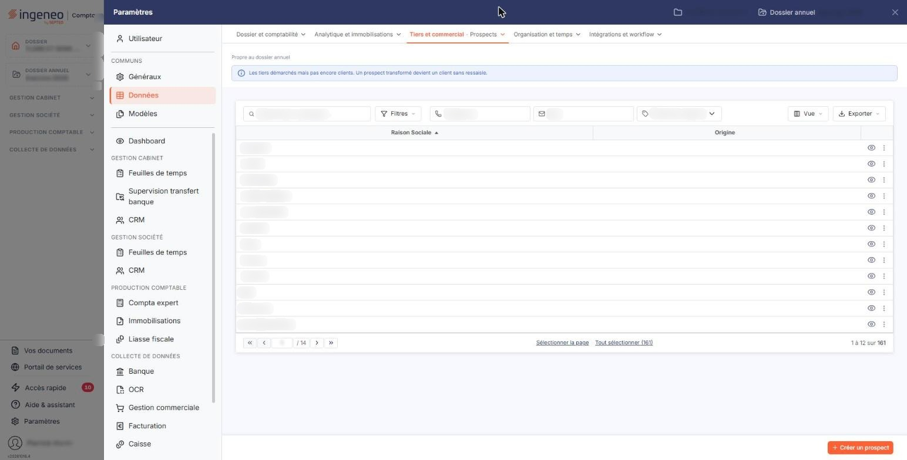
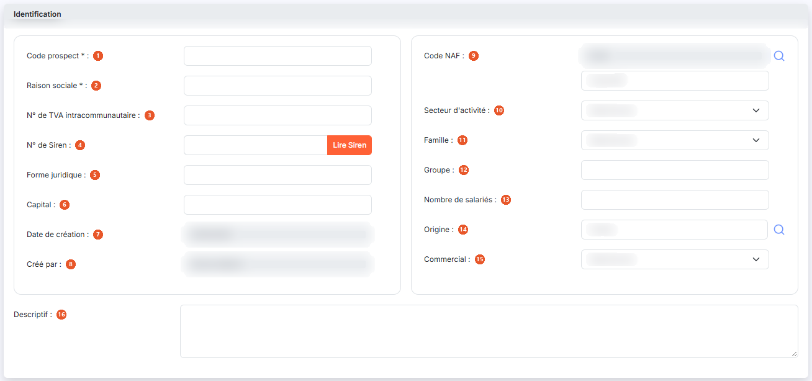
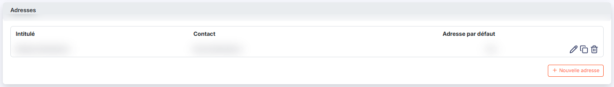
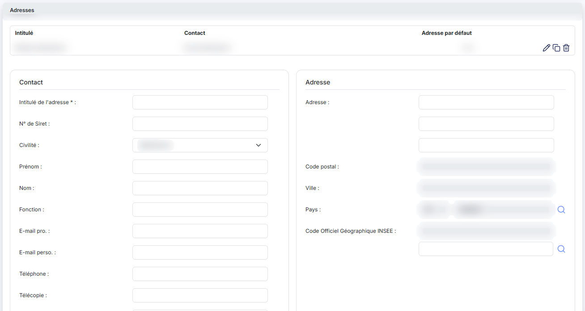

# Prospects


**Où le trouver :** Panneau **Paramètres** › **Données** › **Tiers et commercial** › **Prospects**



**En bref** — Cet écran tient le fichier des prospects, commun à plusieurs modules. Un devis peut être établi pour un prospect, qui devient client si le devis est transformé en facture.

* Pour créer un prospect : bouton \[Créer un prospect], puis renseignez les rubriques « Identification » et « Adresses ».
* Pour remplir la fiche à partir du numéro de Siren : bouton \[Lire Siren].


Le fichier « Prospects » est commun à plusieurs modules d'Ingeneo Compta. Ainsi, où que vous ayez créé ou modifié un prospect, il sera visible de la même manière dans tous les modules.

<figure><figcaption>
Écran « Prospects » de la nouvelle interface
</figcaption></figure>

Un prospect ne peut être supprimé s'il a été affecté à un devis ou si des actions ont été saisies pour lui dans le module « GRC ».

Un devis peut être réalisé pour un client ou pour un prospect. Si le devis est transformé en facture, alors le prospect est transformé en client.

La fiche d'un prospect est beaucoup plus courte que celle d'un client : elle ne comporte que deux rubriques, « Identification » et « Adresses ». Un prospect n'a ni compte auxiliaire, ni délai ou mode de règlement, ni régime de TVA, ni relance, ni coordonnées bancaires, ni document, ni modèle d'impression : ces informations n'apparaissent qu'une fois le prospect devenu client. Attention, quelques libellés diffèrent également d'un écran à l'autre ; ils sont signalés ci-dessous.

## La liste des prospects

La liste présente deux colonnes : **Raison Sociale** et **Origine**. Elle est triée par défaut sur la raison sociale, dans l'ordre croissant. L'origine est celle que vous avez rattachée au prospect ; les origines se gèrent dans le panneau Paramètres, rubrique « Données », groupe « Tiers et commercial », onglet « Origines de prospects ».

Un clic sur une ligne la sélectionne. Au survol, la ligne porte en fin de ligne un pictogramme « Autres actions » (trois points), qui ouvre un menu de deux entrées : « Modifier » ouvre la fiche du prospect en modification et « Supprimer » le supprime. Sous la liste, les liens « Sélectionner la page » et « Tout sélectionner » permettent d'étendre la sélection ; les boutons \[Vue] et \[Exporter], à droite au-dessus de la liste, ouvrent le menu des vues et le menu d'aperçu, d'impression et d'export.

## Les filtres de la liste

Quatre critères sont proposés au-dessus de la liste, sur une même ligne, avec le bouton \[Filtres] qui ouvre le volet de filtres :

| Champ                       | Ce qu'il faut savoir                                                                                                                                                 |
| --------------------------- | -------------------------------------------------------------------------------------------------------------------------------------------------------------------- |
| **Rechercher un prospect…** | Barre de recherche, pour retrouver le prospect par sa raison sociale.                                                                                                |
| **Téléphone**               | Numéro de téléphone recherché.                                                                                                                                       |
| **Mail**                    | Adresse électronique recherchée.                                                                                                                                     |
| **Origine**                 | Liste déroulante des origines paramétrées pour la société ; elle est positionnée sur « Toutes les origines », ce qui signifie que toutes les origines sont retenues. |

Il n'y a plus de bouton \[Afficher] : la liste se recharge dès que vous modifiez un critère. Lorsqu'un critère est posé, le lien « Tout effacer » apparaît à côté de \[Filtres] et les remet à leur valeur d'origine.

## Bouton \[Créer un prospect]

Placé en bas à droite de l'écran, il ouvre une fiche vierge pour créer un nouveau prospect. La fiche comporte les mêmes rubriques et les mêmes champs qu'en modification.

## Bouton \[Supprimer]

Dès qu'une ligne est sélectionnée, un bandeau de sélection (« 1 prospect sélectionné · toutes les pages », « Tout désélectionner ») remplace la barre du bas et porte le bouton \[Supprimer], qui supprime tous les prospects sélectionnés.

## Rubrique « Identification »

<figure><figcaption>
Rubrique « Identification »
</figcaption></figure>

| Champ                               | Ce qu'il faut savoir                                                                                                                                                                                                                                                                                                                                               |
| ----------------------------------- | ------------------------------------------------------------------------------------------------------------------------------------------------------------------------------------------------------------------------------------------------------------------------------------------------------------------------------------------------------------------ |
| 1. **Code prospect**                | Il doit être unique. Contrairement au code d'un client, il reste modifiable après la création de la fiche.                                                                                                                                                                                                                                                         |
| 2. **Raison sociale**               | —                                                                                                                                                                                                                                                                                                                                                                  |
| 3. **N° de TVA intracommunautaire** | —                                                                                                                                                                                                                                                                                                                                                                  |
| 4. **N° de Siren**                  | Le bouton **\[Lire Siren]**, placé à droite du champ, permet, grâce à une API, de remplir plusieurs champs de la fiche : le numéro de TVA intracommunautaire, la forme juridique, le capital, le code NAF, le nombre de salariés, l'activité (renseignée dans le champ **Descriptif**), l'adresse avec le libellé « Adresse principale » suivi du numéro de Siren. |
| 5. **Forme juridique**              | —                                                                                                                                                                                                                                                                                                                                                                  |
| 6. **Capital**                      | —                                                                                                                                                                                                                                                                                                                                                                  |
| 7. **Date de création**             | Renseignée automatiquement, non modifiable. C'est la date de création de la fiche prospect ; en création, elle est préremplie au jour courant.                                                                                                                                                                                                                     |
| 8. **Créé par**                     | Renseigné automatiquement, non modifiable. C'est le nom de l'utilisateur ayant créé la fiche prospect ; en création, il est prérempli avec votre nom.                                                                                                                                                                                                              |
| 9. **Code NAF**                     | Ce champ est double : le code proprement dit, que vous ne saisissez pas directement, et son libellé, avec une loupe qui vous permet de choisir le code dans la nomenclature.                                                                                                                                                                                       |
| 10. **Secteur d'activité**          | Liste déroulante des secteurs paramétrés pour la société, gérés dans le panneau Paramètres, rubrique « Données », groupe « Tiers et commercial », onglet « Secteurs d'activité ».                                                                                                                                                                                  |
| 11. **Famille**                     | Liste déroulante des familles paramétrées pour la société, gérées dans le panneau Paramètres, rubrique « Données », groupe « Tiers et commercial », onglet « Familles de clients ».                                                                                                                                                                                |
| 12. **Groupe**                      | —                                                                                                                                                                                                                                                                                                                                                                  |
| 13. **Nombre de salariés**          | —                                                                                                                                                                                                                                                                                                                                                                  |
| 14. **Origine**                     | C'est l'origine du prospect, choisie à l'aide de la loupe parmi celles que vous avez paramétrées dans le panneau Paramètres, rubrique « Données », groupe « Tiers et commercial », onglet « Origines de prospects ». C'est elle qui s'affiche dans la colonne **Origine** de la liste.                                                                             |
| 15. **Commercial**                  | Liste déroulante des intervenants du cabinet.                                                                                                                                                                                                                                                                                                                      |
| 16. **Descriptif**                  | Zone de texte.                                                                                                                                                                                                                                                                                                                                                     |

## Rubrique « Adresses »

<figure><figcaption>
Rubrique « Adresses »
</figcaption></figure>

<figure><figcaption>
Rubrique « Adresses »
</figcaption></figure>

Une fiche prospect peut contenir plusieurs adresses. La liste des adresses présente trois colonnes : **Intitulé**, **Contact** et **Adresse par défaut**.

Lorsque vous indiquez qu'une adresse est l'adresse par défaut, c'est elle qui sera affectée lors de la création de tout nouveau devis.

Sur chaque ligne, trois commandes sont proposées : « Modifier », qui déplie le formulaire de l'adresse sous la liste, « Supprimer », et « Dupliquer », qui crée une nouvelle adresse à partir de celle sur laquelle vous êtes positionné. Cette dernière commande n'existe pas dans la rubrique « Adresses » d'une fiche client.

Le bouton **\[Nouvelle adresse]** de la rubrique (son libellé est précédé d'un « + ») déplie sous la liste le formulaire d'une adresse vierge. Il ne s'agit pas d'une fenêtre : la saisie se fait dans la fiche elle-même.

Le formulaire d'une adresse comporte les champs suivants :

| Champ                                                        | Ce qu'il faut savoir                                                                                                                                                               |
| ------------------------------------------------------------ | ---------------------------------------------------------------------------------------------------------------------------------------------------------------------------------- |
| **Intitulé de l'adresse**                                    | C'est lui qui permet de distinguer les adresses entre elles.                                                                                                                       |
| **Commentaire**                                              | Zone de texte.                                                                                                                                                                     |
| **N° de Siret**                                              | Il se saisit au niveau de l'adresse, et non dans la rubrique « Identification ».                                                                                                   |
| **Civilité, Prénom, Nom, Fonction**                          | S. Ils identifient le contact rattaché à cette adresse ; c'est le nom du contact qui s'affiche dans la colonne **Contact** de la liste.                                            |
| **E-mail pro., E-mail perso., Téléphone, Télécopie, Mobile** | S. Coordonnées du contact.                                                                                                                                                         |
| **Adresse**                                                  | Facultative, sur trois lignes de saisie.                                                                                                                                           |
| **Commune**                                                  | Champ accompagné d'une loupe de recherche, placé sous les lignes d'adresse ; il remplace le champ « Code Officiel Géographique INSEE », qui n'est plus affiché dans ce formulaire. |
| **Code postal, Ville**                                       | S. Lorsque le pays est la France, ces deux zones sont grisées et affichent « Déduit de la commune » : on ne les saisit pas à la main.                                              |
| **Pays**                                                     | Le code (FR par défaut) se choisit par la loupe, et le libellé (FRANCE) s'affiche dessous sans être saisissable.                                                                   |
| **Adresse par défaut**                                       | Positionné sur Non par défaut. Passez-le à Oui pour que cette adresse soit celle proposée automatiquement dans les nouveaux devis.                                                 |

Trois boutons ferment ce formulaire : le bouton **\[Rafraîchir la carte]**, qui remet à jour le plan affiché à partir de l'adresse saisie, le bouton **\[Enregistrer]**, qui ajoute l'adresse à la liste, et le bouton **\[Annuler]**, qui referme le formulaire sans rien conserver.

Le formulaire d'adresse d'un prospect ne comporte pas de champ **Type d'adresse**, à la différence de celui d'une fiche client : vous ne distinguez donc pas ici les adresses de facturation des adresses de livraison, et la liste des adresses n'affiche pas de colonne correspondante.

## Bouton \[Enregistrer]

<figure><figcaption>
Bouton [Enregistrer]
</figcaption></figure>

Il valide la création ou la modification du prospect et vous ramène à la liste.

## Retour à la liste

Le chevron « Retour », à gauche de la barre d'onglets du panneau Paramètres, vous ramène à la liste des prospects sans enregistrer la fiche en cours.
