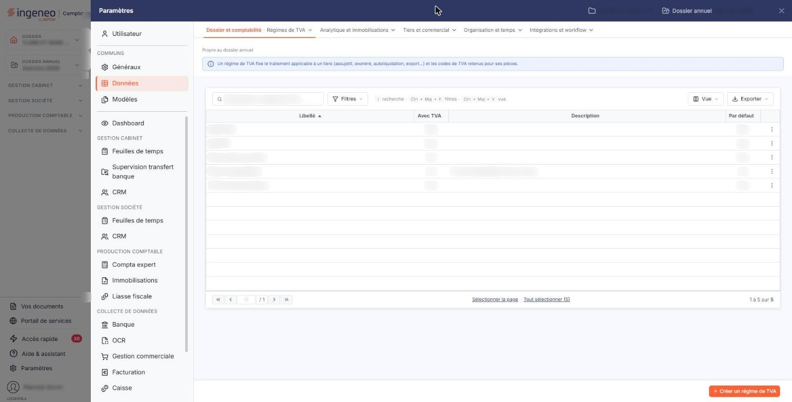
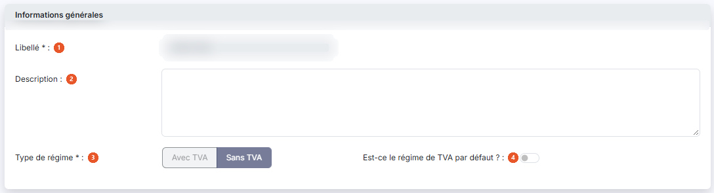

# Régimes de TVA


**Où le trouver :** Panneau **Paramètres** › **Données** › **Dossier et comptabilité** › **Régimes de TVA**



**En bref** — Cet écran tient vos régimes de TVA (France métropolitaine, export, DOM-TOM, intracommunautaire), affectés aux clients puis reportés sur leurs pièces. Les régimes utiles sont fournis par défaut.

* Pour créer un régime : bouton \[Créer un régime de TVA], renseignez la fiche, puis bouton \[Enregistrer].


Cette option permet de tenir la liste de vos régimes de TVA. Un régime de TVA décrit une situation de facturation — la France métropolitaine, l'export, les DOM-TOM, l'intracommunautaire — et il est affecté à vos clients puis reporté sur leurs pièces commerciales. Il permet de gérer tous les cas de facturation, en local comme à l'export, que l'entreprise soit domiciliée en France métropolitaine ou en France d'outre-mer.

<figure><figcaption>
Écran « Régimes de TVA » de la nouvelle interface
</figcaption></figure>

Cet écran s'ouvre par le panneau « Paramètres » : rubrique « Données », groupe « Dossier et comptabilité », entrée « Régimes de TVA ». Un bandeau bleu en haut de l'écran rappelle qu'un régime de TVA fixe le traitement applicable à un tiers (assujetti, exonéré, autoliquidation, export…) et les codes de TVA retenus pour ses pièces.

Le logiciel contient par défaut tous les régimes utiles à une entreprise située en métropole qui vendrait dans les DOM-TOM et dans le monde entier : vous n'avez en général rien à créer ici.

Un régime de TVA est affecté à un client, mais il peut ponctuellement être modifié sur chaque pièce commerciale.

Pour ce qui concerne les articles, chaque régime de TVA porte sa propre ligne de comptes dans les rubriques « Numéros de comptes de vente en fonction du régime de TVA » et « Numéros de comptes d'achat en fonction du régime de TVA » de la fiche article et de la fiche famille d'articles, ce qui facilite la déclaration de TVA. Un régime que vous créez ici apparaît dans les fiches articles existantes.

Un régime de TVA ne peut pas être supprimé s'il est utilisé dans au moins une fiche client, un article ou une pièce commerciale.

## La liste des régimes de TVA

L'écran s'ouvre directement sur la liste de vos régimes, triée par ordre croissant de libellé. Il n'y a pas d'onglet. Au-dessus de la liste, la barre « Rechercher un régime de TVA… » et les boutons \[Filtres], \[Vue] et \[Exporter] permettent de chercher un régime, de filtrer la liste, de personnaliser les colonnes et de l'imprimer ou de l'exporter.

Elle présente les colonnes suivantes :

| Champ           | Ce qu'il faut savoir                                                                                                            |
| --------------- | ------------------------------------------------------------------------------------------------------------------------------- |
| **Libellé**     | Le nom du régime. C'est lui qui est proposé dans les sélecteurs de régime de TVA des fiches clients et des pièces commerciales. |
| **Avec TVA**    | « Oui » si de la TVA s'applique pour ce régime, « Non » dans le cas contraire.                                                  |
| **Description** | Le complément d'information que vous y avez associé.                                                                            |
| **Par défaut**  | « Oui » sur le régime retenu comme régime par défaut, « Non » sur les autres.                                                   |

Il n'y a pas de case à cocher : un clic sur une ligne la sélectionne, un second clic la désélectionne. Sous la liste, le lien « Sélectionner la page » sélectionne toutes les lignes affichées et le lien « Tout sélectionner (5) » étend la sélection à toutes les pages (le nombre entre parenthèses est celui des régimes de la liste). Tant qu'une ligne est sélectionnée, un bandeau « 1 régime de TVA sélectionné » avec le lien « Tout désélectionner » et le bouton \[Supprimer] remplace le bouton de création. Le fonctionnement des listes du logiciel, la personnalisation des colonnes et la barre de pagination sont décrits dans le chapitre « Généralités » en tête de la présente aide.

## Les commandes de chaque ligne

Au survol d'une ligne, le pictogramme « Autres actions » (trois points verticaux) apparaît à droite de la ligne. Il ouvre deux entrées :

« Modifier » ouvre la fiche du régime.

« Supprimer » supprime le régime, après confirmation, dans le respect de la règle rappelée plus haut. Il n'y a pas d'entrée « Dupliquer » sur cet écran.

Selon les droits qui vous sont accordés, l'une ou l'autre de ces entrées peut ne pas vous être proposée.

## Bouton \[Créer un régime de TVA]

Il est en bas à droite de l'écran, hors de la liste, et ouvre une fiche vierge pour créer un régime de TVA.

## Bouton \[Supprimer]

Il apparaît à droite du bandeau de sélection, dès qu'au moins un régime est sélectionné dans la liste (un clic sur sa ligne), et supprime en une fois, après confirmation, tous les régimes sélectionnés, dans le respect de la même règle.

## Rubrique « Informations générales »

<figure><figcaption>
Rubrique « Informations générales »
</figcaption></figure>

| Champ                                       | Ce qu'il faut savoir                                                                                                                                                                                                                                                     |
| ------------------------------------------- | ------------------------------------------------------------------------------------------------------------------------------------------------------------------------------------------------------------------------------------------------------------------------ |
| 1. **Libellé**                              | Il n'est plus modifiable après la création du régime : le champ vous est présenté en lecture seule sur les régimes livrés avec le logiciel. C'est ce libellé qui est employé dans les sélecteurs, pour affecter un régime de TVA à un client ou à une pièce commerciale. |
| 2. **Description**                          | Facultative.                                                                                                                                                                                                                                                             |
| 3. **Type de régime**                       | Indiquez si de la TVA s'applique pour ce régime, en choisissant « Avec TVA » ou « Sans TVA ». Sur certains régimes, ce choix vous est présenté grisé et n'est donc pas modifiable.                                                                                       |
| 4. **Est-ce le régime de TVA par défaut ?** | Interrupteur.                                                                                                                                                                                                                                                            |

Le logiciel réclame qu'un régime soit désigné par défaut : sans lui, l'enregistrement d'une fiche article est refusé avec le message « Vous devez définir un régime de TVA par défaut dans le menu Fichiers > Régimes de TVA ».

## Rubrique « Tableau de correspondance inter-régimes »

Dans les fiches articles, les taux de TVA indiqués s'appliquent au régime par défaut. Pour vos clients qui sont soumis à un autre régime, vous pouvez définir ici une table de correspondance : vous évitez ainsi d'avoir à modifier les taux de TVA sur chaque ligne d'articles dans les pièces commerciales.

Le logiciel affiche une ligne par code TVA du fichier « Codes TVA ». Chaque ligne comporte :

* **Code TVA originel** : le code TVA tel qu'il figure dans la fiche article. Il n'est pas modifiable.
* **Taux originel** : le taux de ce code. Il n'est pas modifiable.
* **Code de remplacement** : le code TVA à employer à la place du précédent lorsque la pièce commerciale relève du régime de la fiche en cours. Le sélecteur est prépositionné sur le code originel lui-même : laissez-le tel quel pour les codes que vous ne souhaitez pas remplacer.
* **Taux de remplacement** : le taux du code de remplacement retenu. Il est affiché par le logiciel et n'est pas modifiable.

Cette rubrique ne vous est pas présentée sur tous les régimes : elle n'apparaît ni sur le régime désigné par défaut — puisque c'est de lui que partent les correspondances — ni sur un régime « Sans TVA », pour lequel un remplacement de taux n'aurait pas de sens. Elle vous est en revanche présentée en création, et sur un régime « Avec TVA » qui n'est pas le régime par défaut.

## Bouton \[Enregistrer]

<figure><figcaption>
Bouton [Enregistrer]
</figcaption></figure>

Il enregistre la fiche et vous ramène à la liste des régimes de TVA.

## Retour à la liste

Le bouton \[Retour] est masqué dans la fiche : le chevron « Retour », à gauche de la barre d'onglets du panneau, ferme la fiche sans enregistrer et vous ramène à la liste des régimes de TVA.
