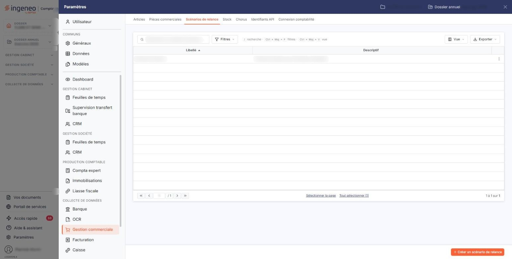
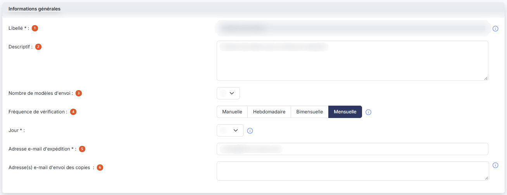
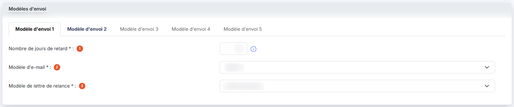

# Scénarios de relance


**Où le trouver :** Panneau **Paramètres** › **Gestion commerciale** › **Scénarios de relance**



**En bref** — Cet écran paramètre les scénarios de relance automatique par e-mail des clients en retard de paiement. Un scénario ne s'applique qu'aux clients qui le désignent dans leur fiche.

* Pour créer un scénario : bouton \[Créer un scénario de relance], renseignez la fiche, puis bouton \[Enregistrer].


Cet écran s'ouvre depuis le panneau « Paramètres » : « Paramètres > Gestion commerciale > Scénarios de relance ».

<figure><figcaption>
Écran « Scénarios de relance » de la nouvelle interface
</figcaption></figure>

Il vous permet de paramétrer l'envoi d'e-mails de relance automatiques à vos clients dès lors qu'au moins une échéance de facture présentera un retard de paiement supérieur à un nombre de jours défini.

L'activation de la relance automatique se fait dans la fiche de chaque client, pavé « Relances » : le paramétrage d'un scénario ne suffit pas à déclencher des relances, il faut encore désigner les clients concernés. Ce pavé distingue les relances manuelles des relances automatiques, et vous y désignez pour chacune le scénario applicable au client.

Si pour un client donné il existe des échéances dont le reste à payer est non nul et dont le nombre de jours de retard est supérieur à celui défini pour un modèle de lettre, le logiciel envoie un e-mail de relance correspondant au modèle de lettre de l'échéance la plus en retard, avec copie éventuelle aux adresses e-mail paramétrées. Cet e-mail de relance contient l'intégralité des échéances en retard.

Vous pouvez créer plusieurs scénarios, par exemple en fonction du type de client. Un scénario peut compter jusqu'à cinq modèles d'envoi successifs, échelonnés selon le retard constaté.

L'écran présente la liste des scénarios du dossier, une ligne par scénario, avec deux colonnes : **Libellé** et **Descriptif**. La liste est triée par défaut sur le libellé, par ordre croissant.

Au-dessus de la liste figurent une barre « Rechercher un scénario de relance… » et les boutons \[Filtres], \[Vue] et \[Exporter] ; il n'y a pas de menu de filtres spéciaux. Aucun critère n'est posé à l'ouverture : si la liste vous paraît courte, c'est donc qu'elle contient réellement peu de scénarios, et non qu'un filtre en masque une partie.

Un clic sur une ligne la sélectionne ; un second clic la désélectionne. À droite de chaque ligne, le menu « Autres actions » (trois points) propose « Modifier », « Dupliquer » et « Supprimer ». La duplication reprend les informations du scénario d'origine dans une nouvelle fiche que vous complétez avant de l'enregistrer.

bouton **\[Créer un scénario de relance]**

Placé en bas à droite de l'écran, il ouvre une fiche vierge pour créer un nouveau scénario de relance.

bouton **\[Supprimer]**

Il apparaît dans le bandeau de sélection, au bas de l'écran, dès qu'une ligne est sélectionnée (le bandeau indique le nombre de scénarios sélectionnés et remplace alors le bouton de création). Il supprime les scénarios sélectionnés dans la liste.

## Rubrique « Informations générales »

<figure><figcaption>
Rubrique « Informations générales »
</figcaption></figure>

| Champ                                       | Ce qu'il faut savoir                                                                                                                                                                                                                                                                                                                                                                                                                                                                                                                                                                                                                                                                                                                                                                                                                                                                                                                                                     |
| ------------------------------------------- | ------------------------------------------------------------------------------------------------------------------------------------------------------------------------------------------------------------------------------------------------------------------------------------------------------------------------------------------------------------------------------------------------------------------------------------------------------------------------------------------------------------------------------------------------------------------------------------------------------------------------------------------------------------------------------------------------------------------------------------------------------------------------------------------------------------------------------------------------------------------------------------------------------------------------------------------------------------------------ |
| 1. **Libellé**                              | C'est lui qui vous servira à reconnaître le scénario, notamment au moment de l'affecter à un client. Une fois le scénario enregistré, ce libellé n'est plus modifiable : lorsque vous rouvrez la fiche, la zone apparaît grisée.                                                                                                                                                                                                                                                                                                                                                                                                                                                                                                                                                                                                                                                                                                                                         |
| 2. **Descriptif**                           | Zone de plusieurs lignes, où vous pouvez préciser à quels clients ou à quelles situations le scénario est destiné.                                                                                                                                                                                                                                                                                                                                                                                                                                                                                                                                                                                                                                                                                                                                                                                                                                                       |
| 3. **Nombre de modèles d'envoi**            | De 1 à 5. Il correspond au nombre d'étapes du scénario, c'est-à-dire au nombre de relances successives que le logiciel peut envoyer pour une même facture en retard.                                                                                                                                                                                                                                                                                                                                                                                                                                                                                                                                                                                                                                                                                                                                                                                                     |
| 4. **Fréquence de vérification**            | 
Quatre boutons côte à côte, <strong>Manuelle</strong>, <strong>Hebdomadaire</strong>, <strong>Bimensuelle</strong> et <strong>Mensuelle</strong>, dont un seul est retenu (rempli) ; un pictogramme « Information » résume le rôle des scénarios manuels et automatiques. C'est le paramètre le plus important de la rubrique, car il détermine qui déclenche l'envoi. Les scénarios <strong>manuels</strong> sont utilisés dans l'édition des relances clients du menu « Editions » : c'est vous qui décidez du moment de l'envoi. Cette édition reprend, pour chaque client relancé, le scénario de relance manuelle indiqué dans sa fiche ; pour les clients qui n'en ont pas, elle vous demande le modèle de lettre de relance à employer. Un scénario manuel ne vous demande donc aucune date : il n'est pas planifié. Les autres scénarios sont vérifiés et déclenchés automatiquement toutes les nuits, et les e-mails sont envoyés automatiquement.
 |
| 5. **Adresse e-mail d'expédition**          | Elle doit être une adresse e-mail valide. C'est l'adresse qui figurera en expéditeur des e-mails de relance adressés à vos clients. À la création d'un scénario, le logiciel vous propose l'adresse e-mail de la société gérée et, à défaut, la vôtre ; vous pouvez la remplacer à tout moment.                                                                                                                                                                                                                                                                                                                                                                                                                                                                                                                                                                                                                                                                          |
| 6. **Adresse(s) e-mail d'envoi des copies** | Si vous désirez recevoir une copie des e-mails de relance envoyés, indiquez la ou les adresses, séparées le cas échéant par des points-virgules.                                                                                                                                                                                                                                                                                                                                                                                                                                                                                                                                                                                                                                                                                                                                                                                                                         |
| **Jour**                                    | Pour une vérification mensuelle. Choisissez le jour du mois, de 1 à 31. Pour un envoi le dernier jour du mois, indiquez « 31 ».                                                                                                                                                                                                                                                                                                                                                                                                                                                                                                                                                                                                                                                                                                                                                                                                                                          |

## Rubrique « Modèles d'envoi »

<figure><figcaption>
Rubrique « Modèles d'envoi »
</figcaption></figure>

Cette rubrique se présente sous la forme de cinq onglets, **Modèle d'envoi 1** à **Modèle d'envoi 5**.

Chaque onglet porte les trois mêmes champs, tous obligatoires.

| Champ                              | Ce qu'il faut savoir                                                                                                                                                                                                        |
| ---------------------------------- | --------------------------------------------------------------------------------------------------------------------------------------------------------------------------------------------------------------------------- |
| 1. **Nombre de jours de retard**   | Définit le nombre de jours de retard à partir duquel l'envoi de la relance est déclenché. Échelonnez vos étapes en croissant : le premier modèle d'envoi correspond au retard le plus faible, le dernier au plus important. |
| 2. **Modèle d'e-mail**             | Le modèle qui servira de corps à l'e-mail de relance. La liste ne propose que les modèles d'e-mail de type relance, créés dans la rubrique « Modèles » du panneau « Paramètres ».                                           |
| 3. **Modèle de lettre de relance** | Le modèle de la lettre joint à l'e-mail. La liste ne propose que les modèles d'impression de type lettre de relance, créés dans la rubrique « Modèles » du panneau « Paramètres ».                                          |

Si l'une de ces deux listes est vide ou ne vous propose pas le modèle attendu, c'est qu'il n'a pas encore été créé — ou qu'il n'est pas du type attendu : commencez alors par le paramétrer dans l'écran correspondant.

bouton **\[Enregistrer]**

Placé en bas à droite de la fiche, il enregistre le scénario.

**Retour à la liste**

Le chevron « Retour », à gauche de la barre d'onglets du panneau, revient à la liste sans enregistrer les modifications en cours.
