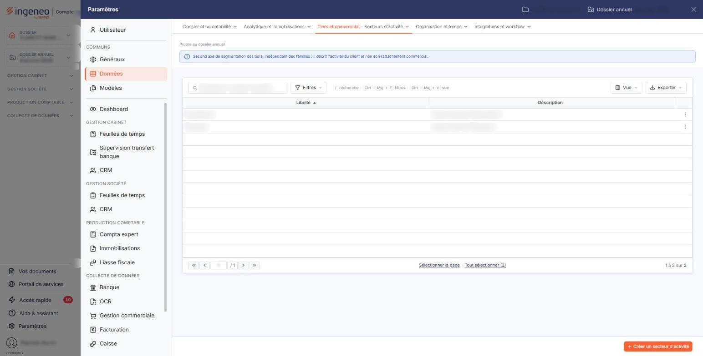
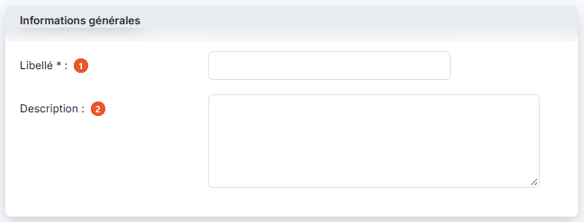

# Secteurs d'activité


**Où le trouver :** Panneau **Paramètres** › **Données** › **Tiers et commercial** › **Secteurs d'activité**



**En bref** — Les secteurs d'activité classent vos clients selon leur métier ou leur position dans votre circuit de vente. Ils s'affectent dans la fiche client.

* Pour créer un secteur : bouton \[Créer un secteur d'activité], renseignez son libellé, puis bouton \[Enregistrer].


Les secteurs d'activité vous permettent de classer vos clients selon leur métier ou leur position dans votre circuit de vente, par exemple pour distinguer un revendeur d'un organisateur d'événements. Un secteur peut ensuite être affecté à chaque fiche client dans la rubrique « Identification », et il est proposé dans la liste déroulante **Secteur d'activité** de cette fiche.

<figure><figcaption>
Écran « Secteurs d'activité » de la nouvelle interface
</figcaption></figure>

Pour chaque secteur d'activité, vous devez saisir un libellé et vous avez la possibilité d'y associer un descriptif. Deux secteurs d'activité ne peuvent avoir le même libellé.

Dans le panneau Paramètres, cet écran se trouve dans la rubrique « Données », onglet « Tiers et commercial », entrée « Secteurs d'activité ».

## La liste des secteurs d'activité

La liste présente deux colonnes : **Libellé** et **Description**. Elle est triée par défaut sur le libellé, dans l'ordre croissant, et chaque colonne peut servir de critère de tri.

Au-dessus de la liste, la barre « Rechercher un secteur d'activité… » permet de retrouver un secteur d'activité par saisie, et le bouton \[Filtres] de poser des critères sur les colonnes ; à l'extrémité droite, le bouton \[Vue] permet de gérer vos vues et de choisir les colonnes affichées, et le bouton \[Exporter] ouvre le menu d'édition de la liste. Tant qu'aucun critère n'est posé, la totalité des secteurs créés pour la société est affichée.

Un clic sur une ligne la sélectionne. Au survol d'une ligne, un pictogramme « Autres actions » (trois points) apparaît en dernière colonne : il ouvre un menu à deux entrées, « Modifier », qui ouvre la fiche, et « Supprimer ». Sous la liste, « Sélectionner la page » et « Tout sélectionner (N) » sélectionnent d'un coup les secteurs de la page ou tous les secteurs. Dès qu'une ligne est sélectionnée, un bandeau apparaît au bas de l'écran, à la place de la barre du bas : il indique le nombre de secteurs sélectionnés et propose « Tout désélectionner » et le bouton \[Supprimer].

## Bouton \[Créer un secteur d'activité]

Situé en bas à droite de l'écran, il ouvre une fiche vierge pour créer un nouveau secteur d'activité.

## Bouton \[Supprimer]

Il s'affiche dans le bandeau de sélection, en bas de l'écran, dès qu'une ligne au moins est sélectionnée, et supprime toutes les lignes sélectionnées. Une ligne peut aussi être supprimée seule par l'entrée « Supprimer » du menu « Autres actions » de la ligne.

## Rubrique « Informations générales »

<figure><figcaption>
Rubrique « Informations générales »
</figcaption></figure>

La fiche d'un secteur d'activité ne comporte que cette seule rubrique, avec deux champs :

| Champ              | Ce qu'il faut savoir                                                                                                                                                                      |
| ------------------ | ----------------------------------------------------------------------------------------------------------------------------------------------------------------------------------------- |
| 1. **Libellé**     | C'est le nom sous lequel le secteur est proposé dans les fiches clients. Vous ne le saisissez qu'à la création : lorsque vous ouvrez un secteur existant, ce champ n'est plus modifiable. |
| 2. **Description** | Zone de texte libre dans laquelle vous précisez à quoi ce secteur correspond ; elle n'est visible que dans cet écran.                                                                     |

## Bouton \[Enregistrer]

<figure><figcaption>
Bouton [Enregistrer]
</figcaption></figure>

Il valide la création ou la modification du secteur d'activité et vous ramène à la liste.

## Retour à la liste

Le bouton \[Retour] n'est plus affiché dans la fiche : pour revenir à la liste sans enregistrer la fiche en cours, utilisez le chevron « Retour » à gauche de la barre d'onglets du panneau Paramètres.
