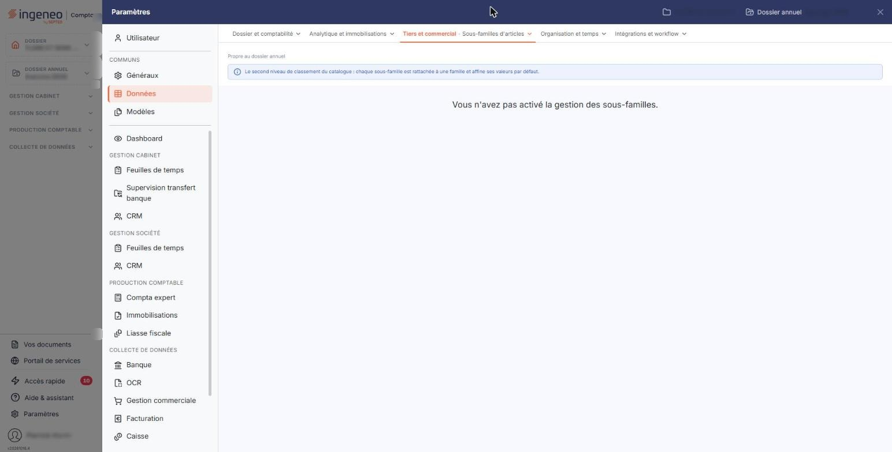

# Sous-familles d'articles


**Où le trouver :** Panneau **Paramètres** › **Données** › **Tiers et commercial** › **Sous-familles d'articles**



**En bref** — Cet écran affine le classement de vos articles à l'intérieur d'une famille. Il n'est disponible que si les sous-familles d'articles sont activées dans les paramètres des articles.

* Si l'écran affiche « Vous n'avez pas activé la gestion des sous-familles. » : activez l'interrupteur « Utiliser les sous-familles d'articles » dans « Paramètres > Gestion commerciale > Articles ».


Cet écran s'ouvre depuis le panneau « Paramètres » : « Paramètres > Données > Tiers et commercial > Sous-familles d'articles ».

<figure><figcaption>
Écran « Sous-familles d'articles » de la nouvelle interface
</figcaption></figure>

Cette option permet d'affiner le classement de vos articles à l'intérieur d'une famille : la famille « Arbustes » peut ainsi se décomposer en sous-familles « Persistants » et « À feuilles caduques ». Chaque sous-famille appartient à une famille, et une sous-famille ne peut exister sans elle.

Ce fichier n'est accessible que si vous avez activé la gestion des sous-familles d'articles dans le panneau « Paramètres » : « Paramètres > Gestion commerciale > Articles », **en plus** de la gestion des familles d'articles. C'est aussi dans ce paramétrage que vous décidez si l'appartenance à une sous-famille est obligatoire ou facultative dans la fiche article.

## Si vous n'avez pas activé les sous-familles

Tant que l'option n'est pas activée, cet écran ne présente rien d'autre qu'un message :

**« Vous n'avez pas activé la gestion des sous-familles. »**

Il n'y a alors ni liste, ni critère de recherche, ni bouton de création : c'est le comportement attendu, et non une anomalie ni un droit qui vous manquerait. Pour disposer de l'écran, rendez-vous dans « Paramètres > Gestion commerciale > Articles » et activez l'interrupteur « Utiliser les sous-familles d'articles » — la gestion des familles devant elle-même être activée.

De la même façon, le champ « Sous-famille » n'apparaît pas dans vos fiches articles tant que cette option est désactivée.
