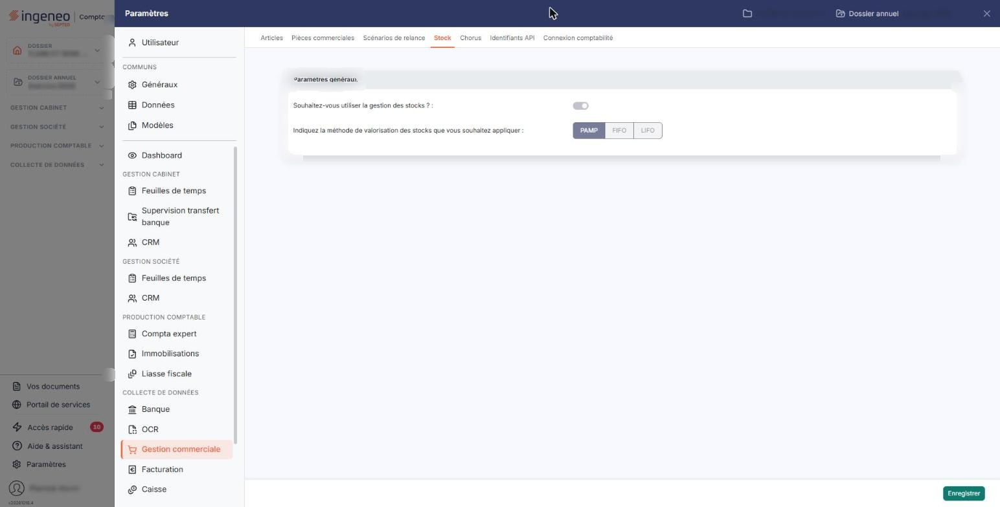
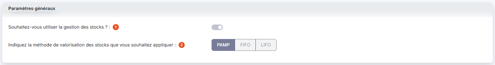

# Stock


**Où le trouver :** Panneau **Paramètres** › **Gestion commerciale** › **Stock**



**En bref** — Cet écran active la gestion des stocks du dossier et fixe la méthode de valorisation : PAMP, FIFO ou LIFO.

* Pour gérer les stocks : activez l'interrupteur Souhaitez-vous utiliser la gestion des stocks ?, choisissez la méthode de valorisation, puis bouton \[Enregistrer].


Cet écran s'ouvre depuis le panneau « Paramètres » : « Paramètres > Gestion commerciale > Stock ».

<figure><figcaption>
Écran « Stock » de la nouvelle interface
</figcaption></figure>

Il commande la gestion des stocks du dossier : elle permet d'une part de l'activer, d'autre part de choisir la méthode de valorisation appliquée.

Ces deux paramètres ne concernent pas seulement cette page. C'est la gestion des stocks qui rend utilisable la rubrique de menu « Stocks » — les mouvements de stock, les inventaires — et les éditions correspondantes ; tant qu'elle n'est pas activée, ces écrans vous le signalent au lieu de vous présenter des données. Et c'est la méthode de valorisation qui détermine la valeur du stock affichée sur ces écrans et dans ces éditions.

C'est aussi cette gestion qui donne son sens à l'option « Article géré en stock » des fiches articles, et c'est par elle que la validation d'une pièce commerciale portant un tel article produit un mouvement de stock.

L'écran ne comporte qu'une rubrique, « Paramètres généraux », et deux champs. Il n'y a ni liste, ni fiche, et aucun bouton de retour : le seul bouton est bouton **\[Enregistrer]**, en bas à droite.

## Rubrique « Paramètres généraux »

<figure><figcaption>
Rubrique « Paramètres généraux »
</figcaption></figure>

| Champ                                                                              | Ce qu'il faut savoir                                                                                                  |
| ---------------------------------------------------------------------------------- | --------------------------------------------------------------------------------------------------------------------- |
| 1. **Souhaitez-vous utiliser la gestion des stocks ?**                             | Interrupteur sans texte (activé ou désactivé).                                                                        |
| 2. **Indiquez la méthode de valorisation des stocks que vous souhaitez appliquer** | Trois choix présentés comme trois boutons côte à côte, **PAMP**, **FIFO** et **LIFO**, dont l'un est retenu (rempli). |

**PAMP**, pour « prix d'achat moyen pondéré » : à chaque entrée en stock, le prix d'achat de l'article est recalculé. Le stock est valorisé au prix d'achat d'avant la nouvelle entrée, le logiciel ajoute la valeur de l'entrée et recalcule un prix moyen en divisant la nouvelle valeur du stock par la quantité totale.

**FIFO**, pour « first in, first out », « premier entré, premier sorti » : pour un article qui a fait l'objet de plusieurs livraisons, c'est celui qui est dans le stock depuis le plus longtemps qui sera vendu le premier.

**LIFO**, pour « last in, first out », « dernier entré, premier sorti » : pour un article qui a fait l'objet de plusieurs livraisons, c'est celui qui est dans le stock depuis le moins longtemps qui sera vendu le premier.

## Des paramètres qui se figent

Une fois qu'un article est géré en stock, en revanche, vous constaterez l'état suivant : l'interrupteur et les trois choix de méthode sont grisés, et bouton **\[Enregistrer]** reste pourtant présent. Aucun message ne vous l'explique à l'écran. Il n'y a donc rien à corriger de votre côté : si vous devez revenir sur l'un de ces deux choix, prenez contact avec votre interlocuteur habituel.
