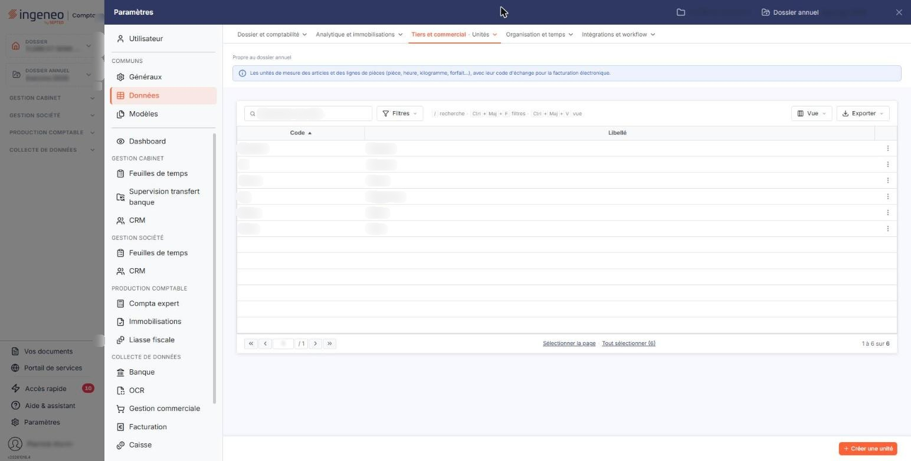
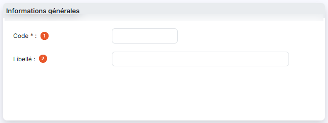
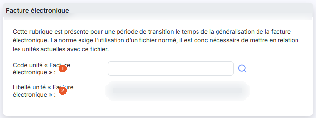

# Unités


**Où le trouver :** Panneau **Paramètres** › **Données** › **Tiers et commercial** › **Unités**



**En bref** — Cet écran gère les unités employées avec les quantités dans les écritures, les fiches articles et les comptes. Chaque unité peut être reliée au fichier normé de la facture électronique.

* Pour créer une unité : bouton \[Créer une unité], renseignez son code et son libellé, puis bouton \[Enregistrer].


Cet écran s'ouvre depuis le panneau « Paramètres » : « Paramètres > Données > Tiers et commercial > Unités ».

<figure><figcaption>
Écran « Unités » de la nouvelle interface
</figcaption></figure>

Cette option permet de gérer les unités qui seront utilisées conjointement avec les quantités dans les écritures. Les unités sont également proposées dans les fiches articles et dans les comptes.

Une unité n'est pas supprimable si elle est utilisée dans au moins une fiche article ou au moins un compte général ou auxiliaire.

Chaque unité comporte un code et un libellé, et peut être mise en relation avec une unité du fichier normé de la facture électronique.

## La liste des unités

La liste présente deux colonnes : **Code** et **Libellé**. Elle est triée par défaut sur le code, dans l'ordre croissant, et chacune des deux colonnes peut servir de critère de tri.

Au-dessus de la liste, la barre « Rechercher une unité… » et le bouton \[Filtres] permettent de restreindre l'affichage ; sans critère, la totalité des unités créées pour la société est affichée. Les deux champs de la rubrique « Facture électronique » de la fiche ne figurent pas dans la liste : le rattachement d'une unité au fichier normé n'est donc visible qu'en ouvrant la fiche.

Un clic sur une ligne la sélectionne. Au survol d'une ligne, un pictogramme « Autres actions » (trois points) apparaît à son extrémité droite et ouvre un menu à trois entrées : « Modifier » ouvre la fiche de l'unité en modification, « Dupliquer » ouvre une fiche préremplie à partir de l'unité choisie et « Supprimer » supprime l'unité. Au-dessus de la liste, le bouton \[Vue] permet de choisir les colonnes affichées et d'enregistrer des vues, et le bouton \[Exporter] donne accès à l'aperçu, à l'impression et aux exports de la liste. Sous la liste, « Sélectionner la page » et « Tout sélectionner (N) » étendent la sélection à la page affichée ou à toutes les unités.

## Bouton \[Créer une unité]

Situé dans la barre du bas, à droite, hors du tableau, il ouvre une fiche vierge pour créer une nouvelle unité.

## Bouton \[Supprimer]

Il apparaît dans le bandeau de sélection, qui s'affiche au bas de l'écran dès qu'une ligne est sélectionnée (« 1 unité sélectionnée », avec le lien « Tout désélectionner ») et remplace alors la barre où figure \[Créer une unité] ; il supprime toutes les unités sélectionnées. Tant qu'aucune ligne n'est sélectionnée, il n'est pas affiché.

## Rubrique « Informations générales »

<figure><figcaption>
Rubrique « Informations générales »
</figcaption></figure>

| Champ          | Ce qu'il faut savoir                                                                                                                                                                                                                     |
| -------------- | ---------------------------------------------------------------------------------------------------------------------------------------------------------------------------------------------------------------------------------------- |
| 1. **Code**    | 10 caractères au maximum. C'est le code sous lequel l'unité est proposée dans les autres écrans, et c'est aussi la clé de tri de la liste. Si vous le laissez vide, le logiciel affiche le message « Le champ "Code" est obligatoire. ». |
| 2. **Libellé** | 50 caractères au maximum. Il précise en clair ce que le code désigne, par exemple « Kilogrammes » pour le code « Kg ».                                                                                                                   |

## Rubrique « Facture électronique »

<figure><figcaption>
Rubrique « Facture électronique »
</figcaption></figure>

Le logiciel affiche en tête de cette rubrique le texte suivant : « Cette rubrique est présente pour une période de transition le temps de la généralisation de la facture électronique. La norme exige l'utilisation d'un fichier normé, il est donc nécessaire de mettre en relation les unités actuelles avec ce fichier. »

Autrement dit, vos unités restent les vôtres, avec vos propres codes et vos propres libellés ; cette rubrique sert à indiquer, pour chacune, à quelle unité de la norme elle correspond. Les unités de la norme sont mises à disposition par votre cabinet, chacune avec un code court et un libellé.

Elle comporte deux champs :

| Champ                                         | Ce qu'il faut savoir                                                                                                                                                                                                                                                                                                                                                                                                                                                                                                                                                                                                                                                                                                                                                                                         |
| --------------------------------------------- | ------------------------------------------------------------------------------------------------------------------------------------------------------------------------------------------------------------------------------------------------------------------------------------------------------------------------------------------------------------------------------------------------------------------------------------------------------------------------------------------------------------------------------------------------------------------------------------------------------------------------------------------------------------------------------------------------------------------------------------------------------------------------------------------------------------ |
| 1. **Code unité « Facture électronique »**    | Une loupe placée à droite du champ ouvre une fenêtre « Recherche » destinée à choisir l'unité du fichier normé à laquelle vous rattachez votre unité. Cette fenêtre, intitulée « Recherche », comporte dans son en-tête un pictogramme « Croix » qui la ferme, puis un champ « Contenu recherché » précédé d'une loupe (il n'y a plus de bouton \[Rechercher]) et, à sa droite, un pictogramme « Information » dont l'infobulle liste les raccourcis clavier de la fenêtre (Ctrl + Entrée pour lancer la recherche, Ctrl + flèche droite et Ctrl + flèche gauche pour changer de page, flèche bas et flèche haut pour parcourir les résultats, Entrée pour sélectionner le résultat). La mention « Cliquez pour sélectionner » n'a pas pu être revue, la zone de résultats étant en échec (voir ci-dessous). |
| 2. **Libellé unité « Facture électronique »** | Ce champ n'est pas saisissable. Il apparaît grisé et le logiciel le renseigne lui-même à partir de l'unité que vous avez sélectionnée dans la fenêtre de recherche.                                                                                                                                                                                                                                                                                                                                                                                                                                                                                                                                                                                                                                          |

Sur l'instance observée, la recherche d'une unité normée est indisponible : au lieu de la liste des unités du fichier normé, la fenêtre « Recherche » affiche le message « Vous ne pouvez accéder à cette page car, soit vous n'avez plus les droits d'accès, soit elle correspond à une session dont vous avez été déconnecté. Veuillez cliquez sur la croix présente dans l'onglet pour la fermer. ». Vous ne pouvez donc pas renseigner ces deux champs par ce moyen.

## Bouton \[Enregistrer]

<figure><figcaption>
Bouton [Enregistrer]
</figcaption></figure>

Il valide la création ou la modification de l'unité.

## Retour à la liste

Le bouton \[Retour] n'est plus affiché dans la fiche : la flèche « Retour » (chevron), à gauche de la barre d'onglets du panneau, vous ramène à la liste des unités sans enregistrer la fiche en cours.
