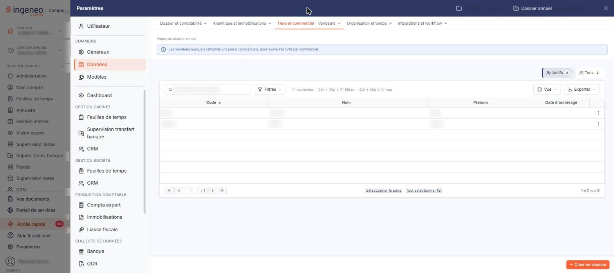
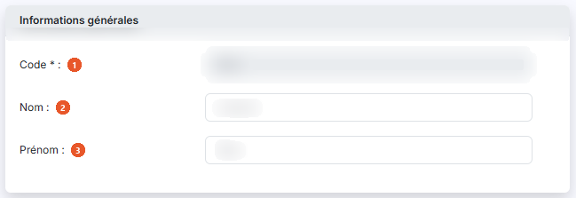

# Vendeurs


**Où le trouver :** Panneau **Paramètres** › **Données** › **Tiers et commercial** › **Vendeurs**



**En bref** — Ce fichier facultatif tient vos vendeurs, dont le code s'affecte aux pièces commerciales pour les trier et les sélectionner ensuite.

* Pour créer un vendeur : bouton \[Créer un vendeur], indiquez son code, son nom et son prénom, puis bouton \[Enregistrer].
* Pour revoir les vendeurs archivés : bouton \[Filtres spéciaux], puis activez l'interrupteur « Vendeurs archivés ».


La gestion du fichier des vendeurs est facultative. Elle permet d'affecter des codes vendeurs aux pièces commerciales afin, ultérieurement, d'effectuer des tris et des sélections selon ces codes.

<figure><figcaption>
Écran « Vendeurs » de la nouvelle interface
</figcaption></figure>

Une fiche de vendeur est volontairement très légère : un code, un nom et un prénom.

## La liste des vendeurs

La liste présente une ligne par vendeur, avec quatre colonnes : **Code**, **Nom**, **Prénom** et **Date d'archivage**.

Le nombre de vendeurs et le nombre de pages sont rappelés sous la liste, avec les liens « Sélectionner la page » et « Tout sélectionner ».

## Les critères de recherche

Au-dessus de la liste, la barre « Rechercher un vendeur… » permet de retrouver un vendeur ; le bouton \[Filtres] ouvre le volet de filtres de la liste, et deux segments, « Actifs » (retenu à l'ouverture) et « Tous », placés au-dessus de la barre à droite, indiquent chacun le nombre de vendeurs qu'ils retiennent (il n'y a plus de bouton \[Filtres spéciaux] ni d'interrupteur « Vendeurs archivés »).

**Actifs / Tous** : « Actifs » est retenu à l'ouverture de l'écran. Les vendeurs archivés sont donc écartés de la liste tant que vous ne retenez pas « Tous », dont le nombre inclut les vendeurs archivés.

## Les boutons \[Vue] et \[Exporter]

Le bouton \[Vue] ouvre le menu des vues de la liste ; le bouton \[Exporter] ouvre le menu d'aperçu, d'impression et d'export de la liste (Excel, PDF, envoi de la liste par e-mail).

## Les commandes de la ligne

Un clic sur une ligne la sélectionne. Au survol, la ligne porte en fin de ligne un pictogramme « Autres actions » (trois points), qui ouvre un menu de trois entrées :

* « Modifier » ouvre la fiche du vendeur ;
* « Dupliquer » prépare la création d'un nouveau vendeur à partir de celui-ci ;
* « Supprimer » supprime le vendeur.

Selon votre profil, certaines de ces entrées peuvent ne pas apparaître.

## Bouton \[Créer un vendeur]

Placé en bas à droite de l'écran, il ouvre la fiche d'un nouveau vendeur, décrite ci-dessous.

## Bouton \[Supprimer]

Dès qu'une ligne est sélectionnée, un bandeau de sélection (« 1 vendeur sélectionné », « Tout désélectionner ») remplace la barre du bas et porte le bouton \[Supprimer], qui supprime en une seule fois tous les vendeurs sélectionnés.

## Rubrique « Informations générales »

<figure><figcaption>
Rubrique « Informations générales »
</figcaption></figure>

C'est la rubrique unique de la fiche.

| Champ         | Ce qu'il faut savoir                                                                              |
| ------------- | ------------------------------------------------------------------------------------------------- |
| 1. **Code**   | Il se saisit à la création du vendeur ; sur un vendeur déjà enregistré, il n'est plus modifiable. |
| 2. **Nom**    | —                                                                                                 |
| 3. **Prénom** | —                                                                                                 |

La fiche prévoit par ailleurs deux informations d'archivage, **Archivé le :** et **Archivé par :**, qui ne sont ni l'une ni l'autre modifiables.

Il n'y a pas d'onglet sur cette fiche, et aucune autre rubrique.

## Les boutons de la fiche

Un seul bouton dans la barre du bas, à la création comme sur un vendeur déjà enregistré.

Bouton \[Enregistrer] : il valide votre saisie.

Pour revenir à la liste sans conserver les modifications en cours, utilisez le chevron « Retour » à gauche de la barre d'onglets du panneau Paramètres.
