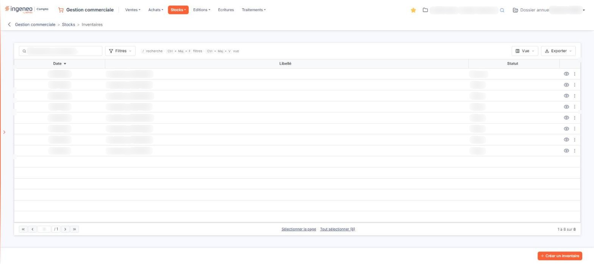
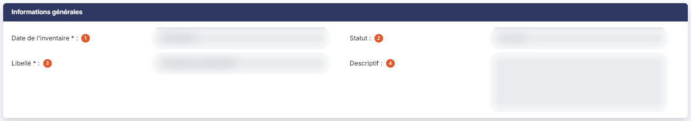
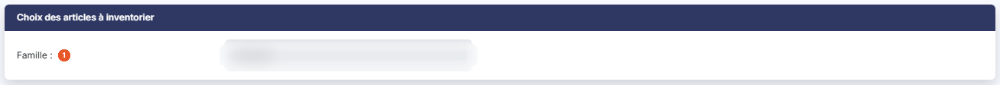
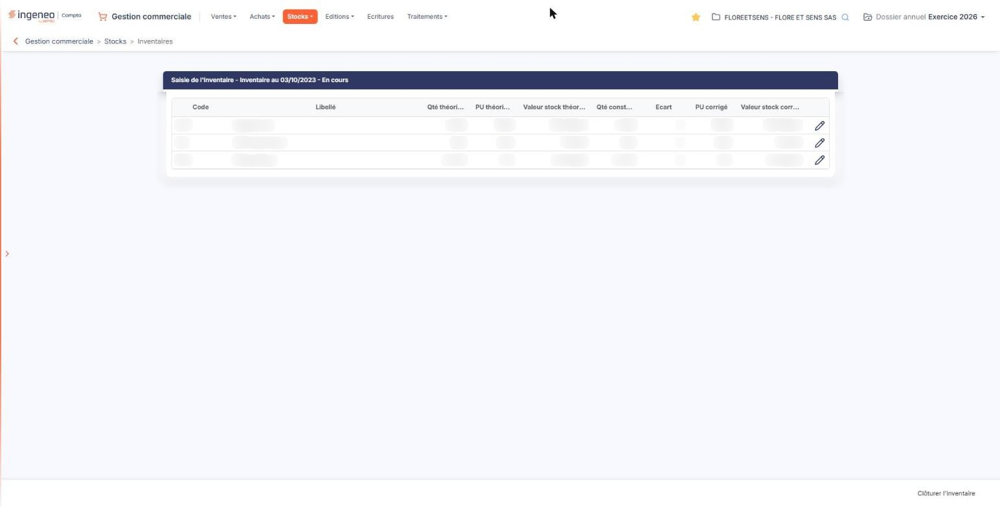

# Inventaires


**Où le trouver :** Menu **Stocks › Inventaires**



**En bref** — Cet écran sert à saisir les inventaires des articles gérés en stock, puis à les clôturer pour aligner le stock du logiciel sur le stock réellement constaté.

* Pour démarrer un inventaire : bouton \[Créer un inventaire], puis définissez ses critères.
* Pour terminer l'inventaire : bouton \[Clôturer l'inventaire] ; attention, la clôture n'est pas réversible.


Cette option permet de saisir les inventaires des articles gérés en stock, puis de les clôturer pour aligner le stock du logiciel sur le stock réellement constaté.

<figure><figcaption>
Écran « Inventaires » de la nouvelle interface
</figcaption></figure>

Un inventaire se déroule en deux temps :

* la définition des critères de l'inventaire ;
* la saisie des quantités constatées, article par article.

## La liste des inventaires

La liste présente une ligne par inventaire, avec trois colonnes : **Date**, **Libellé** et **Statut**. Toutes trois sont triables ; la liste s'ouvre triée sur la date, du plus récent au plus ancien.

La colonne **Statut** vaut « En cours » pour l'inventaire que vous êtes en train de saisir, et « Clôturé » pour ceux qui ont été validés définitivement.

Tant qu'aucune recherche ni aucun filtre n'est posé, tous les inventaires du dossier annuel en cours sont affichés.

Au-dessus de la liste, la barre d'outils habituelle des listes du logiciel porte le champ de recherche « Rechercher un inventaire… », le bouton \[Filtres], le bouton \[Vue] et le bouton \[Exporter], suivis du bouton \[Sélectionner la page], qui sélectionne toutes les lignes de la page, et du bouton \[Tout sélectionner (n)], qui sélectionne les inventaires de toutes les pages (n est leur nombre). Le bouton \[Exporter] ouvre un menu d'impression et d'export de la liste.

## Les commandes de la ligne

Il n'y a plus de case à cocher : un clic sur la ligne la sélectionne (voir j). Chaque ligne propose, à droite, un pictogramme direct et un menu :

* l'« œil » (infobulle « Afficher l'aperçu ») ouvre l'écran de saisie de l'inventaire. C'est par lui que vous reprenez la saisie d'un inventaire interrompue ;
* « Autres actions » (trois points, affichés au survol de la ligne) ouvre un menu de deux entrées : « Modifier », qui ouvre la fiche des critères de l'inventaire, et « Supprimer », qui engage la suppression de l'inventaire.

L'œil est proposé sur toutes les lignes, et le menu « Autres actions » l'est aussi sur les inventaires au statut « Clôturé ».

## Bouton \[Créer un inventaire]

Placé en bas à droite de l'écran, hors de la liste, il ouvre le formulaire de définition des critères d'un nouvel inventaire.

## Rubrique « Informations générales »

<figure><figcaption>
Rubrique « Informations générales »
</figcaption></figure>

Les champs s'affichent sur deux colonnes. Sur la fiche d'un inventaire clôturé, la colonne de gauche porte la date de l'inventaire, la date de clôture et le descriptif, celle de droite le statut et le libellé ; la rubrique « Choix des articles à inventorier » porte la famille.

| Champ                       | Ce qu'il faut savoir                                                                                                      |
| --------------------------- | ------------------------------------------------------------------------------------------------------------------------- |
| 1. **Date de l'inventaire** | C'est la date à laquelle seront créés les mouvements de stock lors de la clôture.                                         |
| 2. **Statut**               | En lecture seule.                                                                                                         |
| 3. **Libellé**              | —                                                                                                                         |
| 4. **Descriptif**           | Zone de texte libre sur plusieurs lignes.                                                                                 |
| **Date de clôture**         | En lecture seule. Ce champ n'apparaît qu'une fois l'inventaire clôturé : il porte alors la date et l'heure de la clôture. |

## Rubrique « Choix des articles à inventorier »

<figure><figcaption>
Rubrique « Choix des articles à inventorier »
</figcaption></figure>

**Famille** : facultatif. Si vous ne précisez pas de famille, l'inventaire portera sur tous les articles gérés en stock.

## Consulter les critères d'un inventaire existant

L'entrée « Modifier » du menu « Autres actions » ouvre la fiche des critères de l'inventaire, mais celle-ci est entièrement en LECTURE SEULE : aucun champ des deux rubriques n'est modifiable - six sur un inventaire clôturé, qui porte en plus sa date de clôture. Sur un inventaire clôturé, aucun bouton n'est affiché en bas de l'écran : on revient à la liste par la flèche « Revenir en arrière », à gauche du fil d'Ariane. Il n'y a aucun bouton d'enregistrement.

## La saisie de l'inventaire

<figure><figcaption>
Rubrique « La saisie de l'inventaire »
</figcaption></figure>

L'« Œil » de la liste ouvre l'écran de saisie. Son titre rappelle l'inventaire concerné et son statut, sous la forme « Saisie de l'inventaire » suivi du libellé de l'inventaire et de son statut.

Le logiciel y présente la liste des articles retenus par les critères, avec les colonnes suivantes, dans l'ordre : **Code**, **Libellé**, **Qté théorique**, **PU théorique**, **Valeur stock théorique**, **Qté constatée**, **Ecart**, **PU corrigé** et **Valeur stock corrigée**.

Les trois colonnes « théoriques » sont ce que le logiciel a en stock ; les colonnes « constatée » et « corrigée » sont ce que vous relevez ; la colonne **Ecart** est la différence, calculée par le logiciel.

Cette liste est un simple tableau : ni pagination, ni tri, ni critères de recherche, ni pictogrammes d'en-tête.

Un pictogramme « Crayon » sur chaque ligne ouvre la fenêtre de saisie de l'article.

On revient à la liste des inventaires par la flèche « Revenir en arrière ».

## Bouton \[Clôturer l'inventaire]

Ce bouton figure en bas de l'écran de saisie, et uniquement tant que l'inventaire est « En cours ».

## Ce que devient un inventaire clôturé

Un inventaire clôturé reste consultable, mais plus rien n'y est modifiable :

* sur son écran de saisie, le Bouton \[Clôturer l'inventaire] a disparu et plus aucun bouton n'est affiché en bas de l'écran (retour par la flèche « Revenir en arrière ») ;

Les entrées « Modifier » et « Supprimer » du menu « Autres actions » restent néanmoins proposées sur la ligne d'un inventaire clôturé dans la liste.

## Bouton \[Supprimer]

Le bouton \[Supprimer] n'est plus proposé en bas de la liste. Il se trouve dans le bandeau de sélection qui apparaît au bas de l'écran, à la place de la barre où figure \[Créer un inventaire], dès que vous avez sélectionné des inventaires en cliquant sur leur ligne. Le bandeau affiche « 1 inventaire sélectionnée » et le lien « Tout désélectionner » à gauche, et le bouton \[Supprimer] à droite, en blanc sur le fond marine : il supprime les inventaires sélectionnés.
