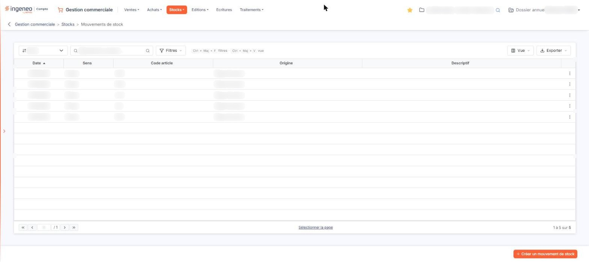
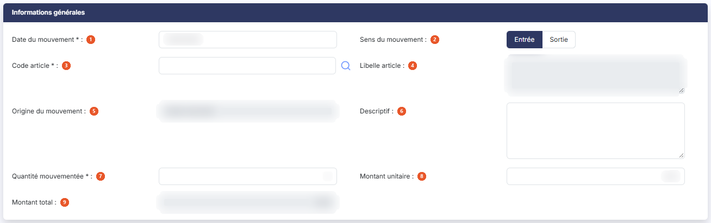

# Mouvements de stock


**Où le trouver :** Menu **Stocks › Mouvements de stock**



**En bref** — Cet écran consulte toutes les entrées et sorties de stock et permet de créer des mouvements manuels, qui ne découlent d'aucune pièce commerciale.

* Pour enregistrer un mouvement manuel : bouton \[Créer un mouvement de stock], renseignez la fiche, puis bouton \[Enregistrer].
* Pour ne voir que les entrées ou les sorties : choisissez Entrée ou Sortie dans la liste « Sens ».


Cette option permet, d'une part, de consulter le fichier des mouvements de stock et, d'autre part, de créer de nouveaux mouvements dits « manuels » pour enregistrer des actions sur les stocks qui ne découlent d'aucune pièce commerciale.

<figure><figcaption>
Écran « Mouvements de stock » de la nouvelle interface
</figcaption></figure>

Le fichier des mouvements de stock mémorise toutes les entrées et toutes les sorties effectuées sur les articles gérés en stock. La colonne **Origine** vous indique d'où provient chaque mouvement.

## La liste des mouvements de stock

La liste présente une ligne par mouvement, avec les colonnes suivantes : **Date**, **Sens**, **Code article**, **Origine** et **Descriptif**. Toutes ces colonnes sont triables ; la liste s'ouvre triée sur la date, dans l'ordre croissant.

Au-dessus de la liste, une barre d'outils réunit le champ de recherche « Rechercher un article… », une liste déroulante intitulée « Sens » (son infobulle indique « Sens du mouvement »), et les boutons \[Filtres], \[Vue] et \[Exporter], suivis du bouton \[Sélectionner la page]. Deux critères de recherche sont ainsi proposés :

| Champ                 | Ce qu'il faut savoir                                                                                                                                                                                                                 |
| --------------------- | ------------------------------------------------------------------------------------------------------------------------------------------------------------------------------------------------------------------------------------ |
| **Sens du mouvement** | La liste propose trois choix : « Sens » (le choix neutre, qui porte le nom de la colonne et n'écarte aucun mouvement), **Entrée** et **Sortie**. Elle est sur « Sens » à l'ouverture de l'écran : aucun mouvement ne vous est caché. |
| **Article**           | Saisissez votre recherche dans le champ « Rechercher un article… », ou utilisez le pictogramme « Loupe » pour parcourir le fichier des articles.                                                                                     |

Il n'y a pas de bouton pour déclencher la recherche sur cet écran : le critère s'applique dès que vous l'avez renseigné. Le bouton \[Annuler le filtre] n'existe plus : dès qu'un critère est posé, le lien « Tout effacer » apparaît à côté du bouton \[Filtres] ; il vide les critères et réaffiche la totalité des mouvements. Tant qu'aucun critère n'est posé, ce lien n'est pas affiché.

## Les commandes de la ligne

Au survol d'une ligne, un seul pictogramme apparaît, à droite : « Autres actions » (trois points). Il ouvre un menu de deux entrées :

* « Modifier » ouvre la fiche du mouvement ;
* « Dupliquer » crée un nouveau mouvement reprenant les données de celui-ci, ce qui fait gagner du temps en saisie.

Il n'y a pas d'entrée de suppression : un mouvement de stock ne se supprime pas.

## La barre d'outils de la liste

La barre d'outils placée au-dessus de la liste remplace les pictogrammes d'en-tête : elle porte le champ de recherche, la liste « Sens du mouvement », le bouton \[Filtres], le bouton \[Vue], le bouton \[Exporter] et le bouton \[Sélectionner la page], qui sélectionne toutes les lignes de la page. Cet écran ne propose pas de bouton \[Tout sélectionner (n)] : seule la sélection de la page est offerte.

Un clic sur une ligne la sélectionne : un bandeau marine remplace alors la barre du bas et affiche « 1 mouvement sélectionnée » avec le lien « Tout désélectionner ». Il ne porte aucun bouton d'action (il n'y a aucun Bouton \[Supprimer] sur cet écran) et le bouton \[Créer un mouvement de stock] n'est plus affiché tant qu'une ligne est sélectionnée.

Le bouton \[Exporter] ouvre un menu qui propose l'aperçu de l'édition en HTML, l'impression, l'export en Excel ou en PDF, l'envoi de la liste par e-mail, l'orientation Portrait ou Paysage, le format Ajustée ou Fixe et le lancement de l'édition. Il en va de même sur les autres listes du logiciel.

## Bouton \[Créer un mouvement de stock]

<figure><figcaption>
Bouton [Créer un mouvement de stock]
</figcaption></figure>

Placé en bas à droite de l'écran, hors de la liste, c'est le seul bouton de bas de liste. Il permet la création d'un mouvement sans relation avec une pièce commerciale.

La fiche ne comporte qu'une rubrique, « Informations générales ». Ses champs, dans l'ordre d'affichage :

| Champ                       | Ce qu'il faut savoir                                                                                                                                                             |
| --------------------------- | -------------------------------------------------------------------------------------------------------------------------------------------------------------------------------- |
| 1. **Date du mouvement**    | Le logiciel propose la date du jour.                                                                                                                                             |
| 2. **Sens du mouvement**    | Choisissez **Entrée** ou **Sortie** à l'aide des deux boutons ; le logiciel se présente sur **Entrée**.                                                                          |
| 3. **Code article**         | Saisissez le début du code pour lancer la recherche et choisissez l'article dans la liste proposée, ou utilisez le pictogramme « Loupe » pour parcourir le fichier des articles. |
| 4. **Libelle article**      | En lecture seule. Il est affiché automatiquement, pour mémoire, dès que l'article est choisi.                                                                                    |
| 5. **Origine du mouvement** | En lecture seule. En création, elle vaut toujours « Saisie manuelle » et ne se choisit pas.                                                                                      |
| 6. **Descriptif**           | Zone de texte libre sur plusieurs lignes, qui permet de décrire les raisons du mouvement manuel.                                                                                 |
| 7. **Quantité mouvementée** | C'est la quantité entrée en stock ou sortie du stock.                                                                                                                            |
| 8. **Montant unitaire**     | —                                                                                                                                                                                |
| 9. **Montant total**        | En lecture seule. Il est calculé par le logiciel : le montant unitaire multiplié par la quantité mouvementée.                                                                    |

Un seul bouton figure en bas de la fiche, à droite : Bouton \[Enregistrer]. Pour revenir à la liste, utilisez la flèche « Revenir en arrière », à gauche du fil d'Ariane (le bouton \[Retour] existe dans la page mais n'est pas affiché). Il n'y a ni validation, ni édition, ni envoi par courrier électronique sur cette fiche.

## Consulter un mouvement issu d'un traitement du logiciel

L'entrée « Modifier » du menu « Autres actions » vous permet de visualiser toutes les informations du mouvement.

Comme en création, le seul bouton de la fiche est Bouton \[Enregistrer] ; on revient à la liste par la flèche « Revenir en arrière ».
