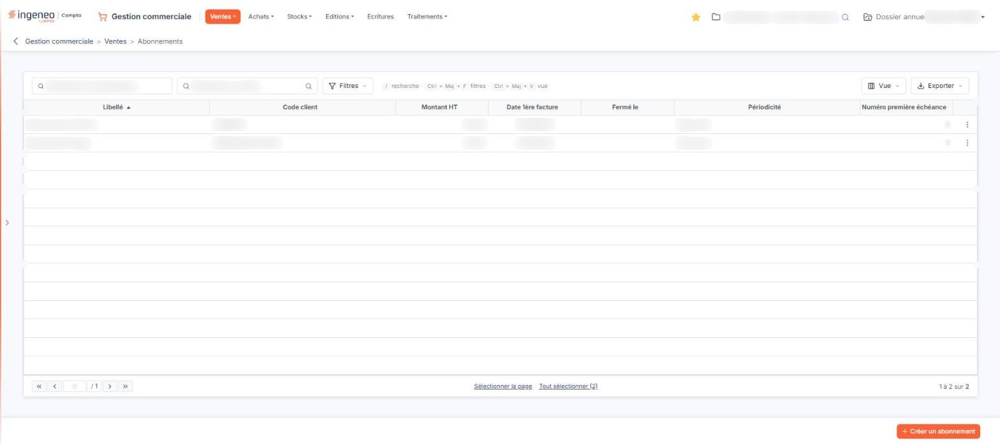
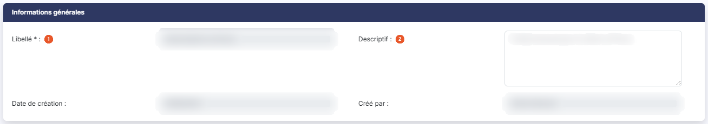
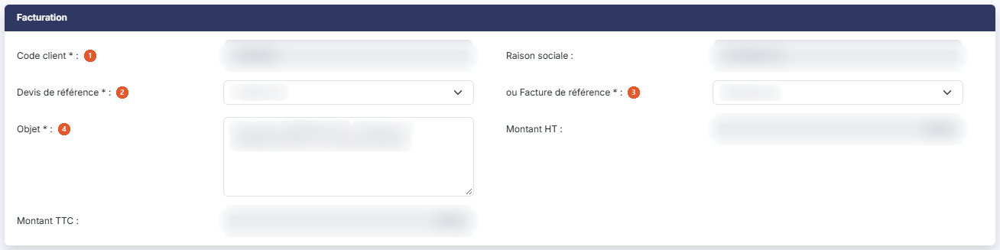
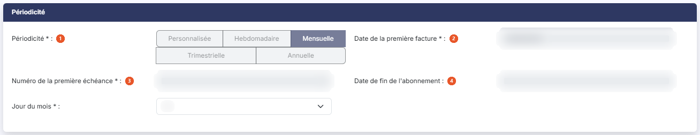
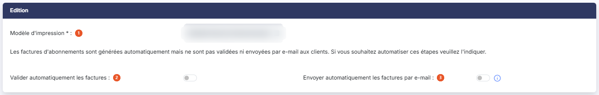

# Abonnements


**Où le trouver :** Menu **Ventes › Abonnements**



**En bref** — Cet écran crée des abonnements : des factures générées automatiquement, à partir d'un devis ou d'une facture existant, selon la périodicité paramétrée.

* Pour créer un abonnement : bouton \[Créer un abonnement], renseignez la fiche, puis bouton \[Enregistrer].
* Pour rattraper une facturation en retard : sélectionnez l'abonnement, puis bouton \[Génération manuelle des factures].
* Pour arrêter l'émission des factures : bouton \[Fermer l'abonnement] dans la fiche.


Cette option permet de créer des abonnements, c'est-à-dire des factures qui seront générées automatiquement aux dates demandées. Ces factures sont créées sur le fondement d'un devis ou d'une facture existant(e) et sont répliquées selon la périodicité qui est paramétrée.

<figure><figcaption>
Écran « Abonnements » de la nouvelle interface
</figcaption></figure>

## La liste des abonnements

La liste présente tous les abonnements du dossier, avec les colonnes **Libellé**, **Code client**, **Montant HT**, **Date 1ère facture**, **Fermé le**, **Périodicité** et **Numéro première échéance**. Toutes sont triables ; par défaut, le logiciel trie sur le libellé.

La colonne **Fermé le** vous indique l'état de l'abonnement : tant qu'elle est vide, l'abonnement est ouvert et ses factures continuent d'être émises.

Au-dessus du tableau, la barre d'outils comporte une zone « Rechercher un abonnement… », une zone « Rechercher un client… » dotée d'un pictogramme « Loupe », qui permet de restreindre la liste à un seul client, puis les boutons \[Filtres], \[Vue] et \[Exporter].

Il n'y a plus de case à cocher dans la liste : un clic sur une ligne la sélectionne, et sous le tableau les liens « Sélectionner la page » et « Tout sélectionner (n) » étendent la sélection. Chaque ligne porte, à droite, un menu « Autres actions » (trois points) qui propose « Modifier » pour ouvrir l'abonnement et « Dupliquer » pour en créer un nouveau reprenant le contenu de celui-ci ; il n'y a pas de commande « Supprimer » sur la ligne. Selon les droits qui vous ont été attribués, certaines de ces commandes peuvent ne pas vous être proposées.

## Rubrique « Informations générales »

<figure><figcaption>
Rubrique « Informations générales »
</figcaption></figure>

| Champ             | Ce qu'il faut savoir                                                                         |
| ----------------- | -------------------------------------------------------------------------------------------- |
| 1. **Libellé**    | Champ obligatoire. Il doit être unique. Il n'est plus modifiable une fois l'abonnement créé. |
| 2. **Descriptif** | Champ facultatif, modifiable à tout moment.                                                  |

**Date de création** et **Créé par** : le logiciel vous rappelle quand et par qui l'abonnement a été créé.

## Rubrique « Facturation »

<figure><figcaption>
Rubrique « Facturation »
</figcaption></figure>

| Champ                          | Ce qu'il faut savoir                                                                                                                                                                                                                                                                                                                                                                                                                                                                                                                                                                     |
| ------------------------------ | ---------------------------------------------------------------------------------------------------------------------------------------------------------------------------------------------------------------------------------------------------------------------------------------------------------------------------------------------------------------------------------------------------------------------------------------------------------------------------------------------------------------------------------------------------------------------------------------- |
| 1. **Code client**             | Champ obligatoire. Il permet d'indiquer quel client doit être facturé. Sa raison sociale s'affiche à droite du code. Le client n'est plus modifiable une fois l'abonnement créé.                                                                                                                                                                                                                                                                                                                                                                                                         |
| 2. **Devis de référence**      | La facture d'abonnement qui sera émise doit l'être depuis un modèle qui est soit un devis, soit une facture. Une fois que vous avez entré un code client, le sélecteur propose tous les devis existants dans le dossier et concernant le client.                                                                                                                                                                                                                                                                                                                                         |
| 3. **ou Facture de référence** | 
Fonctionne de la même manière que pour le devis de référence. Le fait de choisir une facture de référence supprime le devis de référence si vous l'aviez indiqué, et inversement : les deux sont exclusifs l'un de l'autre, vous devez renseigner l'un ou l'autre. Ces deux champs restent modifiables après la création de l'abonnement : si une modalité évolue — un délai ou un mode de règlement, par exemple —, vous pouvez changer la pièce de référence sans avoir à fermer l'abonnement et à le recréer. Le changement est pris en compte pour les factures suivantes.
 |
| 4. **Objet**                   | Champ obligatoire. Il s'agit de l'objet qui figurera dans la facture d'abonnement qui sera générée. Vous avez la possibilité d'intégrer dans le texte plusieurs informations relatives à la facture ; pour cela, indiquez-les entre crochets dans votre texte, comme dans la proposition par défaut qui vous est faite lors de la création d'un nouvel abonnement.                                                                                                                                                                                                                       |

Trois mots-clés sont utilisables : \[PERIODICITE] pour la périodicité, \[NUMECHEANCE] pour le numéro de l'échéance et \[DATEECHEANCE] pour sa date.

Par exemple, « Facturation \[PERIODICITE] - Échéance n° \[NUMECHEANCE] du \[DATEECHEANCE] » donnera « Facturation mensuelle - Échéance n° 5 du 31/10/2018 » ou « Facturation trimestrielle - Échéance n° 3 du 01/10/2018 ».

Le numéro d'échéance est calculé automatiquement depuis la date de la première facture.

**Montant HT** et **Montant TTC** : affichés automatiquement pour contrôle, depuis ce qui existe dans le devis ou la facture modèle qui a été sélectionné(e).

## Rubrique « Périodicité »

<figure><figcaption>
Rubrique « Périodicité »
</figcaption></figure>

| Champ                                 | Ce qu'il faut savoir                                                                                                                                                                                                                                                                                                                                                                                                                                                                                                                                                                                                                                                                                                                                                                                                                                                                                                                                                                                                                                                                                                                                                                                                                                                                                                     |
| ------------------------------------- | ------------------------------------------------------------------------------------------------------------------------------------------------------------------------------------------------------------------------------------------------------------------------------------------------------------------------------------------------------------------------------------------------------------------------------------------------------------------------------------------------------------------------------------------------------------------------------------------------------------------------------------------------------------------------------------------------------------------------------------------------------------------------------------------------------------------------------------------------------------------------------------------------------------------------------------------------------------------------------------------------------------------------------------------------------------------------------------------------------------------------------------------------------------------------------------------------------------------------------------------------------------------------------------------------------------------------ |
| 1. **Périodicité**                    | 
Indiquez la périodicité à laquelle la facture doit être émise, parmi « Personnalisée », « Hebdomadaire », « Mensuelle », « Trimestrielle » et « Annuelle ». Le choix de la périodicité commande les champs que le logiciel vous demande ensuite de renseigner. Il n'est plus modifiable une fois l'abonnement créé. Si vous choisissez « Personnalisée » vous devez indiquer toutes les échéances dans un tableau. Pour créer une nouvelle échéance, utilisez le bouton <strong>[Nouvelle ligne]</strong>, placé sous le tableau des échéances (colonnes Numéro et Date) ; chaque ligne porte à gauche une corbeille « Supprimer ». Si vous choisissez « Hebdomadaire » vous devez indiquer le jour de la semaine pour lequel la facture doit être émise. Si vous choisissez « Mensuelle » le logiciel vous demande le <strong>Jour du mois</strong> auquel la facture doit être émise. Si vous choisissez « Trimestrielle », il s'agira toujours du trimestre civil. Vous devez alors indiquer pour lequel des trois mois du trimestre la facture doit être émise, ainsi que le jour du mois. Si vous choisissez « Annuelle », le logiciel vous demande le <strong>Mois de l'année</strong> — champ obligatoire — puis le <strong>Jour du mois</strong>, comme pour la périodicité trimestrielle.
 |
| 2. **Date de la première facture**    | Champ obligatoire. Il indique la date de la première facture d'abonnement. Cette date ne doit pas obligatoirement répondre aux critères de périodicité indiqués ; toutes les suivantes y répondront.                                                                                                                                                                                                                                                                                                                                                                                                                                                                                                                                                                                                                                                                                                                                                                                                                                                                                                                                                                                                                                                                                                                     |
| 3. **Numéro de la première échéance** | Champ obligatoire, prérempli avec la valeur 1, et en lecture seule dès que l'abonnement est créé. Par défaut la première échéance porte donc le numéro 1, mais si des échéances ont déjà été facturées d'une autre manière, vous avez la possibilité d'indiquer un autre numéro. C'est ce numéro que reprend le mot-clé du numéro d'échéance dans l'objet de la facture.                                                                                                                                                                                                                                                                                                                                                                                                                                                                                                                                                                                                                                                                                                                                                                                                                                                                                                                                                 |
| 4. **Date de fin de l'abonnement**    | Champ facultatif. Si vous le renseignez, le logiciel ne génère plus de facture après la date indiquée.                                                                                                                                                                                                                                                                                                                                                                                                                                                                                                                                                                                                                                                                                                                                                                                                                                                                                                                                                                                                                                                                                                                                                                                                                   |

Sur un abonnement déjà créé, la date de la première facture, la date de fin de l'abonnement et le modèle d'impression sont affichés en lecture seule : l'arrêt de l'abonnement se fait alors par le bouton **\[Fermer l'abonnement]**.

## Rubrique « Edition »

<figure><figcaption>
Rubrique « Edition »
</figcaption></figure>

| Champ                                                  | Ce qu'il faut savoir                                                                                                                                                                                                                                                                                                             |
| ------------------------------------------------------ | -------------------------------------------------------------------------------------------------------------------------------------------------------------------------------------------------------------------------------------------------------------------------------------------------------------------------------- |
| 1. **Modèle d'impression**                             | 
Champ obligatoire. Indiquez le modèle d'impression qui sera utilisé pour toutes les factures émises. Les factures d'abonnements sont générées automatiquement mais ne sont pas validées ni envoyées par e-mail aux clients. Si vous souhaitez automatiser ces étapes, les deux paramètres suivants vous le permettent.
 |
| 2. **Valider automatiquement les factures**            | Activez cet interrupteur pour que chaque facture émise soit validée sans intervention de votre part. Il est désactivé par défaut.                                                                                                                                                                                                |
| 3. **Envoyer automatiquement les factures par e-mail** | Activez cet interrupteur pour que chaque facture émise soit adressée au client. Il est désactivé par défaut.                                                                                                                                                                                                                     |

## Bouton \[Fermer l'abonnement]

<figure><figcaption>
Bouton [Fermer l'abonnement]
</figcaption></figure>

Les factures sont émises tant que l'abonnement reste ouvert. Pour arrêter l'émission, utilisez ce bouton, présent en bas de la fiche.

## Bouton \[Génération manuelle des factures]

Ce bouton est présent dans le bandeau de sélection de la liste des abonnements, qui s'affiche en bas de l'écran dès qu'un abonnement est sélectionné. Il permet de lancer ou de relancer vous-même la génération des factures d'abonnement, sans attendre le passage de l'automate.

## Les autres boutons

bouton **\[Créer un abonnement]** : crée un abonnement ; il se trouve dans la barre du bas, à droite, et cède la place au bandeau de sélection dès qu'un abonnement est sélectionné.

bouton **\[Supprimer]** : supprime les abonnements sélectionnés dans la liste ; il se trouve dans le bandeau de sélection (« 1 abonnement sélectionnée », suivi du lien « Tout désélectionner »), à côté de \[Génération manuelle des factures], et n'apparaît que lorsque des abonnements sont sélectionnés.

bouton **\[Enregistrer]** : enregistre l'abonnement affiché.

Pour refermer l'abonnement et revenir à la liste, utilisez la flèche « Revenir en arrière », à gauche du fil d'Ariane.
