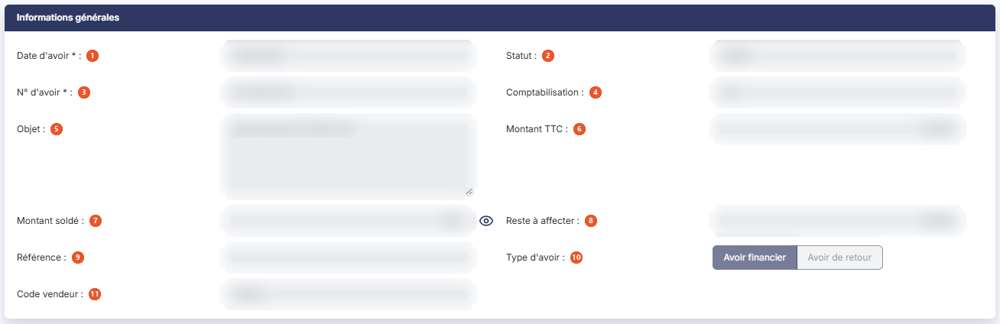
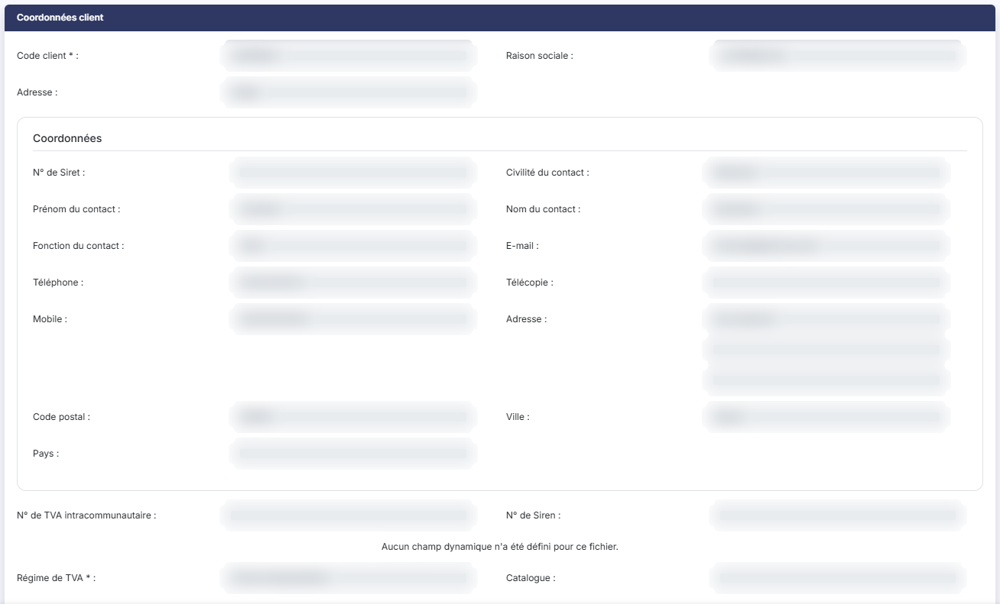
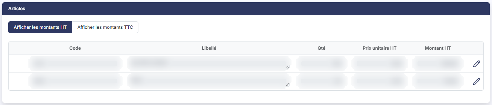
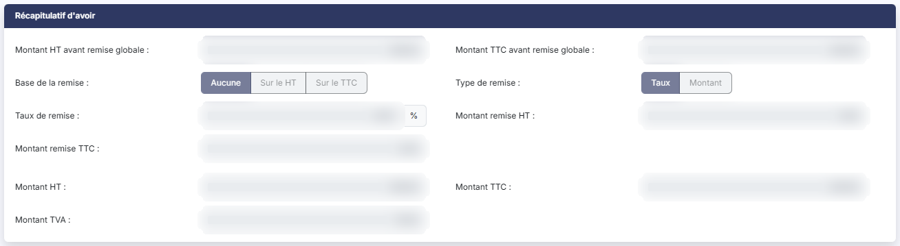
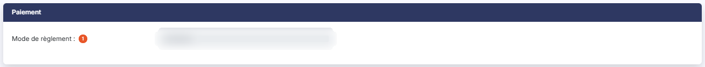
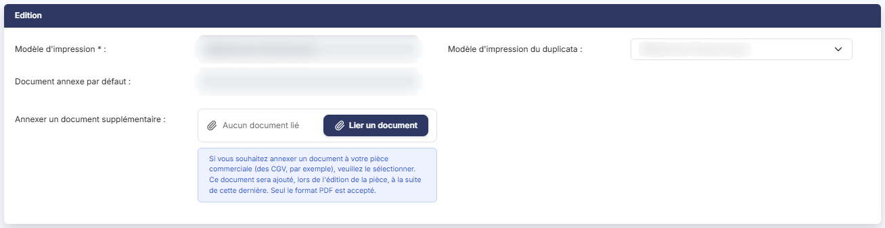

# Avoirs clients


**Où le trouver :** Menu **Ventes › Avoirs**



**En bref** — Cet écran affiche les avoirs clients du dossier annuel en cours. Un avoir se saisit directement ici ou se génère depuis une facture validée ; il fonctionne sur le même principe qu'une facture.

* Pour créer un avoir : bouton \[Créer un avoir], puis renseignez la fiche comme pour une facture.
* Pour restreindre la liste : saisissez un numéro dans Rechercher un avoir… ou un client dans Rechercher un client….


Cette option affiche l'intégralité des avoirs clients du dossier annuel en cours. Un avoir peut être saisi directement ici, ou généré depuis une facture validée.

<figure><figcaption>
Écran « Avoirs » de la nouvelle interface
</figcaption></figure>

Les avoirs fonctionnant sur le même principe que les factures, cette page ne traite que de ce qui leur est propre : reportez-vous au menu « Ventes », option « Factures », pour tout ce qui leur est commun.

## La liste des avoirs

La barre d'outils, au-dessus du tableau, porte deux zones de recherche, **Rechercher un avoir…** (qui remplace l'ancien champ « N° d'avoir ») et **Rechercher un client…** (saisissez le code ou les premières lettres de la raison sociale, ou utilisez le pictogramme « Loupe » pour ouvrir la fenêtre de recherche), puis bouton **\[Filtres]**, qui ouvre le volet « Filtrer » (« + Ajouter un critère sur… », « Vider les filtres » et bouton **\[Filtrer]**), et, à droite, bouton **\[Vue]** et bouton **\[Exporter]**. Dès qu'un critère est posé, le lien « Tout effacer » s'affiche et remplace l'ancien bouton **\[Annuler les filtres]**.

A la différence de la liste des factures, aucun filtre n'est actif à l'ouverture de l'écran (il n'y a ni groupe de filtres rapides « Règlement » et « Statut », ni interrupteur), et la liste n'affiche pas de total.

Le tableau présente sept colonnes, toutes triables : **Numéro**, **Client**, **Raison sociale**, **Montant HT**, **Montant TTC**, **Date avoir** et **Statut**. La colonne **Statut** indique si l'avoir est validé ou non ; sur un avoir validé, elle porte la valeur « Validé ».

Il n'y a ni colonne « Etat », ni colonne « Retard », contrairement à la liste des factures : un avoir n'a pas d'échéance et ne peut donc pas être en retard.

bouton **\[Vue]** permet de choisir les colonnes affichées, dans sa rubrique « Colonnes affichées » ; elles sont propres à chaque utilisateur.

**Les commandes présentes sur chaque ligne**

Il n'y a plus de boîte à cocher : un clic sur la ligne la sélectionne. Chaque ligne porte sept commandes. Au survol de la ligne apparaissent quatre pictogrammes : « Afficher l'aperçu » pour consulter l'avoir sans l'ouvrir (seul visible au repos), « Télécharger » pour en récupérer le fichier .PDF, « Valider » et « Envoyer par mail ». Ils sont suivis du menu « Autres actions » (trois points), qui porte « Modifier » pour ouvrir l'avoir, « Dupliquer » pour créer un nouvel avoir reprenant les caractéristiques de celui-ci et « Editer un relevé de comptes » pour éditer le relevé du client de la ligne.

Il n'y a pas de commande « Régler » : un avoir ne se règle pas, il s'affecte à une ou plusieurs factures depuis le menu « Ventes », option « Règlements ».

Comme pour les factures, une pastille chiffrée se superpose au pictogramme « Enveloppe » de la ligne lorsque l'avoir a déjà été envoyé par courriel.

L'en-tête du tableau ne porte plus ni boîte à cocher ni pictogrammes de commande. Sous le tableau, « Sélectionner la page » retient les lignes de la page affichée et « Tout sélectionner (n) » celles de toutes les pages ; la commande « Envoyer tout par mail » se trouve dans le bandeau de sélection qui s'affiche en bas de l'écran ; la personnalisation des colonnes et l'impression sont dans bouton **\[Vue]** et bouton **\[Exporter]**.

Dans la barre du bas, bouton **\[Créer un avoir]** ouvre une fiche d'avoir vide, bouton **\[Impressions groupées]** et bouton **\[Validations groupées]** traitent des avoirs en une seule fois. Contrairement à leurs homologues de la liste des factures, qui n'apparaissent qu'à partir de deux factures sélectionnées, ces deux boutons sont affichés dès l'ouverture de l'écran, sans sélection préalable. Dès qu'un avoir est sélectionné, le bandeau de sélection prend la place de la barre du bas : il porte Bouton \[Envoyer tout par mail], Bouton \[Impressions groupées] et Bouton \[Validations groupées], et Bouton \[Créer un avoir] n'est plus visible.

Selon les droits qui vous ont été attribués, certaines de ces commandes peuvent ne pas vous être proposées.

## Rubrique « Informations générales »

<figure><figcaption>
Rubrique « Informations générales »
</figcaption></figure>

Les champs y sont présentés dans cet ordre :

| Champ                   | Ce qu'il faut savoir                                                                                                                                                                                                                                                                      |
| ----------------------- | ----------------------------------------------------------------------------------------------------------------------------------------------------------------------------------------------------------------------------------------------------------------------------------------- |
| 1. **Date d'avoir**     | Champ obligatoire.                                                                                                                                                                                                                                                                        |
| 2. **Statut**           | Indique si l'avoir est validé ou non. Ce champ n'est jamais saisissable.                                                                                                                                                                                                                  |
| 3. **N° d'avoir**       | Champ obligatoire, attribué automatiquement en fonction de la règle de création indiquée dans le menu « Paramètres », option « Pièces commerciales ».                                                                                                                                     |
| 4. **Comptabilisation** | Indique si les écritures comptables relatives à l'avoir ont été générées ou non. Ce champ n'est jamais saisissable.                                                                                                                                                                       |
| 5. **Objet**            | Champ facultatif, saisi sur plusieurs lignes. Si l'avoir a été créé à partir d'une facture, la référence à cette facture figure dans l'objet, mais vous pouvez la modifier.                                                                                                               |
| 6. **Montant TTC**      | Il s'agit du montant de l'avoir.                                                                                                                                                                                                                                                          |
| 7. **Montant soldé**    | Lorsqu'un avoir est validé, il devient affectable à des factures, comme un règlement. Ce montant correspond au total de ces affectations. Le pictogramme « Œil » placé à sa droite, dont l'infobulle est « Visualiser les affectations validées », en affiche le détail dans une fenêtre. |
| 8. **Reste à affecter** | C'est la différence entre le montant TTC et le montant soldé.                                                                                                                                                                                                                             |
| 9. **Référence**        | Champ facultatif.                                                                                                                                                                                                                                                                         |
| 10. **Type d'avoir**    | Deux boutons-bascule, « Avoir financier » et « Avoir de retour ». Ce champ n'est proposé que dans la Gestion commerciale : il n'apparaît pas lorsque le même avoir est ouvert depuis le module de Facturation.                                                                            |
| 11. **Code vendeur**    | Champ facultatif.                                                                                                                                                                                                                                                                         |

La rubrique ne comporte ni champ « Etat », ni « Date de livraison », contrairement à la fiche d'une facture.

## Rubrique « Coordonnées client »

<figure><figcaption>
Rubrique « Coordonnées client »
</figcaption></figure>

Elle reprend la rubrique de même nom de la fiche d'une facture, avec une seule différence : il n'y a qu'un bloc d'adresse, dont le libellé est **Adresse :** et non « Adresse de facturation », et aucun bloc d'adresse de livraison.

Vous y trouvez donc, dans l'ordre : **Code client**, champ obligatoire ; **Raison sociale** ; **Adresse**, à choisir dans le sélecteur ou par le pictogramme « Loupe » ; puis, repris de la fiche client et non saisissables ici, **N° de Siret**, **Civilité du contact**, **Prénom du contact**, **Nom du contact**, **Fonction du contact**, **E-mail**, **Téléphone**, **Télécopie**, **Mobile**, **Adresse**, **Code postal**, **Ville** et **Pays** ; puis **N° de TVA intracommunautaire** et **N° de Siren** ; enfin **Régime de TVA**, champ obligatoire, et **Catalogue**.

## Rubrique « Articles »

<figure><figcaption>
Rubrique « Articles »
</figcaption></figure>

C'est dans cette rubrique que sont saisies les lignes de l'avoir. Elle fonctionne exactement comme celle d'une facture : mêmes colonnes, même bascule d'affichage « Afficher les montants HT » ou « Afficher les montants TTC », même saisie simplifiée dans le tableau et même saisie détaillée par la commande « Modifier » de la ligne. Un pictogramme « Plus » en tête de ligne, dont l'infobulle est intitulée « Origine », signale la pièce dont la ligne provient.

**Prix unitaire** : dans les factures, le prix unitaire n'est modifiable que si deux conditions sont remplies : que vous ayez indiqué dans le menu « Paramètres », option « Pièces commerciales », que les prix pouvaient être modifiés dans les pièces commerciales, et que vous ayez fait la même chose dans la fiche de l'article considéré. Pour les avoirs, le prix unitaire est toujours modifiable.

Il n'y a pas de bouton permettant d'ajouter une note de ligne : la fiche d'un avoir ne comporte pas de rubrique « Notes de factures ».

Sur un avoir validé, la seule commande disponible sur les lignes est « Visualiser détails », et la rubrique ne porte plus aucun bouton d'ajout ni de suppression.

## Rubrique « Récapitulatif d'avoir »

<figure><figcaption>
Rubrique « Récapitulatif d'avoir »
</figcaption></figure>

Elle reprend la rubrique « Récapitulatif de facturation » de la fiche d'une facture, dans le même ordre : **Montant HT avant remise globale**, **Montant TTC avant remise globale**, **Base de la remise** avec ses trois choix « Aucune », « Sur le HT » et « Sur le TTC », **Type de remise** avec ses deux choix « Taux » et « Montant », **Taux de remise**, **Montant remise HT**, **Montant remise TTC**, **Montant HT**, **Montant TTC** et **Montant TVA**.

Il n'y a pas de champ « Acompte » : cette notion n'a pas de sens sur un avoir.

## Rubrique « Paiement »

<figure><figcaption>
Rubrique « Paiement »
</figcaption></figure>

Cette rubrique est très réduite par rapport à celle d'une facture :

**Mode de règlement** : champ facultatif.

Il n'y a ni banque, ni type de paiement, ni délai de règlement, ni date d'échéance, ni échéancier : un avoir ne se règle pas par échéances. La rubrique ne comporte donc que le mode de règlement.

Le statut Chorus Pro n'est pas affiché sur la fiche d'un avoir. Pour le consulter, utilisez l'option « Utilisation de Chorus Pro » du menu « Chorus Pro ».

## Rubrique « Edition »

<figure><figcaption>
Rubrique « Edition »
</figcaption></figure>

Elle est identique à celle d'une facture et comporte quatre champs : **Modèle d'impression**, obligatoire ; **Modèle d'impression du duplicata** ; **Document annexe par défaut**, en lecture seule, dont le choix s'effectue dans le menu « Paramètres », option « Pièces commerciales », rubrique « Editions » ; et **Annexer un document supplémentaire**, à désigner avec bouton **\[Lier un document]**. Seul le format .PDF est accepté pour ce document annexé.

## Les boutons de la fiche d'un avoir

Sur un avoir validé, la fiche porte les boutons suivants : bouton **\[Enregistrer]**, bouton **\[Edition originale]**, bouton **\[Edition duplicata]**, bouton **\[Envoyer par mail]** et bouton **\[Avoir électronique]**. Le retour à la liste se fait par la flèche « Revenir en arrière », à gauche du fil d'Ariane : bouton **\[Retour]** n'est plus affiché.

Ils fonctionnent comme leurs homologues de la fiche d'une facture, à deux différences près : le bouton qui génère la pièce au format Factur-X s'appelle ici bouton **\[Avoir électronique]**, et la fiche d'un avoir ne comporte pas de bouton permettant de choisir les champs à afficher.

Il n'y a évidemment ni bouton pour générer un avoir, ni bouton pour régler la pièce.


Attention : sur un avoir validé, tous les champs sont en lecture seule et la rubrique « Articles » n'offre plus aucune commande d'ajout ou de suppression, mais bouton **\[Enregistrer]** reste visible et actif.

