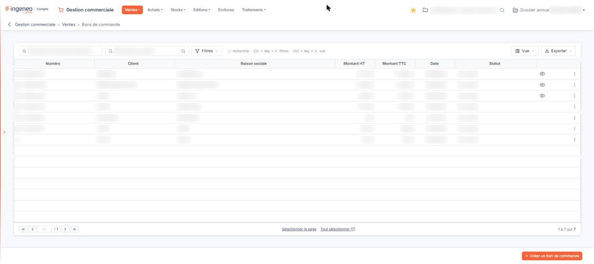
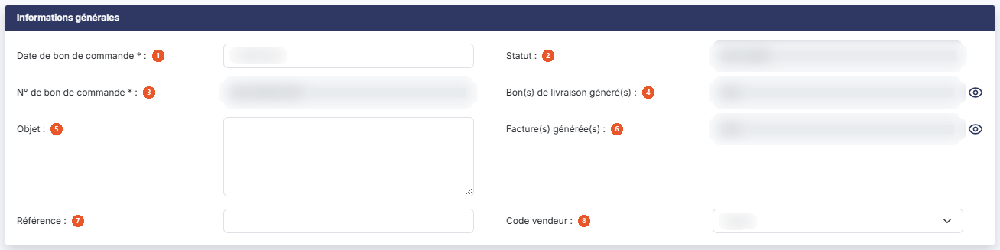
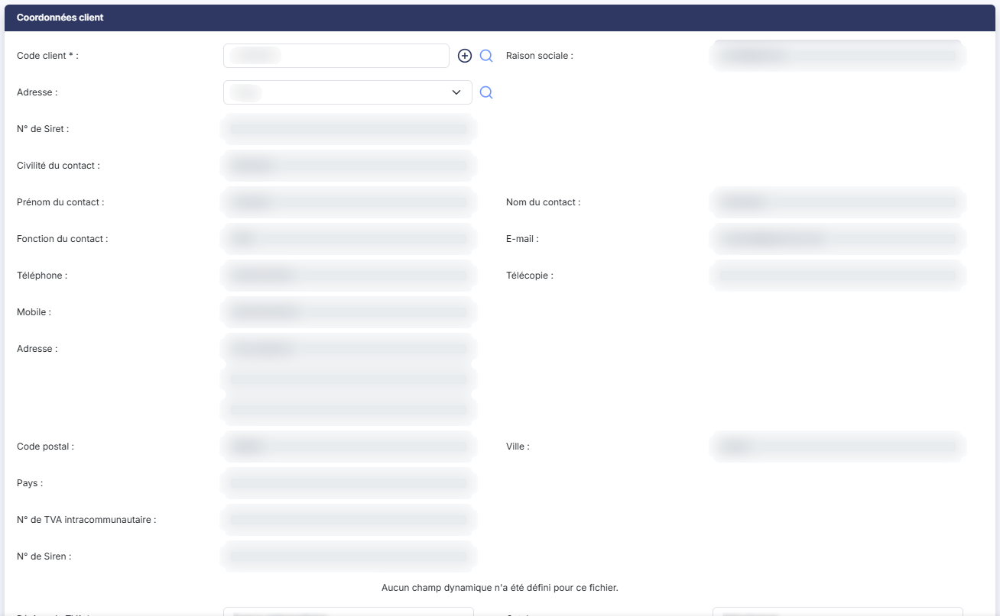
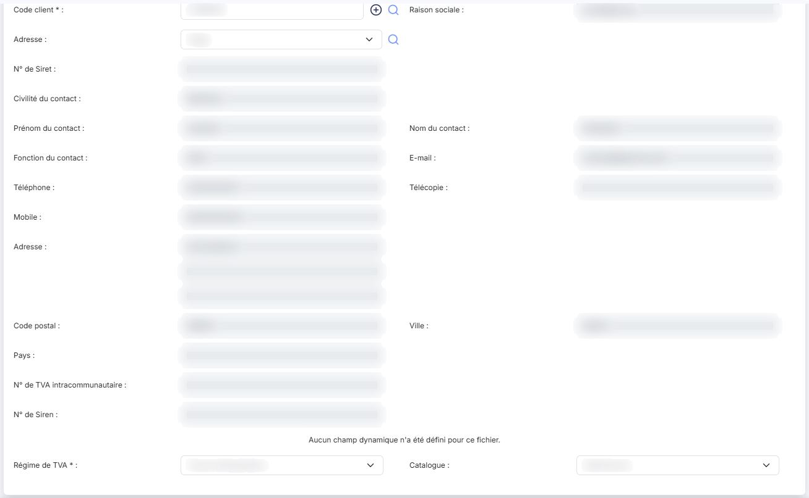
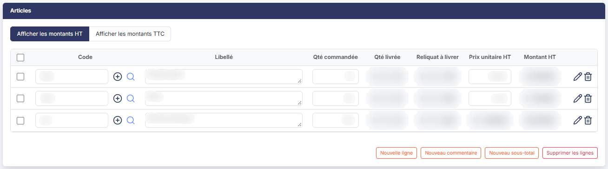
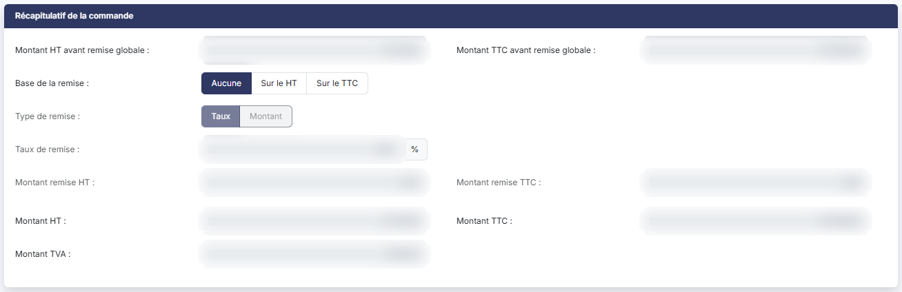
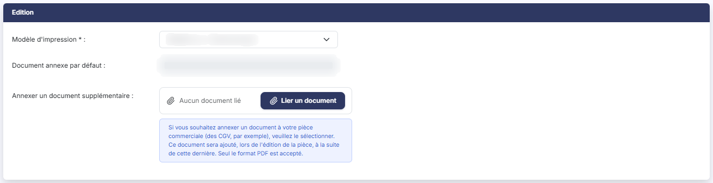
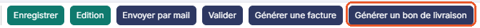
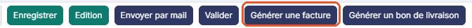

# Bons de commande clients


**Où le trouver :** Menu **Ventes › Bons de commande**



**En bref** — Cet écran affiche les bons de commande clients du dossier annuel en cours. Une commande peut ensuite être transférée en bon de livraison ou directement en facture.

* Pour créer un bon de commande : bouton \[Créer un bon de commande], puis renseignez la fiche.
* Pour livrer une commande : ouvrez-la, puis bouton \[Générer un bon de livraison].
* Pour facturer plusieurs commandes : sélectionnez-les, puis bouton \[Générer les factures].


Cette option affiche la liste des bons de commande clients du dossier annuel en cours. Un bon de commande enregistre ce que le client a commandé ; il peut ensuite être transféré en bon de livraison, qui devra être facturé, ou directement en facture.

<figure><figcaption>
Écran « Bons de commande » de la nouvelle interface
</figcaption></figure>

Les commandes fonctionnant sur le même principe que les factures, cette page ne traite que de ce qui leur est propre : reportez-vous au menu « Ventes », option « Factures », pour tout ce qui leur est commun.

## La liste des bons de commande

Deux zones de recherche, dans la barre d'outils au-dessus du tableau, permettent de restreindre la liste :

| Champ                              | Ce qu'il faut savoir                                                                              |
| ---------------------------------- | ------------------------------------------------------------------------------------------------- |
| **Rechercher un bon de commande…** | Saisissez le numéro recherché.                                                                    |
| **Rechercher un client…**          | Saisissez le client, ou utilisez le pictogramme « Loupe » à droite de la zone pour le rechercher. |

bouton **\[Filtres]** ouvre un volet « Filtrer » : choisissez une colonne dans la liste « Ajouter un critère sur… » (Numéro, Client, Raison sociale, Montant HT, Montant TTC, Date, Statut, mais aussi Factures, Bons de livraison, Objet, Référence, Vendeur, Catalogue et les données du client), puis renseignez le critère. Dès qu'un critère est posé, le lien « Tout effacer » apparaît à côté de \[Filtres] et rétablit la liste complète.

Aucun filtre n'est actif à l'ouverture de l'écran : la liste présente tous les bons de commande du dossier annuel, validés comme non validés. C'est une différence avec la liste des factures, qui ne montre par défaut que les factures non réglées, et avec celle des devis, qui masque par défaut les devis archivés.

Le tableau présente sept colonnes, toutes triables : **Numéro**, **Client**, **Raison sociale**, **Montant HT**, **Montant TTC**, **Date** et **Statut**. La colonne **Statut** indique si le bon de commande est validé ou non ; elle porte la valeur « Non validé » ou « Validé ».

Toutes les colonnes peuvent être redimensionnées et déplacées, sauf celle qui porte les commandes. bouton **\[Vue]** permet de choisir les colonnes affichées, qui sont propres à chaque utilisateur : son menu propose « Mes vues » (« Aucune vue enregistrée » tant que vous n'en avez pas mémorisé, avec « Enregistrer la vue actuelle »), puis « Colonnes affichées » (la liste des colonnes disponibles, 7 affichées sur 40 à l'ouverture), « Rétablir les colonnes d'origine » et Bouton \[Appliquer]. bouton **\[Exporter]** ouvre le menu des éditions de la liste : Aperçu édition HTML, Imprimer, Exporter en Excel, Exporter en PDF, Envoyer la liste par e-mail, orientation (Portrait ou Paysage), format (Ajustée ou Fixe) et Bouton \[Lancer l'édition].

**Les commandes présentes sur chaque ligne**

Un clic sur une ligne la sélectionne : il n'y a plus de boîte à cocher. Au survol d'une ligne, ou quand elle est sélectionnée, trois commandes directes apparaissent à droite : « Télécharger » pour en récupérer le fichier, « Valider » et « Envoyer par mail », suivies du menu « Autres actions » (trois points). Sur certaines lignes s'y ajoute « Afficher l'aperçu », pour consulter le bon de commande sans l'ouvrir : cette commande reste affichée même sans survol. Le menu « Autres actions » propose les trois autres : « Modifier » pour ouvrir le bon de commande, « Dupliquer » pour créer un nouveau bon de commande reprenant les caractéristiques de celui-ci, et « Supprimer ».

Sous le tableau, « Sélectionner la page » sélectionne les lignes de la page et « Tout sélectionner (n) » celles de toutes les pages ; ces liens deviennent « Désélectionner la page » et « Tout désélectionner (n) » quand la sélection est faite.

Selon les droits qui vous ont été attribués, certaines de ces commandes peuvent ne pas vous être proposées.

En bas à droite de l'écran, bouton **\[Créer un bon de commande]** ouvre une fiche de bon de commande vide. Dès qu'au moins un bon est sélectionné, un bandeau remplace cette barre et indique « 1 bon de commande sélectionnée », suivi du lien « Tout désélectionner » ; il propose bouton **\[Supprimer]**, qui supprime tous les bons de commande sélectionnés, bouton **\[Envoyer tout par mail]**, et deux boutons qui transfèrent en une seule fois tous ceux qui ont été sélectionnés : bouton **\[Générer les factures]** et bouton **\[Générer les bons de livraison]**, décrits plus bas.

## Rubrique « Informations générales »

<figure><figcaption>
Rubrique « Informations générales »
</figcaption></figure>

Les champs y sont présentés dans cet ordre :

| Champ                                | Ce qu'il faut savoir                                                                                                                                                                                                                                                                                                                                                        |
| ------------------------------------ | --------------------------------------------------------------------------------------------------------------------------------------------------------------------------------------------------------------------------------------------------------------------------------------------------------------------------------------------------------------------------- |
| 1. **Date de bon de commande**       | Champ obligatoire ; le calendrier s'ouvre au clic dans le champ.                                                                                                                                                                                                                                                                                                            |
| 2. **Statut**                        | Indique si le bon de commande est validé ou non. Ce champ n'est jamais saisissable.                                                                                                                                                                                                                                                                                         |
| 3. **N° de bon de commande**         | Champ obligatoire, attribué automatiquement en fonction de la règle de création indiquée dans le menu « Paramètres », option « Pièces commerciales ». Il n'est pas saisissable.                                                                                                                                                                                             |
| 4. **Bon(s) de livraison généré(s)** | Indique si un ou plusieurs bons de livraison ont été générés à partir de la commande. Ce champ n'est jamais saisissable. Le pictogramme « Œil » placé à sa droite, dont l'infobulle est « Visualiser les bons de livraison générés », en affiche la liste. Sur une commande transférée en facture, la fiche entière est en lecture seule (voir la remarque de fin de page). |
| 5. **Objet**                         | Champ facultatif, saisi sur plusieurs lignes. Si le bon de commande a été créé à partir d'un devis, la référence à ce devis y figure.                                                                                                                                                                                                                                       |
| 6. **Facture(s) générée(s)**         | Même fonctionnement, pour les factures issues de la commande. L'infobulle du pictogramme « Œil » est « Visualiser les factures générées ».                                                                                                                                                                                                                                  |
| 7. **Référence**                     | Champ facultatif.                                                                                                                                                                                                                                                                                                                                                           |
| 8. **Code vendeur**                  | Champ facultatif, à choisir dans un sélecteur.                                                                                                                                                                                                                                                                                                                              |

La rubrique ne comporte ni champ « Etat », ni « Comptabilisation », ni aucun montant, contrairement à la fiche d'une facture : une commande ne donne lieu à aucune écriture comptable.

La fiche d'un bon de commande ne comporte pas non plus de rubrique « Paiement ». Elle en compte cinq : « Informations générales », « Coordonnées client », « Articles », « Récapitulatif de la commande » et « Edition ».

Un bon de commande validé n'est plus supprimable.

Une commande peut être transférée en bon de livraison, qui devra ensuite être facturé, ou directement en facture. Les quantités livrées du bon de livraison ou les quantités facturées de la facture peuvent être modifiées ligne à ligne.

## Rubrique « Coordonnées client »

<figure><figcaption>
Rubrique « Coordonnées client »
</figcaption></figure>

<figure><figcaption>
Rubrique « Coordonnées client »
</figcaption></figure>

Elle reprend la rubrique de même nom de la fiche d'une facture, avec une seule différence : il n'y a qu'un bloc d'adresse, sans bloc d'adresse de livraison.

Vous y trouvez donc, dans l'ordre : **Code client**, champ obligatoire, accompagné du pictogramme « Plus » qui permet de créer un client et du pictogramme « Loupe » qui ouvre la recherche ; **Raison sociale** ; **Adresse**, à choisir dans le sélecteur ou par le pictogramme « Loupe » ; puis, repris de la fiche client et non saisissables ici, **N° de Siret**, **Civilité du contact**, **Prénom du contact**, **Nom du contact**, **Fonction du contact**, **E-mail**, **Téléphone**, **Télécopie**, **Mobile**, **Adresse**, **Code postal**, **Ville** et **Pays** ; puis **N° de TVA intracommunautaire** et **N° de Siren** ; enfin **Régime de TVA**, champ obligatoire, et **Catalogue**, un sélecteur dont le premier choix est « Sélectionnez » (« Particuliers » et « Professionnels » dans le dossier observé) ; sur un bon de commande qui a déjà donné lieu à un bon de livraison ou à une facture, le catalogue est affiché sans sélecteur.


Attention : le libellé « Adresse » est employé deux fois dans cette rubrique. Le premier désigne le sélecteur qui permet de choisir laquelle des adresses du client doit figurer sur la pièce ; le second, plus bas, affiche l'adresse postale correspondante et n'est pas saisissable.


Une zone est réservée aux champs dynamiques du fichier des bons de commande, à l'intérieur de cette rubrique, entre le N° de Siren et le Régime de TVA. Si aucun n'a été créé, le message « Aucun champ dynamique n'a été défini pour ce fichier. » y est affiché.

## Rubrique « Articles »

<figure><figcaption>
Rubrique « Articles »
</figcaption></figure>

C'est dans cette rubrique que sont saisies les lignes de la commande. Deux boutons-bascule, au-dessus du tableau, commandent l'affichage : « Afficher les montants HT », retenu par défaut, ou « Afficher les montants TTC ».

En affichage HT, le tableau présente les colonnes suivantes :

| Champ                 | Ce qu'il faut savoir                                                                                                                                                                                                                                                                       |
| --------------------- | ------------------------------------------------------------------------------------------------------------------------------------------------------------------------------------------------------------------------------------------------------------------------------------------ |
| **Code**              | Il est obligatoire. Vous pouvez le rechercher en tapant ses premières lettres, ou par le pictogramme « Loupe » de la ligne ; le pictogramme « Plus » permet de créer un article.                                                                                                           |
| **Libellé**           | Il est repris depuis la fiche article mais reste modifiable.                                                                                                                                                                                                                               |
| **Qté commandée**     | La quantité commandée par le client.                                                                                                                                                                                                                                                       |
| **Qté livrée**        | La quantité déjà livrée, mise à jour par la validation des bons de livraison et des factures issus de la commande. Ce champ n'est pas saisissable.                                                                                                                                         |
| **Reliquat à livrer** | La différence entre la quantité commandée et la quantité livrée. Ce champ n'est pas saisissable.                                                                                                                                                                                           |
| **Prix unitaire HT**  | Il n'est modifiable que si deux conditions sont remplies : que vous ayez indiqué dans le menu « Paramètres », option « Pièces commerciales », que les prix pouvaient être modifiés dans les pièces commerciales, et que vous ayez fait la même chose dans la fiche de l'article considéré. |
| **Montant HT**        | Il est affiché automatiquement, sans possibilité de modification.                                                                                                                                                                                                                          |

Les colonnes de quantité livrée et de reliquat sont propres au bon de commande : c'est par elles que vous suivez ce qui reste à livrer.

Sur un bon de commande modifiable, chaque ligne commence par une case à cocher (infobulle « Sélectionner », « Sélectionner tout » dans l'en-tête du tableau) et se termine, à droite, par les commandes « Modifier » (crayon), pour ouvrir la saisie détaillée, et « Supprimer » (corbeille). Les lignes peuvent être déplacées à l'aide de la souris.

Les boutons de la rubrique sont bouton **\[Nouvelle ligne]**, bouton **\[Nouveau commentaire]**, bouton **\[Nouveau sous-total]** et bouton **\[Supprimer les lignes]**. Il n'y a pas de bouton permettant d'ajouter une note de ligne.

Cette description est celle d'un bon de commande modifiable, c'est-à-dire sans bon de livraison ni facture généré. Dès qu'un bon de livraison ou une facture a été généré à partir de la commande, les lignes ne sont plus modifiables : la colonne des cases à cocher et les quatre boutons de la rubrique disparaissent, la seule commande de ligne est « Modifier » (crayon) et seul le libellé de l'article reste saisissable.

## Rubrique « Récapitulatif de la commande »

<figure><figcaption>
Rubrique « Récapitulatif de la commande »
</figcaption></figure>

Elle reprend la rubrique « Récapitulatif de facturation » de la fiche d'une facture, sans le champ « Acompte », soit dix champs dans cet ordre : **Montant HT avant remise globale**, **Montant TTC avant remise globale**, **Base de la remise** avec ses trois choix « Aucune », « Sur le HT » et « Sur le TTC », **Type de remise** avec ses deux choix « Taux » et « Montant », **Taux de remise** suivi du signe pour cent, **Montant remise HT**, **Montant remise TTC**, **Montant HT**, **Montant TTC** et **Montant TVA**.

Sur un dossier qui autorise la remise globale, tous les bons de commande affichent ces dix champs, y compris ceux qui ont déjà donné lieu à un bon de livraison ou à une facture. Sur un bon de commande dont la pièce n'autorise pas la remise globale, les champs de la remise ne sont pas rendus et la rubrique se limite à **Montant HT**, **Montant TTC** et **Montant TVA**.

Tant que la base de la remise est « Aucune », le type de remise est grisé et les trois champs **Taux de remise**, **Montant remise HT** et **Montant remise TTC** sont en lecture seule : ils ne deviennent saisissables qu'une fois une base retenue.

## Rubrique « Edition »

<figure><figcaption>
Rubrique « Edition »
</figcaption></figure>

Elle ne comporte que trois champs : **Modèle d'impression**, obligatoire ; **Document annexe par défaut**, en lecture seule, dont le choix s'effectue dans le menu « Paramètres », option « Pièces commerciales », rubrique « Editions » ; et **Annexer un document supplémentaire**, à désigner avec bouton **\[Lier un document]** (« Aucun document lié » s'affiche tant qu'aucun document n'est lié).

Un texte d'information, affiché sous ce dernier champ, rappelle que si vous souhaitez annexer un document à votre pièce commerciale, des conditions générales de vente par exemple, il sera ajouté à la suite de la pièce lors de l'édition, et que seul le format .PDF est accepté.

Il n'y a pas de modèle d'impression du duplicata.

## Bouton \[Générer un bon de livraison]

<figure><figcaption>
Bouton [Générer un bon de livraison]
</figcaption></figure>

Ce bouton est présent dans la fiche d'une commande. Il déclenche la génération du bon de livraison pour les quantités restant à livrer de chaque ligne de la commande.

Le logiciel crée le bon de livraison à la date du jour du transfert et renseigne son objet avec la référence au bon de commande. Vous êtes automatiquement positionné sur le nouveau bon de livraison créé.

La validation d'un bon de livraison déclenche la génération de mouvements de stocks, pour les articles gérés en stock.

Vous ne pouvez pas transférer une commande en bon de livraison s'il existe déjà une facture ou un bon de livraison créé à partir de cette commande et que cette pièce n'a pas été validée.

## Bouton \[Générer une facture]

<figure><figcaption>
Bouton [Générer une facture]
</figcaption></figure>

Ce bouton est présent dans la fiche d'une commande. Il déclenche la génération de la facture pour les quantités restant à livrer de chaque ligne de la commande, et évite ainsi l'étape du bon de livraison.

Le logiciel crée la facture à la date du jour du transfert et renseigne son objet avec la référence au bon de commande. Vous êtes automatiquement positionné sur la nouvelle facture créée.

La validation d'une facture déclenche la génération de mouvements de stocks, pour les articles gérés en stock.

Vous ne pouvez pas transférer une commande en facture s'il existe déjà une facture ou un bon de livraison créé à partir de cette commande et que cette pièce n'a pas été validée.

## Bouton \[Générer les factures]

Ce bouton est présent dans le bandeau de sélection de la liste des bons de commande. Il permet de générer les factures de manière groupée pour toutes les commandes qui ont été sélectionnées en cliquant sur leur ligne.

Les données de plusieurs commandes d'un même client ne sont jamais fusionnées sur une même facture, même lors d'un transfert groupé.

## Bouton \[Générer les bons de livraison]

Ce bouton est présent dans le bandeau de sélection de la liste des bons de commande. Il permet de générer les bons de livraison de manière groupée pour toutes les commandes qui ont été sélectionnées en cliquant sur leur ligne.

Les données de plusieurs commandes d'un même client ne sont jamais fusionnées sur un même bon de livraison, même lors d'un transfert groupé.

## Les autres boutons de la fiche d'un bon de commande

bouton **\[Enregistrer]** enregistre la commande, bouton **\[Edition]** l'édite, bouton **\[Envoyer par mail]** l'adresse par courriel, bouton **\[Valider]** la fige. Ils figurent, avec les deux boutons de transfert, dans la barre du bas de la fiche. Il n'y a plus de bouton \[Retour] visible : pour revenir à la liste, utilisez la flèche « Revenir en arrière », à gauche du fil d'Ariane.

La fiche d'un bon de commande ne comporte ni édition originale ou duplicata, ni bouton de règlement, ni bouton permettant de générer la pièce au format Factur-X, ni bouton permettant de choisir les champs à afficher.

Un point n'est pas traité ici : la fiche d'un bon de commande validé. Aucun bon de commande validé ne figurait dans le dossier observé, et la liste des champs et des boutons dans cet état n'a donc pas pu être établie.
