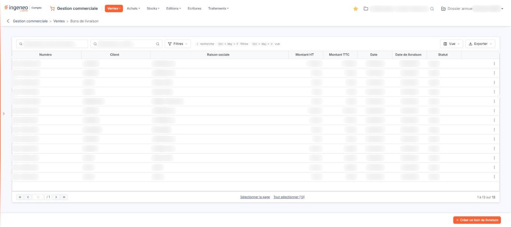
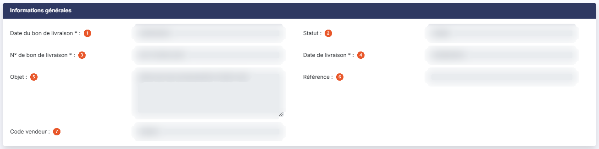
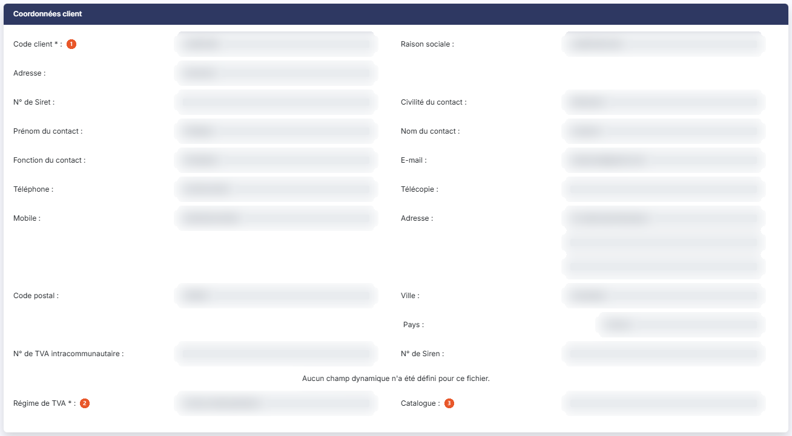
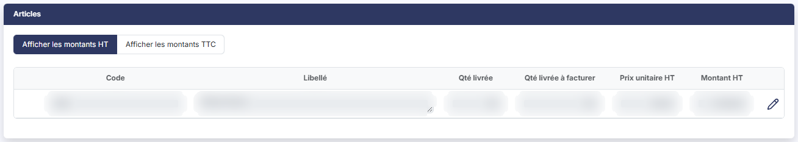
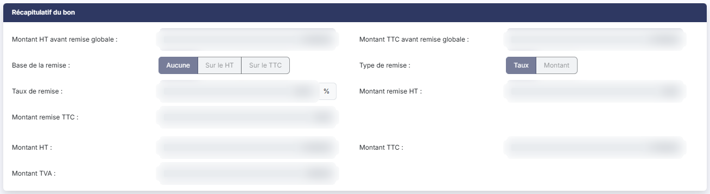
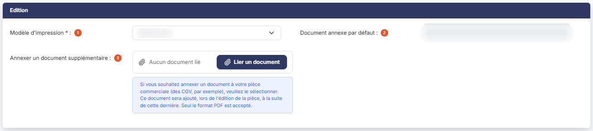

# Bons de livraison


**Où le trouver :** Menu **Ventes › Bons de livraison**



**En bref** — Cet écran affiche les bons de livraison du dossier annuel en cours. Un bon de livraison, issu d'une commande ou créé directement, doit ensuite être facturé.

* Pour créer un bon de livraison : bouton \[Créer un bon de livraison], puis renseignez la fiche.
* Pour facturer plusieurs bons : sélectionnez-les, puis bouton \[Générer les factures].


Les bons de livraison fonctionnent sur le même principe que les factures : reportez-vous au menu « Ventes », option « Factures » pour tout ce qui leur est commun. Cette page ne traite que de ce qui leur est propre.

<figure><figcaption>
Écran « Bons de livraison » de la nouvelle interface
</figcaption></figure>

Un bon de livraison peut être issu d'un bon de commande ou créé directement ; il devra ensuite être facturé.

## La liste des bons de livraison

Deux zones de recherche, dans la barre d'outils au-dessus du tableau, permettent de restreindre la liste :

| Champ                               | Ce qu'il faut savoir                                                                              |
| ----------------------------------- | ------------------------------------------------------------------------------------------------- |
| **Rechercher un bon de livraison…** | Saisissez tout ou partie du numéro recherché.                                                     |
| **Rechercher un client…**           | Saisissez le client, ou utilisez le pictogramme « Loupe » à droite de la zone pour le rechercher. |

bouton **\[Filtres]** ouvre un volet « Filtrer » : choisissez une colonne dans la liste « Ajouter un critère sur… », puis renseignez le critère ; Bouton \[Vider les filtres] retire les critères posés. Dès qu'un critère est posé, le lien « Tout effacer » apparaît à côté de \[Filtres] et rétablit la liste complète. bouton **\[Vue]** permet de choisir les colonnes affichées, qui sont propres à chaque utilisateur, et bouton **\[Exporter]** ouvre le menu des éditions de la liste (aperçu, impression, export Excel ou PDF, envoi de la liste par e-mail, orientation et format de page).

Tant que vous n'avez posé aucun critère, la liste présente tous les bons de livraison du dossier annuel : aucun filtre n'est actif à l'ouverture de l'écran.

Le tableau présente les colonnes **Numéro**, **Client**, **Raison sociale**, **Montant HT**, **Montant TTC**, **Date**, **Date de livraison** et **Statut**. Toutes sont triables : cliquez sur l'en-tête de la colonne sur laquelle vous souhaitez trier.

La colonne **Statut** indique si le bon de livraison est validé ou non.

**Les commandes présentes sur chaque ligne**

Un clic sur une ligne du tableau la sélectionne : il n'y a plus de case à cocher. Au survol d'une ligne, ou quand elle est sélectionnée, trois commandes directes apparaissent à droite : « Télécharger » pour en récupérer le fichier, « Valider » et « Envoyer par mail », suivies du menu « Autres actions » (trois points), qui propose « Modifier » pour ouvrir le bon de livraison, « Dupliquer » pour créer un nouveau bon de livraison reprenant le contenu de celui-ci, et « Supprimer ». La commande « Afficher l'aperçu », qui permet de consulter le bon sans l'ouvrir, n'est pas proposée sur les bons validés.

Selon les droits qui vous ont été attribués, certaines de ces commandes peuvent ne pas vous être proposées.

Sous le tableau, « Sélectionner la page » sélectionne les lignes de la page et « Tout sélectionner (n) » celles de toutes les pages. Les commandes de personnalisation des colonnes, de filtre et d'export se trouvent dans la barre d'outils décrite plus haut.

## Rubrique « Informations générales »

<figure><figcaption>
Rubrique « Informations générales »
</figcaption></figure>

| Champ                           | Ce qu'il faut savoir                                                                                                       |
| ------------------------------- | -------------------------------------------------------------------------------------------------------------------------- |
| 1. **Date du bon de livraison** | Champ obligatoire.                                                                                                         |
| 2. **Statut**                   | Indique si le bon de livraison est validé ou non. Ce champ n'est jamais modifiable.                                        |
| 3. **N° de bon de livraison**   | Champ obligatoire.                                                                                                         |
| 4. **Date de livraison**        | Champ obligatoire.                                                                                                         |
| 5. **Objet**                    | Champ facultatif. Si le bon de livraison a été créé à partir d'un bon de commande, la référence à cette commande y figure. |
| 6. **Référence**                | Champ facultatif.                                                                                                          |
| 7. **Code vendeur**             | Champ facultatif.Sur un bon de livraison validé, le code du vendeur est simplement affiché.                                |

Sur un bon de livraison validé, tous les champs de cette rubrique sont affichés sans possibilité de modification.

## Rubrique « Coordonnées client »

<figure><figcaption>
Rubrique « Coordonnées client »
</figcaption></figure>

| Champ                | Ce qu'il faut savoir                                                                                                                                                                                                                                                                                                                                                                    |
| -------------------- | --------------------------------------------------------------------------------------------------------------------------------------------------------------------------------------------------------------------------------------------------------------------------------------------------------------------------------------------------------------------------------------- |
| 1. **Code client**   | 
Champ obligatoire. La raison sociale, l'adresse à retenir pour la pièce, puis le numéro de Siret, la civilité, le prénom, le nom et la fonction du contact, l'adresse électronique, le téléphone, la télécopie, le mobile, l'adresse postale, le code postal, la ville, le pays, le numéro de TVA intracommunautaire et le numéro de Siren sont repris de la fiche du client.
 |
| 2. **Régime de TVA** | Champ obligatoire, repris de la fiche du client.                                                                                                                                                                                                                                                                                                                                        |
| 3. **Catalogue**     | Champ facultatif, repris de la fiche du client.                                                                                                                                                                                                                                                                                                                                         |

Sur un bon de livraison validé, le code client n'est plus modifiable et le logiciel ne propose plus ni la création d'un client, ni la recherche d'un client : la pièce validée ne permet plus de changer de client. Le régime de TVA, le catalogue et l'adresse sont alors affichés sans sélecteur.

## Les champs dynamiques

Les champs dynamiques que vous avez définis pour les bons de livraison s'affichent à l'intérieur de la rubrique « Coordonnées client », entre le **N° de Siren :** et le **Régime de TVA :**. Si vous n'en avez défini aucun, le logiciel affiche le message « Aucun champ dynamique n'a été défini pour ce fichier. ».

## Rubrique « Articles »

<figure><figcaption>
Rubrique « Articles »
</figcaption></figure>

Deux boutons, au-dessus de la grille, permettent de choisir l'affichage des montants : bouton **\[Afficher les montants HT]** et bouton **\[Afficher les montants TTC]**.

En affichage HT, la grille présente les colonnes **Code**, **Libellé**, **Qté livrée**, **Qté livrée à facturer**, **Prix unitaire HT** et **Montant HT**.

Chaque ligne de détail contient donc la quantité livrée et la quantité livrée à facturer. Cette dernière sera mise à jour lors de la facturation du bon de livraison.

Sur un bon de livraison validé, les lignes ne sont plus modifiables : la seule commande proposée sur la ligne est « Visualiser détails », et le logiciel n'affiche plus les commandes d'ajout, de commentaire, de sous-total ni de suppression de lignes.

**Cas d'un bon de livraison créé à partir d'un bon de commande**

Les lignes du bon de livraison reprennent les quantités restant à livrer de chaque ligne de la commande. Vous avez la possibilité de modifier la quantité livrée de chaque ligne.

A la validation du bon de livraison, les quantités restant à livrer sont mises à jour dans la commande.

## Rubrique « Récapitulatif du bon »

<figure><figcaption>
Rubrique « Récapitulatif du bon »
</figcaption></figure>

Sur un dossier qui n'autorise pas la remise globale, cette rubrique ne présente que **Montant HT :**, **Montant TTC :** et **Montant TVA :**, sans les champs de la remise globale décrits plus bas. Sur un dossier qui l'autorise, y compris à la création d'un bon de livraison, elle récapitule les montants du bon de livraison : **Montant HT avant remise globale :**, **Montant TTC avant remise globale :**, puis, après application de la remise globale, **Montant HT :**, **Montant TTC :** et **Montant TVA :**.

La remise globale se règle avec trois éléments : **Base de la remise :** (« Aucune », « Sur le HT » ou « Sur le TTC »), **Type de remise :** (« Taux » ou « Montant ») et **Taux de remise :**. Le logiciel en déduit le **Montant remise HT :** et le **Montant remise TTC :**.

Sur un bon de livraison validé, tous ces montants sont affichés sans possibilité de modification.

## Rubrique « Edition »

<figure><figcaption>
Rubrique « Edition »
</figcaption></figure>

| Champ                                     | Ce qu'il faut savoir                                                                                                                                                                                                                                          |
| ----------------------------------------- | ------------------------------------------------------------------------------------------------------------------------------------------------------------------------------------------------------------------------------------------------------------- |
| 1. **Modèle d'impression**                | Champ obligatoire. Indiquez le modèle d'impression à utiliser pour éditer le bon de livraison. Ce champ reste modifiable même sur un bon de livraison validé.                                                                                                 |
| 2. **Document annexe par défaut**         | Affiche le document que vous avez défini comme annexe systématique des bons de livraison, par exemple vos conditions générales de vente.                                                                                                                      |
| 3. **Annexer un document supplémentaire** | Cliquez sur bouton **\[Lier un document]** pour joindre un document à ce seul bon de livraison (« Aucun document lié » s'affiche tant qu'aucun n'est lié). Le format PDF est le seul accepté, comme le rappelle le texte d'information affiché sous ce champ. |

## Les boutons du bon de livraison

bouton **\[Enregistrer]** : enregistre le bon de livraison.

bouton **\[Edition]** : édite le bon de livraison selon le modèle d'impression choisi dans la rubrique « Edition ».

bouton **\[Envoyer par mail]** : adresse le bon de livraison par courrier électronique.

Il n'y a plus de bouton \[Retour] visible : pour revenir à la liste, utilisez la flèche « Revenir en arrière », à gauche du fil d'Ariane.

Ces boutons figurent dans la barre du bas de la fiche.

## Bouton \[Générer une facture]

<figure><figcaption>
Bouton [Générer une facture]
</figcaption></figure>

Ce bouton déclenche la génération de la facture sur la base du bon de livraison affiché.

Les quantités et les prix d'une facture issue d'un bon de livraison ne sont pas modifiables ; seuls les libellés des articles et les commentaires le sont.

## Bouton \[Générer les factures]

Ce bouton est présent dans le bandeau de sélection de la liste des bons de livraison, qui s'affiche en bas de l'écran dès qu'un bon est sélectionné. Il permet de générer les factures de manière groupée pour tous les bons de livraison qui ont été sélectionnés en cliquant sur leur ligne. Le traitement est équivalent à celui qui aurait été fait si les bons de livraison avaient été transférés un à un.

Si vous transférez plusieurs bons de livraison d'un même client, le logiciel vous proposera de les fusionner sur une même facture.

## Les autres boutons de la liste

bouton **\[Créer un bon de livraison]** : placé en bas à droite de l'écran, il crée un bon de livraison.

bouton **\[Supprimer]** : présent dans le bandeau de sélection (« 1 bon de livraison sélectionné », suivi du lien « Tout désélectionner ») une fois des bons sélectionnés, il supprime tous les bons de livraison sélectionnés dans la liste. Le même bandeau propose aussi bouton **\[Envoyer tout par mail]** et bouton **\[Générer les factures]** ; il prend la place de \[Créer un bon de livraison] tant qu'un bon est sélectionné.
