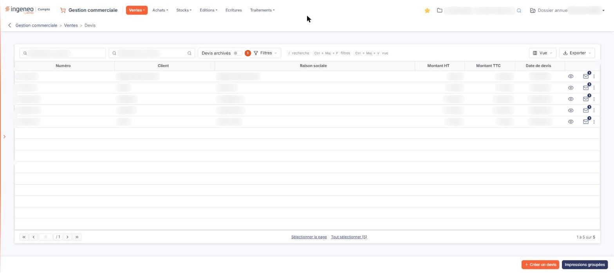
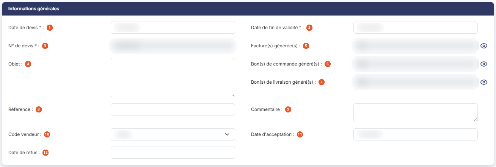
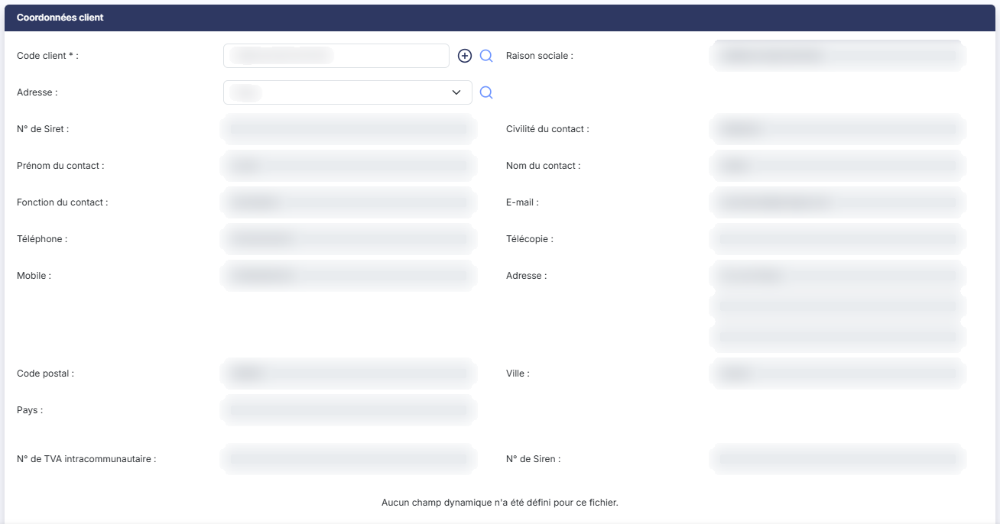
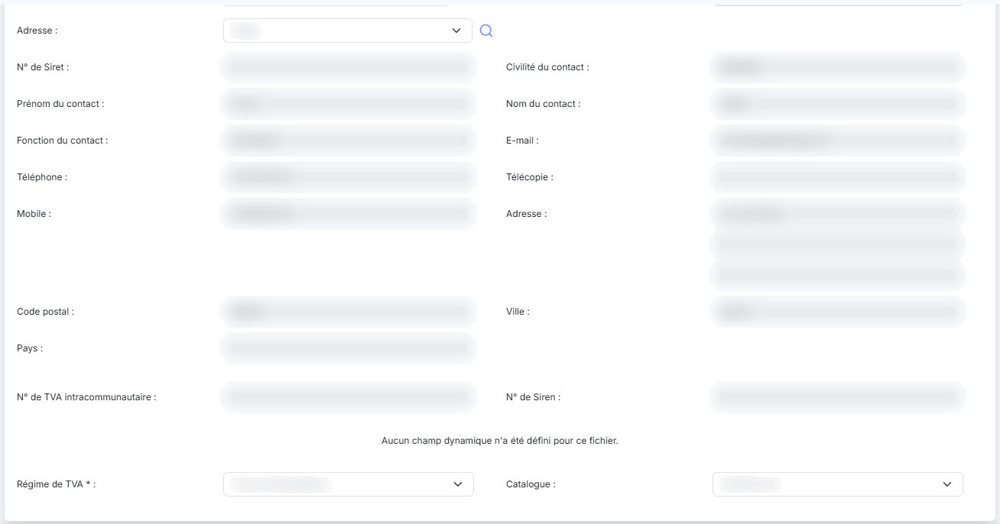
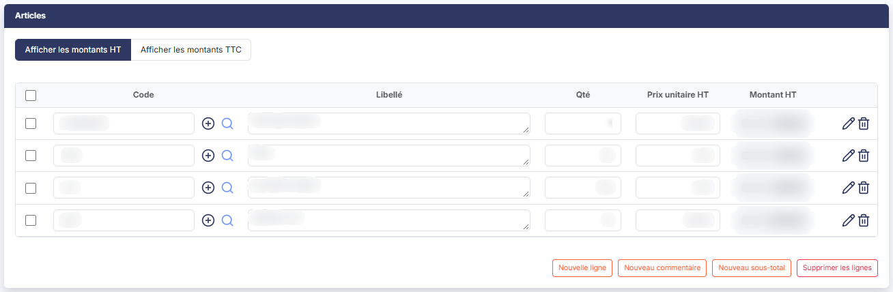
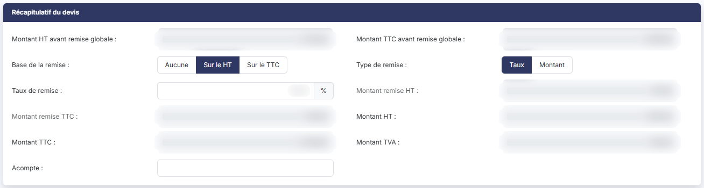
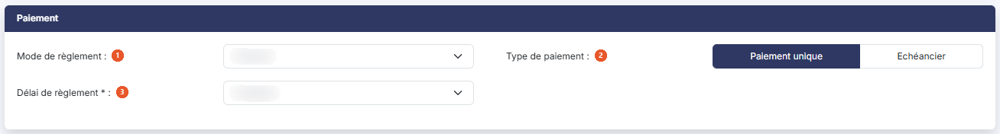
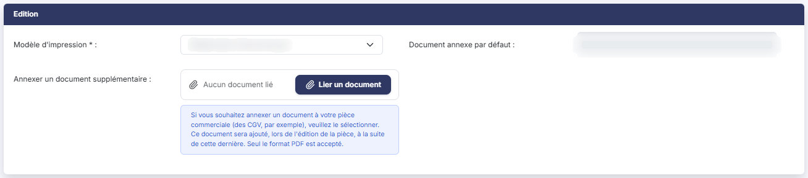
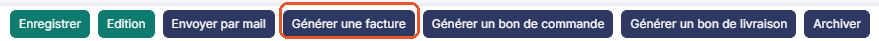

# Devis


**Où le trouver :** Menu **Ventes › Devis**



**En bref** — Cet écran affiche les devis du dossier annuel en cours. Un devis n'a pas d'effet comptable : il prépare une pièce et peut alimenter un bon de commande, un bon de livraison ou une facture.

* Pour créer un devis : bouton \[Créer un devis], puis renseignez la fiche.
* Pour transformer un devis en facture : ouvrez-le, puis bouton \[Générer une facture].
* Pour revoir les devis archivés : bouton \[Filtres spéciaux], puis activez l'interrupteur Devis archivés.


Cette option affiche la liste des devis du dossier annuel en cours. Un devis n'a pas d'effet comptable : il sert à préparer une pièce commerciale, qu'il peut ensuite alimenter en bon de commande, en bon de livraison ou en facture, autant de fois que nécessaire.

<figure><figcaption>
Écran « Devis » de la nouvelle interface
</figcaption></figure>

Les devis fonctionnant sur le même principe que les factures, cette page ne traite que de ce qui leur est propre : reportez-vous au menu « Ventes », option « Factures », pour tout ce qui leur est commun.

## La liste des devis

Au-dessus du tableau, la barre d'outils propose deux zones de recherche, « Rechercher un devis… » et « Rechercher un client… », puis l'interrupteur « Devis archivés », bouton **\[Filtres]**, bouton **\[Vue]** et bouton **\[Exporter]**.

| Champ                 | Ce qu'il faut savoir                                                                                                                                                                                                                                                                                                                                                                      |
| --------------------- | ----------------------------------------------------------------------------------------------------------------------------------------------------------------------------------------------------------------------------------------------------------------------------------------------------------------------------------------------------------------------------------------- |
| 1. **Devis archivés** | Cet interrupteur, visible dans la barre d'outils à côté de la zone « Rechercher un client… » (il n'y a plus de menu « Filtres spéciaux »), dont l'infobulle est « Inclure les devis archivés », est désactivé à l'ouverture de l'écran. Par défaut, la liste ne contient donc que les devis qui n'ont pas encore été archivés ; activez l'interrupteur pour afficher la liste exhaustive. |
| **Recherche**         | Saisissez le début d'un numéro de devis ou d'un nom de client dans la zone correspondante.                                                                                                                                                                                                                                                                                                |
| **Filtres**           | Bouton \[Filtres] ouvre un volet où « + Ajouter un critère sur… » vous fait choisir une colonne du tableau (par exemple Client ou Numéro), puis bouton **\[Filtrer]** applique vos critères et bouton **\[Vider les filtres]** les retire. Dès qu'un critère est posé, le lien « Tout effacer » apparaît à côté de Bouton \[Filtres].                                                     |


Attention au sens du premier filtre : sur la liste des factures, le filtre rapide « Non réglées » restreint la liste, alors qu'ici l'interrupteur « Devis archivés » l'élargit.


Le tableau présente six colonnes, toutes triables : **Numéro**, **Client**, **Raison sociale**, **Montant HT**, **Montant TTC** et **Date de devis**. C'est la liste la plus courte des pièces de vente : un devis n'a ni état, ni statut, ni retard, puisqu'il n'est ni validé ni réglé.

bouton **\[Vue]** permet de choisir les colonnes affichées (« Colonnes affichées »), de les rétablir (« Rétablir les colonnes d'origine ») et d'enregistrer des vues (« Mes vues ») ; ces réglages sont propres à chaque utilisateur.


Attention : aucune colonne, aucune couleur et aucune marque ne distingue un devis archivé d'un devis actif. Lorsque l'interrupteur « Devis archivés » est activé, les deux sortes de devis sont mélangées sans qu'il soit possible de les reconnaître dans la liste. Pour savoir si un devis est archivé, il faut ouvrir sa fiche.


**Les commandes présentes sur chaque ligne**

Un clic sur une ligne la sélectionne. Chaque ligne porte six commandes, au survol, dans la dernière colonne : les pictogrammes « Afficher l'aperçu » pour consulter le devis sans l'ouvrir (seul visible au repos), « Télécharger » pour en récupérer le fichier .PDF et « Envoyer par mail », suivis du menu « Autres actions » (trois points), qui porte « Modifier » pour ouvrir le devis, « Dupliquer » pour créer un nouveau devis reprenant les caractéristiques de celui-ci et « Supprimer ».

Le jeu de commandes est le même sur un devis archivé et sur un devis actif.

La commande « Supprimer » est propre à cet écran : ni la liste des factures, ni celle des avoirs ne permettent de supprimer une pièce depuis la ligne. Inversement, il n'y a ici ni commande « Valider », ni commande « Régler », ni commande « Editer un relevé de comptes ».

Comme pour les factures, une pastille chiffrée se superpose au pictogramme « Enveloppe » de la ligne lorsque le devis a déjà été envoyé par courriel ; passez la souris dessus pour afficher la date, l'heure et les destinataires de chaque envoi.

Sous le tableau, bouton **\[Sélectionner la page]** sélectionne les devis de la page et bouton **\[Tout sélectionner (n)]** étend la sélection à toutes les pages. Les commandes d'impression et d'export sont regroupées sous Bouton \[Exporter].

Dans la barre du bas, bouton **\[Créer un devis]** ouvre une fiche de devis vide et bouton **\[Impressions groupées]** imprime en une seule fois les devis sélectionnés. Dès qu'un devis est sélectionné, un bandeau de sélection prend la place de cette barre : il porte « Tout désélectionner », bouton **\[Supprimer]**, bouton **\[Envoyer tout par mail]**, bouton **\[Archiver]** et bouton **\[Impressions groupées]**, qui traitent tous les devis sélectionnés, dès le premier ; bouton **\[Créer un devis]** n'est plus visible. Il n'y a pas de validations groupées : un devis ne se valide pas.

Selon les droits qui vous ont été attribués, certaines de ces commandes peuvent ne pas vous être proposées.

## Rubrique « Informations générales »

<figure><figcaption>
Rubrique « Informations générales »
</figcaption></figure>

Les champs y sont présentés dans cet ordre :

| Champ                                | Ce qu'il faut savoir                                                                                                                                                                                                                                                                                                                                                                          |
| ------------------------------------ | --------------------------------------------------------------------------------------------------------------------------------------------------------------------------------------------------------------------------------------------------------------------------------------------------------------------------------------------------------------------------------------------- |
| 1. **Date de devis**                 | Champ obligatoire ; le calendrier s'ouvre au clic dans le champ.                                                                                                                                                                                                                                                                                                                              |
| 2. **Date de fin de validité**       | Champ obligatoire ; le calendrier s'ouvre au clic dans le champ. Elle est calculée à la création du devis en ajoutant à sa date la durée de validité par défaut, indiquée dans le menu « Paramètres », option « Pièces commerciales », rubrique « Gestion des ventes et des paiements ». Cette durée est de trente jours si vous ne l'avez pas modifiée, et reste modifiable devis par devis. |
| 3. **N° de devis**                   | Champ obligatoire, attribué automatiquement en fonction de la règle de création indiquée dans le menu « Paramètres », option « Pièces commerciales ». Il n'est pas saisissable.                                                                                                                                                                                                               |
| 4. **Objet**                         | Champ facultatif, saisi sur plusieurs lignes.                                                                                                                                                                                                                                                                                                                                                 |
| 5. **Facture(s) générée(s)**         | Indique si une ou plusieurs factures ont été générées à partir du devis. Ce champ n'est jamais saisissable. Le pictogramme « Œil » placé à sa droite, dont l'infobulle est « Visualiser les factures générées », en affiche la liste.                                                                                                                                                         |
| 6. **Bon(s) de commande généré(s)**  | Même fonctionnement, pour les bons de commande issus du devis.                                                                                                                                                                                                                                                                                                                                |
| 7. **Bon(s) de livraison généré(s)** | Même fonctionnement, pour les bons de livraison issus du devis.                                                                                                                                                                                                                                                                                                                               |
| 8. **Référence**                     | Champ facultatif.                                                                                                                                                                                                                                                                                                                                                                             |
| 9. **Commentaire**                   | Champ facultatif, saisi sur plusieurs lignes et limité à soixante caractères. Il sert à porter une indication de suivi, par exemple que le devis est à facturer.                                                                                                                                                                                                                              |
| 10. **Code vendeur**                 | Champ facultatif.                                                                                                                                                                                                                                                                                                                                                                             |
| 11. **Date d'acceptation**           | Champ facultatif. La saisie de ce champ n'entraîne pas l'archivage du devis.                                                                                                                                                                                                                                                                                                                  |
| 12. **Date de refus**                | Champ facultatif. La saisie de ce champ n'entraîne pas l'archivage du devis.                                                                                                                                                                                                                                                                                                                  |

Deux champs supplémentaires, **Archivé par :** et **le :**, ne sont affichés que sur un devis archivé. Ils portent le nom de l'utilisateur qui a procédé à l'archivage et sa date, et ne sont pas saisissables.

La rubrique ne comporte ni champ « Etat », ni « Statut », ni « Comptabilisation », ni aucun montant, contrairement à la fiche d'une facture. A l'inverse, la date de fin de validité, les trois indicateurs de pièces générées, le commentaire, la date d'acceptation et la date de refus sont propres au devis.

## Rubrique « Coordonnées client »

<figure><figcaption>
Rubrique « Coordonnées client »
</figcaption></figure>

<figure><figcaption>
Rubrique « Coordonnées client »
</figcaption></figure>

Elle reprend la rubrique de même nom de la fiche d'une facture, avec une seule différence : il n'y a qu'un bloc d'adresse, dont le libellé est **Adresse :** et non « Adresse de facturation », sans bloc d'adresse de livraison. La zone réservée aux champs dynamiques du fichier est en revanche présente, comme dans la fiche d'une facture.

Vous y trouvez donc, dans l'ordre : **Code client**, champ obligatoire, accompagné du pictogramme « Plus » qui permet de créer un client et du pictogramme « Loupe » qui ouvre la recherche ; **Raison sociale** ; **Adresse** ; puis, repris de la fiche client et non saisissables ici, **N° de Siret**, **Civilité du contact**, **Prénom du contact**, **Nom du contact**, **Fonction du contact**, **E-mail**, **Téléphone**, **Télécopie**, **Mobile**, **Adresse**, **Code postal**, **Ville** et **Pays** ; puis **N° de TVA intracommunautaire** et **N° de Siren** ; enfin **Régime de TVA**, champ obligatoire, et **Catalogue**.

## Rubrique « Articles »

<figure><figcaption>
Rubrique « Articles »
</figcaption></figure>

C'est dans cette rubrique que sont saisies les lignes du devis. Elle fonctionne comme celle d'une facture : mêmes colonnes, même bascule d'affichage « Afficher les montants HT » ou « Afficher les montants TTC », même saisie simplifiée dans le tableau et même saisie détaillée par la commande « Modifier » de la ligne. Le raccourci clavier Ctrl + Alt + R ouvre la fenêtre de recherche depuis une zone de saisie.

Les commandes de ligne sont « Sélectionner », « Modifier » et « Supprimer », et les boutons de la rubrique sont bouton **\[Nouvelle ligne]**, bouton **\[Nouveau commentaire]**, bouton **\[Nouveau sous-total]** et bouton **\[Supprimer les lignes]**.

Il n'y a pas de bouton permettant d'ajouter une note de ligne : la fiche d'un devis ne comporte pas de rubrique « Notes de factures ».

## Rubrique « Récapitulatif du devis »

<figure><figcaption>
Rubrique « Récapitulatif du devis »
</figcaption></figure>

Elle reprend la rubrique « Récapitulatif de facturation » de la fiche d'une facture, avec les mêmes onze champs et dans le même ordre : **Montant HT avant remise globale**, **Montant TTC avant remise globale**, **Base de la remise** avec ses trois choix « Aucune », « Sur le HT » et « Sur le TTC », **Type de remise** avec ses deux choix « Taux » et « Montant », **Taux de remise**, **Montant remise HT**, **Montant remise TTC**, **Montant HT**, **Montant TTC**, **Montant TVA** et **Acompte**.

## Rubrique « Paiement »

<figure><figcaption>
Rubrique « Paiement »
</figcaption></figure>

Les conditions de paiement saisies dans le devis sont reprises dans la pièce qui en sera issue.

| Champ                     | Ce qu'il faut savoir                                         |
| ------------------------- | ------------------------------------------------------------ |
| 1. **Mode de règlement**  | Champ facultatif.                                            |
| 2. **Type de paiement**   | Deux boutons-bascule, « Paiement unique » et « Echéancier ». |
| 3. **Délai de règlement** | Champ obligatoire.                                           |

Si vous retenez « Echéancier », le **Délai de règlement** disparaît et trois champs obligatoires s'affichent : **Nombre d'échéances**, **Périodicité** et **Date première échéance**, accompagnés du tableau des échéances. Celui-ci comporte les mêmes quatre colonnes que dans la fiche d'une facture : « N° échéance », « Montant échéance », « Date » et « Reste à payer ».

La rubrique ne comporte ni banque, ni date d'échéance, ni statut Chorus Pro, contrairement à celle d'une facture.

## Rubrique « Edition »

<figure><figcaption>
Rubrique « Edition »
</figcaption></figure>

Elle ne comporte que trois champs : **Modèle d'impression**, obligatoire ; **Document annexe par défaut**, en lecture seule, dont le choix s'effectue dans le menu « Paramètres », option « Pièces commerciales », rubrique « Editions » ; et **Annexer un document supplémentaire**, à désigner avec bouton **\[Lier un document]**. Seul le format .PDF est accepté pour ce document annexé.

Il n'y a pas de modèle d'impression du duplicata : un devis ne se valide pas, il n'y a donc pas d'édition originale à dupliquer.

## Bouton \[Archiver] et Bouton \[Désarchiver]

bouton **\[Archiver]** retire le devis de la liste par défaut, en mémorisant la date d'archivage et le nom de l'utilisateur qui l'a effectué.

bouton **\[Désarchiver]** annule l'archivage. Il n'est disponible que dans la fiche d'un devis archivé.

## Bouton \[Générer une facture]

<figure><figcaption>
Bouton [Générer une facture]
</figcaption></figure>

Vous avez la possibilité de générer une facture qui aura exactement les mêmes caractéristiques que le devis, conditions de paiement comprises. Le logiciel vous indique le numéro de la facture générée et vous positionne automatiquement sur cette facture, que vous pouvez modifier.

Un devis peut être transféré plusieurs fois en facture, ce qui permet de s'en servir comme modèle pour des factures récurrentes.

## Bouton \[Générer un bon de commande] et Bouton \[Générer un bon de livraison]

Un devis peut donc être transféré autant de fois que nécessaire aux trois niveaux de la chaîne commerciale : bon de commande, bon de livraison et facture.

## Les autres boutons de la fiche d'un devis

Dans la barre du bas de la fiche, bouton **\[Enregistrer]** enregistre le devis, bouton **\[Edition]** l'édite et bouton **\[Envoyer par mail]** l'adresse par courriel. La flèche « Revenir en arrière », à gauche du fil d'Ariane, ramène à la liste sans enregistrer.

La fiche d'un devis ne comporte ni bouton de validation, ni édition originale ou duplicata, ni bouton de règlement, ni bouton permettant de générer la pièce au format Factur-X, ni bouton permettant de choisir les champs à afficher.

Sur un devis **archivé**, la fiche ne porte plus que deux boutons : bouton **\[Edition]** et bouton **\[Désarchiver]**, le retour à la liste se faisant par la flèche « Revenir en arrière ». Tous les champs y sont en lecture seule et la rubrique « Articles » n'offre plus que la commande « Visualiser détails ». Un devis archivé ne peut donc plus être enregistré, ni envoyé par courriel, ni transféré en bon de commande, en bon de livraison ou en facture : il faut d'abord le désarchiver.

Un point n'est pas traité ici : la liste des colonnes disponibles dans la personnalisation du tableau n'est pas énumérée, car elle dépend de votre paramétrage.
